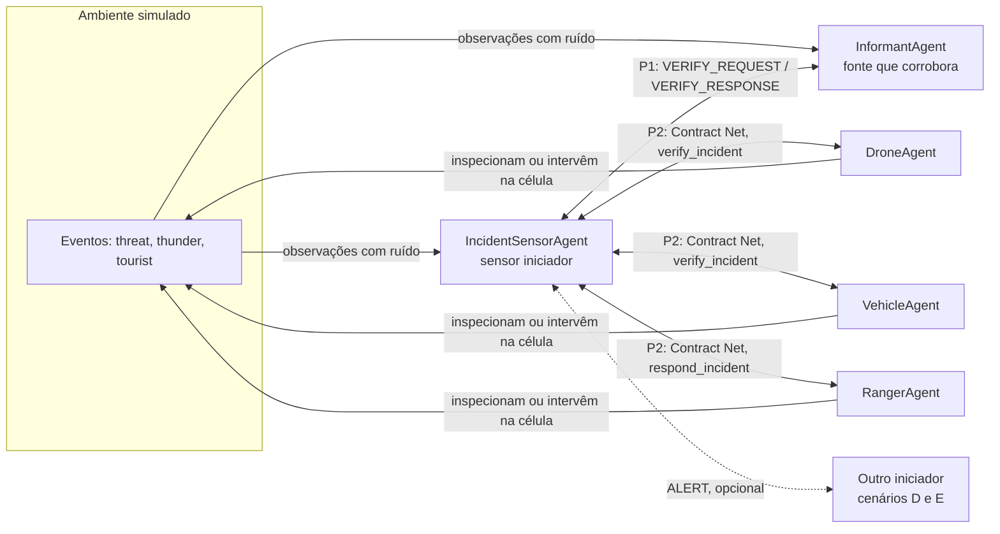
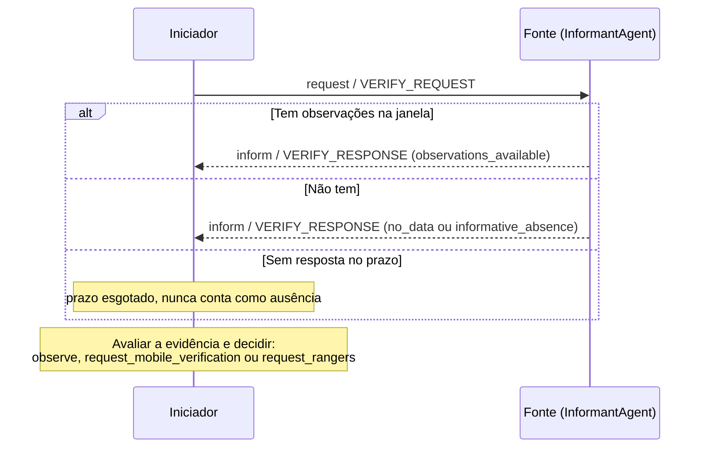
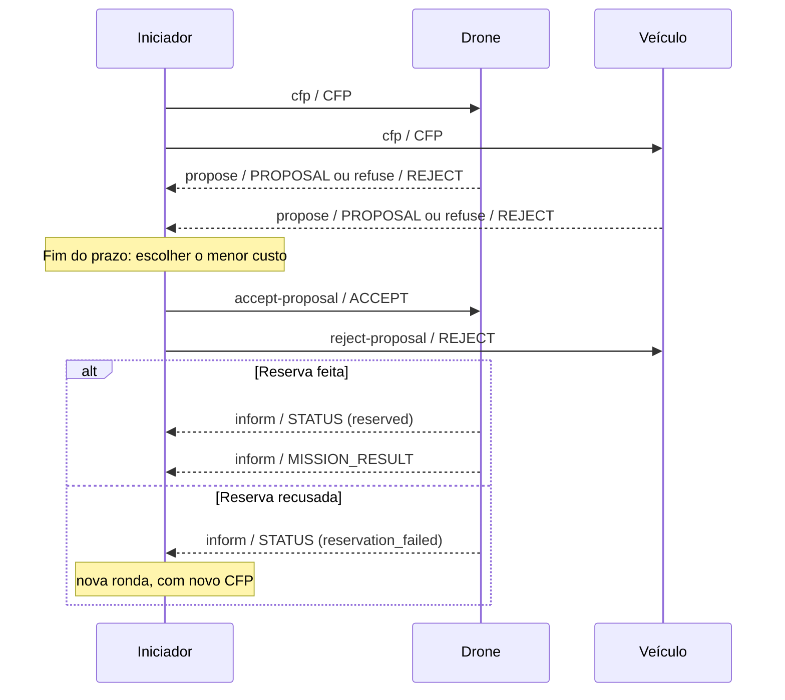

# Monitorização Descentralizada da Vida Selvagem

Sistema multiagente em SPADE para deteção de caça furtiva e coordenação de patrulhas numa reserva natural, sem despachante central.

## Visão geral

A reserva é modelada como uma grelha 2D. Sensores acústicos, câmaras e informadores detetam atividade suspeita e **corroboram** as observações uns dos outros antes de se iniciar uma resposta. Cada ocorrência tem um iniciador local, que negoceia as missões por **Contract Net** com os recursos móveis (drones, veículos e guardas). Cada recurso decide de forma autónoma se propõe ou recusa.

## Arquitetura

### Agentes



| Agente | Comportamentos SPADE | Papel |
|---|---|---|
| `IncidentSensorAgent` | `IncidentBehaviour` (OneShot) | Deteta, pede corroboração (P1), avalia a suspeita, cria a missão e conduz o Contract Net (P2) até fechar a ocorrência |
| `InformantAgent` | `VerificationBehaviour` (Cyclic) | Responde a pedidos de corroboração apenas com as observações do seu feed |
| `DroneAgent`, `VehicleAgent` | `ContractNetBehaviour`, `AcceptBehaviour`, `ExecutionBehaviour` (Cyclic) | Patrulhas: propõem ou recusam missões `verify_incident`, deslocam-se e inspecionam a célula |
| `RangerAgent` | Os mesmos três, herdados de `MobileResourceAgent` | Guarda: aceita missões `respond_incident`, intervém e o seu resultado fecha a ocorrência |

Os três recursos móveis partilham a classe `MobileResourceAgent` e diferem apenas na capacidade, posição e energia. O servidor XMPP só entrega mensagens: não decide, por isso não é um despachante central. Detalhes em [architecture.md](docs/architecture.md); modelo do mundo e parâmetros das fontes em [experiments.md](docs/experiments.md#modelo-do-mundo-e-parâmetros-das-fontes).

### Protocolos

**P1: verificação distribuída** (inspirado em FIPA Request). O iniciador pede a uma fonte as observações que tem na mesma janela de tempo e espaço.



**P2: atribuição de missões** (Contract Net simplificado). Usado primeiro com as patrulhas (`verify_incident`). Se a verificação confirmar a ameaça, repete-se com os guardas (`respond_incident`).



**Mensagens.** Cada mensagem SPADE leva metadados FIPA e um corpo JSON. Exemplo real de um `CFP` da ocorrência de exemplo (identificadores encurtados):

```jsonc
// metadados SPADE
{
  "performative": "cfp",
  "ontology": "isia",
  "protocol": "contract-net",
  "conversation-id": "conversation-9a06"
}

// corpo (message.body)
{
  "schema_version": 1,
  "message_id": "message-45dc",
  "message_type": "CFP",
  "created_at": 0.0,
  "conversation_id": "conversation-9a06",
  "incident_id": "incident-obs-000001",
  "mission_id": "mission-incident-obs-000001-mobile-verification",
  "payload": {
    "task": "verify_incident",
    "target": {"x": 3, "y": 2},
    "required_capability": "mobile_verification",
    "priority": 1,
    "deadline": 100.0,
    "round_number": 1
  }
}
```

Especificação completa, validações e justificação das escolhas em [protocols.md](docs/protocols.md) e [message-contract.md](docs/message-contract.md).

## Instalação

Pré-requisitos: Python 3.12 e Git, com a pasta `.git` presente (o coletor de resultados grava o commit). Não é preciso servidor XMPP. A partir da raiz do repositório:

```bash
python3.12 -m venv .venv
source .venv/bin/activate
python -m pip install -r requirements.txt
export PYTHONPATH=src
```

## Execução

### Ocorrência de exemplo

```bash
python -m isia.simulation.runner > /tmp/isia.json            # corre uma ocorrência (~1 s)
python scripts/replay.py /tmp/isia.json --delay 0.5          # repete-a no terminal
```

Resultado esperado: `closed`. O drone verifica aos 4 s simulados e o guarda intervém aos 10 s.

Opções do runner: `--policy config/agents.json` (política de reputação), `--faults config/faults.json` (falhas no transporte) e `--xmpp` (servidor XMPP local). Com `--policy`, o exemplo termina em `expired` por falta de corroboração independente, o que é esperado ([reputation-policy.md](docs/reputation-policy.md)).

### Cenários

| Cenário | Ficheiro | Descrição |
|---|---|---|
| A | `config/scenarios/A.json` | Operação normal: fontes pouco ruidosas, recursos suficientes, sem falhas |
| B | `config/scenarios/B.json` | Ruído e falsos positivos: trovão e turistas, sensores menos fiáveis |
| C | `config/scenarios/C.json` | Falhas e escassez: perda, atraso e duplicação de mensagens; drone com pouca autonomia |
| D | `config/scenarios/demo/D.json` | Dia movimentado: seis ameaças simultâneas, quatro patrulhas e dois guardas |
| E | `config/scenarios/demo/E.json` | Reserva alargada: 16 ameaças simultâneas e 20 fontes, incluindo câmaras e informadores |

Correr todos os cenários (uma repetição cada, cerca de 4 s) sem alterar `results/`:

```bash
OUT="$(mktemp -d)"
python -m isia.evaluation.collector config/scenarios/*.json config/scenarios/demo/*.json \
    --variants full --repetitions 1 --output "$OUT"
cat "$OUT/summary.csv"
```

### Gravações

Para ver o sistema sem correr agentes, `results/demo/` contém:

| Gravação | Conteúdo |
|---|---|
| [mvp.mp4](results/demo/mvp.mp4) (25 s) | Ocorrência de exemplo (`mvp-seed-6`), não um dos cenários A–E |
| `d.json` | **Cenário D**, execução `D-full-003-busy` |

```bash
python scripts/replay.py results/demo/d.json --delay 0.3   # cenário D
```

Os cenários estão também resumidos numa [página interativa](deliverables/cenarios.html).

### Modo XMPP (opcional)

Terminal 1 (o servidor fica a correr em primeiro plano):

```bash
spade run --host localhost --memory
```

Terminal 2, num terminal novo:

```bash
source .venv/bin/activate
export PYTHONPATH=src
XMPP_PASSWORD=local-demo python -m isia.simulation.runner --xmpp > /tmp/isia-xmpp.json
python scripts/replay.py /tmp/isia-xmpp.json --delay 0.5
```

O resultado é o mesmo do modo local, com `transport: "xmpp"` e a lista `messages` vazia (só o transporte local regista o transcrito). Todos os agentes correm no mesmo processo: o modo demonstra a ligação ao servidor, não o transporte pela rede.

## Testes

```bash
python -m unittest discover -s tests
```

## Reprodução dos resultados

```bash
python scripts/reproduce.py
```

Lista cada resultado publicado com o comando que o gera, o tempo estimado e o destino.

> [!WARNING]
> Estes comandos reescrevem ficheiros versionados em `results/`. Para experimentar o coletor sem os alterar, use `--output "$(mktemp -d)"`.

## Estrutura do repositório

```text
src/isia/
├── agents/          agentes SPADE: sensor, informador, iniciador, drone, veículo, guarda
├── communication/   mensagens JSON e transporte
├── reasoning/       corroboração, reputação, política de resposta, Contract Net
├── simulation/      mapa 2D, relógio, cenários, movimento e runner
├── evaluation/      métricas, coletor de cenários, calibração
└── domain/          modelos, estados do incidente, validação
config/              mapa, política, falhas e cenários A–E
scripts/             reprodução, replay, gráficos, stress e sensibilidade
tests/               unit/, integration/, scenarios/
results/             resultados publicados: CSV, gráficos e gravações
docs/                documentação técnica e relatório de desempenho
deliverables/        entrega: README.txt, referência da API (api/), interface de exemplo (cenarios.html) e slides/
```

## Documentação

| Entregável | Documentos |
|---|---|
| Código SPADE e instruções | `src/`, este README, [README.txt](deliverables/README.txt), [referência da API](deliverables/api/isia.html) |
| Arquitetura, agentes, mensagens e protocolos (P1, P2) | [architecture.md](docs/architecture.md), [protocols.md](docs/protocols.md), [reputation-policy.md](docs/reputation-policy.md) |
| Relatório de desempenho (≥ 3 cenários, P3) | [experiments.md](docs/experiments.md), [evaluation.md](docs/evaluation.md), [scalability.md](docs/scalability.md), [faults.md](docs/faults.md), [sensitivity.md](docs/sensitivity.md) |
| Visualização e demonstração | `scripts/replay.py`, [results/demo/](results/demo/), [cenarios.html](deliverables/cenarios.html) |