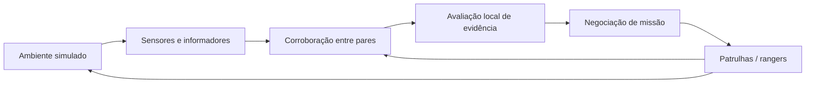

# ISIA — Tema C: Monitorização descentralizada de fauna e patrulhas contra a caça furtiva

> **Estado:** proposta técnica para discussão pelos três elementos do grupo. **Nenhuma arquitetura, política ou distribuição de trabalho aqui descrita foi formalmente aprovada pelo grupo.**
>
> **Unidade curricular:** Introdução aos Sistemas Inteligentes e Autónomos (ISIA), 2026/2027 — Assignment 1.
> **Tema oficial:** *Decentralised Wildlife Monitoring and Anti-Poaching Patrols*.

## Objetivo

Conceber, implementar e avaliar, com **SPADE** (Python/XMPP), um **sistema multiagente descentralizado** numa reserva natural simulada. Sensores e informadores comunicam observações potencialmente suspeitas; agentes distintos corroboram a evidência; recursos móveis e equipas de rangers cooperam para verificar ocorrências e coordenar respostas, sem um despachante com autoridade central.

O enunciado propõe explicitamente falsos positivos, conectividade intermitente e recursos limitados. Exige a documentação das escolhas de conceção, formatos de mensagem, modos de falha, métricas e avaliação em **pelo menos três cenários contrastantes**, bem como código, apresentação e visualização/demonstração. Ver [fontes e requisitos](docs/references.md) e [avaliação](docs/evaluation.md).

**Situação do projeto:** documentação de planeamento; não existe ainda implementação funcional verificada na branch `main` à data da auditoria (20-10-2026). Esta informação deve ser atualizada quando o código for integrado.

## Navegação pela documentação

| Documento | O que contém |
|---|---|
| [Estratégia de implementação](docs/implementation-strategy.md) | Problema, decisões, alternativas, fundamentação, MVP e limitações |
| [Arquitetura](docs/architecture.md) | Ambiente, agentes, responsabilidades, estados e fluxo integral |
| [Plano de desenvolvimento](docs/development-plan.md) | Etapas 0–10, dependências, ficheiros, testes, resultados e checklists |
| [Protocolos](docs/protocols.md) | Contratos de dados, mensagens SPADE/FIPA, sequências e falhas |
| [Avaliação](docs/evaluation.md) | Métricas, três cenários, experiências e matriz de verificação |
| [Organização da equipa](docs/team-tasks.md) | Divisão equilibrada, dependências, paralelismo e revisão no GitHub |
| [Decisões pendentes](docs/decisions.md) | Estatuto de cada decisão, perguntas a aprovar e registo das decisões |
| [Referências](docs/references.md) | Enunciado, slides, bibliografia e referências científicas |

O ficheiro [requirements](requirements) é a **contribuição original de um colega**, com objetivos, RF1–RF4, RNF1–RNF6 e ideias de funcionamento. Não é um `requirements.txt` de dependências Python; não deve ser apagado nem reescrito sem discussão.

## Proposta técnica num relance

> Tudo nesta secção é **[PROPOSTA]**, exceto o uso de SPADE e a descentralização, que decorrem do enunciado.

- **Agentes:** `SensorAgent`, `InformantAgent`, `DroneAgent`, `VehicleAgent` e `RangerAgent`.
- **Arquitetura interna:** sensores sobretudo reativos; patrulhas/rangers com objetivos, estado interno e máquina de estados explícita; abordagem híbrida simplificada, inspirada na matéria da cadeira.
- **Comunicação:** SPADE/XMPP, metadados com semântica FIPA-ACL e conteúdo JSON versionado.
- **Deteção:** observações imperfeitas, identificação de ocorrências e corroboração distribuída entre fontes próximas.
- **Decisão:** pontuação de evidência com pesos e reputação (não confundir com probabilidade calibrada).
- **Coordenação:** *Contract Net* simplificado e iniciador local por ocorrência, sem gestor global de missões.
- **Ambiente:** reserva 2D configurável; estado verdadeiro isolado do conhecimento de cada agente.
- **Robustez:** atrasos, mensagens perdidas/duplicadas, recursos ocupados e limites de combustível/bateria.
- **Avaliação:** funcionamento normal; observações ruidosas; rede degradada e recursos escassos.

Este diagrama é **lógico**. O bloco de avaliação não designa um servidor central: cada ocorrência pode ser avaliada por um iniciador local e os agentes mantêm autonomia para participar ou recusar tarefas.

## Roteiro resumido

O plano completo, com tarefas e critérios verificáveis, está em [development-plan.md](docs/development-plan.md).

| Fase | Etapas | Marco verificável |
|---|---|---|
| Preparação | 0–2 | Repositório auditado, contratos definidos e ambiente simulável |
| Interação | 3–5 | Agentes SPADE comunicam, corroboram e negoceiam |
| **MVP** | **6** | Uma ocorrência decorre de observação a resposta e encerramento |
| Robustez e ciência | 7–9 | Reputação, falhas simuladas e três experiências avaliadas |
| Entrega | 10 | Documentação, métricas e demonstração reproduzível |

**Primeira tarefa quando a proposta for aprovada:** executar a [Etapa 0](docs/development-plan.md#etapa-0--auditoria-e-preparação), analisando novamente o estado do repositório, validando Python/SPADE e acordando convenções. **Não iniciar implementação antes da revisão coletiva**.

## Como discutir e aprovar esta proposta

1. Ler [decisions.md](docs/decisions.md) e comentar cada decisão pendente.
2. Propor alterações a estes Markdown numa branch dedicada.
3. Abrir um *Pull Request* para `main`, solicitar revisão aos restantes elementos e debater nos comentários das linhas correspondentes.
4. Registar as deliberações em `docs/decisions.md`, atualizar documentos afetados e integrar **após aprovação**.
5. Criar GitHub Issues para tarefas aprovadas; utilizar GitHub Projects apenas se o quadro visual facilitar o acompanhamento.

A consulta deste `README.md` não substitui a leitura do [enunciado](docs/references.md#documentos-oficiais) nem a análise das fontes.

## Estado dos entregáveis

- [x] Estratégia de documentação preparada para revisão.
- [ ] Documentação discutida e aprovada pelo grupo.
- [ ] Etapa 0: ambiente e repositório preparados.
- [ ] Etapa 6: MVP funcional.
- [ ] Etapa 9: avaliação dos três cenários.
- [ ] Etapa 10: demonstração e apresentação finalizadas.

**Nota de rigor:** as caixas assinaladas refletem apenas a preparação dos documentos, não testes de software nem acordo dos colegas.
