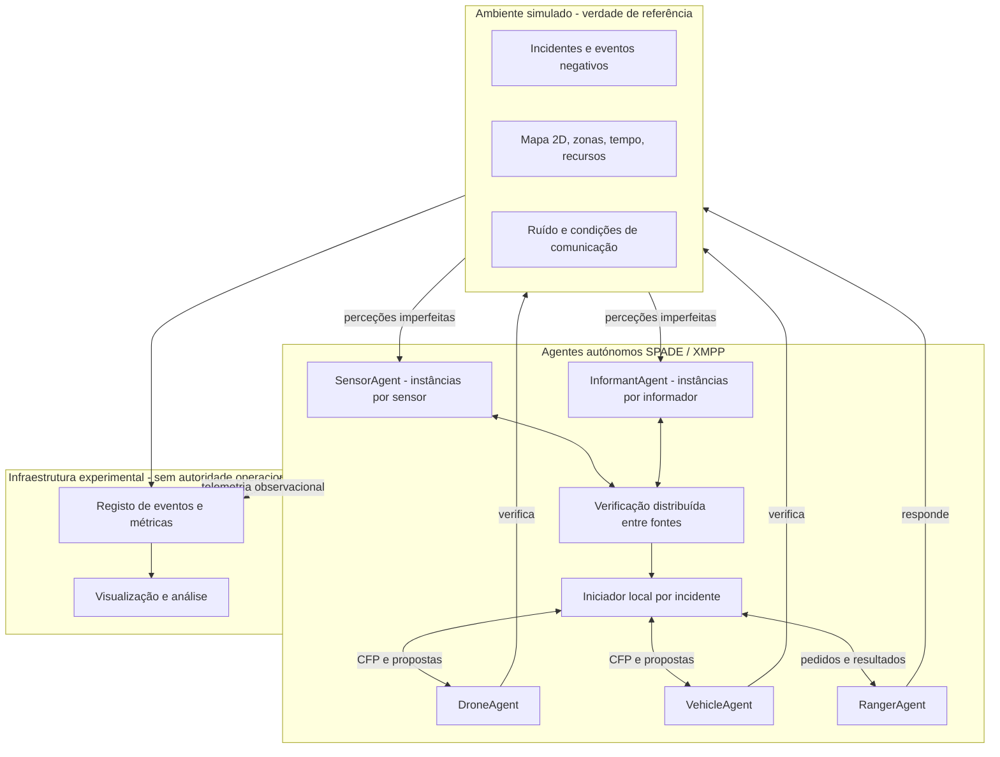
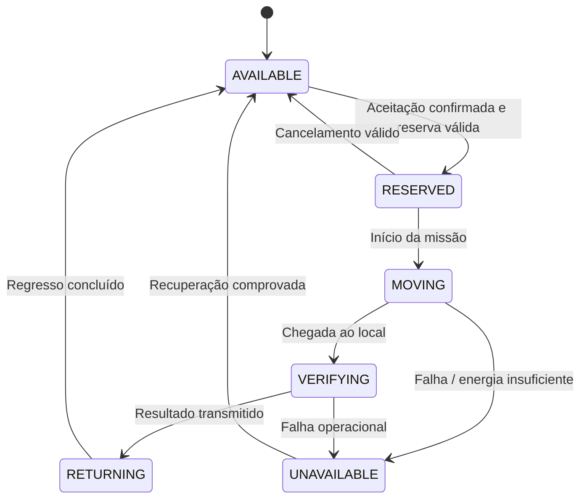

# Arquitetura do sistema multiagente — proposta

> **Estado:** proposta de conceção, a rever pelos três elementos. Nenhum destes componentes está declarado como implementado.

[README](../README.md) · [Estratégia](implementation-strategy.md) · [Protocolos](protocols.md) · [Decisões](decisions.md)

## 1. Princípios de conceção

1. **Autonomia:** um recurso decide se aceita e executa uma tarefa; mensagens de outro agente não invocam diretamente o seu comportamento.
2. **Descentralização da decisão:** não existe *dispatcher* com autoridade global. Um iniciador local conduz **uma conversação por incidente**, com possibilidade de recuperação quando falha.
3. **Observabilidade parcial:** cada agente detém apenas observações, mensagens e estado próprio; o simulador guarda separadamente a verdade de referência.
4. **Heterogeneidade:** sensores, informadores, patrulhas e rangers executam funções distintas.
5. **Reprodutibilidade:** ambiente configurável, relógio coerente, sementes e logs de eventos.
6. **Progressividade:** cada mecanismo deve admitir uma versão simples, funcional e testável antes de otimizações.

### Distinção importante: XMPP e autoridade central

O SPADE usa infraestrutura XMPP para transportar mensagens. Um servidor XMPP **não é**, por si só, um gestor central das decisões; é possível ter agentes autónomos com decisões distribuídas sobre esse transporte. Porém, um único servidor XMPP representa uma dependência de disponibilidade de infraestrutura que devemos **reconhecer como limitação**. A simulação de falhas ao nível da aplicação não equivale a demonstrar tolerância a falhas do próprio servidor.

## 2. Componentes e relações

**Os retângulos “Verificação” e “Iniciador” representam funções e papéis temporários distribuídos**, não serviços centrais obrigatórios. Na implementação, a lógica de corroboração e decisão pertence a instâncias de agentes; os módulos Python reutilizáveis servem apenas para executar algoritmos locais.

## 3. Tipos de agentes

### `SensorAgent`

- **Perceção:** sinais acústicos ou visuais simulados, sujeitos a alcance, erros e falhas.
- **Estado local:** `sensor_id`, posição, modalidade, lista de vizinhos, última leitura, histórico limitado de observações e identificadores vistos.
- **Comportamentos:** obter leitura, gerar `Observation`, enviar `inform`/alerta, responder a `request` de verificação, atualizar conhecimento local.
- **Decisões:** se a leitura justifica alerta; que fontes consultar; quando a evidência é insuficiente ou está desatualizada.
- **Limitação:** não possui acesso ao evento verdadeiro; não deve confirmar automaticamente um incidente só por existir uma leitura.

### `InformantAgent`

- **Perceção:** avistamentos simulados de cidadãos/colaboradores da reserva; frequência e qualidade variáveis.
- **Estado:** posição/zona, identificador, observações próprias e informação temporal.
- **Comportamentos:** reportar observações e responder a pedidos quando possuir informação relevante.
- **Decisões:** quando reportar; eventualmente se tem evidência adicional.
- **Limitação:** uma afirmação não é prova; a reputação será mantida por quem avalia a fonte.

### `DroneAgent`

- **Estado:** posição, bateria, velocidade, autonomia mínima para missão e regresso, disponibilidade, missão atual, informação local sobre incidentes.
- **Comportamentos:** anunciar disponibilidade, receber CFP, calcular proposta, reservar missão, deslocar-se, verificar e reportar resultado.
- **Decisões:** aceitar ou recusar propostas em função de bateria, capacidade e compromissos prévios.
- **Estados:** `AVAILABLE`, `RESERVED`, `MOVING`, `VERIFYING`, `RETURNING`, `UNAVAILABLE`.
- **Limitação:** velocidade, alcance e resultados são **parâmetros simulados**, não características de um drone real.

### `VehicleAgent`

- **Estado:** posição, combustível, velocidade, capacidade de deslocação, disponibilidade e missão em curso.
- **Comportamentos:** análogos aos do drone, mas com parâmetros/limitações próprios.
- **Decisões:** disponibilidade, percurso admissível e custo de uma missão.
- **Limitação:** se for usada grelha sem rede viária, registar essa simplificação no relatório.

### `RangerAgent`

- **Estado:** posição da equipa, disponibilidade, prioridade da missão, capacidade de resposta e compromissos.
- **Comportamentos:** responder a pedidos de assistência, negociar participação, deslocar-se/intervir na simulação, comunicar resultado.
- **Decisões:** aceitar intervenção se for operacionalmente admissível e prioritária.
- **Limitação:** não simular ações perigosas reais, apenas estados/resultados abstratos de resposta.

### Infraestrutura que não deve ser confundida com agentes decisores

- `World`/ambiente: produz condições e atualiza a verdade de referência.
- `ScenarioRunner`: configura e inicia uma execução para fins experimentais, **não distribui missões**.
- `MetricsCollector`: regista resultados, sem determinar a escolha de patrulhas.
- `Visualizer`: representa o estado e as interações; não interfere na lógica de decisão.

## 4. Estado do ambiente vs. crenças dos agentes

| Elemento | Verdade do simulador | Conhecimento de um agente |
|---|---|---|
| Incidente | Existe/não existe, posição e gravidade reais | Estimativa construída a partir de observações |
| Sensor | Parâmetros de erro usados para gerar leitura | Leituras que obteve; reputação estimada por outros |
| Outros agentes | Posição e disponibilidade efetiva | Última posição/estado comunicado e respetiva validade |
| Rede | Condições aplicadas à entrega de mensagens | Timeouts, respostas recebidas ou ausentes |
| Resultado | Verificação segundo regras do cenário | Confirmação comunicada e credibilidade atribuída |

**Invariante arquitetural:** nunca permitir que um método da decisão de um agente consulte `World.true_incidents` como se fosse uma perceção. O simulador só fornece ao agente os dados que a sua função de perceção poderia gerar.

## 5. Ciclo de vida de um incidente

```mermaid
stateDiagram-v2
    [*] --> DETECTED
    DETECTED --> VERIFYING: Pedidos a fontes próximas
    VERIFYING --> ASSESSING: Evidências recebidas / prazo expirado
    ASSESSING --> WATCHING: Evidência insuficiente
    WATCHING --> VERIFYING: Nova evidência
    ASSESSING --> ALLOCATING: Missão necessária
    ALLOCATING --> RESPONDING: Recurso reservado
    ALLOCATING --> UNRESOLVED: Sem propostas ou timeout máximo
    RESPONDING --> CLOSED: Missão concluída / resultado validado
    RESPONDING --> ALLOCATING: Recurso falhou; tentar novamente
    WATCHING --> EXPIRED: Sem nova evidência até ao prazo
    CLOSED --> [*]
    EXPIRED --> [*]
    UNRESOLVED --> [*]
```

Nem todas as ocorrências devem originar uma missão: algumas ficam sob observação ou expiram. Estados finais como `CLOSED`, `EXPIRED` e `UNRESOLVED` devem ser distinguidos nas métricas, para não contabilizar como sucesso incidentes simplesmente abandonados.

## 6. Ciclo de vida de uma patrulha

**Regra de consistência:** cada recurso tem no máximo uma missão ativa incompatível de cada vez. A operação `reserve(mission_id)` deve ser atómica do ponto de vista do agente; mensagens atrasadas ou duplicadas não podem produzir dupla reserva.

## 7. Exemplo completo de execução (hipotético)

1. O simulador cria um evento sonoro suspeito na zona `(6, 9)`; a verdade do evento **não** é enviada diretamente aos agentes.
2. `sensor_01` recebe uma observação com ruído e abre uma ocorrência local.
3. `sensor_01` solicita informação a `sensor_02` e `informant_01` dentro de uma janela temporal.
4. As respostas são deduplicadas e avaliadas segundo proximidade, atualidade e histórico de fontes.
5. A política de decisão opta por pedir verificação móvel; o iniciador local envia `cfp` ao drone e ao veículo.
6. O drone propõe uma ETA reduzida, mas o agente tem de garantir bateria suficiente para executar e regressar. O veículo apresenta outra proposta.
7. O iniciador aceita uma proposta válida; o recurso confirma a reserva e executa a missão.
8. O recurso comunica observação de campo; poderá justificar intervenção de um `RangerAgent`.
9. Ao encerrar, o sistema grava o resultado e atualiza reputação apenas quando houver verdade de referência/validação suficiente.
10. O avaliador calcula métricas de deteção, resposta, energia e comunicação. Não altera o resultado do incidente.

Este é um **cenário ilustrativo**, não uma execução realizada nem resultados medidos.

## 8. Decisões arquiteturais a confirmar

- [ ] Responsabilidade de iniciar conversação local, eleição/failover e prevenção de iniciadores duplicados.
- [ ] Capacidade de descoberta de vizinhos e atualização de posições.
- [ ] Dimensões e resolução da grelha; conectividade entre células.
- [ ] Modelo de relógio para evitar misturar tempo de simulação com relógio real.
- [ ] Definição de confirmação de incidente e de atualização de reputação.
- [ ] Graus mínimos de autonomia e critérios de reserva para patrulhas/rangers.
- [ ] Fronteiras entre camada SPADE e funções Python testáveis.

Ver também [protocols.md](protocols.md) e [decisions.md](decisions.md).
