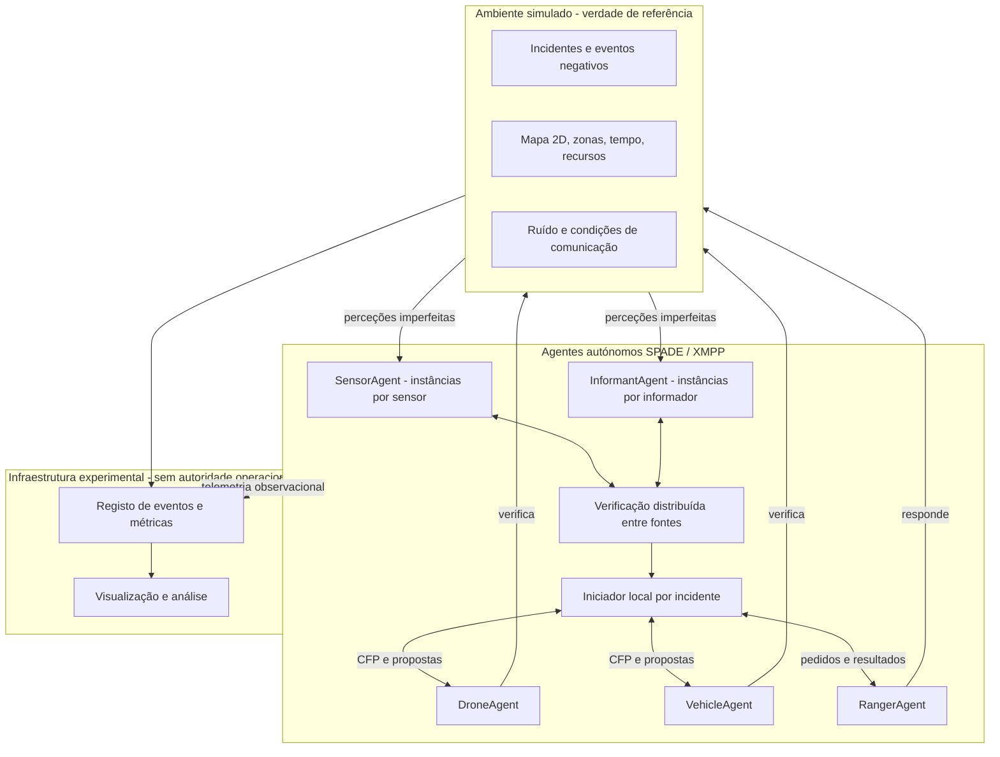
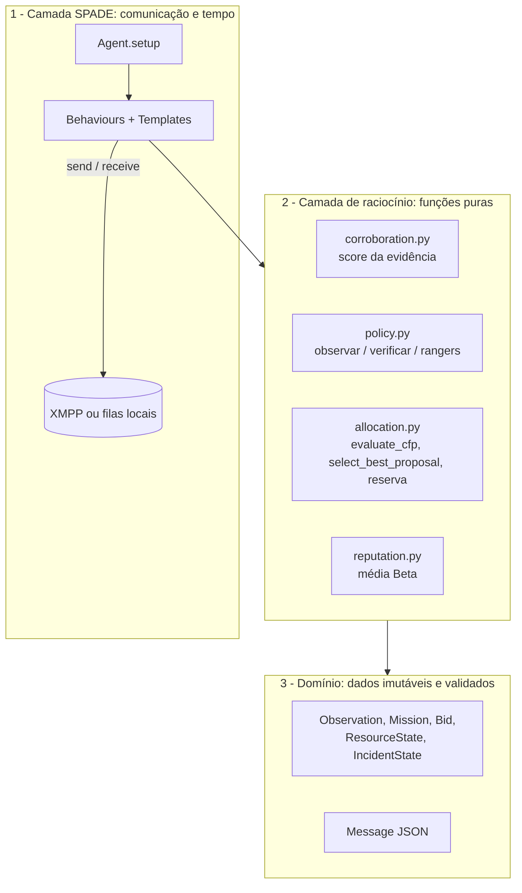
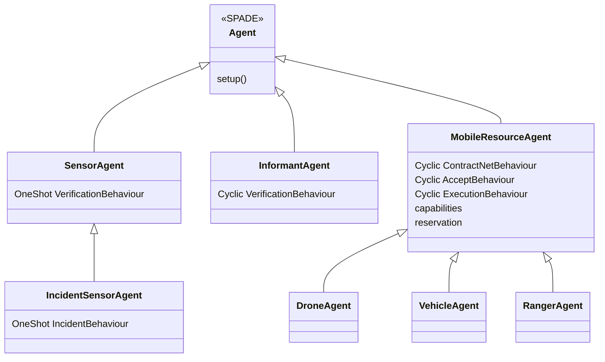
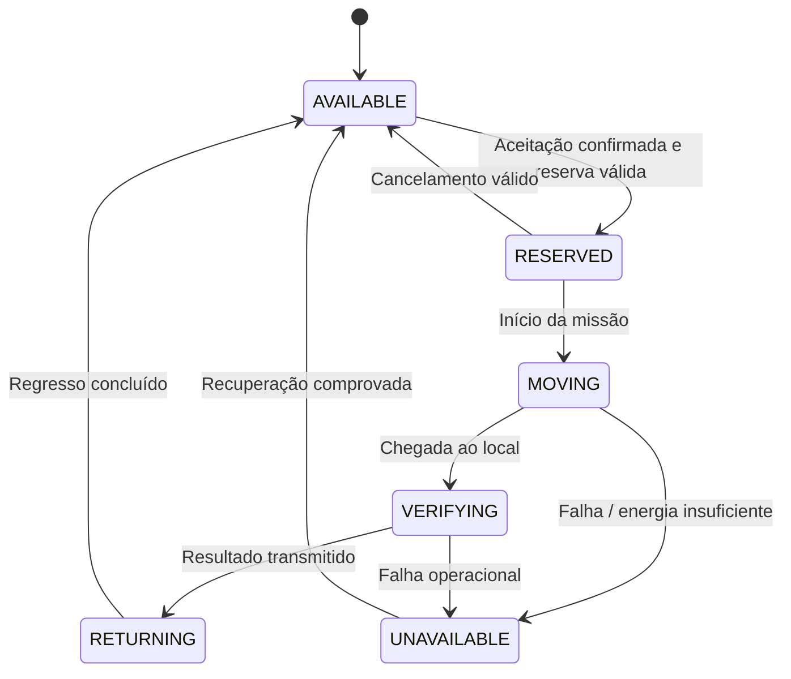
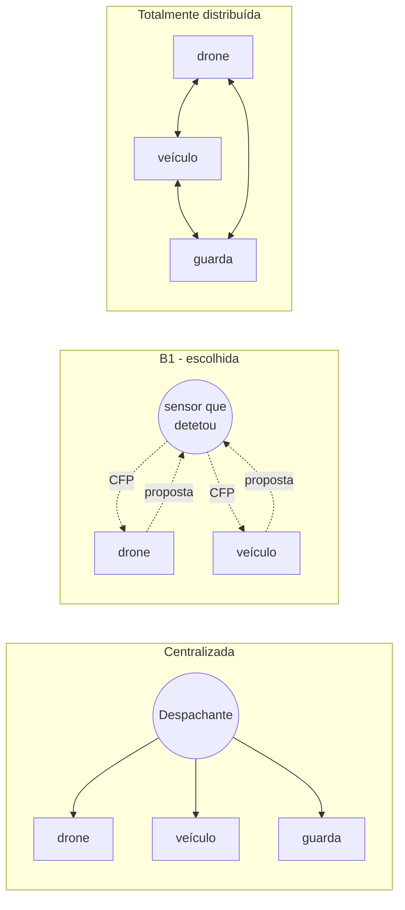

# Arquitetura do sistema multiagente

> **Estado revisto (12-11-2026):** arquitetura ainda sujeita a revisão formal pelos três elementos. As Etapas 1–6 estão integradas na `main`, incluindo o MVP e as correções dos PRs #12 e #13. A Etapa 7 acrescenta reputação e política ao `SensorAgent`; o `IncidentSensorAgent` continua a negociar e executar o ciclo existente com os recursos móveis. Após a execução, o avaliador já pode atualizar reputações a partir de resultados de missão independentes com cobertura espacial e temporal suficiente; um resultado operacional, por si só, não fundamenta aprendizagem. A robustez avançada e a avaliação final permanecem pendentes. Ver [implementação e limites da Etapa 7](reputation-policy.md).

[README](../README.md) · [Plano](development-plan.md) · [Protocolos](protocols.md) · [Decisões pendentes](#decisões-pendentes)

## 1. Princípios de conceção

1. **Autonomia:** um recurso decide se aceita e executa uma tarefa; mensagens de outro agente não invocam diretamente o seu comportamento.
2. **Descentralização da decisão:** não existe *dispatcher* com autoridade global. Um iniciador local conduz **uma conversação por incidente**, com possibilidade de recuperação quando falha.
3. **Observabilidade parcial:** cada agente detém apenas observações, mensagens e estado próprio; o simulador guarda separadamente a verdade de referência.
4. **Heterogeneidade:** sensores, informadores, patrulhas e rangers executam funções distintas.
5. **Reprodutibilidade:** ambiente configurável, relógio coerente, sementes e logs de eventos.
6. **Progressividade:** cada mecanismo deve admitir uma versão simples, funcional e testável antes de otimizações.

### Distinção importante: XMPP e autoridade central

O SPADE usa infraestrutura XMPP para transportar mensagens. Um servidor XMPP **não é**, por si só, um gestor central das decisões; é possível ter agentes autónomos com decisões distribuídas sobre esse transporte. Porém, um único servidor XMPP representa uma dependência de disponibilidade de infraestrutura que devemos **reconhecer como limitação**. A simulação de falhas ao nível da aplicação não equivale a demonstrar tolerância a falhas do próprio servidor.

## 2. Componentes e relações

**Os retângulos “Verificação” e “Iniciador” representam funções e papéis temporários distribuídos**, não serviços centrais obrigatórios. Na implementação, a lógica de corroboração e decisão pertence a instâncias de agentes; os módulos Python reutilizáveis servem apenas para executar algoritmos locais.

## 3. Como os agentes são construídos

> **Estado (16-11-2026, `main` em `89c08a7`):** esta secção descreve o código implementado. As ligações `ficheiro:linha` foram conferidas nesse commit.

**Resumo em 30 segundos.** Cada agente é uma subclasse de `spade.agent.Agent`. No `setup()` regista **comportamentos** SPADE, e cada um tem um **template** que filtra as mensagens pelos metadados FIPA (performativa, ontologia, protocolo). Os comportamentos tratam da comunicação e do tempo. As **decisões** (avaliar evidência, decidir a resposta, propor, escolher a proposta, atualizar a reputação) estão em **funções puras** em `src/isia/reasoning/`, testáveis sem servidor XMPP. Drone, veículo e guarda são **a mesma classe** com capacidades diferentes.

### 3.1 As três camadas

### 3.2 Os agentes e os seus comportamentos

| Agente | Comportamentos | O que faz | Código |
|---|---|---|---|
| `SensorAgent` | `VerificationBehaviour` (OneShot) | Lê o feed local, envia `VERIFY_REQUEST`, espera até 10 s, avalia a evidência e decide | [sensor.py:129](../src/isia/agents/sensor.py#L129) |
| `IncidentSensorAgent` | `IncidentBehaviour` (OneShot; estende o anterior) | Depois da decisão, cria a missão, conduz o Contract Net, espera o resultado e fecha a ocorrência | [incident.py:62](../src/isia/agents/incident.py#L62), `run()` em [:248](../src/isia/agents/incident.py#L248) |
| `InformantAgent` | `VerificationBehaviour` (Cyclic) | Responde a pedidos de verificação só com as observações do seu feed | [informant.py:66](../src/isia/agents/informant.py#L66) |
| `MobileResourceAgent` | `ContractNetBehaviour`, `AcceptBehaviour`, `ExecutionBehaviour` (todos Cyclic) | Responde a CFP; trata ACCEPT/REJECT e reserva-se; avança a missão e envia o resultado | [mobile.py:195](../src/isia/agents/mobile.py#L195), [:285](../src/isia/agents/mobile.py#L285), [:137](../src/isia/agents/mobile.py#L137); `setup()` em [:385](../src/isia/agents/mobile.py#L385) |
| `DroneAgent`, `VehicleAgent`, `RangerAgent` | herdados | Classes **vazias**: só mudam a capacidade, a posição e a energia, definidas pelo cenário | [drone.py](../src/isia/agents/drone.py), [vehicle.py](../src/isia/agents/vehicle.py), [ranger.py](../src/isia/agents/ranger.py) |

O `ExecutionBehaviour` só é registado quando o recurso recebe `configure_execution()`, o que acontece sempre em `run_mvp`. Sem ele, o recurso negoceia e reserva, mas não se desloca.

#### Instâncias usadas nas execuções medidas

| JID | Classe | Fonte / capacidade |
|---|---|---|
| `sensor-mvp` | `IncidentSensorAgent` | `sensor-1`, acústica; inicia a ocorrência |
| `sensor-peer-mvp` | `InformantAgent` | `sensor-2`: visual nos cenários A, B e C; acústica no MVP sem cenário |
| `drone-mvp`, `vehicle-mvp` | `DroneAgent`, `VehicleAgent` | `mobile_verification` |
| `ranger-mvp` | `RangerAgent` | `incident_response` |

Criação em [runner.py:130-166](../src/isia/simulation/runner.py#L130-L166); fontes por cenário em [config/scenarios/](../config/scenarios/).

> **Informador = `sensor-2` visual.** O enunciado pede informadores (fontes humanas). No código, o `InformantAgent` é o papel de **quem responde a pedidos de verificação**, e nas execuções medidas esse papel é desempenhado pelo `sensor-2`, uma câmara (fonte `visual`), ligado em [runner.py:146](../src/isia/simulation/runner.py#L146). O tipo de fonte `human` existe no simulador ([scenario.py:16-19](../src/isia/simulation/scenario.py#L16-L19)), mas **nenhum dos cenários A, B ou C tem uma fonte `human`**. Não há, por isso, resultados medidos sobre informadores humanos.

### 3.3 Porquê assim: sete decisões, com alternativas

**Decisão 1 — Separar a comunicação (SPADE) das decisões (funções puras).**
- **Porquê:** a mesma lógica corre igual com XMPP real ou com filas locais. Cada regra testa-se isoladamente: **489 testes, cerca de 58 s, sem servidor XMPP** (verificação de 16-11-2026). As falhas (perda, atraso, duplicação) são injetadas só no transporte local, sem tocar nos agentes.
- **Alternativa:** pôr a lógica dentro do `run()` dos comportamentos, como nos exemplos do SPADE.
- ✅ Testável, reutilizável e explicável: cada decisão regista fatores e razões no histórico.
- ❌ Mais ficheiros e mais «cola» entre camadas (validações repetidas na fronteira).

**Decisão 2 — Uma única classe `MobileResourceAgent` para drone, veículo e guarda.**
- **Porquê:** em GAIA, o **papel** (executor de verificação, interventor) é diferente do **agente**. O que distingue os recursos é a **capacidade** (`mobile_verification` ou `incident_response`), não o código. Um novo tipo de recurso passa a ser configuração.
- **Alternativa:** três classes com lógica própria.
- ✅ Sem código duplicado; uma correção serve para todos.
- ❌ Não modela diferenças reais: o drone voa por cima de obstáculos, o veículo precisa de estrada. Todos se movem da mesma forma, primeiro em x e depois em y, uma célula por segundo simulado ([movement.py](../src/isia/simulation/movement.py)).

**Decisão 3 — O sensor é OneShot; o informador e os recursos são Cyclic.**
- **Porquê:** o sensor conduz **uma** ocorrência, com princípio e fim. O informador e os recursos são **prestadores de serviço**, sempre à espera de pedidos.
- **Alternativa A:** `FSMBehaviour` do SPADE, com cada estado da ocorrência como estado da máquina. ✅ A máquina ficaria visível no SPADE. ❌ Presa ao SPADE e difícil de testar; a máquina de estados está em [incident_state.py](../src/isia/domain/incident_state.py), com tabela de transições testada sem SPADE.
- **Alternativa B:** um sensor Cyclic que trate várias ocorrências. ✅ Permitiria escalar para vários caçadores. ❌ Exige agrupar observações em ocorrências e gerir várias conversas em simultâneo; ficou fora do MVP (ver escalabilidade, limite C7).

**Decisão 4 — O recurso tem três comportamentos em paralelo.**
- **Porquê:** enquanto executa uma missão, o recurso **continua a responder** a CFP com `REJECT` (`resource_unavailable`), e o movimento avança ao ritmo do relógio simulado. Num só comportamento, uma missão longa bloquearia a negociação.
- ❌ O estado (a reserva) é partilhado entre os três. A `LocalResourceReservation` garante no máximo uma missão de cada vez ([allocation.py:257](../src/isia/reasoning/allocation.py#L257)).

**Decisão 5 — Arquitetura interna híbrida (reativa + objetivos/utilidade), não BDI completo.**
- **Porquê:** os sensores só precisam de estímulo-resposta. Os recursos precisam de estado (energia, posição, reserva) e de uma função de **utilidade** (o custo da proposta). Um interpretador BDI (AgentSpeak, `spade_bdi`) seria pesado para regras tão simples.
- ✅ Determinística, explicável e fácil de testar.
- ❌ Sem planeamento nem reconsideração rica: um drone não abandona uma verificação para ir a uma ocorrência mais grave.
- **Correspondência com BDI:** crença = `ResourceState` e observações; desejo = missão possível (o CFP); intenção = reserva aceite; reconsideração = falha por energia ou interrupção, seguida do regresso.

**Decisão 6 — Dados do domínio imutáveis (`frozen dataclass`) e validados na fronteira.**
- **Porquê:** as mensagens vêm da rede e não são de confiança. Cada `Message`, `Bid` e `Observation` é validado ao ser criado; uma mensagem inválida é rejeitada e registada. A imutabilidade impede que um comportamento altere o estado de outro sem querer.
- ❌ Mais código de validação; é o maior volume do projeto ([allocation.py](../src/isia/reasoning/allocation.py) tem 810 linhas, [corroboration.py](../src/isia/reasoning/corroboration.py) tem 876).

**Decisão 7 — Os agentes nunca veem o `ground_truth`.**
- **Porquê:** se o vissem, não haveria problema de agentes. A verdade serve só ao **avaliador**, que mede TP, FP, TN e FN e atualiza a reputação **depois** da execução ([runner.py:269-275](../src/isia/simulation/runner.py#L269-L275)). O sensor recebe apenas uma cópia dos pesos (`snapshot`) no início.

### 3.4 Onde está a autonomia

1. **O recurso decide localmente se propõe.** `evaluate_request` ([mobile.py:103](../src/isia/agents/mobile.py#L103)) chama `evaluate_cfp` ([allocation.py:498](../src/isia/reasoning/allocation.py#L498)) com o estado do **próprio** recurso. Recusa por estar ocupado, por falta de capacidade ou por energia insuficiente.
2. **A energia conta a ida e a volta.** O custo é `2 × células × energia_por_célula` ([mobile.py:115](../src/isia/agents/mobile.py#L115)); o recurso recusa se ficar abaixo da autonomia mínima.
3. **O recurso pode recusar a reserva depois do `ACCEPT`.** Se o `STATUS` não for `reserved`, o iniciador regista `reservation_rejected` e não o consegue obrigar ([incident.py:190](../src/isia/agents/incident.py#L190)).

O informador também decide o que responder com base **só** nas suas observações; o iniciador não lhe impõe conteúdo.

### 3.5 Infraestrutura que não é agente

- `World` / `Scenario` ([world.py](../src/isia/simulation/world.py), [scenario.py](../src/isia/simulation/scenario.py)): produzem as observações e guardam a verdade de referência.
- `run_mvp` ([runner.py:94](../src/isia/simulation/runner.py#L94)): cria os agentes, avança o relógio e, no fim, atua como avaliador. **Não distribui missões.**
- Coletor ([collector.py](../src/isia/evaluation/collector.py)): corre os cenários e grava métricas, sem influenciar a escolha de recursos.

## 4. Estado do ambiente vs. crenças dos agentes

| Elemento | Verdade do simulador | Conhecimento de um agente |
|---|---|---|
| Incidente | Existe/não existe, posição e gravidade reais | Estimativa construída a partir de observações |
| Sensor | Parâmetros de erro usados para gerar leitura | Leituras que obteve; reputação estimada por outros |
| Outros agentes | Posição e disponibilidade efetiva | Última posição/estado comunicado e respetiva validade |
| Rede | Condições aplicadas à entrega de mensagens | Timeouts, respostas recebidas ou ausentes |
| Resultado | Verificação segundo regras do cenário | Confirmação comunicada e credibilidade atribuída |

**Invariante arquitetural:** nunca permitir que um método da decisão de um agente consulte `World.true_incidents` como se fosse uma perceção. O simulador só fornece ao agente os dados que a sua função de perceção poderia gerar.

## 5. Ciclo de vida de um incidente

```mermaid
stateDiagram-v2
    [*] --> DETECTED
    DETECTED --> VERIFYING: Pedidos a fontes próximas
    VERIFYING --> ASSESSING: Evidências recebidas / prazo expirado
    ASSESSING --> WATCHING: Evidência insuficiente
    WATCHING --> VERIFYING: Nova evidência
    ASSESSING --> ALLOCATING: Missão necessária
    ALLOCATING --> RESPONDING: Recurso reservado
    ALLOCATING --> UNRESOLVED: Sem propostas ou timeout máximo
    RESPONDING --> CLOSED: Missão concluída / resultado validado
    RESPONDING --> ALLOCATING: Recurso falhou; tentar novamente
    WATCHING --> EXPIRED: Sem nova evidência até ao prazo
    CLOSED --> [*]
    EXPIRED --> [*]
    UNRESOLVED --> [*]
```

Nem todas as ocorrências devem originar uma missão: algumas ficam sob observação ou expiram. Estados finais como `CLOSED`, `EXPIRED` e `UNRESOLVED` devem ser distinguidos nas métricas, para não contabilizar como sucesso incidentes simplesmente abandonados.

## 6. Ciclo de vida de uma patrulha

**Regra de consistência:** cada recurso tem no máximo uma missão ativa incompatível de cada vez. A operação `reserve(mission_id)` deve ser atómica do ponto de vista do agente; mensagens atrasadas ou duplicadas não podem produzir dupla reserva.

## 7. Exemplo completo de execução (hipotético)

1. O simulador cria um evento sonoro suspeito na zona `(6, 9)`; a verdade do evento **não** é enviada diretamente aos agentes.
2. `sensor_01` recebe uma observação com ruído e abre uma ocorrência local.
3. `sensor_01` solicita informação a `sensor_02` e `informant_01` dentro de uma janela temporal.
4. As respostas são deduplicadas e avaliadas segundo proximidade, atualidade e histórico de fontes.
5. A política de decisão opta por pedir verificação móvel; o iniciador local envia `cfp` ao drone e ao veículo.
6. O drone propõe uma ETA reduzida, mas o agente tem de garantir bateria suficiente para executar e regressar. O veículo apresenta outra proposta.
7. O iniciador aceita uma proposta válida; o recurso confirma a reserva e executa a missão.
8. O recurso comunica observação de campo; poderá justificar intervenção de um `RangerAgent`.
9. Ao encerrar, o sistema grava o resultado e atualiza reputação apenas quando houver verdade de referência/validação suficiente.
10. O avaliador calcula métricas de deteção, resposta, energia e comunicação. Não altera o resultado do incidente.

Este é um **cenário ilustrativo**, não uma execução realizada nem resultados medidos.

## 8. Decisões arquiteturais a confirmar

- [ ] Responsabilidade de iniciar conversação local, eleição/failover e prevenção de iniciadores duplicados.
- [ ] Capacidade de descoberta de vizinhos e atualização de posições.
- [ ] Dimensões e resolução da grelha; conectividade entre células.
- [ ] Modelo de relógio para evitar misturar tempo de simulação com relógio real.
- [ ] Definição de confirmação de incidente e de atualização de reputação.
- [ ] Graus mínimos de autonomia e critérios de reserva para patrulhas/rangers.
- [ ] Fronteiras entre camada SPADE e funções Python testáveis.

Na implementação inicial da Etapa 2, a grelha é configurável e o relógio
avança por chamadas explícitas em segundos simulados. O exemplo usa 12 × 10
células, sem escala física ou movimento. Ver [execução e limites](../README.md#mapa-2d-e-relógio-da-simulação).
Estes valores de exemplo não representam uma decisão aprovada pelo grupo.

Ver também [protocols.md](protocols.md) e [decisões pendentes](#decisões-pendentes).

## 9. Estratégia técnica e algoritmos

**Tudo nesta secção é uma proposta de conceção, não uma funcionalidade já implementada nem um método imposto pelo docente.** A abordagem B1 combina sensores sobretudo reativos com recursos que mantêm estados e objetivos; não pressupõe um interpretador BDI completo. Um agente coordena temporariamente cada ocorrência, mas não existe despachante global.

### Alternativas e escolhas

| Problema | Proposta simples | Alternativas/limitações |
|---|---|---|
| Arquitetura | Reatividade + estado interno e objetivos | BDI completo e aprendizagem por reforço aumentariam a complexidade do MVP |
| Atribuição | Contract Net simplificado por ocorrência | Patrulha elegível mais próxima é baseline útil; otimização global é mais exigente |
| Corroboração | Pontuação ponderada e reputação | Contar alertas ignora fiabilidade/correlação; modelo probabilístico requer calibração |
| Ambiente | Reserva 2D, relógio coerente e observações imperfeitas | Não é preciso áudio/imagens reais ou simulação física detalhada |

### Porquê B1 e não outras arquiteturas do sistema

| Arquitetura | Prós | Contras | Veredicto |
|---|---|---|---|
| Despachante central | Vê tudo; permite atribuição ótima global (algoritmo húngaro); simples e consistente | Ponto único de falha e gargalo; precisa do estado de todos a toda a hora; o enunciado pede *«without a central authority»* | Não: contraria o tema |
| **B1: iniciador temporário + Contract Net** | Sem gestor global; cada ocorrência tem o seu coordenador, por isso o desenho permite várias em paralelo (**não medido**: todas as execuções têm um só iniciador); usa informação local; recursos autónomos; poucas mensagens | Guloso, não ótimo globalmente; se o iniciador cair, a ocorrência fica parada; dois sensores podem criar ocorrências duplicadas; na prática só o `sensor-1` inicia | **Sim:** melhor equilíbrio |
| Totalmente distribuída (consenso ou votação) | Robusta e simétrica | O(n²) mensagens; lenta; a votação não descobre a verdade (ISIA 5): fontes correlacionadas enganam a maioria | Não: cara e resolve o problema errado |
| Hierárquica (líderes de zona) | Escala bem em reservas grandes | Exige eleger líderes e tratar a falha de um líder | Não: excessivo para um mapa 8×8; evolução futura |
| Blackboard / tuple space | Simples | O quadro é central | Não |

**Contras medidos** (os restantes são do desenho):

- **Contract Net espera pelo prazo:** com o drone silencioso, dez execuções passaram de 1,5 s para 5,5 s reais (verificação de 16-11-2026 em [delivery-todo.md](delivery-todo.md#verificação-de-partida-16-11-2026); o fator depende da máquina).
- **Corroboração por FIPA Request custa recall:** no cenário B, `full` contra `no_corroboration` dá FPR 0,25 contra 0,75, mas recall 0,65 contra 0,80 ([experiments.md](experiments.md)). A baseline também baixa o limiar de patrulha, por isso não isola o efeito da corroboração.
- **Reputação quase sem efeito:** mudou uma decisão em 560 execuções ([experiments.md](experiments.md#desfechos-observados)).

Ver também os [protocolos e desvios ao FIPA](protocols.md#9-porquê-estes-protocolos-alternativas-prós-e-contras).

### Algoritmos candidatos

**Associação:** agrupar observações pelo tipo e proximidade espacial e temporal. Cada observação usa event_id; uma ocorrência agrupada usa incident_id. Não contar retransmissões ou observações correlacionadas como fontes independentes.

**Pontuação heurística de evidência:**

$$
S=\frac{\sum_{i=1}^{n}w_i c_i}{\sum_{i=1}^{n}w_i},\qquad w_i\geq 0,\quad \sum_i w_i>0.
$$

c_i indica força da evidência e w_i peso dependente de fiabilidade/atualidade. S **não é uma probabilidade calibrada**. Se todos os pesos forem nulos, devolver «evidência insuficiente».

**Reputação com suavização:**

$$
R_i=\frac{\alpha_0+a_i}{\alpha_0+\beta_0+a_i+b_i}.
$$

a_i representa observações posteriormente confirmadas e b_i incorretas; α₀ e β₀ são pseudocontagens iniciais. Só atualizar com resultados suficientemente validados, não por simples concordância entre sensores. Esta estatística não mede automaticamente ameaças nunca reportadas.

**Política de resposta:** WATCH, VERIFY, RESPOND, CLOSE/EXPIRE, com limiares configuráveis, gravidade e disponibilidade de recursos. Os 30%/75% do requirements.md são **exemplos não calibrados**.

**Custo de propostas elegíveis:**

$$
J_j=\lambda_t\widehat{T}_j+\lambda_e\widehat{E}_j+\lambda_l\widehat{L}_j,
$$

com tempo, energia e carga **normalizados** e pesos escolhidos/testados pelo grupo. Primeiro filtrar recursos disponíveis, capazes e sem reserva incompatível. Comparar com a alternativa mais simples de escolher a patrulha elegível mais próxima.

**Riscos prioritários:** verdade do simulador acessível indevidamente aos agentes; alertas repetidos; duas missões incompatíveis no mesmo recurso; falha do iniciador; timeouts/mensagens atrasadas; custos de energia mal definidos. Utilizar IDs, reservas atómicas, prazos, estados explícitos e testes de integração. A comunicação por XMPP não demonstra tolerância à falha do servidor.

## 10. Decisões pendentes

Estatutos: **OFICIAL** = exigência do enunciado; **PROPOSTA** = por aprovar coletivamente; **PENDENTE** = precisa de escolha/teste. Guardar aprovações e respetiva justificação numa Issue ou PR, com data.

| Referências da proposta original | Situação |
|---|---|
| D01–D03 | SPADE é **OFICIAL**; Python/XMPP, cinco tipos de agente e arquitetura híbrida simplificada são **PROPOSTAS** |
| D04–D06 | Grelha 2D, verdade de referência separada e mensagens JSON/FIPA: **PROPOSTAS** |
| D07–D10 | Associação, corroboração, reputação e limiares de decisão: **PROPOSTAS** por parametrizar |
| D11–D13 | Contract Net local, reserva, timeouts e custo de missão: **PROPOSTAS**; recuperar iniciador ainda pendente |
| D14 | Pelo menos três cenários é **OFICIAL**; normal/ruidoso/degradado são **PROPOSTAS** |
| D15 | A divisão fixa A/B/C foi substituída, por pedido do utilizador, por tarefas flexíveis em [team-tasks.md](team-tasks.md); ainda requer coordenação com os restantes colegas |
| D16 | Estrutura modular src/isia/, tests/, config/, docs/: **PROPOSTA** |
| D17–D20 | Versões de Python/SPADE; descoberta de vizinhos e substituição de iniciador; parâmetros de erro/energia/velocidades; visualização: **PENDENTES** |

**Antes de implementar:** decidir âmbito do MVP, identificadores e contratos, relógio da simulação, prevenção de ocorrências duplicadas, protocolo mínimo, tratamento de falhas e integração GitHub. Ver [plano de desenvolvimento](development-plan.md), [protocolos](protocols.md) e [avaliação](evaluation.md). Os [requisitos originais](../requirements.md) permanecem intactos.
