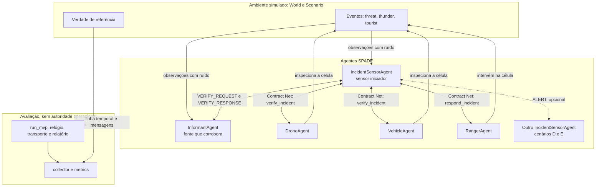
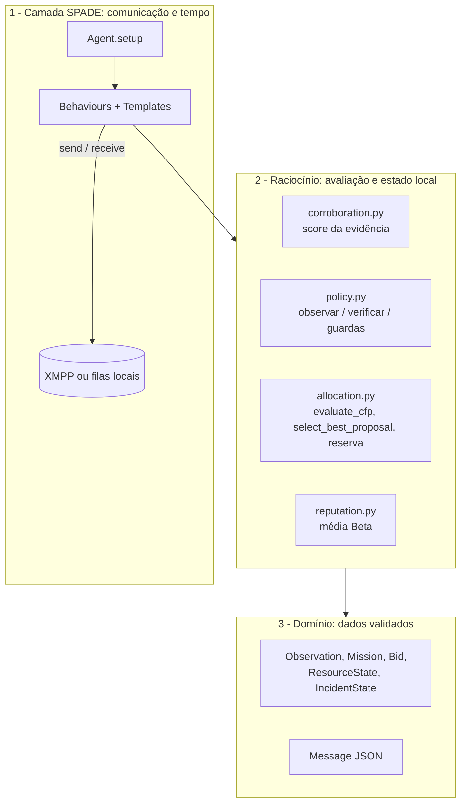
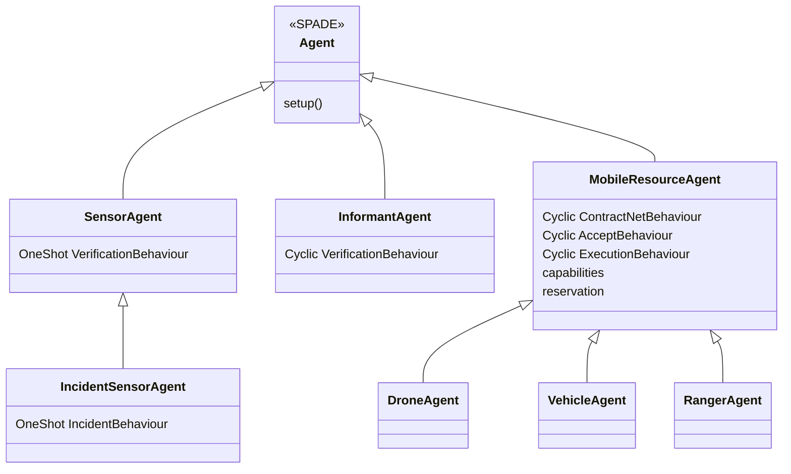
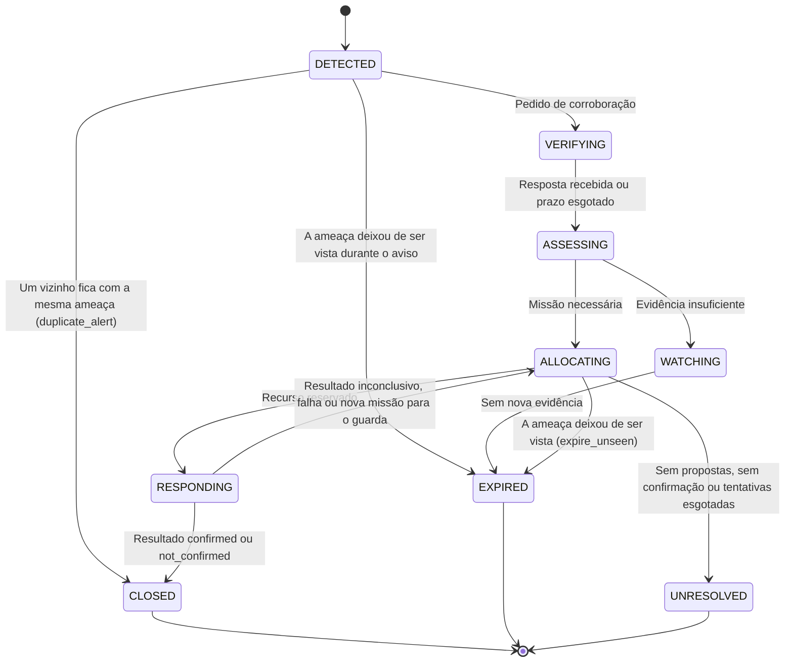
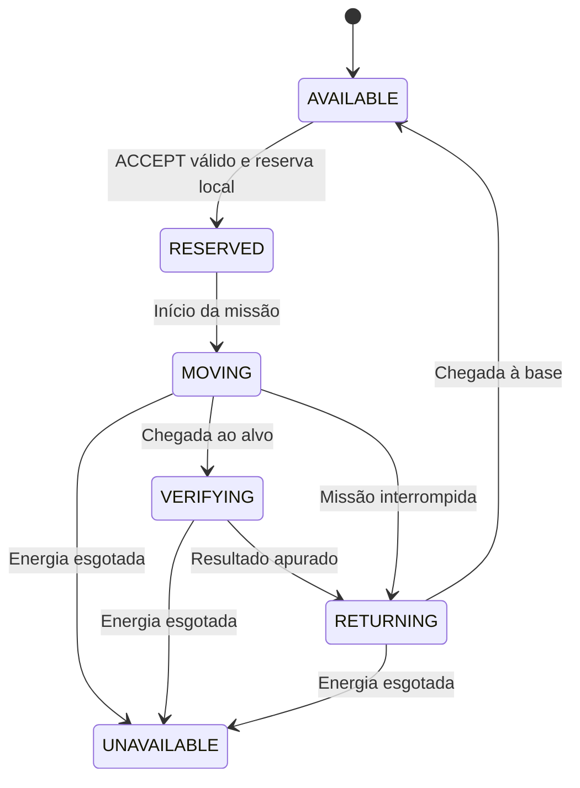
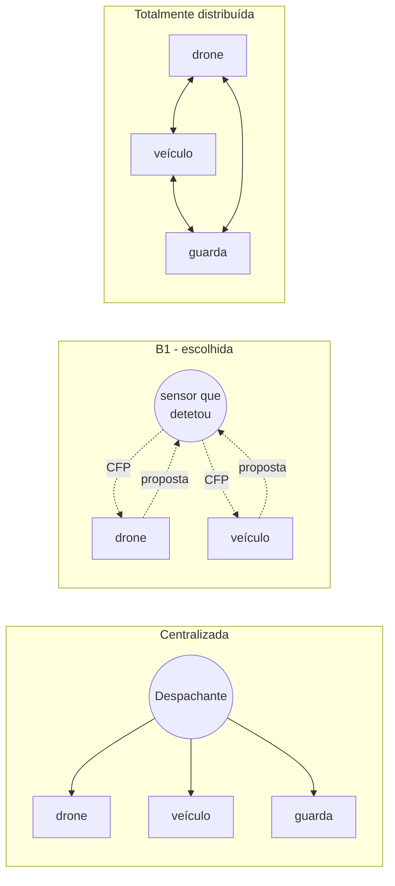

# Arquitetura do sistema multiagente

[README](../README.md) · [Protocolos](protocols.md) · [Reputação e política](reputation-policy.md) · [Falhas](faults.md) · [Escalabilidade](scalability.md)

> **Em resumo**
>
> - Há três papéis de agente, cada um com a sua classe SPADE: o sensor que inicia a ocorrência (`IncidentSensorAgent`), a fonte que corrobora (`InformantAgent`) e o recurso móvel (`MobileResourceAgent`, usado por drone, veículo e guarda).
> - Não existe despachante. O sensor que deteta coordena **a sua** ocorrência: pede corroboração, lança um Contract Net e fecha a ocorrência.
> - Os comportamentos SPADE coordenam comunicação, estado e execução. Delegam regras de avaliação em funções puras de `src/isia/reasoning/`, mas nem todas as decisões são puras.
> - Nos cenários A, B e C só o `sensor-1` inicia. Nos cenários D e E iniciam 6 e 16 sensores, cada um com a sua ocorrência.
> - Limites assumidos: cada iniciador trata uma ocorrência por execução, não há substituição de um iniciador que falhe e o servidor XMPP é um ponto único de falha.

Referência histórica: verificado em 18-11-2026 (branch `fix/auditoria-correcoes`, 560 testes OK em cerca de 45 s). A revisão posterior de validação e a contagem atual dos testes estão no [README](../README.md).

## 1. Princípios de conceção

1. **Autonomia.** Um recurso decide se propõe e se aceita uma missão. Nenhuma mensagem o obriga.
2. **Decisão descentralizada.** Não há despachante global de missões. Cada ocorrência tem um iniciador local. A execução partilha processo, ambiente e relógio; o runner configura participantes e fontes de corroboração.
3. **Observabilidade parcial.** Cada agente só conhece as suas observações, as mensagens que recebeu e o seu estado. A verdade de referência fica no simulador.
4. **Heterogeneidade.** Sensores, fontes que corroboram, patrulhas e guardas têm funções diferentes.
5. **Reprodutibilidade.** Ambiente configurável, relógio simulado, sementes e registo de todas as mensagens.

### XMPP não é autoridade central

O SPADE transporta as mensagens por XMPP. O servidor XMPP entrega mensagens, não toma decisões, por isso não é um despachante.

É, no entanto, uma dependência de infraestrutura: se o servidor cair, ninguém comunica. As falhas que injetamos são ao nível da aplicação ([faults.md](faults.md)) e não demonstram tolerância à queda do servidor.

## 2. Componentes e relações

As setas a cheio entre agentes são mensagens. A seta a tracejado entre iniciadores só existe com a opção `alert_distance` (ligada no cenário E). A avaliação lê a verdade de referência **depois** de a execução terminar.

## 3. Como os agentes são construídos

Cada agente é uma subclasse de `spade.agent.Agent`. No `setup()` regista **comportamentos** com **templates** de metadados; o iniciador filtra apenas pela ontologia e valida os protocolos ao receber. Os comportamentos coordenam comunicação, estado e execução. As funções de raciocínio avaliam evidência e propostas; reservas, reputação, fila e ciclo de vida também mantêm estado.

### 3.1 As três camadas

| Camada | Onde | O que faz |
|---|---|---|
| SPADE | [src/isia/agents/](../src/isia/agents/), [transport.py](../src/isia/communication/transport.py) | Envia, recebe, espera prazos |
| Raciocínio | [src/isia/reasoning/](../src/isia/reasoning/) | Avalia evidência, decide a resposta, propõe, escolhe a proposta, atualiza a reputação |
| Domínio | [models.py](../src/isia/domain/models.py), [incident_state.py](../src/isia/domain/incident_state.py), [messages.py](../src/isia/communication/messages.py) | Dados validados ao serem criados |

O «transporte local» são filas `asyncio` no mesmo processo, criadas por `run_mvp`. Aplica os mesmos templates e corre os mesmos comportamentos, mas não passa pela rede.

### 3.2 Os agentes e os seus comportamentos

| Agente | Comportamento | Template | O que faz |
|---|---|---|---|
| `SensorAgent` ([sensor.py](../src/isia/agents/sensor.py)) | `VerificationBehaviour` (OneShot) | `inform` + ontologia `isia` + protocolo `verification` | Lê o feed local, envia um `VERIFY_REQUEST`, espera a resposta e decide |
| `IncidentSensorAgent` ([incident.py](../src/isia/agents/incident.py)) | `IncidentBehaviour` (OneShot; estende o anterior) | só ontologia `isia` | Depois da decisão, cria a missão, conduz o Contract Net, espera o resultado e fecha a ocorrência |
| `InformantAgent` ([informant.py](../src/isia/agents/informant.py)) | `VerificationBehaviour` (Cyclic) | `request` + `isia` + `verification` | Responde a pedidos só com as observações do seu feed |
| `MobileResourceAgent` ([mobile.py](../src/isia/agents/mobile.py)) | `ContractNetBehaviour` (Cyclic) | `cfp` + `isia` + `contract-net` | Avalia o CFP e responde com proposta ou recusa |
| | `AcceptBehaviour` (Cyclic) | `accept-proposal` ou `reject-proposal` | Reserva-se, confirma com `STATUS` e inicia a missão |
| | `ExecutionBehaviour` (Cyclic) | não recebe mensagens | Avança a missão com o relógio simulado e envia o `MISSION_RESULT` |
| `DroneAgent`, `VehicleAgent`, `RangerAgent` | herdados | herdados | Classes **vazias**: só mudam a capacidade, a posição e a energia, definidas pela configuração |

Dois pormenores que costumam ser perguntados:

- O `IncidentSensorAgent` regista **um só** comportamento, que recebe tudo o que tenha a ontologia `isia`. A verificação e o Contract Net validam intenção e correlação nos respetivos caminhos. O `ALERT` valida a origem entre vizinhos e compatibilidade de observações, mas não tem o mesmo conjunto de verificações de conversa, performativa e cronologia.
- O `ExecutionBehaviour` só é registado quando o recurso recebe `configure_execution()`. O `run_mvp` chama-o sempre. Sem ele, o recurso negoceia e reserva, mas não se desloca.

#### Instâncias usadas nas execuções medidas

Base, presente em todas as execuções (criada em `run_mvp`, [runner.py](../src/isia/simulation/runner.py)):

| JID | Classe | Fonte / capacidade |
|---|---|---|
| `sensor-mvp` | `IncidentSensorAgent` | `sensor-1`, acústica; inicia a ocorrência |
| `sensor-peer-mvp` | `InformantAgent` | `sensor-2`: visual nos cenários A a E; acústica sem cenário |
| `drone-mvp`, `vehicle-mvp` | `DroneAgent`, `VehicleAgent` | `mobile_verification` |
| `ranger-mvp` | `RangerAgent` | `incident_response` |

O que cada cenário acrescenta ([config/scenarios/](../config/scenarios/)):

| Cenário | Mapa | Iniciadores | Fontes que corroboram | Patrulhas | Guardas |
|---|---|---|---|---|---|
| Sem cenário, A, B, C | 8×8 | 1 (`sensor-1`) | 1 (`sensor-2`) | 2 | 1 |
| D, «dia movimentado» | 12×8 | 6 | 6 câmaras | 4 | 2 |
| E, «reserva alargada» | 16×12 | 16 | 2 câmaras e 2 humanos | 4 | 2 |

Os agentes adicionais chamam-se `<fonte>-mvp` (por exemplo `sensor-3-mvp`) e `<recurso>-mvp` (`drone-2-mvp`, `ranger-2-mvp`). As patrulhas adicionais são todas `DroneAgent`. Só existem no transporte local: com `--xmpp`, `run_mvp` recusa-os.

> **O «informador» é o papel de quem responde.** O enunciado pede informadores (fontes humanas). No código, `InformantAgent` é quem responde a pedidos de verificação. Nos cenários A a D esse papel é sempre de uma câmara (fonte `visual`). Só o cenário E tem fontes `human` (`sensor-19` e `sensor-20`), além do grupo `humano` dos testes de stress ([resultados](scalability.md#informadores-humanos-no-lugar-das-câmaras)). Respondem no mesmo instante, como uma câmara; relatos atrasados não foram implementados.

### 3.3 Porquê assim: sete decisões, com alternativas

**Decisão 1 — Separar a orquestração SPADE das regras de avaliação testáveis.**

- **Porquê:** reutiliza-se o código dos Behaviours e das regras com XMPP ou filas locais, sem garantir equivalência de escalonamento e entrega. Há testes isolados e de agentes locais, sem servidor XMPP. As falhas (perda, atraso, duplicação) injetam-se só no transporte local, sem tocar nos agentes.
- **Alternativa:** pôr a lógica dentro do `run()` dos comportamentos, como nos exemplos do SPADE.
- **Pró:** testável e explicável. Cada decisão regista fatores e razões no histórico.
- **Contra:** mais ficheiros e validações repetidas na fronteira entre camadas.

**Decisão 2 — Uma única classe `MobileResourceAgent` para drone, veículo e guarda.**

- **Porquê:** o que distingue os recursos é a **capacidade** (`mobile_verification` ou `incident_response`), não o código. Um novo tipo de recurso passa a ser configuração.
- **Alternativa:** três classes com lógica própria.
- **Pró:** sem código duplicado; uma correção serve para todos.
- **Contra:** não modela diferenças reais. Na realidade, o drone voa por cima de obstáculos e o veículo precisa de estrada. Aqui todos se movem da mesma forma: primeiro em x e depois em y, uma célula por segundo simulado ([movement.py](../src/isia/simulation/movement.py)).

**Decisão 3 — O sensor é OneShot; o informador e os recursos são Cyclic.**

- **Porquê:** o sensor conduz **uma** ocorrência, com princípio e fim. O informador e os recursos são prestadores de serviço, sempre à espera de pedidos.
- **Alternativa A:** `FSMBehaviour` do SPADE, com um estado por fase da ocorrência. Ficaria visível no SPADE, mas preso a ele e difícil de testar. A máquina de estados está em [incident_state.py](../src/isia/domain/incident_state.py), com tabela de transições testada sem SPADE.
- **Alternativa B:** um sensor Cyclic que trate várias ocorrências seguidas. Exige agrupar observações em ocorrências e gerir várias conversas ao mesmo tempo. Não foi feito.
- **O que foi feito para escalar:** vários iniciadores OneShot, um por sensor (cenários D e E). Cada um continua a tratar uma ocorrência por execução.

**Decisão 4 — O recurso tem três comportamentos em paralelo.**

- **Porquê:** enquanto executa uma missão, o recurso continua a responder a CFP com uma recusa (`resource_unavailable`), e o movimento avança ao ritmo do relógio simulado. Num só comportamento, uma missão longa bloquearia a negociação.
- **Contra:** a reserva é estado partilhado entre os três. A `LocalResourceReservation` ([allocation.py](../src/isia/reasoning/allocation.py)) garante no máximo uma missão de cada vez.

**Decisão 5 — Arquitetura interna híbrida (reativa + estado e utilidade), não BDI completo.**

- **Porquê:** os sensores só precisam de estímulo-resposta. Os recursos precisam de estado (energia, posição, reserva) e de uma função de utilidade (o custo da proposta). Um interpretador BDI (AgentSpeak, `spade_bdi`) seria pesado para regras tão simples.
- **Pró:** determinística, explicável e fácil de testar.
- **Contra:** sem planeamento nem reconsideração. Um drone não abandona uma verificação para ir a uma ocorrência mais grave.
- **Correspondência com BDI:** crença = `ResourceState` e observações; desejo = missão possível (o CFP); intenção = reserva aceite; reconsideração = falha por energia ou interrupção, seguida do regresso.

**Decisão 6 — Dados do domínio imutáveis e validados na fronteira.**

- **Porquê:** as mensagens vêm da rede e não são de confiança. `Observation`, `Mission`, `Bid`, `ResourceState` e `IncidentState` são `frozen dataclass`: mudar de estado devolve um objeto novo. `Message` é uma classe normal, mas valida todos os campos ao ser criada; uma mensagem inválida é rejeitada e registada.
- **Contra:** muito código de validação. É o maior volume do projeto: [allocation.py](../src/isia/reasoning/allocation.py) tem cerca de 790 linhas e [corroboration.py](../src/isia/reasoning/corroboration.py) cerca de 850.

**Decisão 7 — Os agentes nunca veem a verdade de referência.**

- **Porquê:** se a vissem, não haveria problema de agentes. A verdade serve só ao **avaliador**, que mede TP, FP, TN e FN e atualiza a reputação **depois** de a execução terminar (fim de `run_mvp`). O sensor recebe apenas uma cópia dos pesos (`snapshot`) no início.

### 3.4 Onde está a autonomia

1. **O recurso decide localmente se propõe.** `evaluate_request` ([mobile.py](../src/isia/agents/mobile.py)) chama `evaluate_cfp` ([allocation.py](../src/isia/reasoning/allocation.py)) com o estado do **próprio** recurso. Recusa por estar ocupado, por falta de capacidade, por alvo fora do mapa ou por energia insuficiente.
2. **A energia conta a ida e a volta.** O custo é `(células até ao alvo + células de regresso) × energia por célula`. O recurso recusa se ficar abaixo da autonomia mínima (10 % por omissão).
3. **O recurso pode recusar a reserva depois do `ACCEPT`.** Se o `STATUS` não disser `reserved`, o iniciador regista `reservation_rejected` e não o consegue obrigar.
4. **O informador decide o que responde** só com as suas observações. O iniciador não lhe impõe conteúdo.

### 3.5 Infraestrutura que não é agente

- `World` e `Scenario` ([world.py](../src/isia/simulation/world.py), [scenario.py](../src/isia/simulation/scenario.py)): produzem as observações e guardam a verdade de referência.
- `run_mvp` ([runner.py](../src/isia/simulation/runner.py)): cria os agentes, avança o relógio e, no fim, atua como avaliador. **Não distribui missões nem escolhe vencedores.**
- Coletor ([collector.py](../src/isia/evaluation/collector.py)): corre os cenários e grava métricas.

O que o `run_mvp` fixa, e que num sistema real seria descoberta dinâmica: a quem cada iniciador pede corroboração (a fonte mais próxima), a lista de patrulhas e de guardas que cada iniciador conhece (todas) e, com `alert_distance`, quem é vizinho de quem.

## 4. Estado do ambiente vs. crenças dos agentes

| Elemento | Verdade do simulador | O que um agente conhece |
|---|---|---|
| Incidente | Existe ou não, posição real | Observações com ruído e respostas recebidas |
| Sensor | Taxas de erro usadas para gerar leituras | As suas leituras; a reputação que lhe foi atribuída |
| Outros agentes | Posição e disponibilidade efetivas | O que disseram nas mensagens (proposta, recusa, `busy_until`) |
| Rede | Perdas e atrasos aplicados | Respostas recebidas ou prazos esgotados |
| Resultado | Se a ameaça estava na célula | O `MISSION_RESULT` do recurso |

**Invariante:** nenhuma decisão de um agente consulta `Scenario.ground_truth` nem os eventos reais. O sensor recebe só o seu `ObservationFeed`. O recurso recebe só uma função `inspect(célula, instante, tarefa)`, que classifica a célula que ele visitou.

## 5. Ciclo de vida de um incidente

As transições estão em `_ALLOWED_TRANSITIONS` ([incident_state.py](../src/isia/domain/incident_state.py)). As duas saídas de `DETECTED` para um estado final só acontecem com o aviso entre iniciadores (`alert_distance`).

A tabela permite ainda `WATCHING → VERIFYING` (nova evidência) e `ASSESSING → CLOSED`, mas **o código atual nunca as usa**: cada execução tem uma só janela, por isso `WATCHING` passa logo a `EXPIRED`.

Os três estados finais não valem o mesmo. O relatório guarda o estado e o motivo (`reason`):

| Estado | Motivos possíveis | Significado |
|---|---|---|
| `closed` | `confirmed`, `not_confirmed`, `duplicate_alert` | Houve inspeção no local, ou outro iniciador ficou com a ameaça |
| `expired` | `insufficient_corroboration`, `threat_expired` | Ninguém foi enviado |
| `unresolved` | `no_eligible_proposals`, `reservation_rejected`, `confirmation_unknown`, `mission_result_unknown`, `inconclusive`, `failed` | Tentou-se e não se concluiu |

`expired` e `unresolved` não são sucessos, e as métricas contam-nos à parte. `closed` / `not_confirmed` também não prova que não havia ameaça: só diz que a patrulha não a viu naquela célula.

Um sensor sem nenhuma leitura não abre ocorrência: o relatório fica com estado vazio e motivo `no_alert`.

## 6. Ciclo de vida de uma patrulha

As transições estão em `ResourceState.change_status` ([models.py](../src/isia/domain/models.py)). O guarda usa os mesmos estados: `VERIFYING` é o segundo que passa na célula, seja a inspecionar ou a intervir.

**Regra de consistência:** cada recurso tem no máximo uma missão ativa. `LocalResourceReservation.reserve()` é atómica; um `ACCEPT` repetido para a mesma missão devolve `already_reserved` e não cria segunda reserva.

Três notas:

- O `MISSION_RESULT` sai no fim de `VERIFYING`. O recurso só volta a `AVAILABLE` quando chega à base.
- Com `chain_missions`, um recurso em `RETURNING` pode aceitar a missão seguinte: o regresso termina na célula onde está e a nova missão parte dali.
- Não há recarga. O modelo permite `UNAVAILABLE → AVAILABLE` e `RESERVED → AVAILABLE`, mas o código nunca as usa: um recurso sem energia fica parado até ao fim da execução.

## 7. Exemplo completo de execução

Execução real de exemplo, sem argumentos (`PYTHONPATH=src python -m isia.simulation.runner`), no mapa 8×8. Tempos em segundos simulados.

| t | O que acontece |
|---|---|
| 0 | Uma ameaça está em (3, 2). `sensor-1` (2, 2) e `sensor-2` (4, 2), ambos acústicos, leem `gunshot_like_sound` com confiança 0,8. |
| 0 | `sensor-mvp` lê o seu feed e abre `incident-obs-000001`. |
| 0 | `sensor-mvp` envia `VERIFY_REQUEST` a `sensor-peer-mvp`, que responde `observations_available` com a sua leitura. |
| 0 | Uma fonte compatível chega para decidir `request_mobile_verification`. |
| 0 | `CFP` para `drone-mvp` e `vehicle-mvp`. O drone, em (0, 2), propõe ETA 3 s e 6 % de energia. O veículo, em (0, 0), propõe ETA 5 s e 10 %. |
| 0 | Custos: drone 3/60 + 6/100 = 0,11; veículo 5/60 + 10/100 = 0,18. `ACCEPT` ao drone, `REJECT` ao veículo. O drone responde `STATUS(reserved)`. |
| 3–4 | O drone chega a (3, 2), inspeciona durante 1 s e envia `MISSION_RESULT(confirmed)`. Volta à base em t = 7, com 94 % de autonomia. |
| 4 | Verificação confirmada: nova missão `respond_incident`. `CFP` para `ranger-mvp`, que propõe ETA 5 s; `ACCEPT`; `STATUS(reserved)`. |
| 9–10 | O guarda chega, intervém e envia `MISSION_RESULT(confirmed)`. A ocorrência fecha como `closed` / `confirmed`. |
| 15 | O guarda está de volta à base, com 90 % de autonomia. |

Total: **15 mensagens** (1 `VERIFY_REQUEST`, 1 `VERIFY_RESPONSE`, 3 `CFP`, 3 `PROPOSAL`, 2 `ACCEPT`, 1 `REJECT`, 2 `STATUS`, 2 `MISSION_RESULT`).

Para ver a mesma execução passo a passo no terminal, seguir o [README](../README.md) (`scripts/replay.py`).

## Estratégia técnica e algoritmos

A abordagem escolhida, a que os documentos chamam **B1**, junta sensores reativos, recursos com estado e objetivos, um iniciador temporário por ocorrência e Contract Net para atribuir missões.

### Escolhas por problema

| Problema | O que está implementado | Alternativa e porque não |
|---|---|---|
| Arquitetura interna | Reativa + estado e utilidade | BDI completo ou aprendizagem por reforço: complexidade a mais para regras simples |
| Atribuição | Contract Net por ocorrência | Patrulha mais próxima: é a variante `nearest`, usada como baseline. Otimização global: precisa de quem veja tudo |
| Corroboração | Score ponderado por reputação, confiança, distância e tempo | Contar alertas ignora a fiabilidade e a correlação entre fontes. Um modelo probabilístico exigiria calibração |
| Ambiente | Grelha 2D, relógio simulado, observações com ruído | Áudio ou imagem reais não são precisos para estudar a coordenação |

### Porquê B1 e não outras arquiteturas do sistema

| Arquitetura | Prós | Contras | Veredicto |
|---|---|---|---|
| Despachante central | Vê tudo; permite atribuição ótima global (algoritmo húngaro); simples e consistente | Ponto único de falha e gargalo; precisa do estado de todos a toda a hora; o enunciado pede *«without a central authority»* | Não: contraria o tema |
| **B1: iniciador temporário + Contract Net** | Sem gestor global; cada ocorrência tem o seu coordenador, por isso várias correm em paralelo (medido com 6 e 16 iniciadores nos cenários D e E); usa informação local; recursos autónomos; 15 mensagens por ocorrência na execução de exemplo | Guloso, não ótimo globalmente; se o iniciador cair, a ocorrência fica parada; dois sensores que ouvem a mesma ameaça abrem duas ocorrências, salvo com o aviso opcional `alert_distance` | **Sim:** melhor equilíbrio |
| Totalmente distribuída (consenso ou votação) | Robusta e simétrica | O(n²) mensagens; lenta; a votação não descobre a verdade: fontes correlacionadas enganam a maioria | Não: cara e resolve o problema errado |
| Hierárquica (líderes de zona) | Escala bem em reservas grandes | Exige eleger líderes e tratar a falha de um líder | Não: excessivo para os mapas medidos (até 16×12); evolução futura |
| Blackboard / tuple space | Simples | O quadro é central | Não |

**Contras medidos** (os restantes são do desenho):

- **O Contract Net espera pelo prazo.** Com o drone silencioso, cada execução demora mais um prazo de receção (0,5 s reais). Dez execuções passaram de 1,5 s para 5,5 s na medição de 16-11-2026; repetida a 18-11-2026 deu 1,7 s e 6,9 s. O valor depende da máquina.
- **Corroborar custa recall.** No cenário B, `full` contra `no_corroboration` dá FPR 0,25 contra 0,75, mas recall 0,65 contra 0,80 ([experiments.md](experiments.md)). A baseline também baixa o limiar de patrulha, por isso não isola o efeito da corroboração.
- **A reputação quase não muda decisões.** Entre `full` e `no_reputation` muda uma decisão em 140 pares de execuções ([experiments.md](experiments.md#desfechos-observados)).
- **Com muitas ocorrências, os recursos não chegam.** No cenário E fecham 132 de 152 ocorrências abertas; 13 expiram e 7 ficam por resolver ([scalability.md](scalability.md#cenário-e--reserva-alargada)).

Ver também os [protocolos e desvios ao FIPA](protocols.md#9-porquê-estes-protocolos-alternativas-prós-e-contras).

### Algoritmos, e onde estão explicados

| Algoritmo | Resumo | Dono do assunto |
|---|---|---|
| Score de suspeita | `clamp((apoio − oposição) / 2, 0, 1) × diversidade`; não é uma probabilidade | [reputation-policy.md](reputation-policy.md#score-de-suspeita) |
| Reputação | Média Beta: `(acertos + α) / (acertos + erros + α + β)`, com α = β = 2 | [reputation-policy.md](reputation-policy.md#reputação) |
| Política de resposta | `observe`, `request_mobile_verification` ou `request_rangers`, por limiares | [reputation-policy.md](reputation-policy.md#política-de-resposta) |
| Custo da proposta | `ETA/60 + energia/100 + carga`, pesos 1; ganha o menor | [protocols.md](protocols.md#5-atribuição-distribuída-contract-net-simplificado) |

**Associação de observações: não há agrupamento.** A ocorrência é ancorada na primeira leitura da janela do sensor (`incident-<event_id>`), e o alvo da missão é a posição dessa leitura. Agrupar leituras por proximidade para separar vários caçadores ouvidos pelo mesmo sensor ficou por fazer ([scalability.md](scalability.md), limite C7).

## Decisões pendentes

O que continua em aberto, sem implementação:

| Tema | Estado hoje |
|---|---|
| Falha do iniciador | Não há substituição. A ocorrência fica parada; o recurso já aceite termina a missão e liberta-se sozinho ([faults.md](faults.md#falha-do-iniciador)) |
| Descoberta de vizinhos | Não há. As listas de recursos, a fonte que corrobora e os vizinhos são fixados por `run_mvp` |
| Várias ocorrências por sensor | Não há. Cada iniciador é OneShot e trata uma ocorrência por execução |
| Vários iniciadores sobre XMPP | Não há. Iniciadores, informadores e recursos adicionais só existem no transporte local |
| Aprovação formal dos parâmetros | Por assinar. Os limiares são valores de engenharia, não calibrados |
| Queda do servidor XMPP | Não tratada nem simulada |
