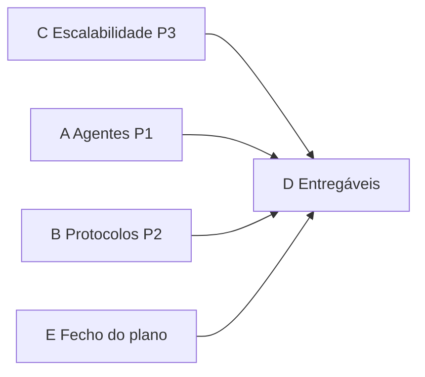

# Pendentes para a entrega — complemento ao plano (Blocos A a E)

> **Lista de acompanhamento (criada em 2026-11-16).** `- [ ]` indica trabalho pendente; `- [x]` exige evidência verificada. As linhas citadas referem-se à `main` em `81a09e8`.

[README](../README.md) · [Plano](development-plan.md) · [Arquitetura](architecture.md) · [Protocolos](protocols.md) · [Experiências](experiments.md)

## Para que serve este documento

- **O que é:** a lista do que falta para entregar o projeto completo.
- **Relação com o plano:** complementa o [plano de desenvolvimento](development-plan.md), não o substitui. Só inclui trabalho que **não está** no plano ou que lá está mal definido; estas últimas tarefas aparecem como «Ajuste à Etapa X».
- **Organização:** os Blocos A, B e C respondem às três questões de análise abaixo; o Bloco D cobre os entregáveis do enunciado (demonstração, apresentação, README); o Bloco E fecha as caixas pendentes do plano. O Bloco F reúne testes de stress opcionais e o Bloco G, no fim, mede a sensibilidade dos parâmetros.
- **Porquê agora:** parte da análise destas questões existe apenas em notas locais, fora do Git. A lista indica o que passar para a documentação versionada.
- **Como usar:** cada elemento escolhe uma tarefa `- [ ]`, executa-a e assinala-a com a evidência. O trabalho opcional só começa depois de fechados os obrigatórios.
- **Quando termina:** quando a [checklist de marcos](#checklist-de-marcos) estiver completa. Nessa altura o documento passa a registo histórico.

## Questões de análise

- **P1.** Como são construídos os agentes?
- **P2.** Que protocolos são usados? Porquê esta arquitetura e não outras? Prós e contras?
- **P3.** Escalabilidade computacional (limites C1–C8 da [Etapa 9A](development-plan.md#etapa-9a--escalabilidade-computacional-e-situacional)) e situacional (distribuição de recursos e caçadores).

## Regras de progressão

- Trabalho **obrigatório** estimado: cerca de **17 h** no total. O trabalho **opcional** só começa depois de os obrigatórios estarem fechados.
- Cada tarefa tem o porquê numa frase. Sem porquê, não entra.
- Não inventar resultados: o que não foi medido fica escrito como «não medido».
- A análise das três questões está hoje em `temp/perguntas-defesa.md`, um ficheiro local que o Git ignora. Tudo o que for necessário à entrega tem de passar para um caminho versionado.

## Verificação de partida (16-11-2026)

- Na `main` (`81a09e8`), a suite completa passou **489 testes, OK**, em cerca de 58 s. Só passa dentro de um repositório Git.
- Os scripts locais `temp/scale.py` e `temp/dist.py` correram sem alterações e reproduziram as contagens de P3: 15 mensagens por execução completa (média 12,4), 8/10, 8/20 e 8/30 caçadores atendidos, 0/10 alertas em (7,0) e 13/20 contra 9/20 com 10 % de perda.
- Com o drone silencioso, dez execuções passaram de 1,5 s para 5,5 s reais. O fator depende da máquina; reportar os dois tempos.
- O modo `--xmpp` foi executado só na base anterior ao PR #18: terminou `closed`, com `messages` vazio, porque a transcrição só existe no transporte local.
- A recolha das 560 execuções da Etapa 9 não foi repetida nesta verificação.

## Dependências gerais

Os Blocos A, B, C e E podem decorrer em paralelo. O Bloco D depende deles para os diapositivos.

---

## Bloco A — P1: construção dos agentes

**Objetivo:** tornar visível na entrega como os agentes são construídos, com a descrição igual ao código.

**Pré-requisitos:** `main` atualizada; acesso a `temp/perguntas-defesa.md` (secções P1.2 a P1.5).

**Ficheiros envolvidos:** `docs/architecture.md`, `temp/perguntas-defesa.md`, `docs/presentation/`.

**Tarefas concretas:**

- [x] **Ajuste à Etapa 10: reescrever a secção 3 de `architecture.md` com o conteúdo de P1.2–P1.5** (obrigatório, ~1,5 h) — a secção atual descreve uma proposta que o código não tem (drone que «anuncia disponibilidade», sensor com «lista de vizinhos»). Ver [architecture.md:60](architecture.md#L60). **Feito:** [secção 3](architecture.md#3-como-os-agentes-são-construídos) com as três camadas, a tabela agente/comportamentos/código, as sete decisões e a autonomia; cada `ficheiro:linha` conferido em `89c08a7`. O título deixou de dizer «proposta».
- [x] **Corrigir as linhas e os números da Parte 0** (obrigatório, ~0,5 h) — as ligações a `incident.py`, `runner.py` e `reputation.py` deslocaram-se com o PR #18, e «421 testes em 12 s» passou a 489 em cerca de 58 s. **Feito** em `temp/perguntas-defesa.md` (local): 29 ligações conferidas; suite reexecutada a 16-11-2026: 489 testes, OK, 57,9 s.
- [x] **Fazer um diapositivo de P1** (obrigatório, ~1 h) — a construção dos agentes deve poder ser explicada em 30 segundos. **Feito:** conteúdo em [presentation/p1-agentes.md](presentation/p1-agentes.md), com as três ligações de autonomia; formato final no Bloco D.
- [x] **Declarar que `InformantAgent` corre como `sensor-2` visual** (obrigatório, ~0,25 h) — o enunciado pede informadores e nenhum cenário medido tem fonte `human`. Ver [architecture.md:70](architecture.md#L70). **Feito:** nota e tabela de instâncias na [secção 3.2](architecture.md#instâncias-usadas-nas-execuções-medidas).

**Evidência disponível:** comportamentos em [sensor.py:129](../src/isia/agents/sensor.py#L129), [informant.py:66](../src/isia/agents/informant.py#L66) e [mobile.py:140](../src/isia/agents/mobile.py#L140), [:197](../src/isia/agents/mobile.py#L198), [:287](../src/isia/agents/mobile.py#L288). Autonomia do recurso em [mobile.py:106](../src/isia/agents/mobile.py#L106) (decide localmente), [mobile.py:118](../src/isia/agents/mobile.py#L118) (energia de ida e volta) e [incident.py:223](../src/isia/agents/incident.py#L223) (pode recusar a reserva depois do `ACCEPT`).

**Dependências:** nenhuma. Alimenta o Bloco D.

**Testes a realizar:** abrir cada ligação `ficheiro:linha` e confirmar que aponta para o código descrito; correr a suite e conferir o número de testes citado.

**Critérios de conclusão:** `architecture.md` contém as três camadas, a tabela agente/comportamentos/código e as sete decisões, sem a palavra «proposta»; o diapositivo mostra as três ligações de autonomia.

**Resultado esperado:** quem lê a entrega encontra a resposta a P1 na documentação versionada e nos diapositivos.

**Erros prováveis/diagnóstico:** copiar linhas da base antiga; descrever o informador como fonte humana quando os cenários A, B e C só têm fontes acústica e visual.

---

## Bloco B — P2: protocolos e arquitetura

**Objetivo:** tornar visível porquê esta arquitetura e estes protocolos, com alternativas, prós e contras.

**Pré-requisitos:** `main` atualizada; acesso a `temp/perguntas-defesa.md` (secções P2.2, P2.3 e P2.5).

**Ficheiros envolvidos:** `docs/protocols.md`, `docs/architecture.md`, `docs/evaluation.md`, `docs/presentation/`.

**Tarefas concretas:**

- [x] **Ajuste à Etapa 10: copiar as tabelas de alternativas (P2.2, P2.3, P2.5) para os documentos versionados** (obrigatório, ~1,5 h) — «porquê não outras» só tem resposta num ficheiro que o Git ignora. A versão atual tem quatro linhas em [architecture.md:196](architecture.md#L196). **Feito:** P2.2 e P2.3 em [protocols.md, secção 9](protocols.md#9-porquê-estes-protocolos-alternativas-prós-e-contras); P2.5 em [architecture.md](architecture.md#porquê-b1-e-não-outras-arquiteturas-do-sistema).
- [x] **Corrigir `protocols.md`: `refuse` contra `reject-proposal`, e `ALERT`/`INCIDENT_CLOSED` não enviados** (obrigatório, ~0,5 h) — o diagrama diz `refuse` ([protocols.md:245](protocols.md#L245)), mas o código envia `reject-proposal` ([mobile.py:259](../src/isia/agents/mobile.py#L259)). É um desvio do FIPA fácil de detetar. A tabela de tipos atribui destinatários a mensagens que só ficam no registo local ([protocols.md:160](protocols.md#L160)). **Feito:** tabela da secção 3 com a performativa enviada e a linha do código; diagramas das secções 4 e 5 sem `refuse`; desvios ao FIPA na secção 9.
- [x] **Reescrever «várias ocorrências em paralelo» como «o desenho permite; não medido»** (obrigatório, ~0,25 h) — é a principal vantagem alegada da abordagem B1 e nenhuma execução tem mais de um iniciador. Ver [evaluation.md:126](evaluation.md#L126). **Feito** aí e na tabela B1 de `architecture.md`.
- [x] **Fazer um diapositivo de P2 com dois contras medidos** (obrigatório, ~1 h) — prós e contras com números convencem mais do que a tabela teórica. **Feito:** conteúdo em [presentation/p2-protocolos.md](presentation/p2-protocolos.md) (espera 1,5 → 5,5 s; recall 0,80 → 0,65); formato final no Bloco D.

**Evidência disponível:** em [experiments.md:98](experiments.md#L98), a reputação mudou uma decisão em 560 execuções; no cenário B, a comparação `full`/`no_corroboration` dá FPR de 0,25 contra 0,75 e recall de 0,65 contra 0,80.

**Dependências:** nenhuma. Alimenta o Bloco D.

**Testes a realizar:** comparar cada performativa do diagrama com a que os agentes enviam; confirmar que nenhum texto afirma paralelismo medido.

**Critérios de conclusão:** os documentos têm as três tabelas com prós, contras e escolha; o diagrama coincide com o código e o desvio do FIPA está escrito como decisão; `protocols.md` deixa de se intitular «proposta».

**Resultado esperado:** resposta a P2 apoiada em código, medições e alternativas descartadas.

**Erros prováveis/diagnóstico:** alterar a performativa no código em vez de documentar o desvio (obriga a mexer em templates e testes); apresentar vantagens do desenho como resultados.

---

## Bloco C — P3: escalabilidade

**Objetivo:** tornar as medições de P3 reproduzíveis por quem recebe a entrega e fechar a Etapa 9A com limites explícitos.

**Pré-requisitos:** Etapa 9; scripts locais `temp/scale.py` e `temp/dist.py`.

**Ficheiros envolvidos:** `scripts/` (novo), `results/scalability/` (novo), `docs/scalability.md` (novo), `docs/development-plan.md`, `temp/perguntas-defesa.md`, `docs/presentation/`.

**Tarefas concretas:**

- [x] **Ajuste à Etapa 9A (tarefa 1): mover os scripts para `scripts/`, gravar CSV e criar `docs/scalability.md`** (obrigatório, ~2 h) — a tarefa do plano não diz para onde nem em que formato. Ver [development-plan.md:545](development-plan.md#L545). **Evidência:** [scripts/](../scripts/), [results/scalability/](../results/scalability/), [scalability.md](scalability.md); corridos num clone limpo a 16-11-2026.
- [x] **Ajuste à Etapa 9A: fechar a etapa com uma tabela C1–C8 «medido / proposto / adiado»** (obrigatório, ~0,5 h) — as oito tarefas atuais pedem C6, C7 e fila por gravidade; com esse âmbito a etapa não fecha. A métrica por caçador conta como feita pela função `attended()` do script de distribuição. **Evidência:** [scalability.md#estado-de-c1c8](scalability.md#estado-de-c1c8); Etapa 9A assinalada no plano.
- [x] **Corrigir três afirmações de P3** (obrigatório, ~0,5 h) — C1 diz que o iniciador conhece a posição base, mas `candidates` só tem `{jid: resource_id}` ([runner.py:201](../src/isia/simulation/runner.py#L201)); o fator «3,4×» varia com a máquina; «menos recursos só prejudica com falhas» é forte demais para 20 repetições. **Evidência:** secção «Correções a afirmações anteriores» de [scalability.md](scalability.md), plano e `temp/perguntas-defesa.md`.
- [x] **Fazer um diapositivo de P3** (obrigatório, ~1 h) — é a questão com mais medições e estas têm de aparecer. **Evidência:** [presentation/p3-escalabilidade.md](presentation/p3-escalabilidade.md) (conteúdo; o formato final dos diapositivos é decidido no Bloco D).

**Estado proposto para C1–C8:**

| Ref. | Estado | Justificação |
|---|---|---|
| C2, C7 | Medido | Espera de 1,5 s para 5,5 s; 8/10, 8/20 e 8/30 atendidos |
| C1, C4 | Proposto | C1 sozinho não muda nada: com duas patrulhas e K ≥ 2, o «antes» é igual ao «depois». Só com C4 |
| C5 | Proposto | O feed é lido uma vez por execução; o ganho não é mensurável no sistema |
| C6 | Proposto | Um único par fixo de corroboração ([runner.py:158](../src/isia/simulation/runner.py#L158)) |
| C8 (reputação) | Proposto | Pelo menos quatro testes usam `book.history`; o crescimento de memória não foi medido |
| C3, C8 (processos) | Adiado | Mudanças grandes; trabalho futuro |

**Dependências:** Etapa 9. Fecha a Etapa 9A e alimenta o Bloco D.

**Testes a realizar:** correr os scripts a partir de um clone limpo; comparar o CSV gerado com a verificação de 16-11-2026.

**Critérios de conclusão:** `PYTHONPATH=src python scripts/dist.py` corre num clone limpo e grava `results/scalability/dist.csv`; a Etapa 9A fica assinalada com adiamentos justificados; o diapositivo mostra a tabela C1–C8, o mapa com o ponto cego (7,0) e a série 8/10, 8/20, 8/30.

**Resultado esperado:** resposta a P3 com referência reproduzível e limites assumidos, medidos e com proposta.

**Erros prováveis/diagnóstico:** caminhos relativos a `temp/` nos scripts; apresentar o fator de lentidão como constante; implementar C1 sem C4 e não obter diferença.

---

## Bloco D — Entregáveis oficiais

**Objetivo:** cobrir os entregáveis do enunciado que faltam: visualização ou demonstração gravada, apresentação e instruções de execução.

**Pré-requisitos:** Blocos A, B e C para o conteúdo dos diapositivos; relatório JSON do `run_mvp`.

**Ficheiros envolvidos:** `scripts/replay.py` (novo), `docs/presentation/` (novo), `README.md`, `src/isia/evaluation/collector.py`, `results/experiments/summary.csv`.

**Estado dos entregáveis (16-11-2026):**

| Entregável | Estado | Falta |
|---|---|---|
| Código SPADE com instruções | Parcial | Estado antigo em [README.md:6](../README.md#L6); sem comando dos cenários nem de P3 |
| Documentação | Parcial | Justificação com alternativas; agentes descritos como estão no código |
| Relatório de desempenho | Pronto | Gráficos (opcional) |
| Visualização/demonstração e diapositivos | Em falta | Tudo |
| Testes e scripts (opcional) | Pronto | Scripts de P3 versionados |

**Tarefas concretas:**

- [x] **Ajuste à Etapa 10: fazer a visualização como repetição do relatório JSON, em `scripts/replay.py`** (obrigatório, ~3 h) — é a opção mais barata que mostra interações e métricas; o plano previa um módulo ao vivo ([development-plan.md:572](development-plan.md#L572)). Ler a `timeline` e não `messages`, que vem vazio em XMPP. **Feito:** [scripts/replay.py](../scripts/replay.py) lê só a `timeline` (aceita também `results/experiments/runs/*.json`); gravação em [results/demo/](../results/demo/) (`script`/`scriptreplay`, sem dependências novas).
- [x] **Ajuste à Etapa 10: fixar o roteiro da apresentação** (obrigatório, ~2 h) — o plano só diz «inserir dados na apresentação» ([development-plan.md:578](development-plan.md#L578)); sem roteiro, as três questões de análise ficam dispersas entre os resultados. **Feito:** [presentation/roteiro.md](presentation/roteiro.md), 12 diapositivos com a fonte de cada número.
- [x] **Ajuste à Etapa 10: pôr no topo do README os comandos por ordem** (obrigatório, ~1 h) — o estado é de 12-11-2026 e as contagens de testes são antigas ([README.md:172](../README.md#L172)). **Feito:** secção [Comandos por ordem](../README.md#comandos-por-ordem), com estado de 16-11-2026.
- [x] **Testar a entrega sem a pasta `.git`** (obrigatório, ~0,5 h) — numa cópia sem Git, o coletor recusa correr e sete testes falham. **Feito:** o coletor continua a exigir Git (proveniência); os 4 testes que dependem dele (as 7 falhas contavam subtestes) passam a `skipped` com a razão, e o README manda entregar com `.git` ou `git bundle`. Verificado a 16-11-2026: com `.git`, 489 testes OK; cópia sem `.git`, 489 OK (`skipped=4`).
- [ ] **Gerar dois gráficos a partir de `summary.csv`** (opcional, ~2 h) — precision, recall e FPR por cenário leem-se melhor em gráfico do que numa tabela de doze linhas.

**Opções de visualização comparadas:**

| Opção | Esforço | Mostra |
|---|---|---|
| **A. Repetição no terminal a partir do JSON, gravada (recomendada)** | ~3 h, sem dependências | Grelha, mensagens por segundo, métricas finais |
| B. Gráficos e grelha animada em matplotlib | ~5–6 h, dependência nova | O mesmo, com melhor aspeto |
| C. Interface gráfica ou painel ao vivo | 10 h ou mais | Interativo; risco de bloquear o SPADE |

**Dependências:** Blocos A, B e C. Substitui a forma de cumprir as tarefas de visualização da Etapa 10.

**Testes a realizar:** um colega instala, testa, corre o MVP, os cenários, P3 e a repetição seguindo apenas o README; extrair a entrega para uma pasta sem Git e repetir.

**Critérios de conclusão:** existe uma gravação da repetição; a apresentação segue P1, P2, P3, resultados A/B/C, demonstração e limites, em cerca de doze diapositivos; o README indica se é preciso entregar o clone com `.git`.

**Resultado esperado:** entregáveis do enunciado cobertos com o mínimo de código novo.

**Erros prováveis/diagnóstico:** visualizador que toma decisões pelos agentes (a repetição evita-o, porque só lê o relatório); entrega em ZIP sem Git; gráficos com dados que não vêm de `results/`.

---

## Bloco E — Fecho do plano

**Objetivo:** fechar as caixas do plano que só dependem de aprovação e alinhar a proveniência dos resultados.

**Pré-requisitos:** um elemento para aprovar (não é preciso reunião nem os três). Os itens 4.x, 5.x e 7.x da ata só depois do Bloco G.

**Ficheiros envolvidos:** `docs/development-plan.md`, `results/experiments/manifest.json`.

**Tarefas concretas:**

- [ ] **Ajuste às Etapas 0, 1 e 7: aprovar parâmetros e contratos** (obrigatório, ~0,25 h) — as caixas das Etapas 0–1, 4–5 e 7 só dependem dessa aprovação. Ver [development-plan.md:49](development-plan.md#L49), [:91](development-plan.md#L91) e [:341](development-plan.md#L341). **Preparado:** ata com os valores atuais em [approvals.md](approvals.md); falta o preenchimento, por um elemento.
- [x] **Ajuste à Etapa 9: corrigir a caixa «tabelas/gráficos»** (obrigatório, ~0,1 h) — está assinalada como feita ([development-plan.md:455](development-plan.md#L455)), mas não há gráficos ([:464](development-plan.md#L464)). **Feito:** dividida em «tabelas» (feita) e «gráficos» (opcional, por fazer).
- [x] **Repetir a recolha das 560 execuções na `main`** (opcional, ~0,5 h) — o `manifest.json` cita o commit `667cba2`, anterior ao PR #18. **Feito** em `a170c97` (`dirty: false`): `summary.csv` e `runs.csv` idênticos byte a byte; só o `manifest.json` mudou.

**Dependências:** nenhuma.

**Testes a realizar:** conferir a checklist de marcos do plano; se a recolha for repetida, comparar `summary.csv` com o publicado.

**Critérios de conclusão:** na checklist de marcos só ficam por fechar a Etapa 9A e a Etapa 10.

**Resultado esperado:** plano coerente com o estado real do trabalho.

**Erros prováveis/diagnóstico:** assinalar aprovações sem as registar; substituir resultados publicados sem guardar o commit e o estado `dirty`.

---

## O que não fazer antes da entrega

- **C5 (pesquisa binária no feed)** — sem efeito mensurável; fica como proposta de duas linhas.
- **C8, histórico da reputação em JSONL** — parte testes e não resolve nada que tenha sido medido.
- **C2, C3, C6, C7, processos separados, qualquer sensor a iniciar, fila por gravidade** — mudanças grandes; ficam como limite medido, com proposta. Medir duas ocorrências em paralelo é diferente: está como opcional no [Bloco F](#bloco-f--testes-de-stress-opcional).
- ~~**Trocar `reject-proposal` por `refuse` no código**~~ — feito a 16-11-2026, a pedido da equipa: o desvio seria fácil de apontar na defesa.
- **Interface gráfica ou painel interativo** — 10 h ou mais, e o enunciado aceita demonstração gravada.
- **Mais repetições, intervalos de confiança, reescrever `message-contract.md`, PyDoc em HTML** — ninguém pediu; basta declarar o limite.

## Checklist de marcos

- [x] Bloco A: P1 respondida na documentação versionada e num diapositivo.
- [x] Bloco B: P2 respondida com alternativas, prós e contras, e diagrama igual ao código.
- [x] Bloco C: P3 reproduzível a partir de `scripts/` e Etapa 9A fechada com adiamentos justificados.
- [x] Bloco D: repetição gravada, apresentação e README finais. Feito: repetição, roteiro, README e teste sem `.git`.
- [x] Bloco E: aprovações registadas e plano coerente.
- [x] Bloco F: 13 CSV em `results/stress/` e mapa de limites em [scalability.md](scalability.md#testes-de-stress-bloco-f).

---

## Bloco F — Testes de stress (opcional)

**Objetivo:** levar o sistema aos limites em várias dimensões e trocar «o desenho permite» por números.

**Pré-requisitos:** Blocos A a E fechados; Bloco C com os scripts em `scripts/`, que servem de modelo.

**Ficheiros envolvidos:** `scripts/stress_*.py` (novos), `results/stress/` (novo), `docs/scalability.md`, `src/isia/simulation/runner.py` (só no grupo F2).

**Regra:** cada teste grava um CSV em `results/stress/` e uma linha em `docs/scalability.md` com o ponto onde o sistema deixa de atender. Sem CSV, o teste não conta como feito.

### F1 — Sem código novo (só parâmetros de `faults` e `scenario`)

Os parâmetros já existem e estão validados em [runner.py:36](../src/isia/simulation/runner.py#L36) e [faults.md](faults.md). Cada teste é um ciclo sobre `run_mvp`.

- [x] **Curva de perda** (opcional, ~1 h) — `loss` em 0; 0,1; 0,2; 0,3; 0,5, com 20 repetições cada. Medir atendidas, `unresolved` e mensagens perdidas. Hoje só existe o ponto de 10 % (13/20 contra 9/20). **Feito:** [perda.csv](../results/stress/perda.csv). Fecha 17/20 sem perda, 7/20 com 10 %, 1/20 com 20 % e 0 a partir de 30 %.
- [x] **Curva de latência** (opcional, ~1 h) — `delay` de 0,1 s a 1,0 s em `PROPOSAL` e depois em `STATUS`, à volta do `receive_timeout` de 0,5 s ([runner.py:202](../src/isia/simulation/runner.py#L202)). Medir onde passa a `no_eligible_proposals` ou `confirmation_unknown`. Mostra se o prazo fixo é frágil. **Feito:** [latencia.csv](../results/stress/latencia.csv). Até 0,4 s, 8/8; a partir de 0,5 s, 0/8. O prazo fixo é frágil.
- [x] **Recursos a cair em cascata** (opcional, ~0,5 h) — `unavailable_agents` com `drone`, depois `drone`+`vehicle`, depois `ranger`. Medir estados finais e tempo real. Mostra como o sistema degrada com menos recursos, e não só quanto demora. **Feito:** [cascata.csv](../results/stress/cascata.csv). Sem as duas patrulhas, 0 confirmadas; sem o guarda, 0 fechadas.
- [x] **Escassez de autonomia** (opcional, ~1 h) — `autonomy_percent` do drone e do veículo de 100 a 10. Medir recusas (`REJECT`), quem ganha e ocorrências sem proposta. Confirma que a decisão local de recusar funciona sob pressão. **Feito:** [autonomia.csv](../results/stress/autonomia.csv). Veículo até 20 %, drone de 19 % a 16 %, ninguém a partir de 15 %.
- [x] **Falhas combinadas** (opcional, ~1 h) — `loss` 0,2 com `duplicate` em `MISSION_RESULT` e `occupied_after_proposal` no drone, tudo na mesma execução. Medir se alguma vez há duas missões no mesmo recurso ou um incidente fechado duas vezes. Hoje cada falha só foi testada sozinha. **Feito:** [combinadas.csv](../results/stress/combinadas.csv). 0 duplas reservas e 0 fechos duplicados em 20 execuções; 0 fechadas.

### F2 — Com código novo no runner

- [x] **Duas ocorrências em paralelo** (opcional, ~5 h) — um segundo `IncidentSensorAgent` (hoje só existe um, em [runner.py:155](../src/isia/simulation/runner.py#L155)) e duas ameaças simultâneas em zonas diferentes, a disputar os mesmos recursos. Medir:
  - duplas reservas: tem de dar zero;
  - renegociações causadas pelo `STATUS`;
  - tempo de resolução com duas ocorrências contra uma.

  Mede a principal vantagem alegada da B1 e a condição de corrida que justifica o `STATUS`.

  **Feito:** `extra_initiators` em `run_mvp` e [paralelo.csv](../results/stress/paralelo.csv). 0 duplas reservas; 10 renegociações por `STATUS` em 10 execuções; fecha 1 das 2 ocorrências (só há um guarda), no mesmo tempo simulado (12 s).
- [x] **Rajada de ocorrências** (opcional, ~2 h, depois da anterior) — 2, 4 e 8 ameaças no mesmo instante. Medir quantas são atendidas e quantas ficam `no_eligible_proposals`. Encontra o ponto de saturação dos três recursos. **Feito:** [paralelo.csv](../results/stress/paralelo.csv). Com 4 e 8 ocorrências, continuam 2 confirmadas e 1 fechada por janela.
- [x] **Mensagens inválidas em massa** (opcional, ~1,5 h) — enviar ao iniciador e aos recursos uma rajada de JSON malformado, IDs trocados e respostas fora de prazo, a meio de uma negociação. Medir se o resultado da negociação legítima se mantém e se algum agente termina com exceção. A validação já existe; falta prová-la sob carga. **Feito:** `faults.flood` e [invalidas.csv](../results/stress/invalidas.csv). Resultado igual até 300 inválidas de cada tipo por mensagem; com 1000 depende da carga da máquina (0/10 e depois 10/10 no clone limpo). Nenhuma exceção.
- [x] **Execução longa** (opcional, ~1 h) — 1000 execuções seguidas com a mesma reputação. Medir a memória do processo e o tamanho de `book.history`. Dá o número que falta ao C8 (reputação), hoje «não medido». **Feito:** [scripts/stress_long.py](../scripts/stress_long.py) e [longa.csv](../results/stress/longa.csv). 1824 registos, 1,3 MB, crescimento linear.
- [x] **Implementar C4 mínimo e C1 e medir mensagens em função de N** (opcional, ~5 h) — é a única correção com «antes e depois» visível. Ver [runner.py:82](../src/isia/simulation/runner.py#L82), [:181](../src/isia/simulation/runner.py#L181), [:201](../src/isia/simulation/runner.py#L201) e [incident.py:156](../src/isia/agents/incident.py#L156). **Feito:** `extra_patrols` e `cfp_limit` em `run_mvp`; [escala.csv](../results/stress/escala.csv). Com 16 patrulhas: 57 mensagens sem limite, 15 com K = 2.
- [x] **Prazo dinâmico, antes e depois** (extra, 17-11-2026) — resposta à fragilidade do prazo fixo encontrada na curva de latência. **Feito:** `max_receive_timeout` em `run_mvp`, desligado por omissão, e [prazo.csv](../results/stress/prazo.csv). O limite de atraso passa de 0,5 s para 2,0 s e o de mensagens inválidas de 1000 para 5000; falhar passa a demorar 2,0 s. Vantagens, desvantagens e limitações em [scalability.md](scalability.md#prazo-dinâmico-antes-e-depois).
- [x] **Tetos do prazo dinâmico** (extra, 17-11-2026) — **Feito:** [teto.csv](../results/stress/teto.csv). O teto é o maior atraso tolerado e o tempo perdido quando ninguém responde; proposta de 2,0 s para o item 5.1 da ata.
- [x] **Fila para recursos ocupados, antes e depois** (extra, 17-11-2026) — resposta ao gargalo do guarda único. **Feito:** `queue_rounds` em `run_mvp`, desligado por omissão, e [fila.csv](../results/stress/fila.csv). Com 8 ocorrências fecha 8 em vez de 1, com o triplo das mensagens e sem duplas reservas.
- [x] **Silêncio perante `ACCEPT` incoerente, antes e depois** (extra, 17-11-2026) — resposta às respostas a lixo. **Feito:** `silent_invalid` em `run_mvp`, desligado por omissão, e [silencio.csv](../results/stress/silencio.csv). Menos 80 % de respostas a lixo.

**Dependências:** F1 depende só do Bloco C. F2 depende de F1 para reutilizar os scripts.

**Testes a realizar:** cada script corre num clone limpo e grava o CSV; repetir uma vez com a mesma semente e conferir que o CSV é igual (a perda depende da ordem do `asyncio`, por isso registar a diferença, se houver). **Feito (17-11-2026):** F1 repetido com as mesmas sementes e os três scripts corridos num clone limpo; os nove CSV saíram iguais, exceto os tempos, a memória e o ponto de 1000 inválidas, que depende da carga da máquina ([scalability.md](scalability.md#limites-destes-testes)).

**Critérios de conclusão:** pelo menos as cinco curvas de F1 em `results/stress/` e resumidas em `docs/scalability.md`; F2 só se houver tempo.

**Estado (17-11-2026):** F1 e F2 feitos, repetidos e corridos num clone limpo. Scripts em `scripts/stress_f1.py`, `stress_f2.py` e `stress_long.py`; resultados e mapa de limites em [scalability.md](scalability.md#testes-de-stress-bloco-f).

**Resultado esperado:** um mapa de limites («até X % de perda atende Y de 20; a partir de Z s de atraso, deixa de negociar») para a defesa.

**Erros prováveis/diagnóstico:** varrer valores sem repetições e ler ruído como efeito; aumentar o `receive_timeout` para «passar» o teste em vez de reportar o limite; em F2, ter um despachante escondido no runner a escolher qual iniciador trata cada ameaça.

---

## Pendentes deixados pelo Bloco F

O que ficou por investigar depois do prazo dinâmico, da fila e do silêncio ([scalability.md](scalability.md#o-que-fica-por-investigar)). Opcional; fazer só depois do Bloco G e dos diapositivos.

- [ ] **Prioridade na fila** (opcional, ~3 h) — hoje, quando o guarda fica livre, ganha o iniciador cujo `ACCEPT` chega primeiro. Uma ocorrência grave pode esperar atrás de uma ligeira, e uma ocorrência pode perder todas as disputas até esgotar `queue_rounds`.
  1. Ligar a gravidade à missão: `create_from_decision` aceita `priority`, mas o iniciador nunca a passa (fica sempre 0), e a gravidade é uma só por cenário (`response_settings.severity`). Passar a gravidade por ameaça ou por sensor.
  2. Escolher uma de duas formas: **(a)** o intervalo de espera da fila depende da prioridade (uma ocorrência grave volta a perguntar mais cedo); não precisa de mensagens novas, mas não garante a ordem. **(b)** O recurso ocupado guarda uma lista de espera e, quando fica livre, avisa o primeiro; garante a ordem, mas acrescenta um passo ao protocolo e estado ao recurso.
  3. Medir com 8 ocorrências (2 graves e 6 ligeiras), antes e depois: tempo até ao fecho das graves, maior número de tentativas de uma só ocorrência e duplas reservas (tem de dar zero). Gravar `results/stress/prioridade.csv` e uma linha no mapa de limites.
- [ ] **Atrasos reais na rede XMPP** (opcional, ~2 h) — os atrasos só foram injetados no transporte local; o runner recusa `faults` com `xmpp=True`. Não se sabe a latência real nem se os prazos chegam na rede.
  1. Medir sem injeção: no servidor local (`spade run`), os tempos de `CFP` a `PROPOSAL` e de `ACCEPT` a `STATUS` em 20 execuções (mediana e máximo). É a base para justificar o teto.
  2. Injetar atraso real na interface local: `sudo tc qdisc add dev lo root netem delay 300ms` (o atraso conta nos dois sentidos) e, no fim, `sudo tc qdisc del dev lo root`. O `tc` existe no WSL2; falta confirmar que o kernel tem o `netem`. Alternativa: o servidor XMPP noutra máquina.
  3. Repetir o prazo fixo contra o dinâmico. **Atenção:** no XMPP o prazo fixo já é 2,0 s, por isso o teto do dinâmico tem de ser maior (por exemplo, 8 s). Gravar `results/stress/xmpp.csv` e uma linha no mapa de limites.

---

## Pendentes deixados pelo Bloco D

O que ficou por fazer ou por verificar depois das quatro tarefas obrigatórias do Bloco D (16-11-2026).

- [ ] **Fazer os diapositivos a partir do [roteiro](presentation/roteiro.md)** (obrigatório, ~3 h, no final, depois dos Blocos F e G) — só existe o roteiro e o conteúdo de P1–P3; o marco do Bloco D não fecha sem a apresentação.
- [ ] **Um colega segue só o README, numa máquina limpa** (obrigatório, ~0,5 h, no final, depois dos diapositivos) — é o teste de aceitação do Bloco D: instalar, testar, correr o MVP, a repetição, os cenários e P3 sem ajuda.
- [ ] **Gravar vídeo da demonstração** (opcional, ~0,25 h) — a gravação versionada é de terminal (`scriptreplay`); se a apresentação precisar de vídeo, correr o `scriptreplay` com um gravador de ecrã.
- [ ] **Gerar dois gráficos a partir de `summary.csv`** (opcional, ~2 h) — a mesma tarefa do [Bloco D](#bloco-d--entregáveis-oficiais); só depois do Bloco E.
- [ ] **Correr `scripts/replay.py` sobre um relatório `--xmpp`** (opcional, ~0,25 h) — o visualizador foi feito para não depender de `messages`, mas só foi testado com o transporte local.
- [ ] **Ler o mapa e os sensores do relatório em `scripts/replay.py`** (opcional, ~0,5 h) — hoje estão fixos (8×8, sensores em (2,2) e (4,2)), como no runner; só é preciso se o runner os passar a variar.

---

## Bloco G — Sensibilidade dos parâmetros (no final)

**Objetivo:** explicar o impacto de cada configuração na solução do problema, medindo dois valores alternativos por parâmetro contra o valor atual. Serve também para decidir os itens ainda abertos da [ata](approvals.md).

**Pré-requisitos:** Blocos A a E fechados; `run_scenario` do coletor e `scripts/scale.py` como modelo.

**Ficheiros envolvidos:** `scripts/sensitivity.py` (novo), `results/sensitivity/summary.csv` (novo), `docs/sensitivity.md` (novo), `src/isia/simulation/runner.py` (só para 4.1 e 5.1), `docs/presentation/roteiro.md`.

**Regra:** variar um parâmetro de cada vez, com tudo o resto igual ao atual; cenários A, B e C, variante `full`, as mesmas sementes da Etapa 9 (20 repetições por episódio). Cada linha do CSV tem `parametro`, `valor`, `cenario` e as métricas de `summary.csv`. As expectativas abaixo são **hipóteses a confirmar**, não resultados.

**Tarefas concretas:**

- [ ] **Escrever `scripts/sensitivity.py`** (obrigatório para o bloco, ~2 h) — um ciclo sobre `(parametro, valor)` que copia o cenário, altera o valor e chama `run_scenario(config, "full")`. Inclui um self-check de que o valor atual reproduz a linha `full` de `results/experiments/summary.csv`.
- [ ] **Expor 4.1 e 5.1 ao cenário** (obrigatório para o bloco, ~1 h) — hoje estão fixos no runner: `set_corroboration_context(..., 3.0, 2.0, 1)` e `receive_timeout=0.5`. Passar a lê-los do cenário, mantendo os valores atuais como omissão.
- [ ] **Medir os nove parâmetros e calibrar os scores (7.6)** (obrigatório para o bloco, ~1,5 h de execução) — 26 configurações (algumas linhas da tabela têm dois subparâmetros) × 3 cenários, cerca de 3500 execuções; a calibração usa os relatórios da Etapa 9 (`results/experiments/runs/`, não versionados: regenerar com o coletor se faltarem).
- [ ] **Escrever `docs/sensitivity.md`** (obrigatório para o bloco, ~2 h) — uma secção por parâmetro: o que controla no problema, a tabela dos três valores e uma frase sobre o compromisso medido.
- [ ] **Um diapositivo de sensibilidade no roteiro** (obrigatório para o bloco, ~1 h) — os dois parâmetros com maior efeito, em gráfico ou tabela.

**Valores a comparar:**

| Ref. | Parâmetro | Atual | Alternativas | O que mostra no problema | Medir |
|---|---|---|---|---|---|
| 4.1 | Distância de compatibilidade | 3,0 células | 1,0 · 5,0 | Quão perto duas observações têm de estar para serem a mesma ameaça | Recall e FPR em B (erro de posição ±1) |
| 4.1 | Janela temporal | 2,0 s | 0,5 · 5,0 s | Quão simultâneas têm de ser | Recall em A; `expired` por falta de corroboração |
| 4.3 | Qualidade das fontes | as de A | ideal (FP = FN = 0) · ruidosa (FP = FN = 0,3) | Quanto do resultado se deve ao sensor e não aos agentes | Precision, recall e FPR em A |
| 5.1 | Prazo de espera | 0,5 s | 0,1 · 2,0 s | Rapidez contra tolerância a atrasos | Tempo real; `no_eligible_proposals` e `confirmation_unknown` em C |
| 5.2 | Pesos do custo (ETA, energia, carga) | 1, 1, 1 | 0, 1, 0 (só energia) · 1, 1, 5 (carga pesada) | Que recurso é escolhido e o que custa | Patrulha escolhida, t de verificação, energia gasta (o «só ETA» já é `nearest`) |
| 5.2 | Autonomia mínima | 10 % | 5 · 30 % | Margem de segurança contra recursos disponíveis | Recusas `autonomy_insufficient`; ocorrências sem proposta em C |
| 7.1 | Prior da reputação α = β | 2,0 | 0,5 · 10,0 | Velocidade de aprendizagem | Decisões alteradas pela reputação (hoje 1 em 560); score final do `sensor-1` |
| 7.2 | Limiar de patrulha | 0,25 | 0,15 · 0,35 | Prudência contra alarmes falsos | Precision, recall, FPR em B (curva de compromisso) |
| 7.2 | Limiar do guarda | 0,65 | 0,5 · 0,8 | Quando se chama o recurso mais caro | Missões do guarda; t de resposta |
| 7.3 | Diversidade para o guarda (grupos e modalidades) | 2 e 2 | 1 e 1 · 3 e 3 | Exigir fontes independentes | Missões do guarda; com 3 e 3 o guarda nunca é chamado pela política (só há 2 fontes) |
| 7.4 | Gravidade por omissão | 0,5 | 0,2 · 0,9 | Com 0,9 entra o caminho «grave» (limiar de patrulha 0,08) | Recall e FPR em B |
| 7.5 | Adjudicação: distância | 1 célula | 0 · 2 | Que resultados de missão contam para aprender | Atualizações de reputação; em B, aprender com a célula errada |
| 7.5 | Adjudicação: atraso | 30 s | 5 · 120 s | Até quando um resultado ainda é da observação | Atualizações de reputação em C (resultados atrasados) |
| 7.6 | Score como probabilidade | não calibrado | — (análise, não variação) | Se um score de 0,65 se comporta como «65 % de ameaças reais»; justifica nunca o chamar probabilidade | Tabela de calibração: agrupar as execuções por score (0–0,25, 0,25–0,5, 0,5–0,75, 0,75–1) e contar a fração de ameaças reais em cada grupo, em A, B e C |

**Dependências:** Blocos A a E. Os resultados decidem os itens abertos da [ata](approvals.md).

**Testes a realizar:** o self-check do valor atual; repetir uma configuração e conferir que o CSV é igual (registar a diferença, se a perda em C a provocar).

**Critérios de conclusão:** `results/sensitivity/summary.csv` com as 26 configurações e a tabela de calibração do 7.6; `docs/sensitivity.md` com uma frase de impacto medido por parâmetro; diapositivo no roteiro.

**Resultado esperado:** para cada parâmetro, uma frase como «subir o limiar de patrulha de 0,25 para 0,35 baixa o FPR em B de X para Y e o recall de Z para W».

**Erros prováveis/diagnóstico:** mudar dois parâmetros de cada vez; ler diferenças de 1–2 execuções como efeito (20 repetições, sem intervalos de confiança); esquecer que a reputação em `full` aprende pela ordem das execuções; ajustar valores até «ficar bom» e apresentá-los como calibrados.
