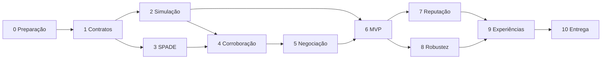

# Plano de desenvolvimento incremental — Etapas 0 a 10

> **Roteiro de acompanhamento (revisto em 2026-11-12).** Este roteiro deriva da [estratégia](architecture.md#estratégia-técnica-e-algoritmos) e dos [requisitos](../README.md#requisitos-e-fontes). `- [x]` indica uma tarefa com implementação/evidência verificada; `- [ ]` indica trabalho pendente, parcialmente demonstrado ou aprovação ainda não comprovada. As listas de ficheiros são orientadoras e não implicam que todos existam.

[README](../README.md) · [Arquitetura](architecture.md) · [Protocolos](protocols.md) · [Equipa](team-tasks.md) · [Avaliação](evaluation.md) · [Decisões](architecture.md#decisões-pendentes)

## Regras de progressão

- Em cada etapa: **preparar → implementar → executar → testar → validar → integrar → avançar**.
- Não avançar sem cumprir os critérios de conclusão e rever eventuais alterações de contrato.
- **MVP ao terminar a Etapa 6**; melhorar reputação, falhas e avaliação nas Etapas 7–10.
- Na implementação, começar sempre por reler a branch e os ficheiros afetados. Se já existir código útil, **adaptar o roteiro ao código existente**, não apagar trabalho por preferência.
- Distinguir testes planeados de testes efetivamente executados; anexar logs/resultados apenas depois de correr o sistema.

## Dependências gerais



Alguma documentação e infraestrutura de testes da Etapa 10 podem começar antes; o seu fecho depende das experiências.

---

## Etapa 0 — Auditoria e preparação

**Objetivo:** estabelecer uma base reprodutível e identificar o trabalho existente antes de qualquer refatorização.

**Pré-requisitos:** acesso ao repositório `Agents-Project`, Git e Python nos computadores dos três elementos; consenso para iniciar implementação.

**Ficheiros envolvidos:** atuais `README.md`, `requirements.md` (manter inalterado), `.gitignore`, futuros `requirements.txt`/`requirements-dev.txt` e configuração do ambiente; documentação em `docs/`.

**Tarefas concretas:**

- [ ] Confirmar a aprovação da documentação e identificar a branch de trabalho.
- [x] Listar todos os ficheiros e branches do repositório; examinar código desenvolvido entretanto.
- [x] Inventariar partes funcionais, dependências, funcionalidades incompletas e riscos.
- [x] Distinguir o ficheiro existente `requirements.md` da futura lista Python `requirements.txt`.
- [ ] Acordar versão de Python e testar instalação do SPADE em cada computador.
- [x] Configurar e testar a infraestrutura XMPP prevista para os testes locais.
- [x] Criar `.gitignore` para ambientes virtuais, caches, segredos e resultados volumosos.
- [x] Estabelecer convenções Git, `src/`, `tests/`, configuração e registo de decisões.
- [x] Criar script mínimo ou teste de arranque/paragem de um agente SPADE.

**Evidência de execução (11-11-2026):** `requirements.txt` fixa `spade==4.1.4`; `.gitignore`, `src/`, `tests/`, `config/`, `docs/` e `hello_agent.py` existem. O servidor XMPP e a comunicação SPADE foram testados localmente, e a auditoria ao repositório identificou dependências e lacunas. **Ainda não há comprovação da aprovação formal da documentação nem de instalação/teste em todos os três computadores** — por isso essas duas tarefas permanecem por assinalar.

**Dependências:** nenhuma etapa técnica anterior; depende da **aprovação da proposta** pelos três elementos. Permite iniciar as Etapas 1–3.

**Testes a realizar:** importação de SPADE; início e fim de um agente sem erros; conectividade ao servidor; repetição por outro colega a partir de instruções escritas.

**Critérios de conclusão:** versão de Python/SPADE e modo de executar acordados e verificados; todos conseguem reproduzir o teste mínimo; requisitos existentes preservados.

**Resultado esperado:** repositório preparado e auditado, com ambiente comum e decisões de arranque registadas.

**Erros prováveis/diagnóstico:** versões inconsistentes, credenciais XMPP inválidas, porta ocupada e *virtualenv* acidentalmente versionado. Documentar a causa e corrigir apenas após reproduzir o erro.

---

## Etapa 1 — Modelos do domínio e contratos partilhados

**Objetivo:** eliminar ambiguidades entre observação, incidente, missão, recurso e mensagem antes de implementar módulos independentes.

**Pré-requisitos:** Etapa 0 concluída; tipos de participantes discutidos.

**Ficheiros envolvidos:** `src/isia/domain/models.py`, `events.py`, `incident_state.py`, `communication/messages.py`, `docs/protocols.md`, `tests/unit/test_models.py`.

**Tarefas concretas:**

- [x] Definir `Position` (coordenadas válidas), `Observation` (fonte, tipo, instante, posição), `Incident`, `ResourceState`, `Mission` e `Bid`.
- [x] Separar `intensity_score` opcional de `confidence_score`, mantendo ambos entre 0 e 1.
- [x] Escolher unidades: posições inteiras na grelha, distância euclidiana, tempo/ETA em segundos simulados, autonomia percentual, custo energético em pontos percentuais, prioridade inteira e carga entre 0 e 1.
- [x] Definir `event_id`, `incident_id`, `mission_id`, `message_id` e `conversation-id` sem sobreposição semântica.
- [x] Criar enumerações de estados para incidentes e recursos; especificar transições permitidas.
- [x] Definir esquema JSON com `schema_version` e validação de campos obrigatórios.
- [x] Especificar a deduplicação local por `message_id`; a reserva atómica e a prevenção de dupla missão permanecem para as etapas posteriores.
- [x] Escrever exemplos válidos e inválidos.
- [ ] Pedir revisão cruzada dos exemplos a quem implementará agentes e simulação.

**Implementação integrada na `main`:** `IncidentState`, contratos JSON
independentes de SPADE, serialização/desserialização dos modelos e
deduplicação por `message_id` estão implementados e testados. O contrato
estrutural de `CFP` exige missão, incidente, conversa, tarefa, destino,
capacidade, prioridade e prazo. A retenção proposta de mensagens duplicadas é
de 600 segundos simulados, sem expiração operacional nesta etapa. Mantêm-se
pendentes a revisão cruzada e a aprovação formal dos contratos pelos três
elementos; a reserva atómica e missões incompatíveis pertencem às etapas
posteriores.

**Dependências:** Etapa 0. Bloqueia a integração das Etapas 2, 3, 4 e 5 até os contratos serem acordados.

**Testes a realizar:** serializar/desserializar objetos; validar limites (posição fora do mapa, energia negativa, identificador vazio); rejeitar transições inválidas; idempotência de uma mensagem repetida.

**Critérios de conclusão:** modelos e contratos documentados, testados e aprovados pelos três elementos; cada componente sabe que objetos recebe e devolve.

**Resultado esperado:** biblioteca mínima de dados consistente, sem agentes nem simulação completos.

**Erros prováveis/diagnóstico:** campos divergentes, mistura de relógio real/simulado, circularidade de imports e nomes ambíguos. Corrigir contratos antes de criar novos consumidores.

---

## Etapa 2 — Ambiente 2D e geração de observações

**Objetivo:** simular ocorrências reais e não criminosas, com perceções imperfeitas e resultados de referência para posterior avaliação.

**Pré-requisitos:** `Position`, `Observation` e `Incident` definidos na Etapa 1.

**Ficheiros envolvidos:** `simulation/world.py`, `clock.py`, `scenario.py`, `movement.py` (base), `config/environment.json`, `tests/unit/test_world.py`.

**Tarefas concretas:**

- [x] Implementar reserva 2D configurável, limites espaciais e posições iniciais.
- [x] Separar `ground_truth` (eventos reais, resultados, posição real) da API de observações dos agentes.
- [x] Definir tipos de evento: ameaça simulada e eventos benignos potencialmente confundíveis.
- [x] Gerar observações com alcance, sensibilidade, falsos positivos e falsos negativos parametrizáveis.
- [x] Representar fontes heterogéneas (acústicas, visuais, humanas) com capacidades distintas.
- [x] Criar relógio de simulação em segundos, com avanço explícito e validação.
- [x] Integrar o relógio com eventos, janelas de corroboração e movimento.
- [x] Guardar a semente aleatória e parâmetros por execução.
- [x] Criar o cenário mínimo com uma ocorrência e duas fontes próximas.

**Implementação:** `world.py` valida a grelha e as posições; `clock.py` fornece
o tempo simulado. `scenario.py` gera leituras por fonte, separa a verdade de
referência e guarda configuração, semente, avanços e resultados por execução.
`movement.py` calcula deslocamentos na grelha a partir do tempo decorrido.
`config/environment.json` contém uma ameaça móvel e duas fontes próximas.
Os testes em `tests/unit/test_world.py` verificam alcance, erros de perceção,
capacidades, janelas temporais, movimento, separação da verdade e reprodução
do registo guardado. Os testes anteriores do mapa e relógio foram preservados.
A demonstração no terminal e as limitações estão descritas no
[README](../README.md#mapa-2d-e-relógio-da-simulação).
A janela permite consultar evidências; a decisão de corroboração e a execução
de missões continuam nas Etapas 4 e 6.

**Dependências:** Etapa 1. Pode decorrer **em paralelo com a Etapa 3**, após os contratos estarem estáveis. Alimenta as Etapas 4 e 6.

**Testes a realizar:** fronteiras do mapa; reprodutibilidade com mesma semente num módulo determinístico; fontes fora de alcance; geração de um evento benigno; observação sem revelação da verdade.

**Critérios de conclusão:** o simulador produz observações interpretáveis a partir de eventos de referência e não expõe a verdade aos agentes decisores.

**Resultado esperado:** ambiente executável/testável isoladamente, sem exigir ainda múltiplos agentes.

**Erros prováveis/diagnóstico:** índices fora da grelha, escalas temporais incompatíveis e uso indevido de `true_incidents` em lógica do agente.

---

## Etapa 3 — Primeiros agentes e comunicação SPADE

**Objetivo:** provar a comunicação real entre dois agentes autónomos, antes de construir protocolos elaborados.

**Pré-requisitos:** servidor XMPP funcional, contrato de mensagem aprovado e SPADE instalado.

**Ficheiros envolvidos:** `agents/sensor.py`, `agents/informant.py` (esqueleto), `communication/transport.py`, `main.py`, `tests/integration/test_messaging.py`.

**Tarefas concretas:**

- [x] Criar `SensorAgent` mínimo com `setup()` e comportamento de receção.
- [x] Criar segundo agente com `CyclicBehaviour` e, quando útil, `PeriodicBehaviour`.
- [x] Implementar envio/receção com `spade.message.Message` e `Template`.
- [x] Adicionar `performative`, `ontology`, referência de conversação e corpo JSON validado.
- [x] Fazer uma troca `VERIFY_REQUEST` → `VERIFY_RESPONSE` com IDs e timeout.
- [x] Tratar mensagem inválida, agente ausente, timeout e desligamento limpo.
- [x] Registar eventos de envio/receção para diagnóstico.

**Evidência (PR #5, integrado em 11-11-2026):** `agents/sensor.py` utiliza `OneShotBehaviour` e `Template`; `agents/informant.py` utiliza `CyclicBehaviour` e `Template` (não foi necessário `PeriodicBehaviour`). `communication/transport.py` valida metadados e corpo; `main.py` inicia/encerra os dois agentes. Foram testados contratos, templates, rejeições, correlação, timeouts e conversas independentes, além de troca real SPADE/XMPP no servidor local. Um teste unitário com mocks não substitui a demonstração XMPP, realizada separadamente.

**Dependências:** Etapas 0 e 1; pode decorrer **em paralelo com a Etapa 2**. Necessária à Etapa 4.

**Testes a realizar:** receção de conteúdo exato por outro JID; mensagem rejeitada por template inadequado; timeout; duas conversações correlacionadas separadamente.

**Critérios de conclusão:** dois agentes independentes enviam e recebem mensagens reais sem acesso direto ao estado interno um do outro.

**Resultado esperado:** teste de integração SPADE/XMPP estável e reproduzível.

**Erros prováveis/diagnóstico:** ausência de `await`, comportamento bloqueado, templates demasiado restritos, configuração XMPP e encerramento prematuro.

---

## Etapa 4 — Deteção e corroboração distribuída

**Objetivo:** permitir verificar observações através de informação de outras fontes, sem consultar a verdade do ambiente.

**Pré-requisitos:** ambiente produz observações; agentes já comunicam; contratos de incidentes existentes.

**Ficheiros envolvidos:** `reasoning/corroboration.py`, `agents/sensor.py`, `agents/informant.py`, `communication/protocols.py`, `tests/unit/test_corroboration.py`, `tests/integration/test_verification.py`.

**Tarefas concretas:**

- [x] Associar observações a ocorrências com regras espacial/temporal explícitas.
- [x] Selecionar fontes elegíveis para corroboração por proximidade/capacidade conhecida.
- [x] Enviar pedidos de verificação e aguardar respostas até ao prazo.
- [x] Classificar resposta: evidência compatível, evidência contraditória, ausência informativa, sem dados e resultado auxiliar inconclusivo.
- [x] Deduplicar por `event_id` e `message_id` e não contar *forwarding* como observações novas.
- [x] Calcular pontuação preliminar e grau de informação disponível.
- [x] Decidir, segundo regra simples inicial, observar ou solicitar verificação móvel.
- [x] Armazenar histórico necessário ao diagnóstico, sem supor que fontes correlacionadas são independentes.

**Evidência (PR #9 integrado na `main`, 11-11-2026):** `reasoning/corroboration.py` associa leituras por distância euclidiana e janela temporal, seleciona fontes e implementa as categorias `compatible`, `contradictory`, `informative_absence` e `no_data`, além do resultado auxiliar conservador `inconclusive`. A deduplicação, a correlação, o histórico local e a decisão preliminar foram preservados, sem consulta a `ground_truth`. `agents/sensor.py`, `agents/informant.py` e `verification_demo.py` demonstraram o fluxo real simulador → observações locais → XMPP → evidências → decisão. A última suite local no Ubuntu, com SPADE, executou **249 testes, OK**. As demonstrações reais de verificação e Contract Net foram aprovadas no fluxo normal; contradição, ausência informativa, deduplicação e respetivos casos-limite foram validados por testes automatizados, não necessariamente por XMPP real. A associação é uma correlação candidata; a gestão completa do ciclo de vida do objeto `Incident` pertence ao MVP de etapas posteriores. O histórico é consultável **apenas durante a vida do agente**.

**Pendência formal:** a implementação técnica da classificação está concluída e as correções recentes de ausência informativa e deduplicação foram validadas localmente nesta branch, mas a integração final no PR ainda está pendente. Continua dependente de aprovação formal do grupo a definição concreta das regras de incompatibilidade/compatibilidade, dos critérios de cobertura e janela de observação, da sensibilidade das fontes e da interpretação dos falsos negativos. Ausência de resposta, timeout ou falha de comunicação continuam a ser `no_data`, nunca ausência informativa.

**Dependências:** Etapas 2 e 3. É base da Etapa 5 e do módulo de reputação na Etapa 7.

**Testes realizados:** leituras compatíveis, tipos de evento diferentes sem relação explícita, regras explícitas de compatibilidade/incompatibilidade, ausência informativa com cobertura/janela/capacidade válidas, falta de cobertura, período inadequado, ausência de capacidade, `no_data` por timeout, duplicação, mensagens tardias, correlação e conflito entre evidências.

**Critérios de conclusão:** uma ocorrência é tratada por comunicação entre pares; a evidência explica a decisão; duplicações e timeouts não provocam falsas confirmações.

**Resultado esperado:** avaliação distribuída de ocorrências com resultados explicáveis.

**Erros prováveis/diagnóstico:** janelas incompatíveis, agregação duplicada, falsas certezas por ausência de resposta e confusão entre ausência de dados e evidência negativa.

---

## Etapa 5 — Contract Net e reserva de recursos

**Objetivo:** alocar uma missão a um recurso autónomo elegível sem despachante central.

**Pré-requisitos:** ocorrência avaliada, recurso com posição/capacidade e mensagens correlacionadas.

**Ficheiros envolvidos (implementação atual):** `src/isia/reasoning/allocation.py`, `src/isia/communication/messages.py`, `src/isia/communication/transport.py`, `src/isia/agents/mobile.py`, `contract_net_demo.py`, `tests/unit/test_allocation.py`, `tests/unit/test_contract_net_demo.py` e `tests/unit/test_mobile_agent.py`. Os nomes `communication/protocols.py` e `tests/integration/test_allocation.py` eram referências de planeamento e ainda não existem como módulos específicos. `agents/drone.py`, `vehicle.py` e `ranger.py` foram acrescentados na Etapa 6.

**Tarefas concretas:**

- [x] Implementar o iniciador local por ocorrência, sem centralizador permanente. Evidência: `ContractNetInitiatorAgent` e `ContractNetBehaviour` em `contract_net_demo.py`; `MissionRegistry` mantém a criação local/idempotente da missão. Testes: `test_repeated_decision_returns_same_mission` e testes do iniciador no `test_contract_net_demo.py`.
- [x] Criar `CFP` com missão, capacidade exigida, posição, prioridade e prazo. Evidência: `build_cfp_message()` em `allocation.py`. Testes: `test_build_cfp_contains_mission_contract_and_correlation_ids`, `test_cfp_round_trip_json_preserves_contract` e validação de tempos/IDs.
- [x] Implementar nos recursos a decisão autónoma de `propose`/`refuse`. Evidência: `evaluate_cfp()` e `MobileResourceAgent.ContractNetBehaviour`. Testes: `test_evaluate_cfp_rejects_ineligible_resources` e `test_mobile_agent.py`; os testes SPADE dependem de `spade==4.1.4`.
- [x] Aplicar filtros de elegibilidade: disponibilidade, competência e reserva mínima de autonomia. Evidência: `evaluate_cfp()`. Testes: recurso indisponível, capacidade incompatível e autonomia insuficiente em `test_allocation.py` e `test_mobile_agent.py`.
- [x] Calcular custo comparável por ETA/energia/carga; definir unidades e normalização. Evidência: `_proposal_cost()`/`select_best_proposal()`; ETA em segundos simulados, energia em pontos percentuais e carga em fração `0..1`. Testes: `test_selects_lowest_normalized_cost_not_first_response` e `test_equal_cost_uses_resource_id_as_tiebreaker`.
- [x] Ordenar propostas válidas e escolher uma; rejeitar as restantes. Evidência: `select_best_proposal()` e envio de `REJECT` em `ContractNetBehaviour`. Testes: seleção determinística, duplicação, mensagens inválidas e propostas tardias.
- [x] Confirmar a reserva no agente escolhido antes de marcar a missão `RESERVED`. Evidência: `LocalResourceReservation.reserve()`, `MobileResourceAgent.AcceptBehaviour` e validação de `STATUS` em `contract_net_demo.py`. Testes: idempotência, concorrência, correlação de confirmação e demonstração XMPP normal validada no Ubuntu.
- [x] Tratar propostas tardias, falta de propostas, recusa da reserva e uma nova ronda limitada. Evidência: `AllocationOutcome`, `ContractNetResult` e limite `max_rounds`/`CONTRACT_MAX_ROUNDS` em `contract_net_demo.py`. Testes unitários determinísticos cobrem ausência, recusa explícita, segunda ronda, timeout, mensagens tardias e concorrência; os cenários de falha XMPP não foram todos executados contra servidor real.

**Dependências:** Etapa 4 e contratos das Etapas 1–3. A execução das missões (Etapa 6) depende desta etapa.

**Testes realizados:** duas patrulhas com custos distintos (`test_selects_lowest_normalized_cost_not_first_response`); recurso sem autonomia (`test_evaluate_cfp_rejects_ineligible_resources`); ambas indisponíveis (`test_two_unavailable_resources_leave_mission_unreserved`); proposta/mensagem atrasada (`test_late_proposal_from_previous_round_is_not_valid_for_new_cfp`); duas missões a disputar o mesmo recurso (`test_concurrent_missions_only_one_can_reserve`). Os testes de comportamento SPADE usam mocks e são executáveis quando `spade==4.1.4` está instalado.

**Critérios de conclusão:** cumpridos para a alocação implementada: a negociação termina em reserva válida ou em resultado explícito (`no_eligible_proposals`, `reservation_rejected` ou `confirmation_unknown`); `LocalResourceReservation` impede dupla reserva incompatível. A execução e recuperação de missões continuam reservadas à Etapa 6.

**Resultado esperado:** uma missão atribuída por mensagens SPADE a um agente móvel autónomo. Validado no cenário normal através de `contract_net_demo.py`; os cenários de falha foram validados por testes determinísticos/mocks.

**Auditoria da etapa:** a demonstração isolada continua em `contract_net_demo.py`.
A Etapa 6 integra `MissionRegistry` no `IncidentSensorAgent`, que herda a
corroboração do `SensorAgent` e inicia a negociação da própria ocorrência.
A aprovação formal dos contratos pelo grupo permanece pendente.

**Erros prováveis/diagnóstico:** escolha antes do prazo, custo com unidades incompatíveis e corrida entre duas aceitações; usar testes de concorrência e logs de conversação.

---

## Etapa 6 — Movimento, resultado e MVP de ponta a ponta

**Objetivo:** completar um ciclo de incidente, da deteção ao encerramento.

**Pré-requisitos:** contratos, simulação, corroboração e atribuição implementados.

**Ficheiros envolvidos:** `src/isia/simulation/movement.py`, `scenario.py`, `runner.py`, `src/isia/agents/mobile.py`, `incident.py`, `drone.py`, `vehicle.py`, `ranger.py`, `src/isia/reasoning/allocation.py`, `src/isia/communication/messages.py`, `src/isia/domain/models.py` e `tests/scenarios/test_mvp.py`. As transições existentes de `domain/incident_state.py` são reutilizadas.

**Tarefas concretas:**

- [x] Definir movimento simplificado no mapa, custo de tempo e gasto energético.
- [x] Implementar reserva → deslocação → verificação → comunicação → regresso/libertação.
- [x] Validar que recursos não se deslocam para locais impossíveis nem esgotam energia sem tratamento.
- [x] Produzir `MISSION_RESULT` (confirmado, não confirmado, inconclusivo ou falha).
- [x] Quando necessário, desencadear pedido de resposta aos `RangerAgent` por protocolo documentado.
- [x] Atualizar estado do incidente, encerrar ou voltar a negociar se a missão falhar.
- [x] Registar linha temporal da execução e os principais estados.
- [x] Executar o caso mínimo com **dois sensores e pelo menos duas patrulhas candidatas**.

**Dependências:** Etapas 2–5. Marco prévio às Etapas 7–10.

**Testes realizados na implementação do PR #12:** 19 testes em `tests/scenarios/test_mvp.py`: trajetória,
energia e regresso; passos fracionários/grandes; destino impossível; energia
insuficiente ou perdida; interrupção; exceção na inspeção; resultados confirmado,
não confirmado e inconclusivo; nova negociação; limite de tentativas; falha do
guarda; correlação e validação de resultados; replay de ACCEPT após libertação;
falha de envio sem impedir o regresso. A suite completa passou 358 testes.

Com o ambiente Python e as dependências de `requirements.txt` ativos, conforme
as instruções do README:

```bash
PYTHONPATH=src python -m unittest discover -s tests -v
PYTHONPATH=src python -m isia.simulation.runner
```

**Evidência de execução (12-11-2026):** no MVP local, os dois sensores corroboram,
drone e veículo propõem, o drone verifica e o guarda responde. Incidente `closed`,
reservas libertadas, recursos nas posições iniciais, energia final 94%/100%/90%.
O mesmo ciclo passou ligado a um servidor XMPP temporário, com os cinco agentes
no mesmo processo; a otimização de entrega do SPADE impede atribuir a esse teste
prova de transporte de todas as mensagens pela rede.

**Critérios de conclusão (MVP):** um alerta suscita corroboração; uma patrulha é escolhida por negociação, executa a missão e comunica resultado; a ocorrência chega a estado terminal sem despachante central.

**Resultado obtido:** **MVP funcional demonstrável**. Ainda não é entrega final: reputação, falhas sistemáticas, cenários e visualização permanecem por completar.

**Limites:** grelha sem obstáculos, inspeção local idealizada e intervenção do
guarda simulada sem alterar os eventos globais. Até duas tentativas por tarefa;
falha/inconclusivo permite outra patrulha. Silêncio após ACCEPT ou durante a
missão termina como `unresolved`, sem nova atribuição automática. O regresso
continua localmente; falha energética imobiliza e liberta a reserva com estado
`unavailable`. A perda do iniciador e a recuperação distribuída ficam na Etapa 8.
O MVP foi integrado na `main` pelo PR #12 em 12-11-2026.

**Erros prováveis/diagnóstico:** relógios incompatíveis, missão não encerrada, estado do recurso ocupado indefinidamente e regresso omitido.

---

## Etapa 7 — Reputação e política de resposta

**Objetivo:** melhorar avaliação e decisão usando histórico de fiabilidade e regras explícitas de mobilização.

**Pré-requisitos:** resultados de missões e verdade de referência disponíveis em camada de avaliação.

**Ficheiros envolvidos:** `reasoning/reputation.py`, `corroboration.py`, `policy.py`, `config/agents.json`, `tests/unit/test_reputation.py`, `test_policy.py`, `agents/sensor.py`, `agents/incident.py`, `simulation/runner.py` e `tests/scenarios/test_mvp_policy.py`.

**Tarefas concretas:**

- [x] Definir quando uma observação pode ser avaliada contra um resultado suficientemente fundamentado.
- [x] Calcular reputação suavizada `(a+α)/(a+b+α+β)` com parâmetros experimentais explícitos.
- [x] Evitar atualizar confiança apenas por concordância entre agentes.
- [x] Combinar confiança das fontes com evidência temporal, espacial e diversidade de modalidades.
- [x] Distinguir *score* de suspeita de probabilidade calibrada; documentar significado.
- [x] Implementar política configurável: observar, verificar com patrulha, solicitar rangers, encerrar.
- [x] Verificar sensibilidade a limiares e gravidade do evento, evitando copiar 30%/75% como valores científicos.
- [x] Registar os fatores determinantes da decisão para posterior análise.

- [ ] Aprovar formalmente os parâmetros com a equipa.
- [x] Ligar resultados de missão a adjudicação automática com cobertura e referências suficientes.

**Correção da base (12-11-2026):** confirmou-se a Etapa 6 em `94e60ca`, integrada
pelo PR #12, e a correção `aacbe34`, integrada pelo PR #13. Esta branch estava em
`ee0fc98` e foi avançada para `96fd866`, preservando as alterações locais num
stash e num arquivo com hashes verificados. A Etapa 7 reutiliza agora
`IncidentSensorAgent`, `MissionExecution` e o contrato `MISSION_RESULT` existentes;
a implementação paralela de coordenação/movimento deixou de fazer parte do código ativo.

**Implementação local:** reputação com prior Beta, score ponderado e política
configurável. O runner aceita `--policy config/agents.json` e pesos previamente
avaliados. O sensor recebe apenas esses pesos. O resultado `not_confirmed` mantém
o encerramento operacional da Etapa 6, sem ser usado como refutação para aprender.
A aprovação dos parâmetros permanece pendente; ver [reputação e política](reputation-policy.md).

**Adjudicação (12-11-2026):** `result_from_mission()` só aprende com `verify_incident`
confirmado, com célula e instante inspecionados dentro de `adjudication`. O runner
aplica-a depois da decisão; `not_confirmed` e o guarda continuam sem atualizar.

**Dependências:** Etapas 4 e 6. Pode desenvolver-se **em paralelo com a Etapa 8**.

**Testes locais:** fonte nova, histórico incorreto, referências insuficientes, correlação, gravidade e limiares; ligação da decisão às patrulhas e aos guardas do MVP, com regresso e libertação. O teste de envio direto ao guarda injeta a decisão para isolar a ligação; os cálculos da política são testados separadamente.

**Verificação desta integração (12-11-2026):** a base `96fd866` passou 365 testes;
após adaptação, a suite completa passou **393 testes, OK**. O runner normal
terminou `closed`, com drone e guarda, reservas libertadas e energia 94%/100%/90%.
Com a configuração da Etapa 7, terminou `expired`, decisão `observe`, sem missões.
`git diff --check` passou. Não foi repetida a demonstração XMPP nesta integração.

**Critérios de conclusão:** pontuações são reproduzíveis, explicáveis e têm comportamento sensato nos extremos; atualizações de reputação só ocorrem quando justificadas.

**Resultado esperado:** decisão adaptada à fiabilidade das fontes, com parâmetros documentados e testados.

**Erros prováveis/diagnóstico:** feedback circular, reputações extremas com poucos dados e limiares tratados como probabilidades validadas.

---

## Etapa 8 — Falhas, atrasos e escassez

**Objetivo:** avaliar o comportamento do sistema com perdas de mensagens, indisponibilidade e limites de recursos.

**Pré-requisitos:** MVP, timeouts, estados e reserva de recursos funcionais.

**Ficheiros envolvidos:** `simulation/runner.py`, `config/faults.json`, `tests/integration/test_faults.py` e [falhas](faults.md).

**Tarefas concretas:**

- [x] Implementar injeção parametrizada de atraso e perda no adaptador de comunicação da aplicação.
- [x] Tratar duplicação e chegada tardia sem repetir efeitos operacionais.
- [x] Simular indisponibilidade temporária de sensores, drones, veículos ou rangers.
- [x] Limitar retransmissões e número de rondas de negociação.
- [x] Definir estados de incidente quando não há confirmação ou recursos.
- [x] Definir e testar política de recuperação quando falha o iniciador local.
- [x] Simular bateria/combustível insuficiente e recurso ocupado.
- [x] Guardar probabilidades/parâmetros e sementes utilizadas.

**Implementação (12-11-2026):** o transporte local do runner aceita `faults`
(perda aleatória com semente, perda por tipo, atraso, duplicação, agentes
indisponíveis e recurso ocupado após proposta). Não há retransmissões; as rondas
continuam limitadas por `max_attempts`. Recuperação do iniciador: o recurso
termina, regressa e liberta a reserva; o incidente fica `unresolved`. A
indisponibilidade dura toda a execução de janela única. Ver [falhas](faults.md).

**Verificação (12-11-2026):** a suite completa passou **410 testes, OK**; os testes
de falhas repetidos três vezes passaram. A injeção não se aplica ao XMPP.

**Dependências:** Etapa 6; pode decorrer **em paralelo com a Etapa 7**. Necessária aos cenários de robustez da Etapa 9.

**Testes a realizar:** perda de `CFP` e `ACCEPT`; duplicação de `MISSION_RESULT`; recurso que desaparece após proposta; interrupção do iniciador; nenhuma patrulha disponível.

**Critérios de conclusão:** falhas conduzem a estados e resultados explícitos, sem bloquear toda a simulação nem atribuir missões incompatíveis.

**Resultado esperado:** sistema robusto o suficiente para comparar desempenho sob degradação controlada.

**Erros prováveis/diagnóstico:** loops de retransmissão, deadlocks, falhas silenciosas e supor indevidamente que se validou a robustez do servidor XMPP.

---

## Etapa 9 — Métricas, cenários e avaliação

**Objetivo:** medir, comparar e interpretar o comportamento do sistema de modo reproduzível.

**Pré-requisitos:** MVP, reputação/política e mecanismos de falha operacionais; definições claras de TP/FP/TN/FN.

**Ficheiros envolvidos:** `evaluation/metrics.py`, `collector.py`, `simulation/runner.py`, `config/scenarios/*.json`, `results/` e `docs/experiments.md` (ou registos na pasta acordada).

**Tarefas concretas:**

- [ ] Definir unidade de avaliação: observação, incidente ou zona/intervalo temporal.
- [ ] Implementar contagem TP, FP, TN e FN, com tratamento explícito de denominadores zero.
- [ ] Medir latências, missões concluídas, energia, mensagens, duplicação e incidentes não resolvidos.
- [ ] Definir cenário A: operação normal; B: ruído e falsos positivos; C: falhas e escassez.
- [ ] Fixar parâmetros de cenário e condições iniciais em ficheiros versionados.
- [ ] Executar diferentes sementes quando há aleatoriedade; registar o número de repetições.
- [ ] Comparar políticas simples: sem corroboração, sem reputação e seleção da patrulha mais próxima.
- [ ] Produzir tabelas/gráficos e discutir compromissos entre precisão, rapidez e custo.
- [ ] Registar falhas observadas, limitações e incerteza — **sem inventar resultados**.

**Dependências:** Etapas 7 e 8; a infraestrutura de métricas pode ser iniciada durante a Etapa 2. Permite fechar a Etapa 10.

**Testes a realizar:** métricas sobre dados sintéticos com contagens conhecidas; armazenamento; repetição controlada de cenário; execução sem eventos para verificar casos de denominador zero.

**Critérios de conclusão:** pelo menos três cenários executados, métricas reproduzíveis, configurações registadas e análise escrita de resultados e limitações.

**Resultado esperado:** relatório de desempenho baseado em execuções efetivas, não em expectativas.

**Erros prováveis/diagnóstico:** métricas entre unidades diferentes, comparação injusta entre políticas, amostras pequenas e mistura de resultados previstos com medidos.

---

## Etapa 10 — Visualização, documentação e apresentação

**Objetivo:** preparar entrega executável, explicável e reproduzível.

**Pré-requisitos:** funcionalidades concluídas e resultados experimentais disponíveis.

**Ficheiros envolvidos:** `evaluation/visualisation.py`, `README.md`, `docs/`, `docs/presentation/`, configurações e scripts de arranque.

**Tarefas concretas:**

- [ ] Mostrar em grelha as fontes, ocorrências, patrulhas, estados e deslocações.
- [ ] Representar as mensagens principais e a passagem por estados do incidente.
- [ ] Mostrar métricas acumuladas e resultado final do cenário.
- [ ] Garantir que o observador/visualizador não toma decisões por agentes.
- [ ] Documentar instalação, servidor XMPP, configuração e comando único de execução.
- [ ] Descrever arquitetura, formatos de mensagem, protocolos, algoritmos, falhas e escolhas descartadas.
- [ ] Inserir dados verdadeiros dos três cenários, gráficos e limitações na apresentação.
- [ ] Fazer ensaio da demonstração com um colega a seguir apenas o `README`.
- [ ] Rever autorias, licenças e não publicar credenciais, dados privados nem materiais docentes sem autorização.
- [ ] Preparar demo interativa **ou** gravada e pacote de entrega segundo Moodle/docentes.

**Dependências:** Etapas 0–9, embora documentação e protótipo de visualização possam avançar em paralelo.

**Testes a realizar:** instalação limpa; execução integral; confirmação de dados exportados; gravação/GUI estável; revisão da apresentação.

**Critérios de conclusão:** terceiros conseguem executar ou compreender a demo; entregáveis correspondem ao enunciado; resultados apresentados foram realmente obtidos.

**Resultado esperado:** código, documentação, relatório de desempenho, visualização/demonstração, apresentação e slides prontos para entrega.

**Erros prováveis/diagnóstico:** passos manuais não documentados, GUI que bloqueia SPADE, paths absolutos, ficheiros de configuração locais e resultados experimentais sem proveniência.

---

## Primeiro trabalho efetivo após aprovação

1. Reabrir [decisões pendentes](architecture.md#decisões-pendentes), registar a aprovação do âmbito do MVP e dos contratos mínimos.
2. Criar **Issue «Etapa 0 — auditoria e ambiente SPADE»** com as caixas desta etapa.
3. Criar branch de implementação separada da branch de documentação.
4. Auditar código já existente; **não presumir que a `main` continua vazia**.
5. Preparar ambiente e executar teste de agente mínimo; publicar resultados no PR da Etapa 0.

## Checklist de marcos

- [ ] Etapas 0–1: ambiente e contratos aceites pela equipa.
- [x] Etapas 2–3: simulador mínimo e comunicação real entre agentes.
- [ ] Etapas 4–5: corroboração e negociação funcionais.
- [x] **Etapa 6: MVP validado em integração local dos comportamentos SPADE; demonstração ligada a XMPP também executada (agentes no mesmo processo).**
- [ ] Etapa 7: implementação local testada, com adjudicação automática; aprovação dos parâmetros pendente.
- [x] Etapa 8: falhas injetadas no transporte local com estados explícitos; queda de processo e XMPP não validados.
- [ ] Etapa 9: três cenários contrastantes medidos e analisados.
- [ ] Etapa 10: documentação e demonstração finais revistas.
