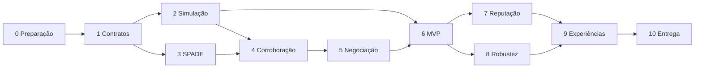

# Plano de desenvolvimento incremental — Etapas 0 a 10

> **Proposta para aprovação.** Este roteiro deriva da [estratégia](implementation-strategy.md) e dos [requisitos](references.md). As tarefas marcadas `- [ ]` **não estão concluídas**. Ficheiros Python e estruturas são sugeridos, não código já existente.

[README](../README.md) · [Arquitetura](architecture.md) · [Protocolos](protocols.md) · [Equipa](team-tasks.md) · [Avaliação](evaluation.md) · [Decisões](decisions.md)

## Regras de progressão

- Em cada etapa: **preparar → implementar → executar → testar → validar → integrar → avançar**.
- Não avançar sem cumprir os critérios de conclusão e rever eventuais alterações de contrato.
- **MVP ao terminar a Etapa 6**; melhorar reputação, falhas e avaliação nas Etapas 7–10.
- Na implementação, começar sempre por reler a branch e os ficheiros afetados. Se já existir código útil, **adaptar o roteiro ao código existente**, não apagar trabalho por preferência.
- Distinguir testes planeados de testes efetivamente executados; anexar logs/resultados apenas depois de correr o sistema.

## Dependências gerais

Alguma documentação e infraestrutura de testes da Etapa 10 podem começar antes; o seu fecho depende das experiências.

---

## Etapa 0 — Auditoria e preparação

**Objetivo:** estabelecer uma base reprodutível e identificar o trabalho existente antes de qualquer refatorização.

**Pré-requisitos:** acesso ao repositório `Agents-Project`, Git e Python nos computadores dos três elementos; consenso para iniciar implementação.

**Ficheiros envolvidos:** atuais `README.md`, `requirements` (manter inalterado), `.gitignore`, futuros `requirements.txt`/`requirements-dev.txt` e configuração do ambiente; documentação em `docs/`.

**Tarefas concretas:**

- [ ] Confirmar a aprovação da documentação e identificar a branch de trabalho.
- [ ] Listar todos os ficheiros e branches do repositório; examinar código desenvolvido entretanto.
- [ ] Inventariar partes funcionais, dependências, funcionalidades incompletas e riscos.
- [ ] Distinguir o ficheiro existente `requirements` da futura lista Python `requirements.txt`.
- [ ] Acordar versão de Python e testar instalação do SPADE em cada computador.
- [ ] Configurar e testar a infraestrutura XMPP prevista para os testes locais.
- [ ] Criar `.gitignore` para ambientes virtuais, caches, segredos e resultados volumosos.
- [ ] Estabelecer convenções Git, `src/`, `tests/`, configuração e registo de decisões.
- [ ] Criar script mínimo ou teste de arranque/paragem de um agente SPADE.

**Dependências:** nenhuma etapa técnica anterior; depende da **aprovação da proposta** pelos três elementos. Permite iniciar as Etapas 1–3.

**Testes a realizar:** importação de SPADE; início e fim de um agente sem erros; conectividade ao servidor; repetição por outro colega a partir de instruções escritas.

**Critérios de conclusão:** versão de Python/SPADE e modo de executar acordados e verificados; todos conseguem reproduzir o teste mínimo; requisitos existentes preservados.

**Resultado esperado:** repositório preparado e auditado, com ambiente comum e decisões de arranque registadas.

**Erros prováveis/diagnóstico:** versões inconsistentes, credenciais XMPP inválidas, porta ocupada e *virtualenv* acidentalmente versionado. Documentar a causa e corrigir apenas após reproduzir o erro.

---

## Etapa 1 — Modelos do domínio e contratos partilhados

**Objetivo:** eliminar ambiguidades entre observação, incidente, missão, recurso e mensagem antes de implementar módulos independentes.

**Pré-requisitos:** Etapa 0 concluída; tipos de participantes discutidos.

**Ficheiros envolvidos:** `src/isia/domain/models.py`, `events.py`, `incident_state.py`, `communication/messages.py`, `docs/protocols.md`, `tests/unit/test_models.py`.

**Tarefas concretas:**

- [ ] Definir `Position` (coordenadas válidas), `Observation` (fonte, tipo, instante, posição, intensidade), `Incident`, `ResourceState`, `Mission` e `Bid`.
- [ ] Escolher unidades: coordenadas, distância, tempo da simulação, energia, prioridade e ETA.
- [ ] Definir `event_id`, `incident_id`, `mission_id`, `message_id` e `conversation-id` sem sobreposição semântica.
- [ ] Criar enumerações de estados para incidentes e recursos; especificar transições permitidas.
- [ ] Definir esquema JSON com `schema_version` e validação de campos obrigatórios.
- [ ] Especificar invariantes: nenhuma dupla missão ativa incompatível; eventos duplicados não contam duas vezes.
- [ ] Escrever exemplos válidos e inválidos; pedir revisão cruzada a quem implementará agentes e simulação.

**Dependências:** Etapa 0. Bloqueia a integração das Etapas 2, 3, 4 e 5 até os contratos serem acordados.

**Testes a realizar:** serializar/desserializar objetos; validar limites (posição fora do mapa, energia negativa, identificador vazio); rejeitar transições inválidas; idempotência de uma mensagem repetida.

**Critérios de conclusão:** modelos e contratos documentados, testados e aprovados pelos três elementos; cada componente sabe que objetos recebe e devolve.

**Resultado esperado:** biblioteca mínima de dados consistente, sem agentes nem simulação completos.

**Erros prováveis/diagnóstico:** campos divergentes, mistura de relógio real/simulado, circularidade de imports e nomes ambíguos. Corrigir contratos antes de criar novos consumidores.

---

## Etapa 2 — Ambiente 2D e geração de observações

**Objetivo:** simular ocorrências reais e não criminosas, com perceções imperfeitas e resultados de referência para posterior avaliação.

**Pré-requisitos:** `Position`, `Observation` e `Incident` definidos na Etapa 1.

**Ficheiros envolvidos:** `simulation/world.py`, `clock.py`, `scenario.py`, `movement.py` (base), `config/environment.json`, `tests/unit/test_world.py`.

**Tarefas concretas:**

- [ ] Implementar reserva 2D configurável, limites espaciais e posições iniciais.
- [ ] Separar `ground_truth` (eventos reais, resultados, posição real) da API de observações dos agentes.
- [ ] Definir tipos de evento: ameaça simulada e eventos benignos potencialmente confundíveis.
- [ ] Gerar observações com alcance, sensibilidade, falsos positivos e falsos negativos parametrizáveis.
- [ ] Representar fontes heterogéneas (acústicas, visuais, humanas) com capacidades distintas.
- [ ] Criar relógio de simulação coerente para eventos, janelas de corroboração e movimento.
- [ ] Guardar a semente aleatória e parâmetros por execução.
- [ ] Criar o cenário mínimo com uma ocorrência e duas fontes próximas.

**Dependências:** Etapa 1. Pode decorrer **em paralelo com a Etapa 3**, após os contratos estarem estáveis. Alimenta as Etapas 4 e 6.

**Testes a realizar:** fronteiras do mapa; reprodutibilidade com mesma semente num módulo determinístico; fontes fora de alcance; geração de um evento benigno; observação sem revelação da verdade.

**Critérios de conclusão:** o simulador produz observações interpretáveis a partir de eventos de referência e não expõe a verdade aos agentes decisores.

**Resultado esperado:** ambiente executável/testável isoladamente, sem exigir ainda múltiplos agentes.

**Erros prováveis/diagnóstico:** índices fora da grelha, escalas temporais incompatíveis e uso indevido de `true_incidents` em lógica do agente.

---

## Etapa 3 — Primeiros agentes e comunicação SPADE

**Objetivo:** provar a comunicação real entre dois agentes autónomos, antes de construir protocolos elaborados.

**Pré-requisitos:** servidor XMPP funcional, contrato de mensagem aprovado e SPADE instalado.

**Ficheiros envolvidos:** `agents/sensor.py`, `agents/informant.py` (esqueleto), `communication/transport.py`, `main.py`, `tests/integration/test_messaging.py`.

**Tarefas concretas:**

- [ ] Criar `SensorAgent` mínimo com `setup()` e comportamento de receção.
- [ ] Criar segundo agente com `CyclicBehaviour` e, quando útil, `PeriodicBehaviour`.
- [ ] Implementar envio/receção com `spade.message.Message` e `Template`.
- [ ] Adicionar `performative`, `ontology`, referência de conversação e corpo JSON validado.
- [ ] Fazer uma troca `VERIFY_REQUEST` → `VERIFY_RESPONSE` com IDs e timeout.
- [ ] Tratar mensagem inválida, agente ausente, timeout e desligamento limpo.
- [ ] Registar eventos de envio/receção para diagnóstico.

**Dependências:** Etapas 0 e 1; pode decorrer **em paralelo com a Etapa 2**. Necessária à Etapa 4.

**Testes a realizar:** receção de conteúdo exato por outro JID; mensagem rejeitada por template inadequado; timeout; duas conversações correlacionadas separadamente.

**Critérios de conclusão:** dois agentes independentes enviam e recebem mensagens reais sem acesso direto ao estado interno um do outro.

**Resultado esperado:** teste de integração SPADE/XMPP estável e reproduzível.

**Erros prováveis/diagnóstico:** ausência de `await`, comportamento bloqueado, templates demasiado restritos, configuração XMPP e encerramento prematuro.

---

## Etapa 4 — Deteção e corroboração distribuída

**Objetivo:** permitir verificar observações através de informação de outras fontes, sem consultar a verdade do ambiente.

**Pré-requisitos:** ambiente produz observações; agentes já comunicam; contratos de incidentes existentes.

**Ficheiros envolvidos:** `reasoning/corroboration.py`, `agents/sensor.py`, `agents/informant.py`, `communication/protocols.py`, `tests/unit/test_corroboration.py`, `tests/integration/test_verification.py`.

**Tarefas concretas:**

- [ ] Associar observações a ocorrências com regras espacial/temporal explícitas.
- [ ] Selecionar fontes elegíveis para corroboração por proximidade/capacidade conhecida.
- [ ] Enviar pedidos de verificação e aguardar respostas até ao prazo.
- [ ] Classificar resposta: evidência compatível, evidência contraditória, ausência informativa ou sem dados.
- [ ] Deduplicar por `event_id` e `message_id` e não contar *forwarding* como observações novas.
- [ ] Calcular pontuação preliminar e grau de informação disponível.
- [ ] Decidir, segundo regra simples inicial, observar ou solicitar verificação móvel.
- [ ] Armazenar histórico necessário ao diagnóstico, sem supor que fontes correlacionadas são independentes.

**Dependências:** Etapas 2 e 3. É base da Etapa 5 e do módulo de reputação na Etapa 7.

**Testes a realizar:** duas leituras compatíveis, leituras temporalmente distantes, fonte sem cobertura, duplicação, mensagem tardia e divergência entre modalidades.

**Critérios de conclusão:** uma ocorrência é tratada por comunicação entre pares; a evidência explica a decisão; duplicações e timeouts não provocam falsas confirmações.

**Resultado esperado:** avaliação distribuída de ocorrências com resultados explicáveis.

**Erros prováveis/diagnóstico:** janelas incompatíveis, agregação duplicada, falsas certezas por ausência de resposta e confusão entre ausência de dados e evidência negativa.

---

## Etapa 5 — Contract Net e reserva de recursos

**Objetivo:** alocar uma missão a um recurso autónomo elegível sem despachante central.

**Pré-requisitos:** ocorrência avaliada, recurso com posição/capacidade e mensagens correlacionadas.

**Ficheiros envolvidos:** `reasoning/allocation.py`, `communication/protocols.py`, `agents/drone.py`, `vehicle.py`, `ranger.py` (esqueletos), `tests/integration/test_allocation.py`.

**Tarefas concretas:**

- [ ] Implementar o iniciador local por ocorrência, sem centralizador permanente.
- [ ] Criar `CFP` com missão, capacidade exigida, posição, prioridade e prazo.
- [ ] Implementar nos recursos a decisão autónoma de `propose`/`refuse`.
- [ ] Aplicar filtros de elegibilidade: disponibilidade, competência e reserva mínima de autonomia.
- [ ] Calcular custo comparável por ETA/energia/carga; definir unidades e normalização.
- [ ] Ordenar propostas válidas e escolher uma; rejeitar as restantes.
- [ ] Confirmar a reserva no agente escolhido antes de marcar a missão `RESERVED`.
- [ ] Tratar propostas tardias, falta de propostas, recusa da reserva e uma nova ronda limitada.

**Dependências:** Etapa 4 e contratos das Etapas 1–3. A execução das missões (Etapa 6) depende desta etapa.

**Testes a realizar:** duas patrulhas com custos distintos; recurso sem bateria; ambas indisponíveis; proposta atrasada; duas missões a disputar o mesmo recurso.

**Critérios de conclusão:** a negociação termina em reserva válida ou resultado explícito de ausência de recurso; nunca há dupla reserva incompatível.

**Resultado esperado:** uma missão atribuída por mensagens SPADE a um agente móvel autónomo.

**Erros prováveis/diagnóstico:** escolha antes do prazo, custo com unidades incompatíveis e corrida entre duas aceitações; usar testes de concorrência e logs de conversação.

---

## Etapa 6 — Movimento, resultado e MVP de ponta a ponta

**Objetivo:** completar um ciclo de incidente, da deteção ao encerramento.

**Pré-requisitos:** contratos, simulação, corroboração e atribuição implementados.

**Ficheiros envolvidos:** `simulation/movement.py`, `agents/drone.py`, `vehicle.py`, `ranger.py`, `domain/incident_state.py`, `simulation/runner.py`, `tests/scenarios/test_mvp.py`.

**Tarefas concretas:**

- [ ] Definir movimento simplificado no mapa, custo de tempo e gasto energético.
- [ ] Implementar reserva → deslocação → verificação → comunicação → regresso/libertação.
- [ ] Validar que recursos não se deslocam para locais impossíveis nem esgotam energia sem tratamento.
- [ ] Produzir `MISSION_RESULT` (confirmado, não confirmado, inconclusivo ou falha).
- [ ] Quando necessário, desencadear pedido de resposta aos `RangerAgent` por protocolo documentado.
- [ ] Atualizar estado do incidente, encerrar ou voltar a negociar se a missão falhar.
- [ ] Registar linha temporal da execução e os principais estados.
- [ ] Executar o caso mínimo com **dois sensores e pelo menos duas patrulhas candidatas**.

**Dependências:** Etapas 2–5. Marco prévio às Etapas 7–10.

**Testes a realizar:** trajetória válida; gasto energético; missão interrompida; resposta inconclusiva; percurso de ponta a ponta desde alerta a encerramento.

**Critérios de conclusão (MVP):** um alerta suscita corroboração; uma patrulha é escolhida por negociação, executa a missão e comunica resultado; a ocorrência chega a estado terminal sem despachante central.

**Resultado esperado:** **MVP funcional demonstrável**. Ainda não é entrega final: reputação, falhas sistemáticas, cenários e visualização permanecem por completar.

**Erros prováveis/diagnóstico:** relógios incompatíveis, missão não encerrada, estado do recurso ocupado indefinidamente e regresso omitido.

---

## Etapa 7 — Reputação e política de resposta

**Objetivo:** melhorar avaliação e decisão usando histórico de fiabilidade e regras explícitas de mobilização.

**Pré-requisitos:** resultados de missões e verdade de referência disponíveis em camada de avaliação.

**Ficheiros envolvidos:** `reasoning/reputation.py`, `corroboration.py`, `policy.py`, `config/agents.json`, `tests/unit/test_reputation.py`, `test_policy.py`.

**Tarefas concretas:**

- [ ] Definir quando uma observação pode ser avaliada contra um resultado suficientemente fundamentado.
- [ ] Calcular reputação suavizada, por exemplo `(a+α)/(a+b+α+β)`, com parâmetros aprovados.
- [ ] Evitar atualizar confiança apenas por concordância entre agentes.
- [ ] Combinar confiança das fontes com evidência temporal, espacial e diversidade de modalidades.
- [ ] Distinguir *score* de suspeita de probabilidade calibrada; documentar significado.
- [ ] Implementar política configurável: observar, verificar com patrulha, solicitar rangers, encerrar.
- [ ] Verificar sensibilidade a limiares e gravidade do evento, evitando copiar 30%/75% como valores científicos.
- [ ] Registar os fatores determinantes da decisão para posterior análise.

**Dependências:** Etapas 4 e 6. Pode desenvolver-se **em paralelo com a Etapa 8**.

**Testes a realizar:** fonte nova, fonte historicamente incorreta, ausência de confirmação, falsas observações correlacionadas, eventos graves com evidência insuficiente.

**Critérios de conclusão:** pontuações são reproduzíveis, explicáveis e têm comportamento sensato nos extremos; atualizações de reputação só ocorrem quando justificadas.

**Resultado esperado:** decisão adaptada à fiabilidade das fontes, com parâmetros documentados e testados.

**Erros prováveis/diagnóstico:** feedback circular, reputações extremas com poucos dados e limiares tratados como probabilidades validadas.

---

## Etapa 8 — Falhas, atrasos e escassez

**Objetivo:** avaliar o comportamento do sistema com perdas de mensagens, indisponibilidade e limites de recursos.

**Pré-requisitos:** MVP, timeouts, estados e reserva de recursos funcionais.

**Ficheiros envolvidos:** `communication/transport.py`, `communication/protocols.py`, `simulation/scenario.py`, `simulation/runner.py`, `tests/integration/test_faults.py`.

**Tarefas concretas:**

- [ ] Implementar injeção parametrizada de atraso e perda no adaptador de comunicação da aplicação.
- [ ] Tratar duplicação e chegada tardia sem repetir efeitos operacionais.
- [ ] Simular indisponibilidade temporária de sensores, drones, veículos ou rangers.
- [ ] Limitar retransmissões e número de rondas de negociação.
- [ ] Definir estados de incidente quando não há confirmação ou recursos.
- [ ] Definir e testar política de recuperação quando falha o iniciador local.
- [ ] Simular bateria/combustível insuficiente e recurso ocupado.
- [ ] Guardar probabilidades/parâmetros e sementes utilizadas.

**Dependências:** Etapa 6; pode decorrer **em paralelo com a Etapa 7**. Necessária aos cenários de robustez da Etapa 9.

**Testes a realizar:** perda de `CFP` e `ACCEPT`; duplicação de `MISSION_RESULT`; recurso que desaparece após proposta; interrupção do iniciador; nenhuma patrulha disponível.

**Critérios de conclusão:** falhas conduzem a estados e resultados explícitos, sem bloquear toda a simulação nem atribuir missões incompatíveis.

**Resultado esperado:** sistema robusto o suficiente para comparar desempenho sob degradação controlada.

**Erros prováveis/diagnóstico:** loops de retransmissão, deadlocks, falhas silenciosas e supor indevidamente que se validou a robustez do servidor XMPP.

---

## Etapa 9 — Métricas, cenários e avaliação

**Objetivo:** medir, comparar e interpretar o comportamento do sistema de modo reproduzível.

**Pré-requisitos:** MVP, reputação/política e mecanismos de falha operacionais; definições claras de TP/FP/TN/FN.

**Ficheiros envolvidos:** `evaluation/metrics.py`, `collector.py`, `simulation/runner.py`, `config/scenarios/*.json`, `results/` e `docs/experiments.md` (ou registos na pasta acordada).

**Tarefas concretas:**

- [ ] Definir unidade de avaliação: observação, incidente ou zona/intervalo temporal.
- [ ] Implementar contagem TP, FP, TN e FN, com tratamento explícito de denominadores zero.
- [ ] Medir latências, missões concluídas, energia, mensagens, duplicação e incidentes não resolvidos.
- [ ] Definir cenário A: operação normal; B: ruído e falsos positivos; C: falhas e escassez.
- [ ] Fixar parâmetros de cenário e condições iniciais em ficheiros versionados.
- [ ] Executar diferentes sementes quando há aleatoriedade; registar o número de repetições.
- [ ] Comparar políticas simples: sem corroboração, sem reputação e seleção da patrulha mais próxima.
- [ ] Produzir tabelas/gráficos e discutir compromissos entre precisão, rapidez e custo.
- [ ] Registar falhas observadas, limitações e incerteza — **sem inventar resultados**.

**Dependências:** Etapas 7 e 8; a infraestrutura de métricas pode ser iniciada durante a Etapa 2. Permite fechar a Etapa 10.

**Testes a realizar:** métricas sobre dados sintéticos com contagens conhecidas; armazenamento; repetição controlada de cenário; execução sem eventos para verificar casos de denominador zero.

**Critérios de conclusão:** pelo menos três cenários executados, métricas reproduzíveis, configurações registadas e análise escrita de resultados e limitações.

**Resultado esperado:** relatório de desempenho baseado em execuções efetivas, não em expectativas.

**Erros prováveis/diagnóstico:** métricas entre unidades diferentes, comparação injusta entre políticas, amostras pequenas e mistura de resultados previstos com medidos.

---

## Etapa 10 — Visualização, documentação e apresentação

**Objetivo:** preparar entrega executável, explicável e reproduzível.

**Pré-requisitos:** funcionalidades concluídas e resultados experimentais disponíveis.

**Ficheiros envolvidos:** `evaluation/visualisation.py`, `README.md`, `docs/`, `docs/presentation/`, configurações e scripts de arranque.

**Tarefas concretas:**

- [ ] Mostrar em grelha as fontes, ocorrências, patrulhas, estados e deslocações.
- [ ] Representar as mensagens principais e a passagem por estados do incidente.
- [ ] Mostrar métricas acumuladas e resultado final do cenário.
- [ ] Garantir que o observador/visualizador não toma decisões por agentes.
- [ ] Documentar instalação, servidor XMPP, configuração e comando único de execução.
- [ ] Descrever arquitetura, formatos de mensagem, protocolos, algoritmos, falhas e escolhas descartadas.
- [ ] Inserir dados verdadeiros dos três cenários, gráficos e limitações na apresentação.
- [ ] Fazer ensaio da demonstração com um colega a seguir apenas o `README`.
- [ ] Rever autorias, licenças e não publicar credenciais, dados privados nem materiais docentes sem autorização.
- [ ] Preparar demo interativa **ou** gravada e pacote de entrega segundo Moodle/docentes.

**Dependências:** Etapas 0–9, embora documentação e protótipo de visualização possam avançar em paralelo.

**Testes a realizar:** instalação limpa; execução integral; confirmação de dados exportados; gravação/GUI estável; revisão da apresentação.

**Critérios de conclusão:** terceiros conseguem executar ou compreender a demo; entregáveis correspondem ao enunciado; resultados apresentados foram realmente obtidos.

**Resultado esperado:** código, documentação, relatório de desempenho, visualização/demonstração, apresentação e slides prontos para entrega.

**Erros prováveis/diagnóstico:** passos manuais não documentados, GUI que bloqueia SPADE, paths absolutos, ficheiros de configuração locais e resultados experimentais sem proveniência.

---

## Primeiro trabalho efetivo após aprovação

1. Reabrir [decisions.md](decisions.md), registar a aprovação do âmbito do MVP e dos contratos mínimos.
2. Criar **Issue «Etapa 0 — auditoria e ambiente SPADE»** com as caixas desta etapa.
3. Criar branch de implementação separada da branch de documentação.
4. Auditar código já existente; **não presumir que a `main` continua vazia**.
5. Preparar ambiente e executar teste de agente mínimo; publicar resultados no PR da Etapa 0.

## Checklist de marcos

- [ ] Etapas 0–1: ambiente e contratos aceites pela equipa.
- [ ] Etapas 2–3: simulador mínimo e comunicação real entre agentes.
- [ ] Etapas 4–5: corroboração e negociação funcionais.
- [ ] **Etapa 6: MVP validado em teste de integração.**
- [ ] Etapas 7–8: reputação, política de resposta e falhas validadas.
- [ ] Etapa 9: três cenários contrastantes medidos e analisados.
- [ ] Etapa 10: documentação e demonstração finais revistas.
