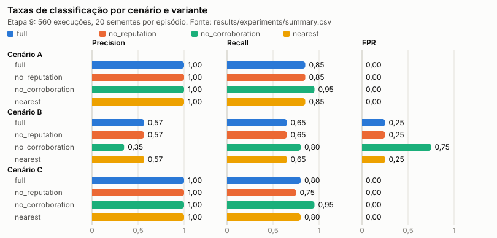
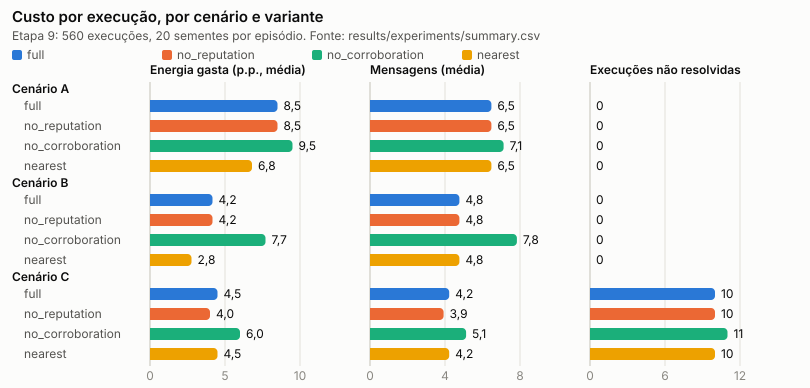

# Experiências — Etapa 9

[Plano de avaliação](evaluation.md) · [Sensibilidade](sensitivity.md) · [Falhas](faults.md) · [Reputação e política](reputation-policy.md)

## Em resumo

- **560 execuções**: 3 cenários (A normal, B ruído, C falhas e escassez) × 4 variantes × 20 sementes. Todos os números desta página foram recalculados a partir de [`runs.csv`](../results/experiments/runs.csv).
- **Corroboração (cenário B):** `full` dá 10 falsos alarmes em 40 negativos, contra 30 sem corroboração (FPR 0,25 contra 0,75). O preço é recall: 0,65 contra 0,80.
- **Reputação:** quase não conta. `full` e `no_reputation` diferem numa única execução em 140 pares (C, repetição 19).
- **Custo composto contra `nearest`:** a classificação é igual. `nearest` verifica mais cedo (4 s contra 6 s em A) e gasta menos (6,8 contra 8,5 p.p.). O benefício de evitar o drone carregado não se mede neste simulador.
- **Falhas (cenário C):** das 16 ameaças mobilizadas, 10 ficam `unresolved`, cada uma por uma mensagem perdida. O guarda responde aos 17 s em vez de 12 s, por causa dos atrasos.

A amostra é pequena (20 ameaças por cenário) e não há testes de significância. Diferenças de uma ou duas execuções não são efeitos.

## Unidade de avaliação e métricas

Definições implementadas em [`metrics.py`](../src/isia/evaluation/metrics.py) (`run_metrics` e `summarize`).

| Termo | Definição |
|---|---|
| Unidade | Uma execução: o mundo de exemplo 8×8, uma janela única, um episódio. Não se avaliam observações isoladas. |
| Positivo real | O episódio tem pelo menos um evento `threat`. |
| Positivo previsto | A decisão final mobiliza recursos: `request_mobile_verification` ou `request_rangers`. Uma execução sem alerta conta como negativo previsto. |
| TP / FP / TN / FN | Cruzamento dos dois anteriores, por execução. |
| Precision, recall, FPR | `TP/(TP+FP)`, `TP/(TP+FN)`, `FP/(FP+TN)`. Com denominador zero ficam `N/A` (`metrics.ratio`). |
| t verificação | `completed_at` do primeiro resultado recebido de `verify_incident`, em segundos simulados desde `t=0`. |
| t guarda | O mesmo para `respond_incident` (intervenção do guarda). |
| Energia | Soma dos pontos percentuais (p.p.) de autonomia gastos pelos três recursos. Não é energia física. |
| Mensagens | Tentativas de envio pela aplicação, incluindo as perdidas. |
| Perdidas, duplicadas | Contagens do `fault_log` do transporte local. |
| Verificações confirmadas | Execuções em que chegou um resultado `verify_incident` com `confirmed`. |
| Não resolvidas | Execuções que terminam com a ocorrência em `unresolved`. |

Três notas para ler os números:

- Eventos e alerta começam em `t=0`. O tempo de deteção é sempre 0 e não se reporta.
- Os tempos só existem quando o resultado chega ao iniciador. O `n` indica quantas execuções têm valor; as outras não entram na média.
- `missions_done` e `missions_failed` contam só os estados que o coordenador conhece. Uma missão concluída cujo resultado se perdeu não é contada.

O movimento custa 1 s e 1 p.p. por célula, mais 1 s de inspeção. Uma ocorrência completa com o veículo gasta 20 p.p. (veículo 10, guarda 10); com o drone, 16 p.p. (drone 6, guarda 10). As médias por execução incluem as execuções sem alerta, que gastam zero.

## Cenários (`config/scenarios/*.json`)

Todos usam o mundo de exemplo. O `sensor-1` (acústico, em (2,2)) inicia a ocorrência e o `sensor-2` (visual, em (4,2)) corrobora. Os recursos são o drone em (0,2), o veículo em (0,0) e o guarda em (5,5). Os eventos ficam em (3,2). Cada cenário corre 20 repetições (sementes 1000 a 1019) de cada episódio.

| Cenário | Episódios | Execuções por variante | Fontes | Recursos e falhas |
|---|---|---:|---|---|
| **A** — normal | `threat`, `empty` | 40 | FP 5 %; FN 5 % e 10 %; sem erro de posição; confiança 0,8 | Drone com carga 0,5; sem falhas |
| **B** — ruído | `threat`, `thunder`, `thunder+tourist` | 60 | FP 60 % e 50 %; FN 20 % e 25 %; erro de posição ±1; confiança 0,7 | Drone com carga 0,5; sem falhas |
| **C** — falhas e escassez | `threat`, `empty` | 40 | Iguais às de A | Drone com 15 % de autonomia; perda de 10 %; atraso de 0,05 s em `PROPOSAL` e `MISSION_RESULT`; `MISSION_RESULT` duplicado |

Como o simulador gera as leituras (`Scenario._sample`):

- Uma ameaça é detetada com probabilidade `sensitivity × (1 − FN)`: 0,90 e 0,81 em A e C; 0,72 e 0,64 em B.
- Um evento benigno gera um falso sinal com probabilidade `sensitivity × FP`: 0,54 (trovão, `sensor-1`) e 0,43 (turista, `sensor-2`) em B.
- O trovão só é audível e o turista só é visível. Um episódio `empty` não tem eventos e nunca gera sinal.

### Modelo do mundo e parâmetros das fontes

- **Mapa:** grelha sem obstáculos, com origem `(0, 0)` no canto inferior esquerdo.
- **Relógio:** tempo simulado, que só avança por ordem explícita.
- **Movimento:** primeiro no eixo x, depois no eixo y; uma célula por segundo e 1 % de energia por célula.
- **Eventos:** `threat` é captado pelos três canais, `thunder` apenas pelo acústico e `tourist` pelo visual e humano.
- **Verdade de referência:** os agentes só conhecem as suas observações; apenas a avaliação vê os eventos reais.

Cada fonte é definida em `sources` no ficheiro do cenário:

| Parâmetro | Descrição |
|---|---|
| `kind` | Tipo de fonte: `acoustic`, `visual` ou `human` |
| `detection_range` | Alcance, em células |
| `sensitivity` | Probabilidade de captar o sinal (0–1) |
| `false_negative_rate` | Perante uma ameaça, deteta com probabilidade `sensitivity × (1 − false_negative_rate)` |
| `false_positive_rate` | Perante um evento benigno, alerta com probabilidade `sensitivity × false_positive_rate` |
| `position_error` | Erro máximo da posição reportada, por eixo |
| `confidence` | Confiança declarada pela própria fonte |

Cada cenário traz a sua cópia de `response_settings`. Os limiares e o prior são iguais aos de `config/agents.json`: patrulha 0,25, guarda 0,65, prior α=β=2. Os dois sensores pertencem a grupos e modalidades diferentes. A regra `compatibility_rules` permite que `suspicious_movement` corrobore `gunshot_like_sound`.

## Variantes comparadas (`collector.VARIANTS`)

| Variante | O que muda em relação a `full` |
|---|---|
| `full` | Nada. A reputação é partilhada entre as execuções sucessivas do cenário e só sobe com verificações confirmadas. |
| `no_corroboration` | Ignora a resposta do par (`corroborate=False`) e baixa os dois limiares de patrulha para 0,01: qualquer alerta isolado mobiliza. |
| `no_reputation` | Reputação reposta no prior (0,5) no início de cada execução (`learn=False`). |
| `nearest` | Seleção só por ETA (`energy_weight=load_weight=0`). Com velocidades iguais, ganha a patrulha elegível mais próxima. |

`no_corroboration` muda duas coisas ao mesmo tempo: a evidência usada e o limiar. Compara dois pipelines; não isola o efeito da corroboração. Sem baixar o limiar, nenhum alerta isolado mobilizaria e o recall seria 0.

## Resultados

### Classificação



| Cen. | Variante | n | TP | FP | TN | FN | Precision | Recall | FPR | Verificações confirmadas | Não resolvidas |
|---|---|---:|---:|---:|---:|---:|---:|---:|---:|---:|---:|
| A | `full` | 40 | 17 | 0 | 20 | 3 | 1,00 | 0,85 | 0,00 | 17 | 0 |
| A | `no_corroboration` | 40 | 19 | 0 | 20 | 1 | 1,00 | 0,95 | 0,00 | 19 | 0 |
| A | `no_reputation` | 40 | 17 | 0 | 20 | 3 | 1,00 | 0,85 | 0,00 | 17 | 0 |
| A | `nearest` | 40 | 17 | 0 | 20 | 3 | 1,00 | 0,85 | 0,00 | 17 | 0 |
| B | `full` | 60 | 13 | 10 | 30 | 7 | 0,57 | 0,65 | 0,25 | 2 | 0 |
| B | `no_corroboration` | 60 | 16 | 30 | 10 | 4 | 0,35 | 0,80 | 0,75 | 2 | 0 |
| B | `no_reputation` | 60 | 13 | 10 | 30 | 7 | 0,57 | 0,65 | 0,25 | 2 | 0 |
| B | `nearest` | 60 | 13 | 10 | 30 | 7 | 0,57 | 0,65 | 0,25 | 2 | 0 |
| C | `full` | 40 | 16 | 0 | 20 | 4 | 1,00 | 0,80 | 0,00 | 10 | 10 |
| C | `no_corroboration` | 40 | 19 | 0 | 20 | 1 | 1,00 | 0,95 | 0,00 | 13 | 11 |
| C | `no_reputation` | 40 | 15 | 0 | 20 | 5 | 1,00 | 0,75 | 0,00 | 9 | 10 |
| C | `nearest` | 40 | 16 | 0 | 20 | 4 | 1,00 | 0,80 | 0,00 | 10 | 10 |

Cada cenário tem 20 ameaças. Os negativos são 20 em A e C (episódios vazios) e 40 em B.

### Rapidez e custo



Tempos em média ± desvio-padrão, com `n` = execuções com esse valor. As restantes colunas são médias sobre todas as execuções.

| Cen. | Variante | t verificação (s) | t guarda (s) | Energia/exec. (p.p.) | Mensagens/exec. | Perdidas/exec. | Duplicadas/exec. |
|---|---|---|---|---:|---:|---:|---:|
| A | `full` | 6,00 ± 0,00 (n=17) | 12,00 ± 0,00 (n=17) | 8,5 | 6,475 | 0 | 0 |
| A | `no_corroboration` | 6,00 ± 0,00 (n=19) | 12,00 ± 0,00 (n=19) | 9,5 | 7,125 | 0 | 0 |
| A | `no_reputation` | 6,00 ± 0,00 (n=17) | 12,00 ± 0,00 (n=17) | 8,5 | 6,475 | 0 | 0 |
| A | `nearest` | 4,00 ± 0,00 (n=17) | 10,00 ± 0,00 (n=17) | 6,8 | 6,475 | 0 | 0 |
| B | `full` | 6,00 ± 1,00 (n=23) | 12,00 ± 0,00 (n=2) | 4,167 | 4,767 | 0 | 0 |
| B | `no_corroboration` | 5,80 ± 1,11 (n=46) | 12,00 ± 0,00 (n=2) | 7,7 | 7,833 | 0 | 0 |
| B | `no_reputation` | 6,00 ± 1,00 (n=23) | 12,00 ± 0,00 (n=2) | 4,167 | 4,767 | 0 | 0 |
| B | `nearest` | 4,17 ± 0,98 (n=23) | 10,00 ± 0,00 (n=2) | 2,767 | 4,767 | 0 | 0 |
| C | `full` | 6,00 ± 0,00 (n=10) | 17,00 ± 0,00 (n=6) | 4,5 | 4,225 | 0,425 | 0,425 |
| C | `no_corroboration` | 6,00 ± 0,00 (n=13) | 17,00 ± 0,00 (n=8) | 6 | 5,125 | 0,475 | 0,55 |
| C | `no_reputation` | 6,00 ± 0,00 (n=9) | 17,00 ± 0,00 (n=5) | 4 | 3,925 | 0,425 | 0,375 |
| C | `nearest` | 6,00 ± 0,00 (n=10) | 17,00 ± 0,00 (n=6) | 4,5 | 4,225 | 0,425 | 0,425 |

### Desfechos observados

O que aconteceu às 20 ameaças de cada cenário na variante `full`:

| Desfecho da ameaça | A | B | C |
|---|---:|---:|---:|
| Fechada: verificação confirmada e guarda no local | 17 | 2 | 6 |
| Fechada `not_confirmed`: a patrulha inspecionou a célula errada | 0 | 11 | 0 |
| `unresolved`: mobilizada, mas a negociação ou o resultado falhou | 0 | 0 | 10 |
| `expired`: alerta sem corroboração suficiente | 2 | 3 | 3 |
| Sem alerta: o `sensor-1` não detetou | 1 | 4 | 1 |

- **A.** As 2 expiradas (repetições 1 e 5) são casos em que o `sensor-2` não detetou. `no_corroboration` mobiliza essas duas e chega a 19. Os 20 episódios vazios nunca geram alerta, em nenhuma variante.
- **B, ameaças.** O erro de posição ±1 manda a patrulha à posição percebida. Em 11 das 13 mobilizações essa célula não é a da ameaça e o resultado é `not_confirmed`. Só 2 acertam em (3,2).
- **B, negativos.** `thunder` gera alerta em 15 de 20 execuções e nunca mobiliza em `full`: o sensor visual não vê trovão, logo não há corroboração. `thunder+tourist` gera 15 alertas e mobiliza 10 vezes: cada sensor dá um falso sinal de origem diferente e os dois parecem corroborar-se. São estes os 10 FP.
- **C, escassez.** O drone nunca propõe: com 15 % de autonomia e reserva mínima de 10 %, recusa os 12 pedidos que recebe (`autonomy_insufficient`); os outros 4 `CFP` perdem-se. O veículo é o único candidato.
- **C, perdas.** As 10 `unresolved` dividem-se em 6 `no_eligible_proposals`, 3 `confirmation_unknown` e 1 `mission_result_unknown`. Cada uma coincide com uma mensagem perdida no caminho do único recurso disponível nessa fase (veículo ou guarda): 4 `CFP`, 2 `PROPOSAL`, 2 `ACCEPT`, 1 `STATUS` e 1 `MISSION_RESULT`. A, B e C correm sem reenvio.
- **C, corroboração perdida.** Em 3 ameaças por variante (repetições 1, 11 e 19) o pedido ou a resposta de corroboração perde-se e o sensor decide só com a evidência local. Em `full`, duas expiram e a da repetição 19 mobiliza na mesma, porque a reputação do `sensor-1` já era suficiente.
- **Reputação.** A repetição 19 de C é a única execução em que `full` e `no_reputation` decidem de forma diferente (ver [Discussão](#discussão)).

As verificações confirmadas em C são 10, mas só 6 ocorrências fecham: nas outras 4, perde-se uma mensagem da fase do guarda.

Os relatórios completos por execução (`results/experiments/runs/`) não são versionados. As contagens deste bloco que não constam de `runs.csv` (mensagens perdidas por tipo, recusas do drone, células inspecionadas) vêm desses relatórios, lidos na cópia local da recolha.

## Discussão

O que cada peça acrescenta, com os números que o mostram.

**Corroboração: menos falsos alarmes, menos recall.**

| Cenário B | `full` | `no_corroboration` |
|---|---:|---:|
| Falsos alarmes (em 40 negativos) | 10 | 30 |
| FPR | 0,25 | 0,75 |
| Precision | 0,57 | 0,35 |
| Recall (em 20 ameaças) | 0,65 | 0,80 |
| Energia por execução (p.p.) | 4,2 | 7,7 |
| Mensagens por execução | 4,8 | 7,8 |

- Em A e C o recall também desce com a corroboração: 0,85 contra 0,95 e 0,80 contra 0,95. Quando o segundo sensor falha, ou a resposta se perde, o alerta isolado não chega ao limiar.
- A corroboração não resolve os 10 FP de `thunder+tourist`: dois falsos sinais de origens distintas parecem evidência independente.
- Em A e C os negativos são episódios vazios, que nunca geram sinal. O FPR 0 desses cenários resulta do desenho e não prova robustez ao ruído.
- A comparação mede corroboração e limiar em conjunto (ver [variantes](#variantes-comparadas-collectorvariants)).

**Reputação: quase sem efeito nesta configuração.**

- A reputação do `sensor-1` sobe com cada verificação confirmada: termina em 0,90 em A, 0,86 em C e 0,67 em B.
- Só muda uma decisão: C, repetição 19. Com reputação 0,846, o score do alerta isolado é `0,846 × 0,8 / 2 × 0,75 ≈ 0,254` e passa o limiar de 0,25. `no_reputation` fica em 0,15 e expira.
- Um alerta isolado só passa o limiar com reputação ≥ 5/6 ≈ 0,83. Em A a reputação só chega a esse valor na repetição 9, já depois dos dois alertas isolados (repetições 1 e 5).
- A reputação só aprende com `confirmed`. Um `not_confirmed` é inconclusivo, por isso em B nunca desce, mesmo com 10 falsos alarmes.
- Não há evidência de que a reputação melhore a precisão. Para ter efeito, precisava de aprender também com os falsos alarmes.

**Custo composto: não se distingue de `nearest` no que se mede.**

- O custo composto (ETA, energia e carga) evita o drone com carga 0,5 e escolhe o veículo, que está mais longe. `nearest` escolhe o drone.
- A classificação é igual. `nearest` verifica mais cedo (4,0 contra 6,0 s em A; 4,2 contra 6,0 s em B) e gasta menos (6,8 contra 8,5 p.p. em A).
- O simulador não penaliza a carga na execução. O benefício de poupar o drone carregado existe no desenho, mas não é mensurável aqui.
- Em C o drone não é elegível e as duas regras escolhem o veículo: resultados iguais.

**Falhas e escassez (C contra A): a degradação é grande.**

- Com as mesmas fontes, só 6 das 20 ameaças chegam à intervenção do guarda, contra 17 em A.
- Uma mensagem perdida basta para deixar a ocorrência `unresolved`, porque só há um recurso elegível e não há reenvio.
- O guarda responde aos 17 s em vez de 12 s. A causa são os atrasos, não as perdas: o atraso de 0,05 s é tempo real e o relógio simulado continua a andar enquanto a mensagem espera. O guarda só é adjudicado aos 11 s em vez dos 6 s.
- Verificação à parte (18-11-2026, 3 repetições de C sem perdas): sem falhas, 12 s; só com o atraso de `PROPOSAL` ou só com o de `MISSION_RESULT`, 16 s; com os dois, 17 s; a duplicação sozinha não muda nada.
- C junta perdas, atrasos, duplicados e escassez. A recolha publicada não separa o efeito de cada um.

O reenvio e as restantes mitigações foram medidos depois, noutros ensaios: ver [escalabilidade](scalability.md).

## Limitações e incerteza

- **Amostra pequena.** 20 ameaças por cenário, sem intervalos de confiança nem testes de significância. A diferença entre `full` e `no_reputation` em C é de uma execução.
- **Execuções dependentes.** Em `full`, a reputação aprende de uma execução para a seguinte. O resultado depende da ordem.
- **Simulação simplificada.** Janela única, eventos e alerta em `t=0`, mundo 8×8, um iniciador, dois sensores, eventos parados. Os tempos são quase determinísticos (desvio-padrão 0 em A e C).
- **Parâmetros escolhidos pela equipa.** Probabilidades, cargas, limiares e a regra de compatibilidade não foram calibrados com dados reais. O efeito de os variar está em [sensibilidade](sensitivity.md).
- **Baseline `no_corroboration`.** Muda a evidência e o limiar. Uma conclusão causal exigia um controlo que separasse as duas alterações.
- **Inspeção e guarda idealizados.** A inspeção vê sempre a ameaça se estiver na célula certa. A carga do drone não tem custo físico.
- **Falhas só no transporte local.** A injeção de falhas não valida o comportamento sobre XMPP. Em C, a perda depende da ordem dos envios no `asyncio` e os prazos de negociação são reais (0,5 s).

## Como reproduzir

```bash
# Recolha completa: apaga e recria runs/, runs.csv, summary.csv e manifest.json na pasta de saída.
PYTHONPATH=src python -m isia.evaluation.collector config/scenarios/*.json --output results/experiments

# Para conferir sem tocar nos ficheiros publicados, usar outra pasta e comparar:
PYTHONPATH=src python -m isia.evaluation.collector config/scenarios/*.json --output /tmp/etapa9
diff /tmp/etapa9/runs.csv results/experiments/runs.csv

# Gráficos (só lê summary.csv) e testes das métricas e dos cenários:
python scripts/charts.py
PYTHONPATH=src python -m unittest tests.unit.test_metrics tests.scenarios.test_experiments -v
```

**Proveniência.** Os ficheiros publicados foram recolhidos no commit `a170c97`, sem alterações por registar (`commit` e `dirty` em [`manifest.json`](../results/experiments/manifest.json)). `summary.csv` é a agregação exata de `runs.csv`. O código mudou depois dessa recolha; a 18-11-2026, a variante `full` dos três cenários (140 execuções) foi repetida no código atual e deu zero diferenças face a `runs.csv`. O cenário C depende da ordem dos envios assíncronos, pelo que noutra máquina pode haver diferenças.
