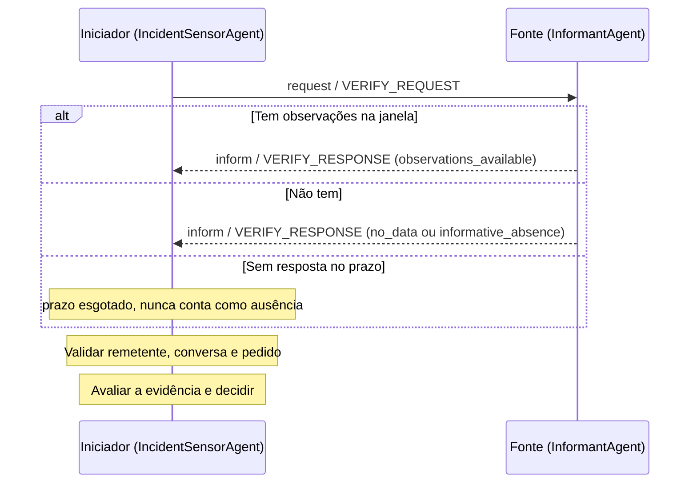
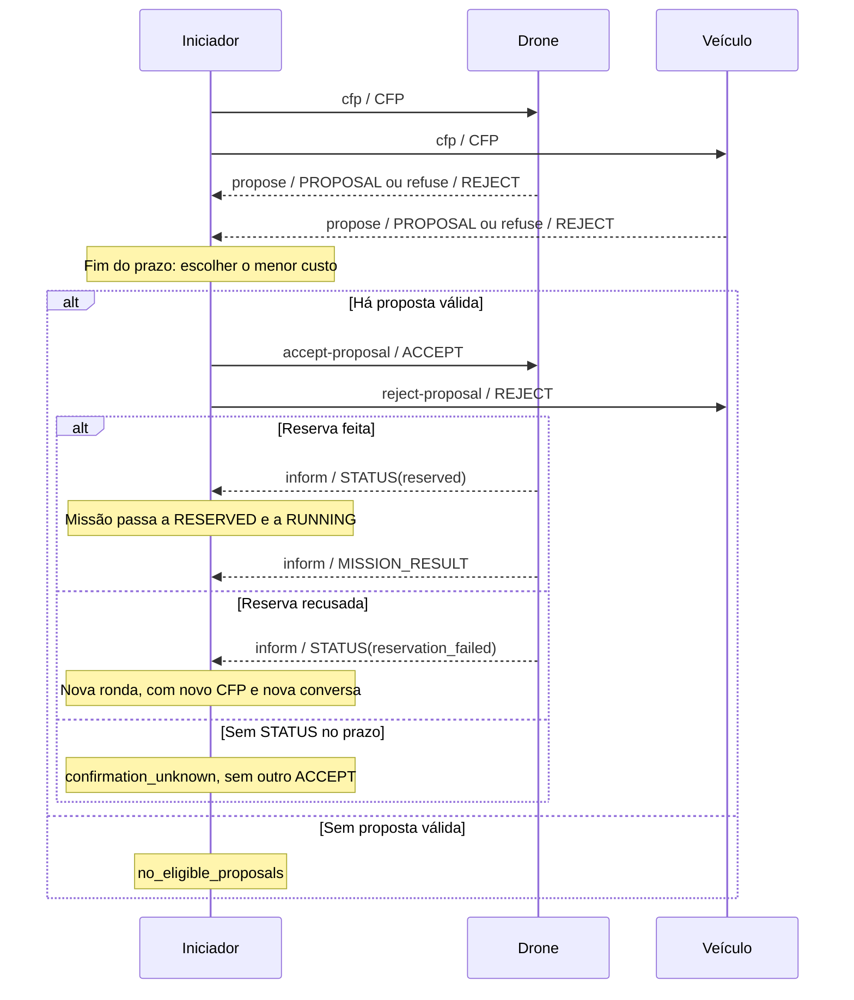

# Comunicação, mensagens e protocolos

[README](../README.md) · [Arquitetura](architecture.md) · [Falhas](faults.md) · [Reputação e política](reputation-policy.md) · [Escalabilidade](scalability.md)

> **Em resumo**
>
> - Há dois protocolos, ambos inspirados em FIPA: **verificação** (FIPA Request) e **atribuição** (Contract Net com uma confirmação extra, o `STATUS`).
> - As mensagens são JSON validado, transportadas pelo SPADE. A performativa vai nos metadados; o tipo (`CFP`, `PROPOSAL`, ...) vai no corpo.
> - Uma ocorrência completa no MVP troca 15 mensagens: 2 de verificação e 13 de duas negociações (patrulha e guarda).
> - `INCIDENT_CLOSED` nunca é enviado. `ALERT` só é enviado com a opção `alert_distance` (cenário E).
> - Fila, prazo dinâmico, reenvio e aviso entre iniciadores são **opções**. Os resultados dos cenários A, B e C foram recolhidos com todas desligadas.

Verificado contra o código em 18-11-2026 (branch `fix/auditoria-correcoes`).

## 1. Camadas da comunicação

| Camada | Responsabilidade | Implementação |
|---|---|---|
| Transporte | Entrega assíncrona entre agentes | SPADE 4.1.4 sobre XMPP, ou filas locais no mesmo processo |
| Metadados | Intenção, protocolo e conversa | `performative`, `ontology` (`isia`), `protocol`, `conversation-id`, `reply-with`, `in-reply-to` |
| Corpo | Dados do domínio | JSON validado, `schema_version` 1 ([messages.py](../src/isia/communication/messages.py)) |
| Protocolo | Ordem das mensagens, prazos e recusas | `verification` e `contract-net` |
| Decisão | Corroboração, reputação, custo | Funções em [reasoning/](../src/isia/reasoning/), sem gestor global |

**Não confundir tipo com performativa.** `CFP`, `PROPOSAL` ou `REJECT` são tipos do corpo (`message_type`). `cfp`, `propose`, `refuse` ou `reject-proposal` são performativas FIPA, nos metadados. O mesmo tipo `REJECT` viaja com duas performativas diferentes ([secção 3](#3-tipos-de-mensagens-e-intenção)).

## 2. Modelo base para mensagens

### Corpo JSON

| Campo | Obrigatório | Significado |
|---|---|---|
| `schema_version` | sim | Sempre o inteiro `1` |
| `message_id` | sim | Identificador da mensagem; mantém-se num reenvio |
| `message_type` | sim | Um dos dez tipos da secção 3 |
| `created_at` | sim | Instante de emissão em **segundos simulados**, finito e não negativo |
| `payload` | sim | Objeto JSON com os dados do tipo |
| `conversation_id` | em `CFP` e `MISSION_RESULT`; na prática, em todas as enviadas | Identificador da conversa. O transporte exige o metadado `conversation-id` e que os dois coincidam |
| `incident_id`, `mission_id` | em `CFP` e `MISSION_RESULT` | Ocorrência e missão |
| `source_id` | em `MISSION_RESULT` | Fonte da observação ou recurso emissor |
| `event_id` | não | Identificador de **uma observação**, não da ocorrência |

Regras de validação em `Message` (lança erro, não corrige):

- Identificadores são strings não vazias.
- `payload` só aceita JSON estrito: `NaN`, `Infinity`, chaves não textuais e objetos Python são rejeitados. `null` é aceite.
- `CFP` exige `task`, `target` (`x`, `y` inteiros não negativos), `required_capability`, `priority` (inteiro ≥ 0) e `deadline`. `round_number` é opcional.
- `MISSION_RESULT` exige `accept_message_id`, `resource_id` (igual a `source_id`), `task`, `outcome`, `reason` e `completed_at ≤ created_at`.

Os outros tipos não têm validação própria em `Message`. Quem recebe confere os campos de que precisa e ignora a mensagem se não baterem.

### Metadados SPADE

`build_spade_message` ([transport.py](../src/isia/communication/transport.py)) escreve sempre `performative`, `ontology`, `protocol` e `conversation-id`. As respostas levam `in-reply-to` com o `message_id` do pedido. Só o `VERIFY_REQUEST` leva `reply-with`.

`parse_spade_message` rejeita a mensagem se a ontologia ou o protocolo não forem os esperados, se faltar `conversation-id` ou se este não coincidir com o do corpo.

O remetente é o JID dado pelo transporte. O `source_id` do corpo não autentica ninguém; os agentes comparam-no com o remetente real.

### Unidades

| Grandeza | Unidade |
|---|---|
| Tempo, ETA, `created_at`, `deadline` | Segundos simulados, a partir de 0 |
| Prazos de espera por respostas | Segundos **reais** (não avançam o relógio simulado) |
| Posição | Célula da grelha, inteiros não negativos |
| Distância entre observações | Euclidiana, em células |
| Distância de deslocação | Manhattan, em células |
| Autonomia, `Bid.energy_cost` | Pontos percentuais (0 a 100) |
| `Bid.load` | Fração entre 0 e 1 |
| `Mission.priority` | Inteiro: 0 leve, 1 média, 2 grave |
| `confidence_score` | Entre 0 e 1; **não** é uma probabilidade calibrada |

### Exemplos reais

Pedido de propostas e proposta do drone, tirados de uma execução do MVP (identificadores encurtados):

```json
{
  "schema_version": 1,
  "message_id": "message-45dc",
  "message_type": "CFP",
  "created_at": 0.0,
  "conversation_id": "conversation-9a06",
  "incident_id": "incident-obs-000001",
  "mission_id": "mission-incident-obs-000001-mobile-verification",
  "payload": {
    "task": "verify_incident",
    "target": {"x": 3, "y": 2},
    "required_capability": "mobile_verification",
    "priority": 1,
    "deadline": 100.0,
    "round_number": 1
  }
}
```

```json
{
  "schema_version": 1,
  "message_id": "proposal-drone-message-45dc",
  "message_type": "PROPOSAL",
  "created_at": 0.0,
  "conversation_id": "conversation-9a06",
  "incident_id": "incident-obs-000001",
  "mission_id": "mission-incident-obs-000001-mobile-verification",
  "source_id": "drone",
  "payload": {
    "cfp_message_id": "message-45dc",
    "bid": {"mission_id": "mission-incident-obs-000001-mobile-verification",
            "resource_id": "drone", "eta": 3.0, "energy_cost": 6.0, "load": 0.0}
  }
}
```

Exemplo inválido: `created_at` negativo e `NaN` no payload são ambos rejeitados.

```json
{"schema_version": 1, "message_id": "msg-err", "message_type": "ALERT", "created_at": -1.0, "payload": {"value": NaN}}
```

## 3. Tipos de mensagens e intenção

O que o código envia hoje. «Iniciador» é o `IncidentSensorAgent` da ocorrência.

| Tipo | Performativa | Protocolo | De → para | Resposta esperada | Onde |
|---|---|---|---|---|---|
| `ALERT` | `inform` | `verification` | Iniciador → iniciadores vizinhos. **Só com `alert_distance`** | Segundo `ALERT` com `keeps` (veredicto) | `yields_to_neighbour`, [incident.py](../src/isia/agents/incident.py) |
| `VERIFY_REQUEST` | `request` | `verification` | Iniciador → a sua fonte de corroboração (uma) | `VERIFY_RESPONSE` ou prazo esgotado | `VerificationBehaviour`, [sensor.py](../src/isia/agents/sensor.py) |
| `VERIFY_RESPONSE` | `inform` (nunca `refuse`) | `verification` | Fonte → iniciador | Nenhuma | `VerificationBehaviour`, [informant.py](../src/isia/agents/informant.py) |
| `CFP` | `cfp` | `contract-net` | Iniciador → recursos candidatos | `PROPOSAL` ou `REJECT` | `allocate`, [incident.py](../src/isia/agents/incident.py) |
| `PROPOSAL` | `propose` | `contract-net` | Recurso → iniciador | `ACCEPT` ou `REJECT` | `ContractNetBehaviour`, [mobile.py](../src/isia/agents/mobile.py) |
| `REJECT` (recusa do CFP) | `refuse` | `contract-net` | Recurso → iniciador | Nenhuma | `ContractNetBehaviour`, [mobile.py](../src/isia/agents/mobile.py) |
| `ACCEPT` | `accept-proposal` | `contract-net` | Iniciador → recurso vencedor | `STATUS` | `allocate`, [incident.py](../src/isia/agents/incident.py) |
| `REJECT` (perdedores) | `reject-proposal` | `contract-net` | Iniciador → outros proponentes | Nenhuma | `allocate`, [incident.py](../src/isia/agents/incident.py) |
| `STATUS` | `inform` | `contract-net` | Recurso vencedor → iniciador | `status`: `reserved` ou `reservation_failed` | `AcceptBehaviour`, [mobile.py](../src/isia/agents/mobile.py) |
| `MISSION_RESULT` | `inform` (também com `outcome=failed`) | `contract-net` | Recurso → iniciador | Nenhuma | `ExecutionBehaviour`, [mobile.py](../src/isia/agents/mobile.py) |
| `INCIDENT_CLOSED` | **nunca enviado** | — | Fica só na linha temporal do iniciador | — | `IncidentBehaviour.run`, [incident.py](../src/isia/agents/incident.py) |

Notas:

- Sem `alert_distance`, `ALERT` também fica só na linha temporal. É o caso do MVP e dos cenários A, B, C e D.
- Motivos de recusa de um CFP (`payload.reason`): `resource_unavailable`, `capability_mismatch`, `autonomy_insufficient`, `autonomy_unknown`, `cfp_expired`, `target_outside_map` e, com fila ordenada, `waiting_turn`.
- O esquema é **«inspirado em FIPA»**, não conforme. Os desvios estão na [secção 9](#9-porquê-estes-protocolos-alternativas-prós-e-contras).

## 4. Verificação distribuída



Como funciona:

1. O iniciador envia **um** pedido a **uma** fonte. No MVP e nos cenários A, B e C é o `sensor-2`. Nos cenários D e E, cada iniciador pergunta ao informador mais próximo.
2. O pedido leva a observação inicial e uma `hypothesis` (tipo de evento, posição e intervalo).
3. A fonte responde com as observações da sua janela (5 s simulados). Não filtra nem avalia: devolve o que tem.
4. O iniciador valida a resposta (remetente, `conversation-id`, `in-reply-to`, `request_message_id`) e classifica cada observação.

**Quando é que uma observação corrobora.** Tem de vir de outra fonte, estar a 3,0 células ou menos e a 2,0 s ou menos da observação inicial, e ser do mesmo tipo ou de um tipo declarado compatível. Nos cenários A a D, a regra diz que um `gunshot_like_sound` (som) pode ser corroborado por um `suspicious_movement` (câmara); o cenário E acrescenta `suspicious_activity_report` (relato humano). Sem regra, tipos diferentes ficam `inconclusive`.

**Prazo de espera**, em segundos reais:

| Situação | Prazo |
|---|---|
| `SensorAgent` isolado | 10 s (`RESPONSE_TIMEOUT_SECONDS`) |
| Cenários A, B e C publicados | 0,5 s |
| MVP por omissão, cenário D | 2 s |
| Cenário E (um reenvio) | 4 s, com o pedido repetido aos 2 s |

Regra: `min(10, max_receive_timeout × (1 + retransmit))`.

**Como o iniciador lê a resposta:**

| Resposta | Efeito |
|---|---|
| `observations_available` com observação compatível | Conta como apoio |
| `observations_available` sem observação compatível | `inconclusive`: não conta a favor nem contra |
| `no_data` | Não conta contra |
| Prazo esgotado | Decisão `observe` com motivo `timeout`. Com a política ativa, decide só com a evidência local (uma ameaça grave ainda pode mobilizar) |

**Implementado, mas não exercitado pelas execuções medidas:**

- `informative_absence`: a fonte declara «olhei e não vi». Exige cobertura configurada (posição, raio, capacidade e oportunidade confirmada). O `run_mvp` não configura cobertura, por isso nas execuções a fonte só responde `observations_available` ou `no_data`.
- Evidência `contradictory`: exige uma regra de incompatibilidade dada pelo iniciador e uma resposta que a declare. O `InformantAgent` nunca a declara.

Ambos estão cobertos por testes unitários ([tests/unit/](../tests/unit/)).

### Aviso entre iniciadores (opcional)

Com vários iniciadores, dois sensores que ouvem a mesma ameaça abrem duas ocorrências e mandam duas patrulhas. A opção `alert_distance=D` evita-o, **antes** da verificação:

1. Cada iniciador com uma leitura envia um `ALERT` aos vizinhos, com o tipo, a posição, o instante e a confiança.
2. Espera pelos `ALERT` dos vizinhos, até um prazo de receção.
3. Dois `ALERT` são «a mesma ameaça» se estiverem a D células ou menos e a 2,0 s ou menos.
4. Tem prioridade a leitura mais antiga; em caso de empate, o menor `source_id`. Os dois lados calculam a mesma ordem.
5. Segunda volta: cada um diz a quem lhe cederia se fica com a ameaça (`{"keeps": true}` ou `false`).
6. Só se cede a um vizinho que fica. Quem cede fecha como `closed` / `duplicate_alert`.

Um `ALERT` ou um veredicto perdido deixa os dois a tratar a ameaça: falha para o lado seguro (duas respostas em vez de nenhuma).

Custos: um vizinho sem leitura não responde, por isso a espera dura o prazo todo. Depois da espera, o iniciador volta a ler o sensor; se a ameaça já não for vista, fecha como `expired` / `threat_expired`.

Vizinhos são os iniciadores cujos alcances se podem sobrepor. A lista é calculada pelo `run_mvp` a partir das posições; não há descoberta dinâmica.

Medição: com 2 iniciadores e 1 ameaça entre eles, passa de 2 para 1 missão de patrulha e de 40 para 18 mensagens por execução ([scalability.md](scalability.md#aviso-entre-iniciadores-antes-e-depois), `results/stress/alerta.csv`).

## 5. Atribuição distribuída: Contract Net simplificado



### Regras operacionais

1. O `CFP` leva `mission_id`, `incident_id`, `conversation_id`, a capacidade exigida, a prioridade e um `deadline`.
2. O recurso avalia **localmente** se pode executar. Recusa se estiver ocupado, sem a capacidade ou sem energia para ir e voltar.
3. A proposta leva uma `Bid` com ETA (s), energia (pontos percentuais) e carga.
4. Propor não reserva. A reserva só acontece quando o recurso processa o `ACCEPT`.
5. O iniciador aceita uma resposta por candidato e ignora o que não bate com o CFP: outra conversa, outra missão, performativa errada ou data fora do prazo.
6. `STATUS(reserved)` confirma. `STATUS(reservation_failed)` é recusa explícita e permite nova ronda. Sem `STATUS` no prazo, o resultado é `confirmation_unknown` e **não** há outro `ACCEPT`: o silêncio não prova que o recurso ficou livre.
7. O `deadline` do CFP é inclusivo e em segundos simulados (`created_at + 100`). Quem limita a espera na prática é o prazo real de receção.
8. Cada nova ronda usa um CFP novo, com `message_id`, `conversation_id` e `round_number` novos. O recurso ignora rondas mais antigas do que a última que viu.
9. Mensagens repetidas não criam segunda reserva nem segunda missão.

**Prazo de receção**, em segundos reais: 0,5 s no transporte local e 2,0 s com XMPP (`receive_timeout`). O `STATUS` espera até `max_receive_timeout`. O resultado da missão espera até 10 prazos de receção.

### Custo da proposta

```text
custo = w_eta × ETA / 60 + w_energia × energia / 100 + w_carga × carga / 1
```

Pesos 1,0 por omissão; ganha o menor custo; o desempate é por `resource_id` e depois por `message_id` (`select_best_proposal`, [allocation.py](../src/isia/reasoning/allocation.py)). As escalas (60 s, 100 %) são parâmetros de engenharia, não uma calibração física.

Exemplo do MVP: drone com ETA 3 s e energia 6 % custa 0,11; veículo com ETA 5 s e 10 % custa 0,18. Ganha o drone.

Nos cenários A e B o drone tem carga 0,5, o que soma 0,5 ao seu custo: ganha o veículo em todas as execuções `full` de `results/experiments/runs.csv`. No cenário C o drone tem 15 % de autonomia e recusa (precisa de 6 % para a missão mais 10 % de reserva mínima).

A variante `nearest` do coletor põe os pesos da energia e da carga a zero: fica só a ETA, ou seja, a patrulha mais próxima. Em A e B passa a ganhar o drone.

### Resultados da ronda

| Resultado | Condição | Efeito |
|---|---|---|
| Reserva confirmada (evento `reserved`) | `STATUS` válido com `status=reserved` | Ocorrência passa a `RESPONDING` |
| `no_eligible_proposals` | Nenhuma `PROPOSAL` válida no prazo | Fila, se estiver ligada e alguém estiver ocupado; senão `unresolved` |
| `reservation_rejected` | `STATUS` com `reservation_failed` | Nova ronda, até `max_attempts` (2) |
| `confirmation_unknown` | Nenhum `STATUS` válido no prazo | `unresolved`; sem novo `ACCEPT` |

### Missões e intervenção — Etapa 6

O `IncidentSensorAgent` cria a missão a partir da decisão (`MissionRegistry.create_from_decision`). O alvo é a posição da primeira observação.

| Decisão | Missão | Capacidade | Candidatos |
|---|---|---|---|
| `request_mobile_verification` | `verify_incident` | `mobile_verification` | Todas as patrulhas |
| `request_rangers` | `respond_incident` | `incident_response` | Todos os guardas |
| `observe` | Nenhuma | — | — |

Depois de `STATUS(reserved)`, o recurso percorre `RESERVED → MOVING → VERIFYING → RETURNING → AVAILABLE` e a missão `RESERVED → RUNNING → DONE` ou `FAILED`. O resultado sai antes do regresso: a ocorrência pode fechar com o recurso ainda a caminho da base.

O `MISSION_RESULT` vai com `performative=inform`, `protocol=contract-net` e `in-reply-to=<ACCEPT.message_id>`. O payload:

| Campo | Valor |
|---|---|
| `accept_message_id` | O `ACCEPT` que autorizou a missão |
| `resource_id` | O recurso emissor; igual a `source_id` |
| `task` | `verify_incident` ou `respond_incident` |
| `outcome` | `confirmed`, `not_confirmed`, `inconclusive` ou `failed` |
| `reason` | Por exemplo `local_inspection`, `energy_exhausted`, `mission_interrupted` |
| `completed_at` | Segundos simulados |
| `position` | Célula inspecionada; o avaliador usa-a para verificar a cobertura |

O que o iniciador faz com cada resultado:

| `outcome` | Efeito |
|---|---|
| `confirmed` numa verificação | Cria **nova missão** `respond_incident` para os guardas, com o mesmo protocolo. Só o resultado do guarda fecha a ocorrência |
| `confirmed` ou `not_confirmed` do guarda | Fecha: `closed`, com esse motivo |
| `not_confirmed` numa verificação | Fecha: `closed` / `not_confirmed`, sem chamar o guarda. Não é uma refutação: a patrulha não viu nada naquela célula, naquele instante |
| `inconclusive` ou `failed` | Volta a `ALLOCATING`, exclui o recurso já tentado e negoceia outra missão. Até 2 tentativas por tarefa; depois, `unresolved` |
| Nenhum resultado no prazo | `unresolved` / `mission_result_unknown`. Não se deduz falha física nem se atribui outra missão |

O guarda devolve `not_confirmed` quando chega e a ameaça já lá não está. A intervenção não remove o evento do ambiente.

A inspeção é idealizada: o recurso recebe a classificação da célula que visitou, sem erro e sem acesso aos eventos reais.

### Opções da fila, do reenvio e do aviso

Nenhuma destas opções cria tipos de mensagem novos. Valores por omissão de `run_mvp` e valores usados em cada recolha:

| Opção | O que faz | `run_mvp` | A, B, C publicados | D | E |
|---|---|---|---|---|---|
| `max_receive_timeout` | Prazo dinâmico: sem nenhuma proposta ao fim do prazo-base, espera até este teto | 2,0 s | desligado | 2,0 s | 2,0 s |
| `queue_rounds` | Fila: com os recursos ocupados, espera 5 s simulados e volta a pedir, até N vezes | 60 | 0 | 60 | 60 |
| `silent_invalid` | O recurso não responde a um `ACCEPT` que não bate com a sua proposta | ligado | desligado | ligado | ligado |
| `queue_priority` | Fila ordenada no recurso: primeiro a ocorrência mais grave, depois a que espera há mais tempo. Os outros recebem `waiting_turn` | desligado | desligado | ligado | ligado |
| `expire_unseen` | Antes de cada CFP, o iniciador volta a ler o sensor. Janela vazia (5 s simulados): `expired` / `threat_expired` | desligado | desligado | ligado | ligado |
| `queue_until_free` | A recusa por ocupação traz `busy_until`; o iniciador espera até lá em vez de 5 em 5 s | desligado | desligado | ligado | ligado |
| `chain_missions` | No regresso à base, com o resultado já entregue, o recurso propõe a partir da posição atual | desligado | desligado | ligado | ligado |
| `retransmit` | Reenvio: sem resposta, o mesmo `VERIFY_REQUEST`, `CFP` ou `ACCEPT` (mesmo `message_id`) volta a sair até N vezes; o destinatário repete a resposta já dada | 0 | 0 | 0 | 1 |
| `alert_distance` | [Aviso entre iniciadores](#aviso-entre-iniciadores-opcional) | desligado | desligado | desligado | 1,0 |
| `cfp_limit` | CFP só às K patrulhas com base mais próxima do alvo | desligado | desligado | desligado | desligado |

As três primeiras estão ligadas por omissão em `run_mvp`. O coletor e os scripts de medição desligam-nas (`PUBLISHED_CONDITIONS`, [runner.py](../src/isia/simulation/runner.py)) para reproduzir os resultados publicados; as opções de um cenário (`options` em D e E) sobrepõem-se.

Limites: a fila não é uma fila no recurso com garantia de ordem global, é o iniciador a insistir. O `busy_until` é uma previsão. Com o relógio simulado parado, um prazo real impede a espera infinita.

Medições antes e depois de cada opção: [scalability.md](scalability.md#mitigações-da-espera-na-fila-antes-e-depois) e [reenvio](scalability.md#reenvio-de-mensagens-antes-e-depois).

## 6. Estado e ordenação

| Entidade | Identificador | Regra |
|---|---|---|
| Observação | `event_id` | Imutável depois de emitida |
| Ocorrência | `incident_id` = `incident-<event_id da primeira leitura>` | Estados em [architecture.md](architecture.md#5-ciclo-de-vida-de-um-incidente) |
| Missão | `mission_id` | `PROPOSED → RESERVED → RUNNING → DONE` ou `FAILED` |
| Conversa | `conversation_id` | Uma por pedido de verificação e uma por CFP |

Repetições e mensagens fora de ordem são tratadas por cada agente, no seu comportamento. Não há registo partilhado de mensagens já vistas.

| Quem | Regra |
|---|---|
| Iniciador | Uma resposta por candidato em cada CFP; ignora mensagens com data no futuro, de outra conversa ou de outro remetente |
| Iniciador | Duas mensagens da mesma observação (`event_id`) contam uma vez |
| Recurso | CFP repetido com o mesmo `message_id`: devolve a mesma proposta. CFP já recusado: ignora, ou repete a recusa se o reenvio estiver ligado |
| Recurso | `ACCEPT` de uma missão já terminada: nunca volta a reservar |
| Recurso | Uma proposta não aceite caduca 10 s simulados depois do `deadline` do CFP |

Receber uma mensagem, aceitar um pedido e concluir uma tarefa são três coisas diferentes. Por isso existem `STATUS` (aceitei) e `MISSION_RESULT` (concluí).

## 7. Gestão de erros e falhas

O protocolo responde a cada falha com um estado explícito, nunca com silêncio:

| Falha | Resposta do protocolo |
|---|---|
| Fonte não responde | Prazo esgotado; decisão `observe` (`timeout`) |
| Recurso sem energia ou ocupado | `refuse` / `REJECT` com motivo |
| Proposta tardia | Ignorada; sem outra, `no_eligible_proposals` |
| Recurso ocupado entre a proposta e o `ACCEPT` | `STATUS(reservation_failed)` e nova ronda |
| `ACCEPT` ou `STATUS` perdido | `confirmation_unknown` |
| `MISSION_RESULT` perdido | `mission_result_unknown` |
| Missão falha a meio | `MISSION_RESULT` com `outcome=failed`; nova tentativa com outro recurso |
| Mensagem duplicada ou inválida | Ignorada, sem segundo efeito e sem erro |
| Iniciador desaparece | **Sem recuperação**: a ocorrência fica parada |

A injeção de falhas, os estados resultantes medidos e o reenvio estão em [faults.md](faults.md).

## 8. Implementação e compatibilidade SPADE

Com SPADE 4.1.4 ([requirements.txt](../requirements.txt)) usamos `Agent`, `OneShotBehaviour`, `CyclicBehaviour`, `Message`, `Template` e metadados. `PeriodicBehaviour` e `FSMBehaviour` não foram precisos.

| Ficheiro | Conteúdo |
|---|---|
| [messages.py](../src/isia/communication/messages.py) | `Message`, `MessageType`, conversão dos modelos para JSON |
| [transport.py](../src/isia/communication/transport.py) | Performativas, ontologia, `build_spade_message`, `parse_spade_message` |
| [allocation.py](../src/isia/reasoning/allocation.py) | Construção e validação de `CFP`, `ACCEPT`, `STATUS`; escolha da proposta; reserva |
| [agents/](../src/isia/agents/) | Os comportamentos que conduzem os dois protocolos |

Para correr o MVP com XMPP real:

```bash
spade run --host localhost --memory                                         # terminal 1
XMPP_PASSWORD=<palavra-passe> PYTHONPATH=src python -m isia.simulation.runner --xmpp   # terminal 2
```

Limites do que foi validado sobre XMPP:

- Só o MVP base (5 agentes). Falhas injetadas, iniciadores e recursos adicionais existem apenas no transporte local.
- Os agentes correm no mesmo processo, e o SPADE pode entregar mensagens internamente. Não é uma prova de rede com processos separados.
- Usar metadados FIPA não é conformidade FIPA-ACL integral.

## 9. Porquê estes protocolos: alternativas, prós e contras

Os prós e contras são **do desenho**, salvo quando indicam uma medição. Os números estão em [experiments.md](experiments.md) e [scalability.md](scalability.md).

### Verificação: porquê FIPA Request

| Opção | Como funciona | Prós | Contras | Escolhida? |
|---|---|---|---|---|
| **FIPA Request** | Pede uma vez e recebe uma resposta | Simples; correlação por `in-reply-to`; prazo fácil | Só dá uma «fotografia»: evidência posterior ao pedido não chega | **Sim** |
| FIPA Query-ref | Pergunta «qual é o valor de X?» | Semanticamente certo para pedir dados | Para este caso, igual ao Request | Não: sem ganho |
| FIPA Subscribe | A fonte avisa sempre que observar algo | Recebe evidência que surge depois do pedido | Mais mensagens; é preciso cancelar a subscrição | Não: trabalho futuro (várias janelas) |
| Difusão a todos os sensores | Todos respondem | Mais evidência | O(n) mensagens e respostas a correlacionar | Não: não escala |
| Blackboard partilhado | Todos escrevem num quadro comum | Sem troca de mensagens | O quadro é uma entidade central, o que contradiz o tema | Não |

Contra medido: corroborar com uma só fonte custa recall. No cenário B, 0,65 com corroboração contra 0,80 sem ela, em troca de FPR 0,25 contra 0,75 ([experiments.md](experiments.md)).

### Atribuição: porquê Contract Net

| Opção | Como funciona | Prós | Contras | Escolhida? |
|---|---|---|---|---|
| **Contract Net** (leilão inverso, propostas fechadas, uma ronda) | O iniciador anuncia; os recursos propõem ou recusam; ganha o menor custo | Uma ronda, cerca de 3N mensagens; cada recurso decide localmente se propõe; recusas explícitas | Escolha gulosa por ocorrência; não é *strategy-proof*; espera pelo prazo quando um recurso não responde | **Sim** |
| Atribuição direta | O iniciador escolhe e ordena | 2 mensagens | O iniciador teria de conhecer o estado de todos; sem autonomia do recurso; é um despachante disfarçado | Não |
| Primeiro a voluntariar-se | Ganha a primeira proposta que chegar | Rápido | Ganha a rede mais rápida, não o melhor recurso | Não |
| Leilão inglês | Lances públicos em rondas ascendentes | Revela informação | Várias rondas; lento e com muitas mensagens | Não |
| Leilão holandês | O «preço» desce até alguém aceitar | Uma aceitação | Precisa de relógio partilhado; escolhe por velocidade de resposta | Não |
| Vickrey (segundo preço) | Ganha o melhor, «paga» o segundo | Dizer a verdade é estratégia dominante | Sem pagamentos não há incentivo; os agentes são cooperativos | Não |
| Leilão combinatório / VCG | Atribui vários recursos a várias ocorrências de uma vez | Eficiência global | NP-difícil; exige pagamentos e alguém que veja todas as ocorrências | Não: trabalho futuro |

Contra medido: com um recurso silencioso, cada execução espera mais um prazo de receção (0,5 s reais). O prazo dinâmico e o reenvio são as mitigações opcionais.

### Porquê o `STATUS` depois do `ACCEPT`

No Contract Net clássico, `accept-proposal` vale como compromisso. Aqui, entre propor e ser aceite, o recurso pode ter sido reservado por outra ocorrência. Sem `STATUS`, o iniciador acreditaria ter um recurso que não tem.

O teste `test_resource_occupied_after_proposal_renegotiates_once` ([test_faults.py](../tests/integration/test_faults.py)) cobre este caso: o recurso responde `reservation_failed` e o iniciador renegoceia uma vez.

- **Pró:** nunca há duas missões no mesmo recurso.
- **Contra:** mais uma mensagem e mais um ponto onde uma perda deixa a ocorrência `unresolved` (`confirmation_unknown`).

### Desvios ao FIPA assumidos como decisão

| Desvio | FIPA | Código | Porquê |
|---|---|---|---|
| Confirmação de reserva | não existe | `inform` / `STATUS` depois do `ACCEPT` | Evita a condição de corrida descrita acima |
| Falha de missão | `failure` | `inform` / `MISSION_RESULT` com `outcome=failed` | Um único tipo de resultado; o iniciador valida um só caminho |
| Fonte sem dados | `refuse` ou `failure` | `inform` com `status=no_data` | «Não vi» é informação, não recusa |
| Conteúdo | FIPA-SL | JSON validado | Compatível com SPADE e testável sem XMPP |

A recusa de um CFP segue o FIPA: o recurso envia `refuse` e o iniciador envia `reject-proposal` às propostas não escolhidas. O tipo do corpo é `REJECT` nos dois casos.
