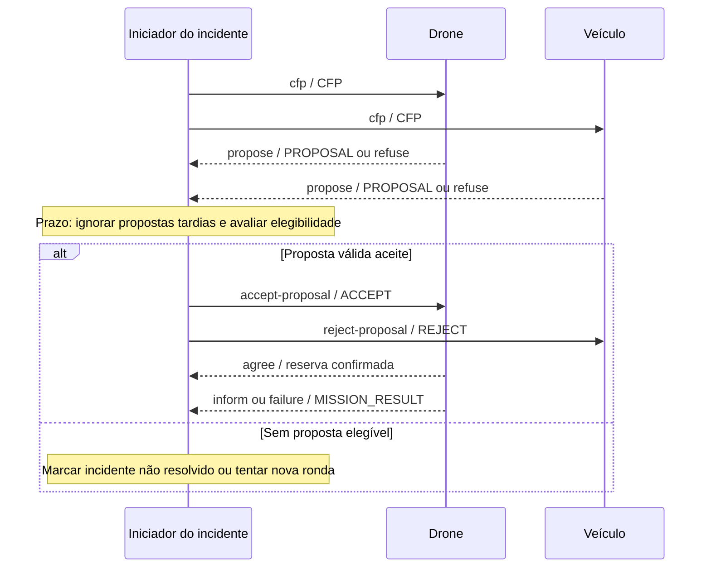

# Comunicação, mensagens e protocolos — proposta

> **Estado:** contrato inicial para discussão. **Não existe implementação confirmada**; os nomes de mensagens e os exemplos JSON não são exigências literais do docente.

[README](../README.md) · [Arquitetura](architecture.md) · [Plano](development-plan.md) · [Decisões](decisions.md)

## 1. Camadas da comunicação

| Camada | Responsabilidade | Proposta |
|---|---|---|
| Transporte | Entrega assíncrona entre identidades | SPADE + XMPP |
| Metadados da mensagem | Intenção, protocolo e associação à conversa | Campos/`metadata` com semântica FIPA-ACL |
| Corpo da mensagem | Dados do domínio | JSON UTF-8 validado e versionado |
| Protocolo | Ordem de mensagens, prazos, recusa e falhas | `verification`, `task-allocation`, `mission-report` |
| Lógica de domínio | Corroboração, reputação e decisões | Funções locais em `reasoning/`, sem gestor global |

**Nota:** `ALERT`, `VERIFY_REQUEST` etc. são **tipos de conteúdo do domínio**. `inform`, `request`, `cfp`, `propose`, `accept-proposal`, `reject-proposal` são *performatives* FIPA. Não devem ser confundidos.

## 2. Modelo base para mensagens

Proposta de contrato para o **corpo JSON** (campos obrigatórios mínimos marcados com `*`):

| Campo | Tipo | Significado |
|---|---|---|
| `schema_version`* | inteiro | Versão do contrato: começa em 1 |
| `message_id`* | string | Identificador global da mensagem, para deduplicar |
| `message_type`* | string | Tipo do conteúdo: `ALERT`, `CFP`, `PROPOSAL`, ... |
| `created_at`* | número/string documentado | Instante da emissão (definir unidade e relógio) |
| `event_id` | string | Identificador de uma observação, **não** do incidente |
| `incident_id` | string | Identificador de ocorrência agrupando evidência relacionada |
| `mission_id` | string | Identificador da missão negociada/executada |
| `source_id` | string | Fonte original da observação, quando aplicável |
| `payload`* | objeto JSON | Dados específicos do tipo de mensagem |

Metadados SPADE recomendados: `performative`, `ontology`, `protocol`, `conversation-id` (ou correlação por `thread`, a validar no SPADE escolhido), `reply-with` e `in-reply-to` quando aplicáveis. O endereço do remetente/destinatário deverá ser obtido e validado pela infraestrutura SPADE, evitando confiar cegamente num `source_id` declarado no corpo.

### Exemplo — observação de um sensor

```json
{
  "schema_version": 1,
  "message_id": "msg-001",
  "message_type": "ALERT",
  "created_at": 120.0,
  "event_id": "obs-001",
  "incident_id": "incident-07",
  "source_id": "sensor_01",
  "payload": {
    "event_type": "gunshot_like_sound",
    "position": {"x": 6, "y": 9},
    "confidence_score": 0.82,
    "sensor_modality": "acoustic"
  }
}
```

Aqui `confidence_score` é a pontuação atribuída pela fonte ao sinal e **não** uma probabilidade calibrada de caça furtiva. `created_at` usa tempo simulado em segundos apenas neste exemplo; a unidade definitiva será acordada na Etapa 1.

### Exemplo — pedido de propostas

```json
{
  "schema_version": 1,
  "message_id": "msg-014",
  "message_type": "CFP",
  "created_at": 128.0,
  "incident_id": "incident-07",
  "mission_id": "mission-03",
  "payload": {
    "task": "verify_incident",
    "target": {"x": 6, "y": 9},
    "required_capability": "mobile_verification",
    "deadline": 138.0,
    "priority": 2
  }
}
```

A prioridade é um valor de domínio a definir; não significa que exista atualmente uma escala de severidade aprovada.

## 3. Tipos de mensagens e intenção

| Tipo lógico | Performative sugerida | Emissor → destinatário | Resposta esperada |
|---|---|---|---|
| `ALERT` | `inform` | Sensor/informador → vizinhos elegíveis | Opcional: verificação |
| `VERIFY_REQUEST` | `request` | Iniciador local → fontes próximas | `VERIFY_RESPONSE` / `refuse` / timeout |
| `VERIFY_RESPONSE` | `inform` ou `refuse` | Fonte → iniciador | Evidência/ausência; referência ao pedido |
| `CFP` | `cfp` | Iniciador → recursos candidatos | `PROPOSAL` / `refuse` |
| `PROPOSAL` | `propose` | Recurso → iniciador | `ACCEPT` / `REJECT` |
| `ACCEPT` | `accept-proposal` | Iniciador → recurso | Confirmação de reserva ou falha |
| `REJECT` | `reject-proposal` | Iniciador → recurso | Nenhuma; libertar eventual reserva provisória |
| `MISSION_RESULT` | `inform` / `failure` | Patrulha/ranger → iniciador ou pares relevantes | Atualização de estado |
| `STATUS` | `inform` | Recurso → agentes interessados | Atualização temporizada |
| `INCIDENT_CLOSED` | `inform` | Agente que encerra → envolvidos | Deduplicação e fecho local |

Nem todos os esquemas propostos correspondem formalmente a um protocolo FIPA completo. Devemos dizer **«inspirado em FIPA»** salvo quando respeitarmos integralmente as sequências e a semântica documentadas.

## 4. Verificação distribuída

```mermaid
sequenceDiagram
  participant S1 as Sensor 1 / iniciador local
  participant S2 as Sensor 2
  participant I as Informador
  S1->>S2: request / VERIFY_REQUEST
  S1->>I: request / VERIFY_REQUEST
  alt Evidência existente
    S2-->>S1: inform / VERIFY_RESPONSE
  else Não tem dados ou não consegue observar
    S2-->>S1: inform (ausência) ou refuse
  end
  opt Informador responde dentro do prazo
    I-->>S1: inform / VERIFY_RESPONSE
  end
  Note over S1: Validar janela temporal, área e IDs; tratar timeout
  Note over S1: Calcular evidência local sem acesso à verdade
```

**Critérios de compatibilidade a parametrizar:** raio espacial, janela temporal, modalidades, independência aproximada e validade das fontes. Duas mensagens da **mesma observação** nunca contam como fontes distintas. A falta de deteção só pesa contra a hipótese de ameaça se o sensor tinha capacidade e oportunidade de observar.

## 5. Atribuição distribuída: Contract Net simplificado



### Regras operacionais

1. Cada CFP contém `conversation-id`, `mission_id`, capacidades mínimas e `deadline`.
2. O recurso avalia localmente se pode executar, rejeitando missões incompatíveis com a sua disponibilidade ou autonomia.
3. A proposta calcula ETA, consumo energético e custo dentro de unidades explicitadas.
4. O iniciador ignora propostas tardias, duplicadas e de missões diferentes.
5. A aceitação só se torna **missão confirmada** após o recurso garantir uma reserva válida.
6. A ausência de confirmação ou falha é tratada com timeout, estado explícito e eventual negociação alternativa.
7. A perda do iniciador deve ter uma política de recuperação acordada (p. ex. expiração de liderança local e novo iniciador determinístico). **Ainda não está definida.**
8. O encerramento deve ser idempotente: mensagens repetidas não criam novas missões.

## 6. Estado e ordenação

- `Observation`: identificada por `event_id`; permanece imutável após emissão.
- `Incident`: agrupa observações; pode ter revisões de avaliação.
- `Mission`: tem `mission_id` único e transições validadas (`PROPOSED` → `RESERVED` → `RUNNING` → `DONE`/`FAILED`).
- Guardar `message_id` processados por uma janela finita para evitar duplicação, com política de expiração.
- Mensagens fora de ordem devem ser rejeitadas ou reconciliadas com base em estado/versão.
- O transporte não garante, por si só, execução de missão; distinguir **mensagem recebida**, **pedido aceite** e **tarefa concluída**.

## 7. Gestão de erros e falhas

| Falha | Tratamento proposto | Teste |
|---|---|---|
| Fonte indisponível | Prazo de verificação e marcação de evidência incompleta | Desligar sensor durante pedido |
| Mensagem duplicada | Deduplicação por `message_id`/`event_id` | Reenviar mensagem idêntica |
| Mensagem tardia | Conferir `deadline` e estado da conversa | Atrasar uma proposta após o fecho |
| Dupla atribuição | Reserva atómica por recurso | Duas conversas concorrentes |
| Recurso sem energia | `refuse` com motivo | Bateria inferior à reserva mínima |
| Falha de missão | `failure`, libertação/reavaliação | Interromper recurso em movimento |
| Falha do iniciador | Política de substituição ainda pendente | Simular desaparecimento do iniciador |
| Mensagem inválida | Validação + rejeição sem crash | JSON malformado ou campos ausentes |
| Conectividade degradada | Perda/atraso no adaptador de transporte | Comparar cenários de rede |

## 8. Implementação e compatibilidade SPADE

Na Etapa 3 verificar, com a versão realmente instalada: `spade.agent.Agent`, comportamentos (`CyclicBehaviour`, `PeriodicBehaviour`), `spade.message.Message`, `Template`, `send`/`receive` e metadados. A utilização específica de FIPA deverá ser comprovada com um teste de integração, e não presumida a partir de exemplos antigos.

Os contratos devem ser implementados em `communication/messages.py`, as conversações em `communication/protocols.py`, e a simulação de perda/latência num adaptador em `communication/transport.py`. Testes de serialização podem ser feitos sem XMPP; testes de entrega exigem agentes reais.

## 9. Checklist de aprovação

- [ ] Escolher versão final do contrato e unidade do relógio.
- [ ] Acordar IDs, destinatários, convenção de correlação e prazos.
- [ ] Definir campos mínimos de `Observation`, `Mission` e `Bid`.
- [ ] Confirmar performatives/protocolos suportados pela versão SPADE usada.
- [ ] Documentar recusa, timeout, deduplicação, reserva e recuperação.
- [ ] Escrever primeiro os testes dos fluxos de verificação e de atribuição.
