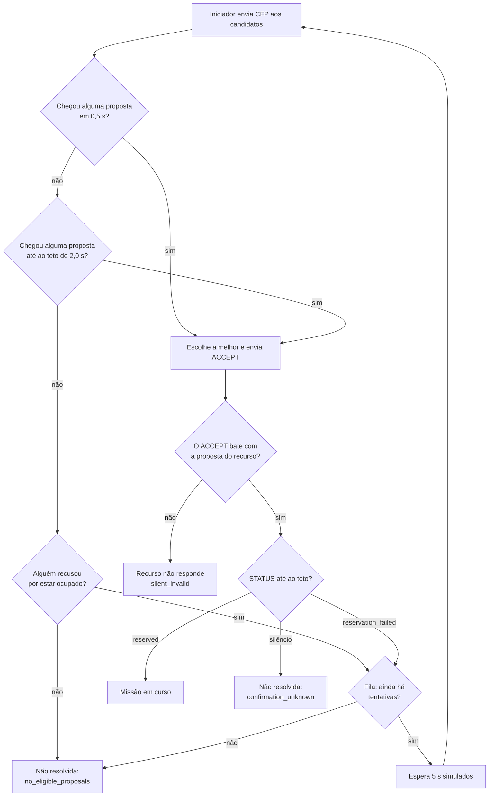

# Escalabilidade — Etapa 9A (P3)

[Plano](development-plan.md#etapa-9a--escalabilidade-computacional-e-situacional) · [Experiências](experiments.md) · [Arquitetura](architecture.md) · [Pendentes](delivery-todo.md#bloco-c--p3-escalabilidade)

Resposta a P3: que limites de escala tem o sistema, quais foram medidos e o que se propõe para cada um. Os números vêm de [`results/scalability/`](../results/scalability/), gerados a 16-11-2026 com o código `src/` da `main` em `89c08a7`.

## Como reproduzir

A partir da raiz do repositório (não precisa de servidor XMPP nem da pasta `.git`):

```bash
PYTHONPATH=src python scripts/dist.py    # ~2 min, grava results/scalability/dist.csv
PYTHONPATH=src python scripts/scale.py   # ~20 s, grava results/scalability/scale.csv
```

- **Cenário:** A (fontes fiáveis), variante `full`, sementes 1000–1009 (10 repetições); os casos com perdas usam 1000–1019 (20).
- **Transporte:** local. As perdas são injetadas no transporte local e não validam a rede XMPP.
- **Tempo real** (`tempo_real_s`): depende da máquina. Comparar casos da mesma execução, nunca valores entre máquinas.
- **«Atendidos»** (`atendidos/ameacas`): ameaças reais em cuja posição uma patrulha confirmou a ameaça. É a métrica por caçador, calculada pela função `attended()` de [`scripts/dist.py`](../scripts/dist.py). Não conta intervenções concluídas pelo guarda.

## Montagem

```
   y
   7 . . . . . . . .
   6 . . . . . . P .     P = caçador fora de alcance (6,6)
   5 . p . . . R . .     p = caçador testado (2,5);  R = guarda (5,5)
   4 . . . . . . . .
   3 . . . . . . . .
   2 D . S X S . . .     S = sensor-1 (2,2), único iniciador; sensor-2 (4,2)
   1 . . . . . . . .     X = caçador base (3,2);  D = drone (0,2)
   0 V . . . . . . Q     V = veículo (0,0);  Q = ponto cego do iniciador (7,0)
     0 1 2 3 4 5 6 7  x
```

Os dois sensores têm alcance de 5 células. Em (7,0), o sensor-2 está a 3,6 células e vê o caçador; o sensor-1 está a 5,4 e não vê.

## Custo computacional (`scale.csv`)

Mensagens por missão com N candidatos: N CFP + N respostas + 1 `ACCEPT` + até N−1 rejeições + 1 `STATUS` + 1 resultado, ou seja, **no máximo 3N + 2**. Uma ocorrência completa = 2 (verificação) + 8 (patrulha, N = 2) + 5 (guarda, N = 1) = **15 mensagens**.

| Caso | Confirmadas | Não resolvidas | Mensagens por execução | Tempo real (10 execuções) |
|---|---|---|---|---|
| Base: 2 patrulhas, 1 guarda, 1 caçador | 8/10 | 0 | 15 (×8), 2 (×2) | 1,5 s |
| Drone silencioso | 8/10 | 0 | 13 (×8), 2 (×2) | 5,5 s |
| 0 patrulhas | 0/10 | 8 | 4 (×8), 2 (×2) | 4,1 s |
| 0 guardas | 8/10 | 8 | 11 (×8), 2 (×2) | 4,6 s |
| 3 caçadores | 8/10 | 0 | 15 (×8), 2 (×2) | 1,5 s |

- As execuções com 2 mensagens pararam na corroboração (`insufficient_corroboration`); por isso a média da base é 12,4 e não 15.
- **C2 medido:** um candidato calado faz cada ronda esperar o prazo inteiro. Nesta máquina, dez execuções passaram de 1,5 s para 5,5 s reais, sem qualquer ganho de resultado. O fator depende da máquina; reportam-se os dois tempos.
- Com 3 caçadores, as mensagens não mudam: só existe uma ocorrência (C7).

## Escalabilidade situacional (`dist.csv`)

**A) Onde estão os caçadores (recursos fixos)**

| Caso | Alertas | Atendidos | t verif. (s sim.) | O que mostra |
|---|---|---|---|---|
| 1 caçador em (3,2) | 10/10 | 8/10 | 4 | Referência; as 2 falhas vêm da corroboração |
| 1 caçador em (2,5) | 10/10 | 8/10 | 6 | Mais longe dos recursos, verificação mais lenta |
| 1 caçador em (7,0) | **0/10** | 0/10 | — | O sensor-2 vê, mas só o sensor-1 inicia |
| 1 caçador em (6,6) | 0/10 | 0/10 | — | Fora do alcance dos dois sensores |
| 2 caçadores | 10/10 | **8/20** | 4 | Uma ocorrência por janela (C7) |
| 3 caçadores | 10/10 | **8/30** | 4 | A métrica por execução (8 TP) esconde as ameaças sem resposta |

**B) Quantidade e posição dos recursos (1 caçador em (3,2), drone com carga 0,5)**

| Caso | Confirmadas | Não resolvidas | t verif. | t guarda | Energia (p.p.) |
|---|---|---|---|---|---|
| Recursos na base | 8 | 0 | 6 | 12 | 16,0 |
| Recursos no canto (7,7) | 8 | 0 | 9 | 19 | 27,2 |
| Só o guarda em (0,7) | 8 | 0 | 6 | 15 | 20,8 |
| Drone com 15 % (1 patrulha elegível) | 8 | 0 | 6 | 12 | 16,0 |
| Drone e veículo com 15 % (0 elegíveis) | 0 | 8 | — | — | 0 |

**C) Recursos com 10 % de perda (20 repetições)**

| Caso | Alertas | Atendidos | Não resolvidas | t guarda |
|---|---|---|---|---|
| 2 patrulhas elegíveis | 19/20 | 13/20 | 8 | 15,9 |
| 1 patrulha elegível | 19/20 | 9/20 | 10 | 17,0 |

**Leitura, com o alcance que a amostra permite:**

1. **A cobertura do iniciador limita mais do que os recursos.** Um caçador fora do alcance do sensor-1 nunca gera alerta, mesmo que o sensor-2 o veja.
2. **Recursos mais longe aumentam tempo e energia, não mudaram decisões** nestes casos.
3. **Menos recursos:** sem perdas, uma patrulha elegível obteve as mesmas confirmações que duas; sem nenhuma, 0 confirmações e 8 não resolvidas. Com 10 % de perda, duas patrulhas atenderam 13/20 e uma atendeu 9/20. Com 20 repetições e sem intervalos de confiança, isto sugere que a redundância ajuda sob perdas; não prova que menos recursos só prejudicam quando há perdas.
4. **Mais caçadores do que ocorrências:** com 2 ou 3 caçadores só um é atendido.

## Estado de C1–C8

| Ref. | Limite | Onde | Estado | Justificação |
|---|---|---|---|---|
| C1 | CFP enviado a todos os candidatos: O(N) por missão | [incident.py:143](../src/isia/agents/incident.py#L143) | **Implementado e medido (Bloco F)** | `cfp_limit=K` envia o CFP só às K patrulhas com base mais próxima do alvo. Com 16 patrulhas: 57 → 15 mensagens por ocorrência, mesma decisão. Opcional: sem `cfp_limit`, o comportamento é o anterior. Usa a posição base, não a atual |
| C2 | Candidato calado obriga a esperar o prazo inteiro | [incident.py:146](../src/isia/agents/incident.py#L146) | **Medido** | 1,5 s → 5,5 s reais nesta máquina. Proposta: não voltar a chamar quem ficou calado na ronda seguinte |
| C3 | Prazos reais com tempo simulado | [runner.py:257](../src/isia/simulation/runner.py#L257), [incident.py:146](../src/isia/agents/incident.py#L146) | Adiado | Obriga a avançar o relógio simulado durante a negociação; trabalho futuro |
| C4 | Recursos e sensores fixos no runner | [runner.py:67](../src/isia/simulation/runner.py#L67), [:86](../src/isia/simulation/runner.py#L86), [:200](../src/isia/simulation/runner.py#L200) | **Mínimo implementado (Bloco F)** | `run_mvp(extra_patrols=..., extra_initiators=...)` acrescenta drones e sensores iniciadores sem mudar o código. Os ficheiros de cenário continuam com os três recursos fixos |
| C5 | `ObservationFeed.recent()` percorre todo o histórico, O(H) | [scenario.py:98](../src/isia/simulation/scenario.py#L98) | Proposto | O feed é lido uma vez por execução; o ganho não é mensurável neste sistema. Proposta: `bisect` ou `deque` da janela |
| C6 | Corroboração com um único par fixo | [runner.py:167](../src/isia/simulation/runner.py#L167) | Proposto | Perguntar aos k vizinhos com alcance e decidir com as respostas até ao prazo |
| C7 | Uma ocorrência por janela, ancorada na primeira observação | [incident.py:326](../src/isia/agents/incident.py#L326), [allocation.py:783](../src/isia/reasoning/allocation.py#L783) | **Medido** | 8/10, 8/20, 8/30 atendidos. Proposta: agrupar observações por proximidade e criar uma ocorrência por grupo |
| C8 (reputação) | Histórico da reputação cresce em memória | [reputation.py:128](../src/isia/reasoning/reputation.py#L128) | **Medido (Bloco F)** | 1000 execuções: 1824 registos, 1,3 MB serializados, crescimento linear (~1,3 kB por execução). Irrelevante à escala do projeto; a proposta de truncar ou gravar em JSONL mantém-se para execuções muito longas |
| C8 (processos) | Todos os agentes num processo | [runner.py](../src/isia/simulation/runner.py) | Adiado | Um processo por agente ligado ao XMPP; mudança grande, trabalho futuro |

**Situacionais, também propostos:** qualquer sensor poder iniciar (elimina o ponto cego de (7,0), mas exige evitar ocorrências duplicadas); fila de ocorrências por gravidade, só depois de C7. A métrica por caçador está feita em `attended()`.

## Correções a afirmações anteriores

- **C1 — o iniciador não conhece a posição base dos recursos.** `candidates` só tem `{jid: resource_id}` ([runner.py:226](../src/isia/simulation/runner.py#L226)). Filtrar pelos K mais próximos obriga o runner a passar as posições ou os recursos a anunciá-las; a posição só chega ao iniciador na `PROPOSAL`, depois do CFP. **Resolvido no Bloco F** pela primeira via: o runner passa as posições base em `configure_mvp(base_positions=...)`.
- **C2 — o fator de lentidão não é constante.** A análise de 13-11 indicava «3,4×» (1,6 s → 5,5 s); a medição de 16-11 deu 1,5 s → 5,5 s. Reportam-se os tempos e a máquina, não um fator.
- **Recursos — «menos recursos só prejudica com falhas» é forte demais.** Sem perdas, retirar todas as patrulhas elegíveis já impede qualquer confirmação; e a diferença 13/20 contra 9/20 vem de 20 repetições sem intervalo de confiança.

## Limites da evidência

- 10–20 repetições, sem intervalos de confiança; um cenário (A) e uma variante (`full`).
- O drone com 15 % de autonomia continua a receber CFP; simula um recurso inelegível, não um recurso ausente.
- O aumento do número de drones (C4) só foi medido em mensagens, com uma ocorrência e drones adicionais com 100 % de autonomia (Bloco F).
- Os resultados não demonstram escalabilidade geral.

## Testes de stress (Bloco F)

Onde o sistema deixa de atender, em várias dimensões. Os números vêm de [`results/stress/`](../results/stress/), gerados a 16-11-2026 na branch `feature/bloco-f-stress`, com o transporte local.

```bash
PYTHONPATH=src python scripts/stress_f1.py     # ~8 min: perda, latencia, cascata, autonomia, combinadas
PYTHONPATH=src python scripts/stress_f2.py     # ~14 min: paralelo, invalidas, escala, prazo (~8,5 min), teto (~2,5 min), fila, silencio, espera, prioridade
PYTHONPATH=src python scripts/stress_long.py   # ~3 min: longa
PYTHONPATH=src python scripts/stress_f1.py reenvio        # ~9 min: perda sem reenvio e com 1 e 2 reenvios
PYTHONPATH=src python scripts/stress_f2.py humano alerta  # ~1 min: informadores humanos e aviso entre iniciadores
```

- **F1** usa o cenário A (1 caçador em (3,2), fontes com ruído) e a variante `full`, com reputação nova em cada execução. Em 10 execuções, 2 param na corroboração; por isso o máximo é 8/10 (17/20 com 20 execuções).
- **F2** usa fontes sem ruído (alcance 1) e política sem corroboração, com um caçador na célula de cada sensor iniciador. Assim, a única variável é a disputa pelos recursos.
- **«Fechadas»** = ocorrências em que a patrulha confirmou e o guarda interveio (`closed`). **«Confirmadas»** = só a verificação pela patrulha.

### Para que serviu este bloco

Antes dizíamos «o sistema foi desenhado para aguentar falhas». Agora dizemos «aguenta até aqui e deixa de funcionar aqui», com números.

**1. Deu respostas medidas às perguntas da defesa.**

| Pergunta | Resposta medida |
|---|---|
| E se a rede perder mensagens? | Fecha 17 de 20 ocorrências sem perda, 7 com 10 % de perda e nenhuma a partir de 30 % |
| E se a rede for lenta? | Funciona até 0,4 s de atraso; a partir de 0,5 s deixa de negociar |
| E se faltarem recursos? | Sem o drone, o resultado é igual, só mais lento. Sem patrulhas, nada é confirmado. Sem o guarda, nada é fechado |
| E se houver várias ocorrências ao mesmo tempo? | Em cada janela confirma 2 e fecha 1, porque só há um guarda |
| E se alguém enviar mensagens falsas? | Milhares de mensagens inválidas não mudam nenhuma decisão nem fazem parar nenhum agente |

**2. Mostrou três fraquezas que não se viam.**

- O prazo de espera fixo (0,5 s) é frágil: não há degradação gradual, o sistema passa de «funciona sempre» para «nunca funciona». Foi isto que motivou o [prazo dinâmico](#prazo-dinâmico-antes-e-depois).
- O único guarda é o gargalo: com 2, 4 ou 8 ocorrências, só uma fecha por janela. Foi isto que motivou a [fila](#fila-para-recursos-ocupados-antes-e-depois).
- Os agentes respondem a parte das mensagens inválidas. As respostas estão corretas, mas dão tráfego de volta a quem ataca. Foi isto que motivou o [silêncio perante `ACCEPT` incoerente](#silêncio-perante-accept-incoerente-antes-e-depois).

**3. Provou duas garantias que eram só alegações.**

- **Nenhuma reserva dupla.** O risco: duas ocorrências pedem o mesmo drone e o drone aceita as duas. O sistema evita-o com o `STATUS`: depois de escolher o drone, o iniciador espera que ele confirme a reserva; se o drone já foi reservado por outra ocorrência, responde que não e o iniciador procura outro recurso. Provocámos esta situação de propósito e contámos zero reservas duplas.
- **Nenhuma exceção.** Enviámos milhares de mensagens com defeito e nenhum agente parou.

**4. Fechou duas pontas soltas da escalabilidade.** O C1 passou a ter «antes e depois» (57 mensagens contra 15, com 16 patrulhas) e o C8 deixou de estar «não medido» (1,3 kB por execução).

**5. Repete-se.** Com as mesmas sementes e num clone limpo, os resultados saem iguais. A única exceção depende da velocidade do computador e está explicada [abaixo](#limites-destes-testes).

### Mapa de limites

| Teste | CSV | Onde deixa de atender |
|---|---|---|
| Perda de mensagens | [perda.csv](../results/stress/perda.csv) | Com 10 % de perda fecha 7/20 (17/20 sem perda); com 20 %, 1/20; a partir de 30 %, nenhuma |
| Latência de `PROPOSAL` e `STATUS` | [latencia.csv](../results/stress/latencia.csv) | Até 0,4 s de atraso, 8/8; a partir de 0,5 s (o `receive_timeout`), 0/8. Não há degradação gradual |
| Recursos a cair | [cascata.csv](../results/stress/cascata.csv) | Sem o drone, igual (8/8); sem as duas patrulhas, 0 confirmadas; sem o guarda, 8 confirmadas e 0 fechadas |
| Escassez de autonomia | [autonomia.csv](../results/stress/autonomia.csv) | Até 20 %, ganha o veículo; de 19 % a 16 %, o veículo recusa e ganha o drone; a partir de 15 %, os dois recusam e nada é atendido |
| Falhas combinadas | [combinadas.csv](../results/stress/combinadas.csv) | 0 duplas reservas e 0 fechos duplicados em 20 execuções; 6 confirmadas, 0 fechadas |
| Ocorrências em paralelo e rajada | [paralelo.csv](../results/stress/paralelo.csv) | Por janela, o sistema fecha 1 ocorrência (1 guarda) e confirma 2 (2 patrulhas), sejam 2, 4 ou 8 as ocorrências. 0 duplas reservas |
| Mensagens inválidas | [invalidas.csv](../results/stress/invalidas.csv) | Até 300 mensagens inválidas de cada tipo por mensagem real (12 600 por execução), resultado igual em 10/10. Com 1000, depende da carga da máquina: 0/10 na primeira execução e 10/10 no clone limpo. Nenhuma exceção |
| Execução longa | [longa.csv](../results/stress/longa.csv) | Não deixa de atender em 1000 execuções; o histórico da reputação cresce 1,3 kB por execução |
| Prazo fixo contra prazo dinâmico | [prazo.csv](../results/stress/prazo.csv) | Atraso: o limite passa de 0,5 s para 2,0 s. Mensagens inválidas: passa de 1000 para 5000 por mensagem real. Ver [antes e depois](#prazo-dinâmico-antes-e-depois) |
| Tetos do prazo dinâmico | [teto.csv](../results/stress/teto.csv) | O teto é o maior atraso tolerado e também o tempo perdido quando ninguém responde. Ver [que teto escolher](#que-teto-escolher) |
| Fila para recursos ocupados | [fila.csv](../results/stress/fila.csv) | Sem fila fecha 1 ocorrência por janela; com fila fecha todas (8 de 8), com o triplo das mensagens. Ver [antes e depois](#fila-para-recursos-ocupados-antes-e-depois) |
| Espera na fila com ameaças curtas | [espera.csv](../results/stress/espera.csv) | Com ameaças de 30 s, 40 de 80 patrulhas chegam em vão e só 20 de 80 ocorrências têm o guarda a tempo. Ver [o que acontece a quem espera](#fila-para-recursos-ocupados-antes-e-depois) |
| Prazo de validade da ocorrência | [validade.csv](../results/stress/validade.csv) | Com ameaças de 30 s, as patrulhas em vão descem de 40 para 12 e as idas do guarda em vão de 20 para 8; 40 de 80 expiram sem deslocação. Não salva nenhuma ocorrência. Ver [mitigações](#1-prazo-de-validade-da-ocorrência) |
| Mais guardas | [guardas.csv](../results/stress/guardas.csv) | Com 2 guardas, cada ocorrência é atendida ao primeiro pedido (3,3 pedidos com 1); o último fecho só desce de 81 s para 68 s, porque passam a faltar patrulhas. O quarto guarda não ajuda. Ver [mitigações](#2-mais-guardas-e-um-informador-por-iniciador) |
| Um informador por iniciador | [informadores.csv](../results/stress/informadores.csv) | Com 1, 2 e 4 informadores para 4 ocorrências, são mobilizadas 10, 20 e 40 de 40; as outras expiram sem corroboração. Ver [mitigações](#2-mais-guardas-e-um-informador-por-iniciador) |
| Recurso ocupado diz quando fica livre | [ocupado.csv](../results/stress/ocupado.csv) | Mensagens de 367 para 336 e pedidos ao guarda de 3,2 para 2,6, em média; o ganho é limitado pela duração curta das missões. Ver [mitigações](#3-o-recurso-ocupado-diz-quando-fica-livre) |
| Missões encadeadas | [encadear.csv](../results/stress/encadear.csv) | O último fecho de 8 ocorrências passa de 81 s para 54 s, sem duplas reservas. Ver [mitigações](#5-encadear-missões) |
| Cenário D, «dia movimentado» | [runs.csv](../results/scenario-d/runs.csv) | 6 ameaças ao mesmo tempo, tudo ligado: 45 de 52 ocorrências fechadas, 0 por resolver, 0 duplas reservas; as graves fecham em média aos 10 s e as leves aos 31 s. Ver [cenário D](#cenário-d--dia-movimentado) |
| Fila ordenada por gravidade | [prioridade.csv](../results/stress/prioridade.csv) | Com 2 graves, 3 médias e 3 leves ao mesmo tempo, as graves fecham em média aos 23 s em vez de 74 s; as leves passam de 27 s para 76 s. Ver [antes e depois](#fila-ordenada-por-gravidade-antes-e-depois) |
| Silêncio perante `ACCEPT` incoerente | [silencio.csv](../results/stress/silencio.csv) | As respostas a lixo descem 80 % (de 5 para 1 por unidade de `flood`). Ver [antes e depois](#silêncio-perante-accept-incoerente-antes-e-depois) |
| Mensagens em função de N (C4 + C1) | [escala.csv](../results/stress/escala.csv) | Sem limite: 15, 21, 33 e 57 mensagens com 2, 4, 8 e 16 patrulhas. Com K = 2: 15 em todos os casos |
| Reenvio de mensagens | [reenvio.csv](../results/stress/reenvio.csv) | Com 10 % de perda e 1 reenvio fecha 17/20, como sem perda (7/20 sem reenvio). Com 20 %: 1, 10 e 16 de 20 com 0, 1 e 2 reenvios. Com 30 %: 0, 3 e 9. Ver [reenvio](#reenvio-de-mensagens-antes-e-depois) |
| Aviso entre iniciadores | [alerta.csv](../results/stress/alerta.csv) | Com 4 iniciadores a ouvir a mesma ameaça, 40 ocorrências e 40 idas de patrulha passam a 10 e 10; duas ameaças a 4 células não se fundem. Ver [aviso](#aviso-entre-iniciadores-antes-e-depois) |
| Informadores humanos | [humano.csv](../results/stress/humano.csv) | Um informador humano fiável corrobora como uma câmara (40 de 40). Com 30 % de falhas, erro de 1 célula e confiança 0,5, são mobilizadas 30 de 40. Ver [informadores humanos](#informadores-humanos-no-lugar-das-câmaras) |
| Cenário E, «reserva alargada» | [runs.csv](../results/scenario-e/runs.csv) | 16 ameaças ao mesmo tempo e 20 fontes: 132 de 160 fechadas, 13 expiradas sem corroboração, 7 por resolver (guardas sem autonomia), 0 duplas reservas; último fecho aos 118 s, em média. Ver [cenário E](#cenário-e--reserva-alargada) |

### F1 — só parâmetros

**Perda (20 execuções por ponto)**

| Perda | Mobilizou | Confirmadas | Fechadas | Não resolvidas | Mensagens (média) |
|---|---|---|---|---|---|
| 0 % | 17 | 17 | 17 | 0 | 13,0 |
| 10 % | 15 | 13 | 7 | 8 | 9,6 |
| 20 % | 12 | 8 | 1 | 11 | 6,8 |
| 30 % | 10 | 4 | 0 | 10 | 5,0 |
| 50 % | 4 | 0 | 0 | 4 | 2,0 |

- Nestas condições os agentes não retransmitem. Uma ocorrência completa precisa de 15 mensagens seguidas, por isso a perda de uma só já a deixa por fechar. O [reenvio](#reenvio-de-mensagens-antes-e-depois), opcional, responde a isto.
- A perda atinge primeiro a corroboração: com 50 %, 15 das 20 execuções param em `insufficient_corroboration` e nem chegam a negociar.

**Latência (10 execuções por ponto).** O limite é o prazo fixo de 0,5 s reais. Atraso na `PROPOSAL` ≥ 0,5 s dá `no_eligible_proposals`; atraso no `STATUS` ≥ 0,5 s dá `confirmation_unknown`, com o recurso já reservado. O prazo fixo é frágil: 0,4 s funciona sempre e 0,5 s nunca.

**Cascata (10 execuções por caso).** Retirar o drone não muda o resultado, mas o tempo real passa de 1,5 s para 5,5 s (o candidato calado esgota o prazo, C2). O guarda é ponto único de falha da intervenção: sem ele, as 8 ameaças confirmadas ficam `unresolved`.

**Autonomia (drone e veículo com o mesmo valor).** A recusa é local e segue a conta de cada recurso: autonomia mínima de 10 % mais a ida e volta (veículo a 5 células, 10 p.p.; drone a 3 células, 6 p.p.).

| Autonomia | `REJECT` dos recursos | Quem verifica | Fechadas |
|---|---|---|---|
| 100 % a 20 % | 0 | veículo | 8 |
| 19 % a 16 % | 8 (veículo) | drone | 8 |
| 15 % e 10 % | 16 (os dois) | ninguém | 0 |

**Falhas combinadas.** Perda de 20 %, `MISSION_RESULT` duplicado e drone ocupado depois da proposta, na mesma execução. As garantias mantêm-se (nenhum recurso com duas missões, nenhum incidente fechado duas vezes), mas nenhuma ocorrência chega ao fim: 12 de 20 ficam `unresolved`.

### F2 — com código novo no runner

`run_mvp` ganhou parâmetros opcionais, só no transporte local: `extra_initiators`, `extra_patrols` e `cfp_limit` (17-11-2026), `extra_rangers`, `extra_informants`, `map_size` e `sensor_positions` (18-11-2026), e a chave `flood` em [`faults`](faults.md). Sem eles, o comportamento é o anterior.

**Ocorrências em paralelo e rajada (10 execuções por caso).** Cada iniciador trata só o que o seu sensor deteta; o runner não escolhe quem trata cada ameaça.

| Ocorrências | Confirmadas | Fechadas | Não resolvidas | `STATUS` `reservation_failed` | CFP de 2.ª ronda | Duplas reservas | Mensagens (média) |
|---|---|---|---|---|---|---|---|
| 1 | 10/10 | 10/10 | 0 | 0 | 0 | 0 | 15 |
| 2 | 20/20 | 10/20 | 10 | 10 | 20 | 0 | 33 |
| 4 | 20/40 | 10/40 | 30 | 50 | 60 | 0 | 63 |
| 8 | 20/80 | 10/80 | 70 | 130 | 140 | 0 | 123 |

- **O `STATUS` resolve a corrida.** Com 2 ocorrências, os dois iniciadores aceitam a mesma patrulha; um recebe `reservation_failed`, renegocia e fica com a outra. Nunca houve dupla reserva.
- **Saturação: 2 verificações e 1 intervenção por janela.** Não há fila: quem perde a corrida fica `unresolved` (`reservation_rejected` ou `no_eligible_proposals`) e não volta a tentar quando o recurso regressa.
- O tempo simulado das ocorrências fechadas não muda (12 s com 1 ou com 8).

**Mensagens inválidas (10 execuções por ponto)**

| Inválidas por mensagem real (de cada tipo) | Inválidas por execução | Resultado igual ao de referência | Exceções | Tempo real |
|---|---|---|---|---|
| 0 | 0 | 10/10 | 0 | 2,0 s |
| 10 | 420 | 10/10 | 0 | 2,2 s |
| 100 | 4 200 | 10/10 | 0 | 4,9 s |
| 300 | 12 600 | 10/10 | 0 | 11,2 s |
| 1000 | 17 200 | 0/10 | 0 | 13,8 s |

- A validação aguenta a carga: nenhum agente termina com exceção e nenhuma mensagem inválida muda uma decisão.
- Com 1000, a negociação legítima falhou por tempo, não por erro: processar o lixo demorou mais do que o prazo de 0,5 s. No clone limpo, com a máquina menos carregada, o mesmo ponto deu 10/10 (42 000 inválidas por execução, 17,8 s). O limite depende do CPU, não do código: na medição do [prazo dinâmico](#prazo-dinâmico-antes-e-depois), com a máquina sem carga, o prazo fixo aguentou 1000 e falhou com 2000.
- **Achado:** os agentes respondem a parte do lixo (5 respostas por unidade de `flood`). O `InformantAgent` responde a um `VERIFY_REQUEST` com IDs trocados (é um pedido bem formado), e os recursos respondem `reservation_failed` a um `ACCEPT` incoerente. São respostas corretas, mas dão tráfego de volta a quem ataca. Ver [silêncio perante `ACCEPT` incoerente](#silêncio-perante-accept-incoerente-antes-e-depois).

**Execução longa.** 1000 execuções com o mesmo `ReputationBook` em 176 s: 1824 registos em `book.history`, 1,3 MB serializados. O pico de memória do processo passou de 85 MB para 104 MB, dos quais 12 MB nas primeiras 100 execuções. A reputação do sensor-1 estabiliza em 0,998.

**Mensagens em função do número de patrulhas (C4 mínimo + C1, 10 execuções por caso)**

| Patrulhas | Sem limite | Com `cfp_limit=2` |
|---|---|---|
| 2 | 15 | 15 |
| 4 | 21 | 15 |
| 8 | 33 | 15 |
| 16 | 57 | 15 |

Cada patrulha a mais custa 3 mensagens (CFP, `PROPOSAL`, `REJECT`). Com K = 2, o custo é constante e as 10 ocorrências fecham no mesmo tempo simulado (12 s).

### Prazo dinâmico (antes e depois)

**O problema.** O iniciador esperava sempre 0,5 s pelas propostas e 0,5 s pelo `STATUS`. Uma resposta que chegasse aos 0,6 s era tratada como se nunca tivesse chegado.

**A ideia.** Esperar pouco quando há alternativa e esperar mais quando desistir significa falhar.

- **Propostas:** ao fim de 0,5 s, se já chegou pelo menos uma proposta, o iniciador avança com ela, como antes. Se não chegou nenhuma, continua à espera até um teto de 2,0 s.
- **`STATUS`:** o iniciador espera até ao teto. Depois do `ACCEPT` não há alternativa: desistir dá `confirmation_unknown`, que não permite escolher outro recurso.

**Como ligar.** `run_mvp(max_receive_timeout=2.0)` ([incident.py](../src/isia/agents/incident.py), `allocate`). Esteve desligado por omissão até 18-11-2026; desde então é o valor por omissão de `run_mvp`, e `max_receive_timeout=None` repõe o prazo fixo. O coletor e os scripts de medição passam `PUBLISHED_CONDITIONS` (prazo fixo, sem fila, com resposta a `ACCEPT` incoerente), para os resultados publicados continuarem reproduzíveis; a alteração está registada na [ata](approvals.md#registo-de-alterações-ao-código). Ligar as três opções não muda os resultados oficiais: a recolha da Etapa 9 repetida com elas ligadas (17-11-2026) deu `summary.csv` e `runs.csv` iguais, byte a byte, porque cada execução tem uma só ocorrência, nenhuma mensagem inválida, e as perdas do cenário C não se resolvem esperando. Mudariam 4 testes que verificam o comportamento antigo e as curvas do F1, que passam a ser o «antes».

**Resultados** ([prazo.csv](../results/stress/prazo.csv), 17-11-2026, montagem do F2, 10 execuções por célula; ocorrências fechadas e tempo real por execução):

| Caso | Prazo fixo (0,5 s) | Prazo dinâmico (0,5 a 2,0 s) |
|---|---|---|
| Sem falhas | 10/10 · 0,20 s | 10/10 · 0,20 s |
| `PROPOSAL` com 0,4 s de atraso | 10/10 · 0,99 s | 10/10 · 0,99 s |
| `PROPOSAL` com 0,6 s | 0/10 · 0,51 s | **10/10** · 1,37 s |
| `PROPOSAL` com 1,5 s | 0/10 · 0,51 s | **10/10** · 3,17 s |
| `PROPOSAL` com 2,5 s | 0/10 · 0,51 s | 0/10 · 2,01 s |
| `STATUS` com 0,6 s | 0/10 · 0,51 s | **10/10** · 1,21 s |
| `STATUS` com 1,5 s | 0/10 · 0,51 s | **10/10** · 3,01 s |
| `STATUS` com 2,5 s | 0/10 · 0,51 s | 0/10 · 2,01 s |
| Sem o drone | 10/10 · 0,70 s | 10/10 · 0,69 s |
| Sem as duas patrulhas | 0/10 · 0,51 s | 0/10 · 2,01 s |
| Sem o guarda | 0/10 · 0,56 s | 0/10 · 2,06 s |
| 1000 inválidas por mensagem | 10/10 · 1,68 s | 10/10 · 1,68 s |
| 2000 inválidas | 0/10 · 1,78 s | **10/10** · 3,17 s |
| 5000 inválidas | 0/10 · 2,10 s | **10/10** · 7,68 s |
| 8000 inválidas | 0/10 · 3,48 s | 0/10 · 6,70 s |

**Vantagens**

- O sistema aguenta atrasos quatro vezes maiores: o limite passou de 0,5 s para 2,0 s.
- Aguenta cinco vezes mais mensagens inválidas nesta máquina: de 1000 para 5000 por mensagem real.
- Não custa nada quando tudo corre bem: sem falhas e sem o drone, o tempo é igual.
- É pequeno: cerca de dez linhas no iniciador, sem mensagens novas e sem mudar o protocolo.

**Desvantagens**

- Falhar demora quatro vezes mais. Quando ninguém responde (sem patrulhas ou sem guarda), a ocorrência só é dada como não resolvida ao fim de 2,0 s, em vez de 0,5 s.
- Há mais um valor para escolher e justificar (o teto).

**Limitações**

- O limite não desapareceu, mudou de sítio: com 2,5 s de atraso falha nos dois casos. O teto continua a ser um número fixo; o iniciador não aprende com os tempos que observa. Um prazo que se ajusta sozinho, como o do TCP, fica como trabalho futuro.
- Uma proposta lenta continua a perder: se uma proposta chega dentro de 0,5 s, o iniciador não espera pelas outras, mesmo que fossem melhores. Já era assim.
- O prazo continua a ser em tempo real. Por isso, o limite das mensagens inválidas depende do computador: os valores 5000 e 8000 são desta máquina, sem carga.
- Só muda a espera por propostas e pelo `STATUS`. A espera pelo `VERIFY_RESPONSE` (10 s) e pelo `MISSION_RESULT` (dez prazos) fica igual.
- Medido só no transporte local, com a política sem corroboração e 10 execuções por célula. Na rede XMPP (servidor local, 17-11-2026) só se confirmou que o MVP fecha a ocorrência com as três opções ligadas; não há injeção de atrasos nesse transporte.

#### Que teto escolher

Medimos quatro tetos ([teto.csv](../results/stress/teto.csv), 5 execuções por célula; sem perdas aleatórias, as execuções de cada célula são iguais). Ocorrências fechadas e tempo real por execução:

| Caso | Teto 0,5 s (prazo fixo) | Teto 1,0 s | Teto 2,0 s | Teto 4,0 s |
|---|---|---|---|---|
| `PROPOSAL` com 0,6 s de atraso | 0/5 · 0,51 s | **5/5** · 1,37 s | **5/5** · 1,38 s | **5/5** · 1,37 s |
| `PROPOSAL` com 1,5 s | 0/5 · 0,51 s | 0/5 · 1,01 s | **5/5** · 3,17 s | **5/5** · 3,18 s |
| `PROPOSAL` com 3,0 s | 0/5 · 0,51 s | 0/5 · 1,01 s | 0/5 · 2,01 s | **5/5** · 6,18 s |
| Ninguém responde (sem patrulhas) | 0/5 · 0,51 s | 0/5 · 1,01 s | 0/5 · 2,01 s | 0/5 · 4,01 s |

- **A regra é simples:** o teto é, ao mesmo tempo, o maior atraso que o sistema tolera e o tempo que se perde quando ninguém responde. Não há um valor ótimo; há uma troca.
- **Quando há resposta, o teto não custa nada:** com 0,6 s de atraso, o tempo é o mesmo (1,37 s) com teto de 1, 2 ou 4 s.
- **O custo é pequeno face a uma missão.** Uma verificação seguida de intervenção demora pelo menos 12 s simulados; num caso real, deslocar um veículo demora minutos. Perder 2 s a mais quando ninguém responde não muda o resultado.
- **Proposta para a ata (item 5.1):** teto de 2,0 s, que é o prazo que o projeto já usa na rede XMPP.

### Fila para recursos ocupados (antes e depois)

**O problema.** Com várias ocorrências ao mesmo tempo, quem encontrava o guarda ocupado terminava logo como `unresolved`. O guarda ficava livre segundos depois, mas já ninguém o voltava a chamar.

**A ideia.** Um recurso ocupado não é uma falha. O iniciador espera 5 s simulados e volta a enviar o `CFP`, até um número máximo de vezes. Vale para o guarda e para as patrulhas.

**Como ligar.** `run_mvp(queue_rounds=60)` ([incident.py](../src/isia/agents/incident.py), `execute_task`). Ligada por omissão desde 18-11-2026, como o prazo dinâmico (`queue_rounds=0` desliga-a); também não muda a Etapa 9. A decisão é de cada iniciador; o runner continua sem despachante.

**Resultados** ([fila.csv](../results/stress/fila.csv), 10 execuções por linha):

| Ocorrências | Fechadas sem fila | Fechadas com fila | Último fecho (simulado) | Mensagens sem fila | Mensagens com fila | Duplas reservas |
|---|---|---|---|---|---|---|
| 2 | 10 de 20 | **20 de 20** | 12 s → 23 s | 33 | 40 | 0 |
| 4 | 10 de 40 | **40 de 40** | 12 s → 45 s | 63 | 120 | 0 |
| 8 | 10 de 80 | **80 de 80** | 12 s → 80 s | 123 | 352 | 0 |

**Vantagens**

- Todas as ocorrências acabam por ser atendidas, em vez de uma por janela.
- Continua sem duplas reservas: a disputa pelo recurso libertado é resolvida pelo `STATUS`, como antes.
- Não há agente novo nem mensagens novas: é o mesmo `CFP`, numa ronda seguinte.

**Desvantagens**

- Mais mensagens: com 8 ocorrências, quase o triplo (352 contra 123). Cada tentativa é um `CFP` e uma recusa por candidato.
- A última ocorrência espera: cerca de 10 s simulados a mais por cada ocorrência à frente.

**Limitações**

- Não há ordem de chegada nem prioridade. Ganha quem perguntar primeiro depois de o recurso ficar livre; uma ocorrência grave pode ficar atrás de uma ligeira. Resolvido com a [fila ordenada por gravidade](#fila-ordenada-por-gravidade-antes-e-depois).
- O gargalo continua a ser o guarda único. A fila troca «não atendida» por «atendida mais tarde»; um segundo guarda acaba com a espera pelo guarda ([medido](#2-mais-guardas-e-um-informador-por-iniciador)).
- O iniciador desiste ao fim de `queue_rounds` tentativas, e não verifica se a ameaça ainda lá está quando chega a sua vez (resolvido com o [prazo de validade](#1-prazo-de-validade-da-ocorrência)).
- O número de mensagens e o instante do último fecho variam até 2 % entre execuções iguais, porque a espera depende do relógio real; o número de ocorrências fechadas não varia.
- Medido só no transporte local, com a política sem corroboração.

**O que acontece a quem espera** ([espera.csv](../results/stress/espera.csv), 8 ocorrências com fila, 10 execuções, 80 ocorrências por linha):

| Duração da ameaça | Fechadas como confirmadas | Patrulhas que chegam em vão | Intervenções do guarda depois do fim da ameaça | Rondas ao guarda (média · máximo) |
|---|---|---|---|---|
| 1000 s | 80 | 0 | 0 | 3,3 · 15 |
| 60 s | 54 | 10 | 16 | 3,1 · 13 |
| 30 s | 20 | 40 | 20 | 3,2 · 8 |

- **A fila atende todas, mas não a tempo.** Com ameaças de 30 s, só 20 das 80 ocorrências têm o guarda no local antes de a ameaça terminar: 40 patrulhas chegam em vão e 20 intervenções do guarda acabam depois do fim.
- **O simulador já vê o guarda atrasado.** Na primeira medição (17-11-2026) a intervenção dava sempre `confirmed`: com 30 s contavam-se 39 confirmadas, das quais 19 tardias pelo relógio. Desde 18-11-2026 o guarda que chega tarde devolve `not_confirmed`, e a tabela acima é a medição repetida nesse dia: as tardias deixaram de contar como confirmadas.
- **Uma ocorrência chega a pedir o guarda 15 vezes,** contra uma média de 2,9: não há ordem de chegada.
- As mitigações foram feitas e medidas a 18-11-2026: ver [mitigações da espera na fila](#mitigações-da-espera-na-fila-antes-e-depois).

### Fila ordenada por gravidade (antes e depois)

**O problema.** Na fila, ganhava quem perguntasse primeiro. Uma ocorrência grave podia esperar atrás de uma ligeira.

**A ideia.** Cada recurso guarda a lista de quem lhe pediu e ainda espera. Só faz proposta ao primeiro da lista: a ocorrência mais grave e, em caso de empate, a que espera há mais tempo. Os outros recebem uma recusa (`waiting_turn`), mesmo que o recurso esteja livre. Se chegar um pedido mais grave entre a proposta e o `ACCEPT`, a reserva fica para esse.

**Três níveis.** A gravidade do sensor (de 0 a 1) passa para a missão como prioridade: **grave** a partir de 0,8 (o limiar grave da política), **média** a partir de 0,4 e **leve** abaixo disso. A gravidade por omissão (0,5) é média.

**Como ligar.** `run_mvp(queue_rounds=60, queue_priority=True)` ([mobile.py](../src/isia/agents/mobile.py), `is_turn`); a gravidade de cada sensor vem de `response_settings["severity_by_source"]`. Está desligada por omissão. Não há mensagens novas: é a recusa do Contract Net com outro motivo. A prioridade do `CFP` passou a ser sempre preenchida (antes era sempre 0); nada a usava, e a recolha da Etapa 9 repetida com este código (17-11-2026) deu `summary.csv` e `runs.csv` iguais, byte a byte.

**Resultados** ([prioridade.csv](../results/stress/prioridade.csv), 8 ocorrências ao mesmo tempo: 2 graves, 3 médias e 3 leves; 10 execuções). Instante do fecho, em tempo simulado:

| Gravidade | Fecho médio, sem ordem | Fecho médio, por gravidade | Último fecho, sem ordem | Último fecho, por gravidade |
|---|---|---|---|---|
| Grave | 73,5 s | **22,8 s** | 83 s | **30 s** |
| Média | 46,7 s | 46,7 s | 83 s | 65 s |
| Leve | 27,3 s | 75,9 s | 58 s | 95 s |

Nos dois casos fecham as 80 ocorrências, com 349 mensagens por execução e zero duplas reservas. Sem ordem, a sequência é arbitrária; nesta montagem, as graves calharam no fim.

**Vantagens**

- As ocorrências graves fecham três vezes mais cedo, com as mesmas mensagens.
- Entre ocorrências do mesmo nível, passa à frente a que espera há mais tempo: deixa de haver uma que perde sempre.
- Não muda o protocolo: mesmas mensagens, mais um motivo de recusa.

**Desvantagens**

- As leves pagam a conta: o fecho médio passa de 27 s para 76 s.
- O último fecho atrasa (de 83 s para 95 s), porque a ordem olha para a gravidade e não para a distância.
- O recurso passa a ter memória (a lista de espera).

**Limitações**

- Não interrompe missões: uma ocorrência grave que chega com o guarda a caminho de uma leve espera que ele volte.
- Com ocorrências graves a chegar sem parar, as leves nunca são atendidas. O tempo de espera só desempata dentro do mesmo nível.
- A gravidade é do sensor, não de cada ameaça.
- Um pedido antigo pode deixar o recurso parado até 10 s simulados: acontece quando o primeiro da lista foi atendido por outro recurso e não avisou.
- Não resolve a ameaça que já lá não está (tabela acima): para isso há o [prazo de validade](#1-prazo-de-validade-da-ocorrência).
- Medido só no transporte local, 10 execuções.

### Mitigações da espera na fila (antes e depois)

Cinco respostas aos problemas medidos em [o que acontece a quem espera](#fila-para-recursos-ocupados-antes-e-depois), feitas a 18-11-2026. Todas partem da mesma montagem: 8 ocorrências ao mesmo tempo, fila ligada (`queue_rounds=60`), 10 execuções, 80 ocorrências por linha. Estão desligadas por omissão e não acrescentam mensagens ao protocolo. A recolha da Etapa 9 repetida com este código deu `summary.csv` e `runs.csv` iguais, byte a byte.

**Pré-requisito: o simulador passou a ver o guarda atrasado.** A intervenção do guarda só dá `confirmed` se a ameaça ainda estiver na célula; se chegar tarde, dá `not_confirmed` e a ocorrência fecha com esse motivo ([scenario.py](../src/isia/simulation/scenario.py), `inspect`). Antes dava sempre `confirmed`, e as intervenções tardias só se contavam pelo relógio.

#### 1. Prazo de validade da ocorrência

**O problema.** Quem esperava na fila mandava a patrulha ou o guarda a uma ameaça que já tinha terminado.

**A ideia.** Antes de cada pedido, o iniciador volta a ler o seu próprio sensor. Se a janela do feed (5 s simulados, 6 leituras seguidas) estiver vazia, fecha a ocorrência como `expired`, com motivo `threat_expired`, e não manda ninguém. São várias leituras e não uma, para um falso negativo isolado não fazer desistir de uma ameaça real.

**Como ligar.** `run_mvp(expire_unseen=True)` ([incident.py](../src/isia/agents/incident.py), `execute_task`). A máquina de estados ganhou a transição `ALLOCATING → EXPIRED`.

**Resultados** ([validade.csv](../results/stress/validade.csv)):

| Duração da ameaça | Validade | Fechadas como confirmadas | Expiradas | Patrulhas em vão | Guarda em vão | Mensagens (média) |
|---|---|---|---|---|---|---|
| 60 s | sem | 50 | 0 | 10 | 20 | 354 |
| 60 s | com | 54 | 8 | 9 | **9** | 341 |
| 30 s | sem | 20 | 0 | 40 | 20 | 319 |
| 30 s | com | 20 | 40 | **12** | **8** | 266 |

- **Vantagens:** com ameaças de 30 s, as patrulhas em vão descem de 40 para 12 e as idas do guarda em vão de 20 para 8, com menos 16 % de mensagens. As ocorrências confirmadas a tempo são as mesmas (com 60 s, 54 contra 50: o guarda que não vai em vão chega a tempo a outra).
- **Desvantagens:** a validade não salva nenhuma ocorrência; só evita deslocações inúteis. Uma ocorrência expirada fica sem verificação no local.
- **Limitações:** a janela dá 5 s de atraso, por isso ainda há deslocações em vão (quem parte dentro desses 5 s, ou quem parte a tempo e chega tarde). Depende de o sensor continuar a ver a ameaça: uma ameaça que se cala ou sai do alcance expira como se tivesse terminado. As contagens variam em 2 a 4 ocorrências entre execuções iguais (duas execuções do grupo, a 18-11-2026): a espera na fila depende do relógio real.

#### 2. Mais guardas e um informador por iniciador

**Guardas.** `run_mvp(extra_rangers={id: posição})` acrescenta guardas, como `extra_patrols` faz às patrulhas ([guardas.csv](../results/stress/guardas.csv)):

| Guardas | Fechadas | Último fecho (simulado) | Rondas ao guarda (média · máximo) | Mensagens (média) | Duplas reservas |
|---|---|---|---|---|---|
| 1 | 80 de 80 | 81 s | 3,3 · 15 | 362 | 0 |
| 2 | 80 de 80 | 68 s | 1,0 · 1 | 343 | 0 |
| 4 | 80 de 80 | 67 s | 1,0 · 1 | 395 | 0 |

- **O segundo guarda acaba com a espera pelo guarda:** cada ocorrência passa a ser atendida ao primeiro pedido.
- **O gargalo muda de sítio.** O último fecho só desce de 81 s para 68 s, porque as 8 verificações continuam a depender de 2 patrulhas. O quarto guarda já não ajuda e custa mais mensagens (mais candidatos por `CFP`).

**Informadores (C6).** Até aqui, os iniciadores adicionais não corroboravam. Com `run_mvp(extra_informants={id: posição})`, cada fonte indicada ganha um `InformantAgent` e cada iniciador adicional passa a perguntar ao informador mais próximo. Medição com a política completa (sem o atalho «sem corroboração»), 4 ocorrências a 4 células umas das outras e informadores visuais de alcance 1 ([informadores.csv](../results/stress/informadores.csv), 40 ocorrências por linha):

| Informadores | Corroboradas | Mobilizadas | Fechadas | Expiradas sem corroboração | `VERIFY_REQUEST` · `VERIFY_RESPONSE` por execução | Corroboração (tempo real) |
|---|---|---|---|---|---|---|
| 1 | 10 | 10 | 10 | 30 | 4 · 4 | 1,5 ms |
| 2 | 20 | 20 | 20 | 20 | 4 · 4 | 1,7 ms |
| 4 | 40 | 40 | 40 | 0 | 4 · 4 | 1,8 ms |

- **A cobertura dos informadores decide o que é mobilizado.** Um iniciador sem informador que veja a sua zona recebe uma resposta sem observações compatíveis, decide `observe` e a ocorrência expira. Com um informador por iniciador, as 40 são mobilizadas.
- **O custo em mensagens não muda:** é sempre um pedido e uma resposta por ocorrência. O tempo de corroboração é o de uma troca de mensagens em memória; não mede a rede.
- **Limitações:** fontes sem ruído; os iniciadores adicionais continuam a não atualizar a reputação; a escolha do informador é fixa (o mais próximo), feita na configuração.

#### 3. O recurso ocupado diz quando fica livre

**O problema.** Quem esperava perguntava de 5 em 5 s, e cada pergunta custava um `CFP` e uma recusa por candidato.

**A ideia.** O recurso conhece o percurso da sua missão. A recusa por ocupação passa a levar `busy_until`, o instante simulado em que prevê estar livre; o iniciador espera até lá.

**Como ligar.** `run_mvp(queue_until_free=True)`. O recurso envia sempre o campo ([mobile.py](../src/isia/agents/mobile.py), `evaluate_request`); a opção só muda o que o iniciador faz com ele.

**Resultados** ([ocupado.csv](../results/stress/ocupado.csv)):

| Espera | Fechadas | Mensagens (média) | Rondas ao guarda (média · máximo) | Último fecho (simulado) |
|---|---|---|---|---|
| De 5 em 5 s | 80 de 80 | 367 | 3,2 · 15 | 82 s |
| Até `busy_until` | 80 de 80 | 336 | 2,6 · 9 | 70 s |

- **Vantagens:** menos 8 % de mensagens e menos rondas, e o último fecho adianta 12 s, porque quem espera pede no instante em que o recurso fica livre.
- **Limitações:** a poupança é pequena porque uma missão dura cerca de 10 s, só duas esperas de 5 s. Quando o recurso fica livre, todos os que esperam pedem ao mesmo tempo; um ganha e os outros voltam a esperar. Um `busy_until` errado ou falso só atrasa: a espera continua limitada pelo prazo real.

#### 4. Ordem na fila

Feita a 17-11-2026: ver [fila ordenada por gravidade](#fila-ordenada-por-gravidade-antes-e-depois).

#### 5. Encadear missões

**O problema.** O recurso só ficava livre depois de regressar à base, mesmo com ocorrências à espera pelo caminho.

**A ideia.** No regresso, com o `MISSION_RESULT` já enviado, o recurso responde a um `CFP` com uma proposta calculada a partir da posição atual. O `ACCEPT` termina o regresso nesse ponto e a missão seguinte parte daí. A energia conta a ida a partir da posição atual mais o regresso à base.

**Como ligar.** `run_mvp(chain_missions=True)` ([mobile.py](../src/isia/agents/mobile.py), `returning`; [movement.py](../src/isia/simulation/movement.py), `release`). Vale para patrulhas e guardas.

**Resultados** ([encadear.csv](../results/stress/encadear.csv)):

| Recursos | Fechadas | Último fecho (simulado) | Mensagens (média) | Rondas ao guarda (média · máximo) | Duplas reservas |
|---|---|---|---|---|---|
| Livres só na base | 80 de 80 | 81 s | 358 | 3,1 · 12 | 0 |
| Encadeiam missões | 80 de 80 | **54 s** | 306 | 2,2 · 6 | 0 |

- **Vantagens:** o último fecho adianta um terço (de 81 s para 54 s), com menos 14 % de mensagens. É a mitigação com mais efeito sem acrescentar recursos.
- **Desvantagens:** o recurso passa mais tempo fora da base; a energia continua a garantir o regresso, mas não há recarga.
- **Limitações:** só aceita a missão seguinte depois de entregar o resultado da anterior; não interrompe uma missão em curso. Entre a proposta e o `ACCEPT` o recurso continua a andar: se a energia deixar de chegar, a missão falha logo (`autonomy_insufficient`) e o iniciador renegoceia.

### Silêncio perante `ACCEPT` incoerente (antes e depois)

**O problema.** Os recursos respondiam `reservation_failed` a qualquer `ACCEPT` que não batesse com a proposta feita. Quem enviasse lixo recebia uma resposta por cada mensagem.

**A ideia.** Um `ACCEPT` com IDs trocados ou com data no futuro nunca é enviado por um iniciador legítimo. Por isso, o recurso regista um aviso e não responde.

**Como ligar.** `run_mvp(silent_invalid=True)` ([mobile.py](../src/isia/agents/mobile.py), `AcceptBehaviour`). Ligado por omissão desde 18-11-2026 (`silent_invalid=False` repõe a resposta); muda o contrato de mensagens, e os testes que verificavam a resposta foram ajustados.

**Resultados** ([silencio.csv](../results/stress/silencio.csv), 10 execuções por linha; a ocorrência fecha em 10/10 nos dois casos):

| Inválidas por mensagem real | Inválidas por execução | Respostas a lixo, antes | Respostas a lixo, depois |
|---|---|---|---|
| 10 | 420 | 50 | 10 |
| 100 | 4 200 | 500 | 100 |
| 300 | 12 600 | 1 500 | 300 |

**Vantagens:** menos 80 % de respostas a lixo e menos tráfego total (1515 mensagens passam a 315), sem mudar o resultado.

**Desvantagens:** um iniciador com um erro deixa de receber «reserva falhada» e passa a ver silêncio, que só se nota no fim do prazo (`confirmation_unknown`). Fica mais difícil de diagnosticar.

**Limitações**

- Sobra uma resposta em cada cinco: o `InformantAgent` responde ao `VERIFY_REQUEST` com IDs trocados, porque é um pedido bem formado. Só autenticar o remetente ou limitar pedidos por remetente o impediria.
- Um `ACCEPT` de uma proposta desconhecida ou expirada continua a ter resposta (`proposal_not_correlated`), de propósito: um iniciador legítimo pode aceitar uma proposta que entretanto expirou.
- Não é um amplificador no sentido estrito: cada mensagem inválida gera, no máximo, uma resposta.

### Como funcionam as três opções juntas

O que o iniciador faz em cada missão, com `max_receive_timeout`, `queue_rounds` e `silent_invalid` ligados:



- **Prazo dinâmico** são os dois losangos de cima e o do `STATUS`: prazo curto com uma proposta na mão, teto sem nenhuma.
- **Fila** é o caminho que volta ao início: recurso ocupado ou reserva falhada dão nova tentativa, em vez de fim.
- **Fila ordenada** não aparece no diagrama: é o recurso que decide a quem faz proposta quando há vários pedidos (primeiro o mais grave).
- **Silêncio** é o ramo do recurso: um `ACCEPT` que não bate com a proposta não tem resposta. Um iniciador legítimo nunca chega a esse ramo.

### Cenário D — dia movimentado

**O que é.** Um cenário versionado que junta o que os testes de stress mediram em separado: [config/scenarios/demo/D.json](../config/scenarios/demo/D.json). Seis ameaças ao mesmo tempo num mapa 12×8, cada uma com um sensor iniciador acústico e um informador visual ao lado (fontes com o ruído do cenário A, alcance 1,5), quatro patrulhas e dois guardas. Gravidades: 2 graves, 2 médias e 2 leves; uma das leves dura só 15 s. Corre com a política completa e com o prazo dinâmico, a fila ordenada por gravidade, o silêncio, o prazo de validade, o `busy_until` e as missões encadeadas ligados.

```
7 | . . . . . . . . . . . .
6 | . . S X S . . . S X S D     S sensor (iniciador à esquerda da ameaça, informador à direita)
5 | . . . . . R . . . . . .     X ameaça real
4 | . . . . . S X S . . R .     D drone · V veículo · R guarda
3 | . . . . . . . . . . . .
2 | D . S X S . . . S X S D
1 | . . . . . . . . . . . .
0 | V . . . . S X S . . . .
    0 1 2 3 4 5 6 7 8 9 0 1  x
```

**Mundo lido da configuração (C4 completo).** O ficheiro de cenário ganhou duas chaves opcionais, que o coletor converte em argumentos de `run_mvp` ([collector.py](../src/isia/evaluation/collector.py), `world_options`):

- `world`: `width`, `height` e, como `{id: {x, y}}`, `sensors` (posições do sensor-1 e do sensor-2), `initiators`, `informants`, `patrols` e `rangers` (os adicionais).
- `options`: `max_receive_timeout`, `queue_rounds`, `queue_priority`, `queue_until_free`, `silent_invalid`, `cfp_limit`, `expire_unseen`, `chain_missions`, `retransmit` e `alert_distance`.

Sem estas chaves, o cenário corre no mundo do MVP e nas condições publicadas: os cenários A, B e C não mudaram. O cenário D está fora de `config/scenarios/*.json` para não entrar na recolha da Etapa 9.

**Como correr.**

```bash
PYTHONPATH=src python -m isia.evaluation.collector config/scenarios/demo/D.json --variants full --output results/scenario-d
python scripts/replay.py results/demo/d.json --delay 0.3     # uma execução, no visualizador
```

**Resultados** ([results/scenario-d/](../results/scenario-d/), 10 execuções, 60 ameaças, 18-11-2026). Em `runs.csv`, as colunas habituais são as do sensor-1; `incidents`, `incidents_closed`, `incidents_expired`, `incidents_unresolved` e `last_close_time` contam todos os iniciadores.

| Desfecho | Ocorrências |
|---|---|
| Ameaças sem alerta (falso negativo do sensor iniciador) | 8 de 60 |
| Fechadas como confirmadas, com patrulha e guarda | 40 |
| Fechadas como não confirmadas (a ameaça de 15 s terminou antes de a patrulha chegar) | 5 |
| Expiradas sem corroboração | 4 |
| Expiradas pelo prazo de validade (`threat_expired`) | 3 |
| Não resolvidas | 0 |
| Duplas reservas | 0 |

| Gravidade | Confirmadas | Fecho médio | Último fecho |
|---|---|---|---|
| Grave | 17 | 9,9 s | 14 s |
| Média | 15 | 21,2 s | 24 s |
| Leve | 8 | 31,2 s | 39 s |

Por execução: último fecho aos 30 s, em média, 186 mensagens e 72 pontos percentuais de energia.

- **As seis ocorrências são tratadas em paralelo, sem despachante,** por seis iniciadores que disputam os mesmos seis recursos; nenhuma fica por resolver.
- **A gravidade ordena o atendimento:** as graves fecham em média aos 10 s, as médias aos 21 s e as leves aos 31 s.
- **A ameaça curta nunca é atendida a tempo:** é leve, fica no fim da fila e termina aos 15 s. Ou expira pelo prazo de validade, ou a patrulha chega e já não a encontra.

**Limitações**

- Não se repete byte a byte: com fila, a ordem dos pedidos depende do relógio real. Em três recolhas iguais, as 40 confirmadas repetiram-se; o destino da ameaça curta variou (0, 4 e 3 expiradas pelo prazo de validade).
- O `manifest.json` desta recolha tem `dirty: true`: foi feita com o código ainda sem commit. Repetir depois do commit.
- Os tempos por gravidade vêm dos relatórios completos de cada execução (`results/scenario-d/runs/`), que não são versionados.
- Drone, veículo e guarda base existem sempre; os recursos adicionais são drones ou guardas com 100 % de autonomia.
- Os iniciadores adicionais não atualizam a reputação. Um cenário, 10 execuções, transporte local.

### Reenvio de mensagens (antes e depois)

**O problema.** Sem reenvio, uma só mensagem perdida deixa a ocorrência por fechar: com 10 % de perda fecham 7 de 20 em vez de 17 ([curva de perda](#f1--só-parâmetros)).

**O que mudou.** `retransmit=N` em `run_mvp`, desligado por omissão (0). Quando a resposta não chega no prazo, o iniciador volta a enviar **a mesma mensagem, com o mesmo `message_id`**, até N vezes por pedido:

| Pedido | Resposta em falta | O que o destinatário faz ao pedido repetido |
|---|---|---|
| `VERIFY_REQUEST` | `VERIFY_RESPONSE` | O informador responde outra vez; a resposta tem o mesmo ID |
| `CFP` (só sem nenhuma proposta na mão) | `PROPOSAL` ou recusa | O recurso repete a proposta ou a recusa que já deu, sem reavaliar |
| `ACCEPT` | `STATUS` | O recurso repete a confirmação da reserva; não reserva duas vezes |
| `ACCEPT`, como pergunta | `MISSION_RESULT` | O recurso repete a confirmação e, se já existir, o resultado |

Código: [incident.py](../src/isia/agents/incident.py) (`allocate` e `mission_result`), [sensor.py](../src/isia/agents/sensor.py) e [mobile.py](../src/isia/agents/mobile.py) (`resend_replies`). O [contrato de mensagens](message-contract.md) já previa que um `message_id` repetido não repete efeitos.

**Resultados** ([reenvio.csv](../results/stress/reenvio.csv), cenário A, 20 execuções por linha; sem perda fecham 17 de 20):

| Perda | Reenvios | Fechadas | Não resolvidas | Mensagens por execução | Reenviadas por execução | Tempo real (20 exec.) |
|---|---|---|---|---|---|---|
| 10 % | 0 | 7 | 8 | 9,6 | 0 | 44,7 s |
| 10 % | 1 | 17 | 0 | 13,2 | 1,0 | 17,8 s |
| 10 % | 2 | 17 | 0 | 13,2 | 1,0 | 17,8 s |
| 20 % | 0 | 1 | 11 | 6,8 | 0 | 79,2 s |
| 20 % | 1 | 10 | 4 | 11,8 | 1,9 | 61,1 s |
| 20 % | 2 | 16 | 1 | 16,0 | 3,8 | 54,1 s |
| 30 % | 0 | 0 | 10 | 5,0 | 0 | 100,8 s |
| 30 % | 1 | 3 | 8 | 10,4 | 2,8 | 102,2 s |
| 30 % | 2 | 9 | 7 | 17,3 | 6,3 | 120,4 s |

- **Com 10 % de perda, um reenvio repõe o resultado sem perda:** 17 de 20 fechadas e nenhuma por resolver.
- **Também é mais rápido em tempo real,** com 10 % e 20 % de perda: reenviar ao fim do prazo curto evita esperar os 10 s da verificação e os 5 s do resultado.
- **Zero duplas reservas e zero fechos duplicados** nas 180 execuções: repetir um pedido não repete o efeito.

**Desvantagens e limitações**

- Mais mensagens: cerca de uma reenviada por execução com 10 % de perda, seis com 30 % e 2 reenvios.
- Com 30 % de perda o segundo reenvio já custa tempo real (120 s contra 101 s) e ainda ficam 7 por resolver.
- O `CFP` só é reenviado quando não há nenhuma proposta: com uma na mão, o iniciador decide com o que tem e pode escolher o segundo melhor recurso.
- A recusa do `CFP` e a rejeição enviada aos perdedores não são confirmadas; perdê-las não muda o resultado.
- Medido no cenário A e no transporte local, com o prazo fixo de 0,5 s. Os cenários A, B e C publicados continuam sem reenvio.

### Aviso entre iniciadores (antes e depois)

**O problema.** Com vários sensores a iniciar, cada um que ouve a mesma ameaça abre a sua ocorrência: duas patrulhas e dois guardas para um caçador. Era a razão para só o `sensor-1` iniciar nos cenários A, B e C (limite C7 e ponto cego em (7,0)).

**O que mudou.** `alert_distance=D` em `run_mvp`, desligado por omissão. Cada iniciador com uma leitura envia um `ALERT` (`inform`, protocolo `verification`) aos iniciadores vizinhos e espera pelos deles durante um prazo. Se um vizinho leu a mesma ameaça (até D células e dentro da janela temporal da corroboração) **antes**, ou no mesmo instante mas com um identificador menor, o iniciador desiste e fecha com o motivo `duplicate_alert`. Os dois lados calculam a mesma ordem, por isso só um desiste. Numa segunda volta, cada iniciador diz aos vizinhos que lhe cederiam se fica com a ameaça (um `ALERT` com `keeps`), e só se cede a quem fica: numa fila de ameaças vizinhas, quem cederia a um vizinho que também desistiu trata a sua. Depois da espera, o iniciador volta a ler o sensor e é essa leitura que segue para a corroboração (correção de 18-11-2026, ver [ata](approvals.md#registo-de-alterações-ao-código)). Não há despachante: o runner só diz quem é vizinho (os sensores cujo alcance se pode sobrepor), como já dizia as posições base no C1. Código: `yields_to_neighbour` em [incident.py](../src/isia/agents/incident.py).

**Resultados** ([alerta.csv](../results/stress/alerta.csv), 10 execuções por linha, fontes sem ruído com alcance 1,5):

| Caso | Aviso | Ocorrências tratadas | Desistências | Idas de patrulha | Idas do guarda | Energia por execução | Mensagens por execução |
|---|---|---|---|---|---|---|---|
| 2 iniciadores, 1 ameaça entre eles | sem | 20 | 0 | 20 | 20 | 36 p.p. | 40 |
| 2 iniciadores, 1 ameaça entre eles | até 1 célula | 10 | 10 | 10 | 10 | 20 p.p. | 18 |
| 4 iniciadores, 1 ameaça ao centro | sem | 40 | 0 | 40 | 40 | 72 p.p. | 119 |
| 4 iniciadores, 1 ameaça ao centro | até 1 célula | 10 | 30 | 10 | 10 | 20 p.p. | 33 |
| 2 iniciadores, 2 ameaças a 4 células | sem | 20 | 0 | 20 | 20 | 36 p.p. | 40 |
| 2 iniciadores, 2 ameaças a 4 células | até 1 célula | 20 | 0 | 20 | 20 | 36 p.p. | 44 |

- **Uma ameaça passa a ter uma só ocorrência,** sejam dois ou quatro os iniciadores que a ouvem; todas são fechadas como confirmadas.
- **Duas ameaças diferentes não se fundem:** a 4 células uma da outra, cada iniciador trata a sua, e o aviso só custa 2 mensagens por execução.

**Desvantagens e limitações**

- Um `ALERT` perdido, da primeira ou da segunda volta, deixa os dois iniciadores a tratar a mesma ameaça, como sem aviso.
- Numa fila de quatro ou mais ameaças vizinhas, dois iniciadores seguidos podem ficar os dois com a sua: sobra trabalho duplicado, nunca uma ameaça sem resposta.
- A segunda volta custa uma mensagem por par de vizinhos com a mesma ameaça (18 em vez de 17 e 33 em vez de 27 mensagens por execução, na tabela acima).
- Quem desiste não entrega a sua leitura ao vizinho: seria evidência independente para a corroboração e fica por aproveitar.
- Um vizinho sem leitura não responde, e o iniciador espera o prazo todo (0,5 s reais) antes de avançar. Entretanto o relógio simulado anda com as missões dos outros; se a ameaça deixar de ser vista, a ocorrência fecha `expired/threat_expired`.
- D pequeno deixa passar duplicados quando há erro de posição; D grande funde ameaças próximas. Só foi medido D = 1.
- Só no transporte local, onde existem os iniciadores adicionais.

### Informadores humanos no lugar das câmaras

O enunciado pede informadores. Até aqui, quem respondia aos pedidos de verificação era sempre uma câmara (fonte `visual`). O simulador já tinha a fonte `human`, que emite `suspicious_activity_report`; faltava um cenário que a usasse. Não foi preciso código novo nos agentes: basta declarar a fonte como `human` no cenário e dizer nas `compatibility_rules` que um relato é compatível com o som de tiro.

**Resultados** ([humano.csv](../results/stress/humano.csv), 4 ocorrências com um informador ao lado de cada iniciador, política completa com corroboração, 10 execuções):

| Informador | Corroboradas | Mobilizadas | Fechadas | Expiradas sem corroboração |
|---|---|---|---|---|
| Câmara, sem ruído | 40 de 40 | 40 | 40 | 0 |
| Humano fiável (só muda o tipo de sinal) | 40 de 40 | 40 | 40 | 0 |
| Humano realista (falha 30 %, erro de 1 célula, confiança 0,5) | 30 de 40 | 30 | 30 | 10 |

- **O sistema trata um relato humano como trata uma câmara:** com a mesma fiabilidade, o resultado é igual.
- **O que conta é a fiabilidade da fonte, não o seu tipo:** com 30 % de relatos em falta, 10 das 40 ocorrências expiram por falta de corroboração. O erro de posição de 1 célula e a confiança 0,5 não impediram nenhuma mobilização.

**Limitações:** o informador humano responde no mesmo instante, como uma câmara; não há relatos atrasados, porque os eventos começam todos em `t = 0` e o iniciador lê o sensor uma vez. Não mediu falsos relatos (turistas tomados por caçadores).

### Cenário E — reserva alargada

**O que é.** O maior cenário versionado: [config/scenarios/demo/E.json](../config/scenarios/demo/E.json). **16 ameaças ao mesmo tempo** num mapa 16×12, com **20 fontes**: 16 sensores acústicos iniciadores (um na célula de cada ameaça), 2 câmaras e 2 informadores humanos. O mapa tem quatro quadrantes de 8×6, com quatro ameaças cada; em dois quadrantes quem corrobora é uma câmara e nos outros dois um informador humano, que falha 25 % das vezes, erra a posição em 1 célula e declara confiança 0,6. Há 4 patrulhas e 2 guardas. Gravidades: 4 graves, 8 médias e 4 leves. Corre com tudo o que o cenário D liga, mais o reenvio (1) e o aviso entre iniciadores (1 célula).

**Como correr.**

```bash
PYTHONPATH=src python -m isia.evaluation.collector config/scenarios/demo/E.json --variants full --output results/scenario-e
PYTHONPATH=src python scripts/scenario_e.py     # câmaras contra informadores humanos: results/scenario-e/informants.csv
```

**Resultados** ([results/scenario-e/](../results/scenario-e/), 10 execuções, 160 ameaças, 18-11-2026, `dirty: false`):

| Desfecho | Ocorrências |
|---|---|
| Ameaças sem alerta (falso negativo do sensor iniciador) | 8 de 160 |
| Fechadas como confirmadas, com patrulha e guarda | 132 |
| Expiradas sem corroboração | 13 |
| Não resolvidas: a patrulha confirmou, mas nenhum guarda tinha autonomia | 7 |
| Duplas reservas | 0 |

| Quem corrobora ([informants.csv](../results/scenario-e/informants.csv)) | Com alerta | Corroboradas | Fechadas | Expiradas | Por resolver |
|---|---|---|---|---|---|
| Câmara | 76 de 80 | 74 | 72 | 1 | 3 |
| Informador humano | 76 de 80 | 60 | 60 | 12 | 4 |

| Gravidade | Confirmadas | Fecho médio | Último fecho | Por resolver |
|---|---|---|---|---|
| Grave | 39 | 29,7 s | 71 s | 0 |
| Média | 68 | 72,7 s | 115 s | 0 |
| Leve | 25 | 110,2 s | 126 s | 7 |

Por execução: último fecho aos 118 s, em média, 1188 mensagens e 344 pontos percentuais de energia.

- **Dezasseis ocorrências em paralelo, sem despachante:** 16 iniciadores disputam 6 recursos e a fila fecha 132 das 139 mobilizadas.
- **Os guardas esgotam a autonomia:** as 7 por resolver são todas leves, as últimas da fila. A patrulha confirmou a ameaça, mas os dois guardas já não tinham energia para ir e voltar com a reserva de 10 % e recusaram (`autonomy_insufficient`). Numa segunda recolha igual ficaram 2 por resolver e fecharam 137: a ordem na fila depende do relógio real e decide que guarda gasta a autonomia.
- **O informador humano corrobora menos:** 60 de 76 contra 74 de 76 com câmara, e 12 ocorrências expiram em vez de 1. As ocorrências graves são mobilizadas mesmo sem corroboração (limiar de 0,08), por isso há mais mobilizadas do que corroboradas.
- **A gravidade ordena o atendimento:** as graves fecham em média aos 30 s, as médias aos 73 s e as leves aos 110 s.
- **O gargalo são os recursos:** com 6 recursos para 16 ocorrências, a última fecha aos 2 minutos simulados, e a autonomia dos guardas não chega para todas.

**Recolha anterior.** Até à correção de 18-11-2026 ao aviso entre iniciadores, esta tabela dizia 129 fechadas, 23 expiradas e 0 por resolver. Dez das 23 expiradas não eram falta de corroboração: o iniciador esperava pelos vizinhos, o relógio simulado andava com as missões dos outros e o informador respondia `no_data` a um pedido com a hora do arranque. Com a correção, essas ocorrências são corroboradas e mobilizadas; passa a haver mais trabalho para os mesmos dois guardas, e é aí que a autonomia deixa de chegar.

**Limitações**

- As ameaças estão a 3 ou mais células umas das outras e cada iniciador só ouve a sua (alcance 1): o aviso entre iniciadores corre (cerca de 30 `ALERT` por execução), mas não há nenhum duplicado para eliminar. O que ele poupa está medido em [alerta.csv](../results/stress/alerta.csv).
- Não houve perda de mensagens, por isso o reenvio ficou ligado sem ser exercitado (0 reenvios).
- As 16 ameaças começam em `t = 0`: é um pico simultâneo, não um dia de operação com ameaças espaçadas no tempo.
- Não se repete byte a byte, como o cenário D: a ordem na fila depende do relógio real.
- Os tempos por gravidade vêm dos relatórios completos de cada execução (`results/scenario-e/runs/`), que não são versionados.

### O que fica por investigar

1. **Prazo que se ajusta sozinho:** estimar o teto a partir dos tempos de resposta observados, em vez de o fixar.
2. **Interromper uma missão leve por uma ocorrência grave,** e impedir que as leves esperem para sempre.
3. **Patrulhas como gargalo:** com 2 guardas, o último fecho passa a depender das 2 patrulhas; falta medir patrulhas e guardas a variar em conjunto, e dar autonomia e carga próprias aos recursos adicionais.
4. **Atrasos reais na rede XMPP:** continuam por medir. A 18-11-2026 confirmou-se que o visualizador lê um relatório `--xmpp` e que o SPADE entrega diretamente as mensagens entre agentes do mesmo processo (`spade/container.py`), sem passar pelo servidor. Como o runner corre todos os agentes num processo, um atraso na rede (por exemplo, `tc netem`) não chegaria às mensagens. Obrigá-las a passar pelo servidor local (`spade run`) não deu entrega fiável nos ensaios, e a causa ficou por determinar. Medir a rede pede primeiro agentes em processos separados (C8).
5. **Mais cenários e intervalos de confiança:** os testes de stress usam um cenário e 5 a 20 execuções por ponto.
6. **Ameaças espaçadas no tempo e relatos atrasados:** os eventos começam todos em `t = 0` e cada iniciador lê o sensor uma vez. Um dia de operação, com informadores que relatam minutos depois, pede um iniciador que volte a ler o sensor.
7. **Aproveitar a leitura de quem desiste:** com o aviso entre iniciadores, o vizinho que desiste tem evidência independente que podia contar para a corroboração.

### Limites destes testes

- 10 a 20 execuções por ponto, sem intervalos de confiança; um cenário.
- Tudo no transporte local; nada disto valida a rede XMPP.
- Os iniciadores adicionais só corroboram com `extra_informants` (grupos `informadores` e `humano`, cenários D e E) e nunca atualizam a reputação.
- `cfp_limit` usa a posição base dos recursos, não a atual.
- Os valores de tempo real e o limite das mensagens inválidas dependem da máquina e da carga: com o prazo fixo, entre 300 e 2000; com o prazo dinâmico, entre 5000 e 8000.
- Repetição (17-11-2026, mesma máquina): o F1 foi corrido duas vezes com as mesmas sementes e depois os três scripts num clone limpo do commit. Os nove CSV de então saíram iguais em todas as colunas, exceto `tempo_real_s` e `rss_pico_kb`, com uma exceção: o ponto de 1000 inválidas, que falhou na primeira execução e passou no clone (ver acima). O `espera.csv` foi corrido três vezes na mesma máquina: as confirmadas e as patrulhas em vão variam em 1 ocorrência, as intervenções tardias entre 12 e 15, e as mensagens até 3 %. O `prioridade.csv` só foi corrido uma vez. Os grupos novos do F2 (`prazo`, `teto`, `fila`, `silencio`) foram repetidos num segundo clone limpo: `teto` e `silencio` saíram iguais; no `prazo`, as ocorrências fechadas são as mesmas e só muda o motivo de uma falha em 300 execuções; na `fila`, as ocorrências fechadas são as mesmas (40 de 40 e 80 de 80), mas as mensagens e o instante do último fecho variam até 2 %, porque a espera da fila depende do relógio real.
- Repetição (18-11-2026, com as mitigações no código e as três opções ligadas por omissão): a Etapa 9, `scale.py`, `dist.py`, o F1 e os grupos `paralelo`, `escala`, `teto` e `silencio` saíram iguais em todas as colunas, exceto os tempos reais. Na `fila` e na `prioridade`, as ocorrências fechadas são as mesmas e as mensagens variam até 4 %; mantêm-se publicados os CSV de 17-11-2026. O `espera.csv` foi regenerado, porque o guarda atrasado passou a devolver `not_confirmed`. Os grupos `invalidas`, `prazo` e `stress_long.py` não foram repetidos.
