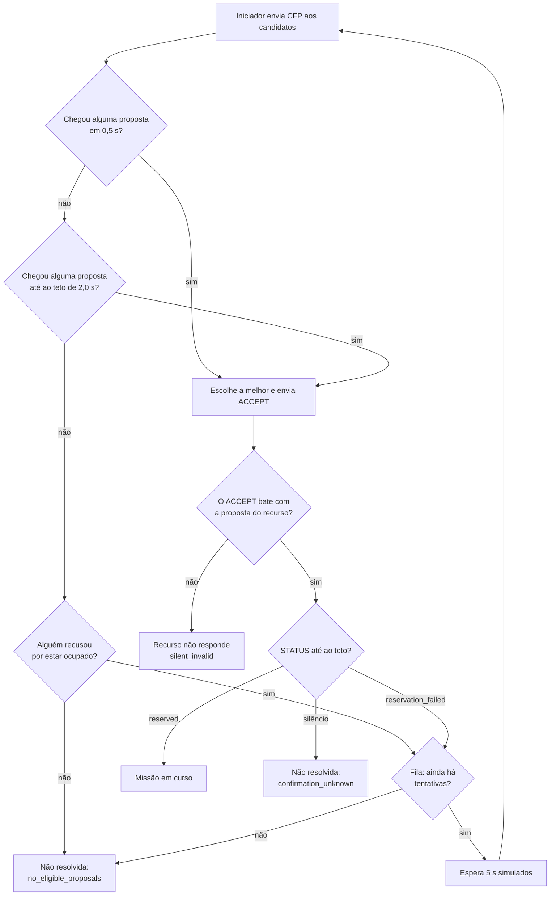

# Escalabilidade — Etapa 9A (P3)

[Experiências](experiments.md) · [Arquitetura](architecture.md)

Resposta a P3: o que acontece ao custo quando o sistema cresce (computacional) e o que acontece ao resultado quando mudam as ameaças, os sensores, os recursos e as falhas (situacional). Os números agregados vêm dos ficheiros versionados em [`results/`](../results/); alguns detalhes por ocorrência dependem dos relatórios locais não versionados, como indicado nos cenários D e E. As tabelas foram conferidas a 18-11-2026; as ressalvas documentais desta revisão não alteram a recolha histórica.

## Em resumo

- **Computacional.** Uma ocorrência custa 3N + 9 mensagens com N patrulhas: 15 com 2 e 57 com 16. Com o CFP só às 2 mais próximas, fica em 15 para qualquer N. O tempo real é feito de prazos: cada candidato calado custa um prazo inteiro (0,5 s). A memória cresce 1,3 kB por execução.
- **Situacional, como estava.** Nos cenários A, B e C só o `sensor-1` inicia e há uma ocorrência por janela: uma ameaça fora do alcance dele nunca gera alerta (0 de 10) e, com 2 ou 3 ameaças, só uma é atendida (8 de 20 e 8 de 30).
- **O que mudámos.** Vários sensores iniciadores, fila para recursos ocupados com ordem por gravidade, reenvio e aviso entre iniciadores. Com 8 ocorrências ao mesmo tempo fecham 80 de 80 em vez de 10; no cenário E (16 ameaças, 6 recursos) fecham 132 de 152, sem reservas duplas.
- **O preço.** A fila paga-se em mensagens e em espera: 15 mensagens por ocorrência passam a 44 com 8 em simultâneo e a 78 no cenário E, onde as ocorrências leves fecham em média aos 110 s.
- **Limites.** Tudo no transporte local, 5 a 20 execuções por ponto, sem intervalos de confiança. Os prazos são em tempo real, por isso alguns limites dependem da máquina.

## Mapa: do problema ao limite que fica

| Problema | O que medimos | O que mudámos | Efeito (antes → depois) | Limite que fica |
|---|---|---|---|---|
| O CFP vai a todas as patrulhas | 15, 21, 33 e 57 mensagens com 2, 4, 8 e 16 patrulhas | [CFP só aos K mais próximos](#cfp-só-aos-k-mais-próximos) | 57 → 15 mensagens (16 patrulhas, K = 2) | Usa a posição base; medido com uma só ocorrência |
| Um candidato calado gasta o prazo inteiro | 1,5 s → 5,5 s reais em 10 execuções | Nada: só medido | — | Em aberto (C2) |
| Prazo fixo de 0,5 s | Atraso de 0,4 s: fecham todas; 0,5 s: nenhuma | [Prazo dinâmico](#prazo-dinâmico-antes-e-depois) | Atraso de 1,5 s: 0 → 10 de 10 fechadas | Com 2,5 s falha na mesma; falhar passa a demorar 2,0 s |
| Só o `sensor-1` inicia | Ameaça fora do alcance dele: 0 de 10 alertas; 3 ameaças: 8 de 30 atendidas | [Vários sensores iniciadores](#vários-sensores-iniciadores) | 1 ocorrência por execução → uma por iniciador | Sem fila, só fecha 1 por execução (um guarda) |
| Recurso ocupado é ocorrência perdida | 8 em simultâneo: fecham 10 de 80 | [Fila](#fila-para-recursos-ocupados-antes-e-depois) | 10 de 80 → 80 de 80 | Mensagens 123 → 352; último fecho 12 s → 80 s |
| Na fila ganha quem pergunta primeiro | As graves fecham em média aos 74 s | [Fila por gravidade](#fila-ordenada-por-gravidade-antes-e-depois) | Graves: 74 s → 23 s | Leves: 27 s → 76 s; não interrompe missões |
| A ameaça acaba enquanto se espera | Ameaças de 30 s: 40 patrulhas chegam em vão | [Prazo de validade](#prazo-de-validade) | Patrulhas em vão: 40 → 12 | Não salva nenhuma ocorrência |
| Um só guarda | 3,3 pedidos ao guarda por ocorrência | [Mais guardas](#mais-guardas) | 3,3 → 1,0 pedidos; último fecho 81 s → 68 s | O gargalo passa para as 2 patrulhas |
| Quem espera pergunta de 5 em 5 s | 367 mensagens por execução | [O recurso diz quando fica livre](#o-recurso-ocupado-diz-quando-fica-livre) | 367 → 336 mensagens | Ganho pequeno: as missões são curtas |
| O recurso só fica livre na base | Último fecho aos 81 s | [Encadear missões](#encadear-missões) | 81 s → 54 s | Não há recarga; não interrompe missões |
| Os recursos respondem a mensagens inválidas (recolha histórica) | 5 respostas por unidade de `flood` | [Silêncio](#silêncio-perante-accept-incoerente-antes-e-depois) | 5 → 1 respostas (−80 %) | Não revalidado após a correção temporal |
| Uma mensagem perdida trava a ocorrência | 10 % de perda: fecham 7 de 20 | [Reenvio](#reenvio-de-mensagens-antes-e-depois) | 7 → 17 de 20 (como sem perda) | Com 30 % de perda e 2 reenvios: 9 de 20 |
| Iniciadores vizinhos duplicam a ocorrência | 4 iniciadores, 1 ameaça: 40 idas de patrulha | [Aviso entre iniciadores](#aviso-entre-iniciadores-antes-e-depois) | 40 → 10 idas; 119 → 33 mensagens | Um `ALERT` perdido volta a duplicar |
| Um só informador para todos | 4 iniciadores, 1 informador: 10 de 40 mobilizadas | [Um informador por iniciador](#um-informador-por-iniciador) | 10 → 40 de 40 | Cada iniciador pergunta só a um, fixo |
| Os informadores eram sempre câmaras | — | [Informadores humanos](#informadores-humanos-no-lugar-das-câmaras) | Fiável: 40 de 40; com 30 % de falhas: 30 de 40 | Respondem no mesmo instante; sem falsos relatos |
| O histórico da reputação cresce | 1,3 kB por execução | Nada: só medido | — | Em aberto (C8) |

## Opções: valor por omissão e onde estão ligadas

Cada mecanismo é um argumento de `run_mvp` ([runner.py](../src/isia/simulation/runner.py)). O coletor e os scripts de medição passam `PUBLISHED_CONDITIONS` (prazo fixo, sem fila, com resposta a `ACCEPT` incoerente); por isso A, B, C, `scale.csv`, `dist.csv` e o F1 correm com tudo desligado. Um cenário só liga o que declarar na chave `options`.

| Mecanismo | Argumento | Por omissão em `run_mvp` | A, B, C e medições base | Cenário D | Cenário E | Dimensão |
|---|---|---|---|---|---|---|
| CFP aos K mais próximos | `cfp_limit` | desligado (`None`) | desligado | desligado | desligado | computacional |
| Prazo dinâmico | `max_receive_timeout` | **ligado** (2,0 s) | desligado | ligado | ligado | situacional (atrasos) |
| Fila | `queue_rounds` | **ligado** (60) | desligado | ligado | ligado | situacional (recursos) |
| Silêncio | `silent_invalid` | **ligado** | desligado | ligado | ligado | computacional (tráfego) |
| Fila por gravidade | `queue_priority` | desligado | desligado | ligado | ligado | situacional (recursos) |
| Prazo de validade | `expire_unseen` | desligado | desligado | ligado | ligado | situacional (ameaças) |
| Recurso diz quando fica livre | `queue_until_free` | desligado | desligado | ligado | ligado | computacional (tráfego) |
| Encadear missões | `chain_missions` | desligado | desligado | ligado | ligado | situacional (recursos) |
| Reenvio | `retransmit` | desligado (0) | desligado | desligado | ligado (1), sem perdas para o exercitar | situacional (falhas) |
| Aviso entre iniciadores | `alert_distance` | desligado (`None`) | desligado | desligado | ligado (1 célula), sem duplicados para eliminar | situacional (sensores) |
| Vários iniciadores | `extra_initiators` | só o `sensor-1` | só o `sensor-1` | 6 iniciadores | 16 iniciadores | situacional (sensores) |
| Um informador por iniciador | `extra_informants` | só o `sensor-2` | só o `sensor-2` | 6 câmaras | 2 câmaras e 2 humanos | situacional (sensores) |
| Mais patrulhas e guardas | `extra_patrols`, `extra_rangers` | 2 patrulhas, 1 guarda | 2 patrulhas, 1 guarda | 4 patrulhas, 2 guardas | 4 patrulhas, 2 guardas | situacional (recursos) |

A execução de exemplo na linha de comandos (`python -m isia.simulation.runner`) usa os valores por omissão: prazo dinâmico, fila e silêncio ligados. Iniciadores, informadores e recursos adicionais só existem no transporte local.

## Como reproduzir

A partir da raiz do repositório, sem servidor XMPP:

```bash
PYTHONPATH=src python scripts/scale.py                    # ~20 s: results/scalability/scale.csv
PYTHONPATH=src python scripts/dist.py                     # ~2 min: results/scalability/dist.csv
PYTHONPATH=src python scripts/stress_f1.py                # perda, latencia, cascata, autonomia, combinadas
PYTHONPATH=src python scripts/stress_f1.py reenvio        # perda sem reenvio e com 1 e 2 reenvios
PYTHONPATH=src python scripts/stress_f2.py                # os 16 grupos do F2 (um CSV por grupo)
PYTHONPATH=src python scripts/stress_f2.py humano alerta  # só os grupos indicados
PYTHONPATH=src python scripts/stress_long.py              # longa.csv (1000 execuções)
PYTHONPATH=src python -m isia.evaluation.collector config/scenarios/demo/D.json --variants full --output results/scenario-d
PYTHONPATH=src python -m isia.evaluation.collector config/scenarios/demo/E.json --variants full --output results/scenario-e
PYTHONPATH=src python scripts/scenario_e.py               # results/scenario-e/informants.csv
```

Os scripts gravam por cima dos CSV em `results/`. Os três scripts de stress demoram cerca de meia hora no total.

- **Sementes:** 1000 + número da execução. 10 execuções por ponto; 20 nos casos com perda; 5 no `teto.csv`.
- **Transporte:** local. As falhas são injetadas no transporte local e não validam a rede XMPP.
- **Tempo real:** depende da máquina. Comparar casos da mesma execução, nunca valores entre máquinas.
- **«Fechada»:** estado terminal `closed`; o motivo pode ser `confirmed`, `not_confirmed` ou `duplicate_alert`. Só `closed/confirmed` indica intervenção confirmada do guarda; pode resultar de chamada direta, sem verificação móvel. Nos ensaios simples aqui tabelados, os fechos eram confirmados, salvo indicação em contrário. **«Confirmada»:** nas colunas de verificação, só a verificação pela patrulha; não equivale ao motivo de fecho `confirmed`. **«Atendida»** (`dist.csv`): ameaça real confirmada por uma patrulha na sua posição, contada por caçador pela função `attended()` de [`scripts/dist.py`](../scripts/dist.py).

# Parte 1 — Computacional

O que acontece às mensagens, ao tempo e à memória quando o sistema cresce.

## Custo computacional (`scale.csv`)

Mensagens por missão com N candidatos: N CFP + N respostas + 1 `ACCEPT` + até N − 1 rejeições + 1 `STATUS` + 1 resultado, ou seja, **no máximo 3N + 2**. Uma ocorrência completa = 2 (verificação) + 8 (patrulha, N = 2) + 5 (guarda, N = 1) = **15 mensagens**. Com N patrulhas e um guarda: **3N + 9**.

Cenário A, variante `full`, 10 execuções:

| Caso | Confirmadas | Não resolvidas | Mensagens por execução | Tempo real (10 execuções) |
|---|---|---|---|---|
| Base: 2 patrulhas, 1 guarda, 1 caçador | 8 de 10 | 0 | 15 (×8), 2 (×2) | 1,5 s |
| Drone calado | 8 de 10 | 0 | 13 (×8), 2 (×2) | 5,5 s |
| 0 patrulhas | 0 de 10 | 8 | 4 (×8), 2 (×2) | 4,1 s |
| 0 guardas | 8 de 10 | 8 | 11 (×8), 2 (×2) | 4,6 s |
| 3 caçadores | 8 de 10 | 0 | 15 (×8), 2 (×2) | 1,5 s |

- As execuções com 2 mensagens pararam na corroboração (`insufficient_corroboration`); por isso a média da base é 12,4 e não 15.
- **Candidato calado (C2):** o iniciador espera o prazo inteiro por quem não responde. Dez execuções passam de 1,5 s para 5,5 s reais, com o mesmo resultado. Está medido, não resolvido.
- **Com 3 caçadores as mensagens não mudam:** o `sensor-1` abre uma só ocorrência por janela (C7).

## CFP só aos K mais próximos

**O que acontecia.** O iniciador enviava o CFP a todas as patrulhas. Cada patrulha a mais custa 3 mensagens (CFP, `PROPOSAL`, rejeição).

**O que mudámos.** `cfp_limit=K`: o CFP vai só às K patrulhas com a base mais próxima do alvo ([incident.py](../src/isia/agents/incident.py), `allocate`). O runner entrega ao iniciador as posições base dos recursos. Valor acrescentado: o custo de uma missão deixa de crescer com o número de patrulhas.

**Efeito medido** ([escala.csv](../results/stress/escala.csv), uma ocorrência, 10 execuções por caso, mensagens por execução):

| Patrulhas | Sem limite | Com `cfp_limit=2` |
|---|---|---|
| 2 | 15 | 15 |
| 4 | 21 | 15 |
| 8 | 33 | 15 |
| 16 | 57 | 15 |

Nos oito casos fecham as 10 ocorrências, aos 12 s simulados. Com 16 patrulhas e sem limite ganha um drone adicional com o mesmo custo do veículo; com K = 2 ganha o veículo.

**Limite.**

- Desligado por omissão e em todos os cenários, D e E incluídos.
- Usa a posição base do recurso, não a atual.
- Em cada nova ronda o limite alarga para K × ronda. Com fila, quem espera acaba por chamar todos: o efeito com várias ocorrências em simultâneo não foi medido.
- Medido só com K = 2 e patrulhas adicionais com 100 % de autonomia.

## Quanto custa a fila em mensagens

Quem espera por um recurso volta a enviar o CFP e recebe uma recusa por candidato. O custo por ocorrência cresce com o número de ocorrências em simultâneo:

| Montagem | Ocorrências por execução | Mensagens por execução | Mensagens por ocorrência |
|---|---|---|---|
| Uma ocorrência ([escala.csv](../results/stress/escala.csv)) | 1 | 15 | 15 |
| Fila, 2 ocorrências ([fila.csv](../results/stress/fila.csv)) | 2 | 40 | 20 |
| Fila, 4 ocorrências | 4 | 120 | 30 |
| Fila, 8 ocorrências | 8 | 352 | 44 |
| Cenário D ([runs.csv](../results/scenario-d/runs.csv)) | 5,2 | 186 | 36 |
| Cenário E ([runs.csv](../results/scenario-e/runs.csv)) | 15,2 | 1188 | 78 |

No cenário E, o CFP e as recusas são 83 % das mensagens (510 e 481 em 1188, por execução). É o custo de não haver despachante: a fila é feita de perguntas repetidas.

## Memória numa execução longa

[longa.csv](../results/stress/longa.csv): 1000 execuções seguidas com o mesmo `ReputationBook`, em 176 s.

- O histórico da reputação chega a 1824 registos e 1,3 MB serializados: cresce de forma linear, 1,3 kB por execução.
- O pico de memória do processo passa de 85 MB para 104 MB, dos quais 12 MB nas primeiras 100 execuções.
- Nenhuma ocorrência fica por resolver; a reputação do `sensor-1` estabiliza em 0,998.

Irrelevante à escala do projeto. O histórico não é truncado nem gravado em disco (C8).

## Carga de mensagens inválidas

**Recolha histórica, anterior às correções de validação temporal.** O gerador `flood` em `runner.py` ainda injeta cópias com `created_at + 1e6`. O código atual rejeita mensagens futuras no recetor, incluindo respostas; o informador também rejeita pedidos posteriores ao seu instante local. Assim, as contagens de respostas e os limiares de carga abaixo, em `prazo.csv`, `teto.csv` e `silencio.csv`, não caracterizam automaticamente o código atual. Os testes de integração existentes cobrem uma carga pequena (`flood=5`) e o silêncio perante `ACCEPT` incoerente (`flood=2`); não revalidam os limites publicados. Não foram repetidas simulações nesta revisão.

[invalidas.csv](../results/stress/invalidas.csv): por cada mensagem real, o transporte entrega ao mesmo destinatário N cópias inválidas de cada tipo (JSON partido, IDs trocados, data no futuro); a variante de IDs trocados é omitida nos CFP, pois seria um novo pedido válido. Montagem do F2, 10 execuções por ponto.

| Inválidas por mensagem real (de cada tipo) | Inválidas por execução | Resultado igual ao de referência | Exceções | Tempo real (10 execuções) |
|---|---|---|---|---|
| 0 | 0 | 10 de 10 | 0 | 2,0 s |
| 10 | 420 | 10 de 10 | 0 | 2,2 s |
| 100 | 4 200 | 10 de 10 | 0 | 4,9 s |
| 300 | 12 600 | 10 de 10 | 0 | 11,2 s |
| 1000 | 17 200 | 0 de 10 | 0 | 13,8 s |

- Na recolha histórica, não houve exceções nem decisões alteradas por aceitação de conteúdo inválido; a carga provocou falhas por prazo no ponto de 1000.
- Com 1000, a negociação legítima falha por tempo: processar o lixo demora mais do que o prazo de 0,5 s. **O limite depende da máquina:** na medição do [prazo dinâmico](#prazo-dinâmico-antes-e-depois), o prazo fixo aguentou 1000 e falhou com 2000.
- Na recolha histórica, os agentes respondiam a parte do lixo: 5 respostas por unidade de `flood`. Ver [silêncio](#silêncio-perante-accept-incoerente-antes-e-depois).

# Parte 2 — Situacional

O que acontece ao resultado quando mudam a posição e a quantidade de ameaças, sensores e recursos, e quando há falhas.

## Escalabilidade situacional (`dist.csv`)

Cenário A, variante `full`, nas condições publicadas: só o `sensor-1` inicia.

```
   y
   7 . . . . . . . .
   6 . . . . . . P .     P = caçador em (6,6)
   5 . p . . . R . .     p = caçador em (2,5);  R = guarda (5,5)
   4 . . . . . . . .
   3 . . . . . . . .
   2 D . S X S . . .     S = sensor-1 (2,2), único iniciador; sensor-2 (4,2)
   1 . . . . . . . .     X = caçador base (3,2);  D = drone (0,2)
   0 V . . . . . . Q     V = veículo (0,0);  Q = caçador em (7,0)
     0 1 2 3 4 5 6 7  x
```

Os dois sensores têm alcance de 5 células, em linha reta. O `sensor-2` vê os pontos Q (a 3,6 células) e P (a 4,5); o `sensor-1` não vê nenhum dos dois (5,4 e 5,7).

**A) Onde estão os caçadores (recursos fixos, 10 execuções)**

| Caso | Alertas | Atendidos | Verificação (s simulados) | O que mostra |
|---|---|---|---|---|
| 1 caçador em (3,2) | 10 de 10 | 8 de 10 | 4 | Referência; as 2 falhas vêm da corroboração |
| 1 caçador em (2,5) | 10 de 10 | 8 de 10 | 6 | Mais longe dos recursos, verificação mais lenta |
| 1 caçador em (7,0) | **0 de 10** | 0 de 10 | — | O `sensor-2` vê, mas só o `sensor-1` inicia |
| 1 caçador em (6,6) | **0 de 10** | 0 de 10 | — | O mesmo: só o `sensor-2` o alcança |
| 2 caçadores | 10 de 10 | **8 de 20** | 4 | Uma ocorrência por janela (C7) |
| 3 caçadores | 10 de 10 | **8 de 30** | 4 | A métrica por execução (8 confirmadas) esconde as ameaças sem resposta |

**B) Quantidade e posição dos recursos (1 caçador em (3,2), drone com carga 0,5, 10 execuções)**

| Caso | Confirmadas | Não resolvidas | Verificação (s) | Guarda (s) | Energia (p.p.) |
|---|---|---|---|---|---|
| Recursos na base | 8 | 0 | 6 | 12 | 16,0 |
| Recursos no canto (7,7) | 8 | 0 | 9 | 19 | 27,2 |
| Só o guarda longe, em (0,7) | 8 | 0 | 6 | 15 | 20,8 |
| Drone com 15 % de autonomia (1 patrulha elegível) | 8 | 0 | 6 | 12 | 16,0 |
| Drone e veículo com 15 % (0 elegíveis) | 0 | 8 | — | — | 0 |

**C) Recursos com 10 % de perda de mensagens (20 execuções)**

| Caso | Alertas | Atendidos | Não resolvidas | Guarda (s) |
|---|---|---|---|---|
| 2 patrulhas elegíveis | 19 de 20 | 13 de 20 | 8 | 15,9 |
| 1 patrulha elegível | 19 de 20 | 9 de 20 | 10 | 17,0 |

Além da perda, estes dois casos têm 0,05 s de atraso na `PROPOSAL` e no `MISSION_RESULT` e o `MISSION_RESULT` duplicado.

**Leitura:**

1. **A cobertura do iniciador limita mais do que os recursos.** Um caçador fora do alcance do `sensor-1` nunca gera alerta, mesmo que o `sensor-2` o veja.
2. **Recursos mais longe custam tempo e energia, não decisões:** a verificação passa de 6 s para 9 s e a energia de 16 para 27 pontos percentuais, com as mesmas 8 confirmadas.
3. **Menos recursos:** sem perdas, uma patrulha elegível confirma tanto como duas; sem nenhuma, 0 confirmadas e 8 não resolvidas. Com 10 % de perda, duas patrulhas atendem 13 de 20 e uma atende 9 de 20. São 20 execuções sem intervalo de confiança: sugere que a redundância ajuda sob perdas, não o prova.
4. **Mais caçadores do que ocorrências:** com 2 ou 3 caçadores só um é atendido.

Nenhum caso deste ficheiro tem um caçador fora do alcance dos dois sensores. O drone com 15 % de autonomia continua a receber o CFP: simula um recurso que recusa, não um recurso ausente.

## Testes de stress (Bloco F)

Onde o sistema deixa de atender, dimensão a dimensão. CSV em [`results/stress/`](../results/stress/).

- **F1** ([stress_f1.py](../scripts/stress_f1.py)): cenário A (1 caçador em (3,2), fontes com ruído), política completa, reputação nova em cada execução. Em 10 execuções, 2 param na corroboração: o máximo é 8 de 10 (17 de 20 com 20 execuções).
- **F2** ([stress_f2.py](../scripts/stress_f2.py)): fontes sem ruído (alcance 1), política sem corroboração e um caçador na célula de cada sensor iniciador. A única variável é a disputa pelos recursos. Cada grupo liga só a opção que mede.

### Mapa de limites

Onde o sistema deixa de atender nas condições publicadas (tudo desligado). O que cada mecanismo muda está no [mapa do início](#mapa-do-problema-ao-limite-que-fica).

| Teste | CSV | Onde deixa de atender |
|---|---|---|
| Perda de mensagens | [perda.csv](../results/stress/perda.csv) | Fecha 17 de 20 sem perda, 7 com 10 %, 1 com 20 % e nenhuma a partir de 30 % |
| Atraso da `PROPOSAL` ou do `STATUS` | [latencia.csv](../results/stress/latencia.csv) | Até 0,4 s fecham as 8 mobilizadas; a partir de 0,5 s (o prazo), nenhuma. Não há degradação gradual |
| Recursos a cair | [cascata.csv](../results/stress/cascata.csv) | Sem o drone, igual (8 fechadas); sem as duas patrulhas, 0 confirmadas; sem o guarda, 8 confirmadas e 0 fechadas |
| Autonomia baixa | [autonomia.csv](../results/stress/autonomia.csv) | Até 20 % ganha o veículo; de 19 % a 16 % ganha o drone; a partir de 15 % os dois recusam e nada é atendido |
| Falhas combinadas | [combinadas.csv](../results/stress/combinadas.csv) | 20 execuções: 6 confirmadas, 0 fechadas, 12 não resolvidas; 0 reservas duplas e 0 fechos duplicados |
| Ocorrências em simultâneo | [paralelo.csv](../results/stress/paralelo.csv) | Por execução, confirma 2 (2 patrulhas) e fecha 1 (1 guarda), sejam 2, 4 ou 8 as ocorrências |
| Mensagens inválidas | [invalidas.csv](../results/stress/invalidas.csv) | Até 300 por mensagem real, resultado igual; com 1000, falha por tempo. [Tabela](#carga-de-mensagens-inválidas) |
| Execução longa | [longa.csv](../results/stress/longa.csv) | Não deixa de atender em 1000 execuções. [Detalhe](#memória-numa-execução-longa) |
| Tudo ligado, 6 ameaças | [scenario-d](../results/scenario-d/runs.csv) | 45 de 52 ocorrências fechadas, 0 por resolver. [Cenário D](#cenário-d--dia-movimentado) |
| Tudo ligado, 16 ameaças | [scenario-e](../results/scenario-e/runs.csv) | 132 de 152 fechadas, 7 por resolver por falta de autonomia dos guardas. [Cenário E](#cenário-e--reserva-alargada) |

Duas garantias mantiveram-se em todos os CSV: **zero reservas duplas** (coluna `duplas_reservas`) e **zero exceções** com mensagens inválidas.

### Perda de mensagens

[perda.csv](../results/stress/perda.csv), 20 execuções por ponto, sem reenvio:

| Perda | Mobilizou | Confirmadas | Fechadas | Não resolvidas | Mensagens (média) |
|---|---|---|---|---|---|
| 0 % | 17 | 17 | 17 | 0 | 13,0 |
| 10 % | 15 | 13 | 7 | 8 | 9,6 |
| 20 % | 12 | 8 | 1 | 11 | 6,8 |
| 30 % | 10 | 4 | 0 | 10 | 5,0 |
| 50 % | 4 | 0 | 0 | 4 | 2,0 |

Uma ocorrência completa precisa de 15 mensagens seguidas; perder uma já a deixa por fechar. A perda atinge primeiro a corroboração: com 50 %, 15 das 20 execuções param em `insufficient_corroboration`. O [reenvio](#reenvio-de-mensagens-antes-e-depois) responde a isto.

### Atraso, recursos em falta e autonomia

- **Atraso** ([latencia.csv](../results/stress/latencia.csv)). Com o prazo fixo de 0,5 s reais, um atraso de 0,5 s ou mais na `PROPOSAL` dá `no_eligible_proposals`; no `STATUS` dá `confirmation_unknown`, com o recurso já reservado. O [prazo dinâmico](#prazo-dinâmico-antes-e-depois) responde a isto.
- **Recursos em falta** ([cascata.csv](../results/stress/cascata.csv)). Retirar o drone não muda o resultado, mas o tempo real passa de 1,5 s para 5,5 s (candidato calado, C2). O guarda é ponto único de falha da intervenção: sem ele, as 8 confirmadas ficam `unresolved`.
- **Autonomia** ([autonomia.csv](../results/stress/autonomia.csv), drone e veículo com o mesmo valor). A recusa é local: cada recurso exige a reserva mínima de 10 % mais a ida e volta (veículo a 5 células, 10 p.p.; drone a 3 células, 6 p.p.).

| Autonomia | Recusas dos recursos (10 execuções) | Quem verifica | Fechadas |
|---|---|---|---|
| 100 % a 20 % | 0 | veículo | 8 |
| 19 % a 16 % | 8 (veículo) | drone | 8 |
| 15 % e 10 % | 16 (os dois) | ninguém | 0 |

- **Falhas combinadas** ([combinadas.csv](../results/stress/combinadas.csv)). Perda de 20 %, `MISSION_RESULT` duplicado e drone ocupado depois da proposta, na mesma execução. Nenhum recurso fica com duas missões e nenhum incidente fecha duas vezes, mas nenhuma ocorrência chega ao fim.

# Parte 3 — Mecanismos, antes e depois

Cada secção tem o mesmo molde: o que acontecia, o que mudámos, o efeito medido e o limite que fica.

## Vários sensores iniciadores

**O que acontecia.** Só o `sensor-1` abria ocorrências: uma por janela, ancorada na primeira leitura. Uma ameaça fora do alcance dele não tinha resposta e, com 2 ou 3 ameaças, só uma era atendida ([`dist.csv`](#escalabilidade-situacional-distcsv)).

**O que mudámos.** `extra_initiators={fonte: posição}`: cada fonte indicada ganha um sensor no mapa e um iniciador próprio, que trata só o que o seu sensor deteta. O runner não escolhe quem trata cada ameaça. Num ficheiro de cenário é a chave `world.initiators`. Valor acrescentado: várias ameaças passam a ter, cada uma, a sua ocorrência, em paralelo e sem despachante.

**Efeito medido** ([paralelo.csv](../results/stress/paralelo.csv), uma ameaça por iniciador, sem fila, 10 execuções por caso):

| Ocorrências por execução | Confirmadas | Fechadas | Não resolvidas | `STATUS` com reserva falhada | Reservas duplas | Mensagens (média) |
|---|---|---|---|---|---|---|
| 1 | 10 de 10 | 10 de 10 | 0 | 0 | 0 | 15 |
| 2 | 20 de 20 | 10 de 20 | 10 | 10 | 0 | 33 |
| 4 | 20 de 40 | 10 de 40 | 30 | 50 | 0 | 63 |
| 8 | 20 de 80 | 10 de 80 | 70 | 130 | 0 | 123 |

- **A reserva local atómica resolve a corrida.** Dois iniciadores aceitam a mesma patrulha; o recurso reserva para um e comunica ao outro `STATUS(reservation_failed)`, permitindo renegociar com a outra patrulha. O `STATUS` comunica o resultado; a exclusividade é assegurada por `LocalResourceReservation`. Não houve reserva dupla nos ensaios publicados.
- **Sem fila, satura em 2 verificações e 1 intervenção por execução:** quem perde a corrida fica `unresolved`.

**Limite.**

- A, B e C continuam com um só iniciador.
- Cada iniciador continua a abrir uma só ocorrência por janela (C7).
- Os iniciadores adicionais não atualizam a reputação e só corroboram com `extra_informants`.
- Se dois iniciadores ouvem a mesma ameaça, abrem duas ocorrências: ver o [aviso](#aviso-entre-iniciadores-antes-e-depois).

## Prazo dinâmico (antes e depois)

**O que acontecia.** O iniciador esperava 0,5 s reais pelas propostas e 0,5 s pelo `STATUS`. Uma resposta que chegasse depois contava como se nunca tivesse chegado.

**O que mudámos.** `max_receive_timeout` é um teto ([incident.py](../src/isia/agents/incident.py), `allocate`). Valor acrescentado: o iniciador tolera respostas lentas sem atrasar o caso normal.

- **Propostas:** com pelo menos uma proposta ao fim de 0,5 s, avança como antes. Sem nenhuma, espera até ao teto.
- **`STATUS`:** espera sempre até ao teto. Depois do `ACCEPT` não há alternativa: desistir dá `confirmation_unknown`.
- **`VERIFY_RESPONSE`:** espera o teto por cada tentativa (teto × (1 + reenvios), no máximo 10 s). Nas condições publicadas são 0,5 s.
- **`MISSION_RESULT`:** não muda (dez prazos-base, 5 s).

**Efeito medido** ([prazo.csv](../results/stress/prazo.csv), montagem do F2, 10 execuções por célula; ocorrências fechadas e tempo real por execução):

| Caso | Prazo fixo (0,5 s) | Prazo dinâmico (0,5 a 2,0 s) |
|---|---|---|
| Sem falhas | 10 de 10 · 0,20 s | 10 de 10 · 0,20 s |
| `PROPOSAL` com 0,4 s de atraso | 10 de 10 · 0,99 s | 10 de 10 · 0,99 s |
| `PROPOSAL` com 0,6 s | 0 de 10 · 0,51 s | **10 de 10** · 1,37 s |
| `PROPOSAL` com 1,5 s | 0 de 10 · 0,51 s | **10 de 10** · 3,17 s |
| `PROPOSAL` com 2,5 s | 0 de 10 · 0,51 s | 0 de 10 · 2,01 s |
| `STATUS` com 0,6 s | 0 de 10 · 0,51 s | **10 de 10** · 1,21 s |
| `STATUS` com 1,5 s | 0 de 10 · 0,51 s | **10 de 10** · 3,01 s |
| `STATUS` com 2,5 s | 0 de 10 · 0,51 s | 0 de 10 · 2,01 s |
| Sem o drone | 10 de 10 · 0,70 s | 10 de 10 · 0,69 s |
| Sem as duas patrulhas | 0 de 10 · 0,51 s | 0 de 10 · 2,01 s |
| Sem o guarda | 0 de 10 · 0,56 s | 0 de 10 · 2,06 s |
| 1000 inválidas por mensagem | 10 de 10 · 1,68 s | 10 de 10 · 1,68 s |
| 2000 inválidas | 0 de 10 · 1,78 s | **10 de 10** · 3,17 s |
| 5000 inválidas | 0 de 10 · 2,10 s | **10 de 10** · 7,68 s |
| 8000 inválidas | 0 de 10 · 3,48 s | 0 de 10 · 6,70 s |

- O atraso tolerado sobe até ao teto de 2,0 s: com o prazo fixo, 0,4 s passa e 0,5 s falha; com o dinâmico, 1,5 s passa e 2,5 s falha.
- As mensagens inválidas toleradas passam de 1000 para 5000 por mensagem real (nesta máquina).
- Não custa nada quando tudo corre bem: sem falhas e sem o drone, o tempo é igual.

**Limite.**

- Falhar demora quatro vezes mais: sem patrulhas ou sem guarda, a ocorrência só é dada como não resolvida ao fim de 2,0 s.
- O limite mudou de sítio, não desapareceu: com 2,5 s de atraso falha nos dois casos. O teto é fixo; o iniciador não aprende com os tempos que observa.
- Com uma proposta na mão ao fim de 0,5 s, o iniciador não espera pelas outras, mesmo que fossem melhores.
- O prazo é em tempo real: os valores 5000 e 8000 são desta máquina, sem carga.
- Só no transporte local. Na rede XMPP o prazo-base já é 2,0 s, igual ao teto por omissão, e não há injeção de atrasos.

#### Que teto escolher

[teto.csv](../results/stress/teto.csv), 5 execuções por célula; ocorrências fechadas e tempo real por execução:

| Caso | Teto 0,5 s (prazo fixo) | Teto 1,0 s | Teto 2,0 s | Teto 4,0 s |
|---|---|---|---|---|
| `PROPOSAL` com 0,6 s de atraso | 0 de 5 · 0,51 s | **5 de 5** · 1,37 s | **5 de 5** · 1,38 s | **5 de 5** · 1,37 s |
| `PROPOSAL` com 1,5 s | 0 de 5 · 0,51 s | 0 de 5 · 1,01 s | **5 de 5** · 3,17 s | **5 de 5** · 3,18 s |
| `PROPOSAL` com 3,0 s | 0 de 5 · 0,51 s | 0 de 5 · 1,01 s | 0 de 5 · 2,01 s | **5 de 5** · 6,18 s |
| Ninguém responde (sem patrulhas) | 0 de 5 · 0,51 s | 0 de 5 · 1,01 s | 0 de 5 · 2,01 s | 0 de 5 · 4,01 s |

- **O teto é uma troca, não um ótimo:** é o maior atraso tolerado e também o tempo perdido quando ninguém responde.
- **Quando há resposta, o teto não custa nada:** com 0,6 s de atraso, o tempo é o mesmo com teto de 1, 2 ou 4 s.
- **Escolhemos 2,0 s:** é o prazo que o projeto já usa na rede XMPP, e perder 2 s é pouco face a uma missão (pelo menos 12 s simulados).

## Fila para recursos ocupados (antes e depois)

**O que acontecia.** Com várias ocorrências ao mesmo tempo, quem encontrava o guarda ocupado terminava logo como `unresolved`. O guarda ficava livre segundos depois e ninguém o voltava a chamar.

**O que mudámos.** `queue_rounds=N`: um recurso ocupado ou uma reserva falhada deixam de ser falha. O iniciador espera 5 s simulados (ou 0,5 s reais, se o relógio simulado estiver parado) e volta a enviar o CFP, até N vezes ([incident.py](../src/isia/agents/incident.py), `execute_task`). Vale para patrulhas e guardas. Não há agente novo nem mensagens novas. Valor acrescentado: todas as ocorrências acabam por ser atendidas.

**Efeito medido** ([fila.csv](../results/stress/fila.csv), 10 execuções por linha):

| Ocorrências por execução | Fechadas sem fila | Fechadas com fila | Último fecho (simulado) | Mensagens sem fila | Mensagens com fila | Reservas duplas |
|---|---|---|---|---|---|---|
| 2 | 10 de 20 | **20 de 20** | 12 s → 23 s | 33 | 40 | 0 |
| 4 | 10 de 40 | **40 de 40** | 12 s → 45 s | 63 | 120 | 0 |
| 8 | 10 de 80 | **80 de 80** | 12 s → 80 s | 123 | 352 | 0 |

**Limite.**

- Quase o triplo das mensagens com 8 ocorrências (352 contra 123).
- A última ocorrência espera: cerca de 10 s simulados por cada ocorrência à frente. A fila troca «não atendida» por «atendida mais tarde».
- Sem ordem: ganha quem pergunta primeiro depois de o recurso ficar livre. Uma ocorrência chegou a pedir o guarda 15 vezes (média 3,3).
- Com fila, a ordem dos pedidos depende do relógio real. Esta montagem (8 ocorrências, fila) aparece em seis CSV: fecham sempre as 80, mas as mensagens variam entre 349 e 367 e o último fecho entre 80 s e 82 s.

**Atender todas não é atender a tempo** ([espera.csv](../results/stress/espera.csv), 8 ocorrências com fila, 80 por linha):

| Duração da ameaça | Fechadas como confirmadas | Patrulhas que chegam em vão | Intervenções do guarda depois do fim da ameaça | Pedidos ao guarda (média · máximo) |
|---|---|---|---|---|
| 1000 s | 80 | 0 | 0 | 3,3 · 15 |
| 60 s | 54 | 10 | 16 | 3,1 · 13 |
| 30 s | 20 | 40 | 20 | 3,2 · 8 |

Com ameaças de 30 s, só 20 das 80 ocorrências têm o guarda no local a tempo. As secções seguintes respondem a isto.

## Fila ordenada por gravidade (antes e depois)

**O que acontecia.** Na fila ganhava quem perguntasse primeiro. Uma ocorrência grave podia esperar atrás de uma leve.

**O que mudámos.** `queue_priority=True`: cada recurso guarda a lista de quem lhe pediu e só faz proposta ao primeiro, que é a ocorrência mais grave e, em caso de empate, a que espera há mais tempo ([mobile.py](../src/isia/agents/mobile.py), `is_turn`). Os outros recebem uma recusa com o motivo `waiting_turn`. Se chegar um pedido mais grave entre a proposta e o `ACCEPT`, a reserva fica para esse. Valor acrescentado: as ocorrências graves são atendidas primeiro.

A gravidade do sensor (0 a 1) passa para a missão em três níveis: **grave** a partir de 0,8 (o limiar grave da política), **média** a partir de 0,4 e **leve** abaixo disso. Vem de `response_settings["severity_by_source"]`; o valor por omissão (0,5) é média.

**Efeito medido** ([prioridade.csv](../results/stress/prioridade.csv), 8 ocorrências ao mesmo tempo: 2 graves, 3 médias e 3 leves; 10 execuções; instante do fecho em tempo simulado):

| Gravidade | Fecho médio, sem ordem | Fecho médio, por gravidade | Último fecho, sem ordem | Último fecho, por gravidade |
|---|---|---|---|---|
| Grave | 73,5 s | **22,8 s** | 83 s | **30 s** |
| Média | 46,7 s | 46,7 s | 83 s | 65 s |
| Leve | 27,3 s | 75,9 s | 58 s | 95 s |

Nos dois casos fecham as 80 ocorrências, com 349 mensagens por execução e zero reservas duplas. Sem ordem a sequência é arbitrária; nesta montagem, as graves calharam no fim.

**Limite.**

- As leves pagam a conta: o fecho médio passa de 27 s para 76 s e o último fecho de 83 s para 95 s.
- Não interrompe missões: uma grave que chega com o guarda a caminho de uma leve espera que ele volte.
- Com graves a chegar sem parar, as leves nunca são atendidas: o tempo de espera só desempata dentro do mesmo nível.
- A gravidade é do sensor, não de cada ameaça.
- Um pedido antigo pode deixar o recurso parado até 10 s simulados, quando o primeiro da lista foi atendido por outro recurso.

## Mitigações da espera na fila (antes e depois)

Respostas aos problemas da tabela [«atender todas não é atender a tempo»](#fila-para-recursos-ocupados-antes-e-depois). Todas partem da mesma montagem: 8 ocorrências ao mesmo tempo, fila ligada (`queue_rounds=60`), 10 execuções, 80 ocorrências por linha. Estão desligadas por omissão e não acrescentam tipos de mensagem.

**Pré-requisito no simulador.** A intervenção do guarda só dá `confirmed` se a ameaça ainda estiver na célula; se chegar tarde, dá `not_confirmed` ([scenario.py](../src/isia/simulation/scenario.py), `inspect`).

### Prazo de validade

**O que acontecia.** Quem esperava na fila mandava a patrulha ou o guarda a uma ameaça que já tinha terminado.

**O que mudámos.** `expire_unseen=True`: antes de cada pedido, o iniciador volta a ler o seu sensor. Se a janela do feed (5 s simulados, 6 leituras) estiver vazia, fecha a ocorrência como `expired`, com o motivo `threat_expired`, e não manda ninguém ([incident.py](../src/isia/agents/incident.py), `execute_task`). Valor acrescentado: evita deslocações inúteis.

**Efeito medido** ([validade.csv](../results/stress/validade.csv)):

| Duração da ameaça | Validade | Fechadas como confirmadas | Expiradas | Patrulhas em vão | Guarda em vão | Mensagens (média) |
|---|---|---|---|---|---|---|
| 60 s | sem | 50 | 0 | 10 | 20 | 354 |
| 60 s | com | 54 | 8 | 9 | **9** | 341 |
| 30 s | sem | 20 | 0 | 40 | 20 | 319 |
| 30 s | com | 20 | 40 | **12** | **8** | 266 |

**Limite.** Não salva nenhuma ocorrência: só evita a viagem. A janela dá 5 s de atraso, por isso ainda há deslocações em vão. Depende de o sensor continuar a ver a ameaça: uma ameaça que se cala expira como se tivesse terminado. As contagens variam em algumas ocorrências entre execuções iguais (a linha «60 s, sem» deu 50 aqui e 54 no `espera.csv`).

### Mais guardas

**O que acontecia.** Um só guarda para 8 ocorrências: cada uma pedia-o 3,3 vezes, em média.

**O que mudámos.** `extra_rangers={id: posição}` acrescenta guardas, como `extra_patrols` acrescenta patrulhas. Valor acrescentado: mostra onde está o gargalo.

**Efeito medido** ([guardas.csv](../results/stress/guardas.csv)):

| Guardas | Fechadas | Último fecho (simulado) | Pedidos ao guarda (média · máximo) | Mensagens (média) | Reservas duplas |
|---|---|---|---|---|---|
| 1 | 80 de 80 | 81 s | 3,3 · 15 | 362 | 0 |
| 2 | 80 de 80 | 68 s | 1,0 · 1 | 343 | 0 |
| 4 | 80 de 80 | 67 s | 1,0 · 1 | 395 | 0 |

**Limite.** O gargalo muda de sítio: com 2 guardas, o último fecho só desce de 81 s para 68 s, porque as 8 verificações dependem de 2 patrulhas. O quarto guarda não ajuda e custa mais mensagens. Patrulhas e guardas a variar em conjunto não foram medidos.

### Um informador por iniciador

**O que acontecia.** A corroboração tinha um par fixo, o `sensor-2`. Um iniciador longe dele recebia uma resposta sem observações, decidia `observe` e a ocorrência expirava.

**O que mudámos.** `extra_informants={fonte: posição}`: cada fonte indicada ganha um `InformantAgent`, e cada iniciador adicional pergunta ao informador mais próximo ([runner.py](../src/isia/simulation/runner.py)). Valor acrescentado: a corroboração acompanha o crescimento do mapa.

**Efeito medido** ([informadores.csv](../results/stress/informadores.csv), política completa, 4 ocorrências a 4 células umas das outras, câmaras sem ruído de alcance 1, 40 ocorrências por linha):

| Informadores | Corroboradas | Mobilizadas | Fechadas | Expiradas sem corroboração | Pedidos · respostas de verificação por execução |
|---|---|---|---|---|---|
| 1 | 10 | 10 | 10 | 30 | 4 · 4 |
| 2 | 20 | 20 | 20 | 20 | 4 · 4 |
| 4 | 40 | 40 | 40 | 0 | 4 · 4 |

O custo em mensagens não muda: um pedido e uma resposta por ocorrência.

**Limite.** Cada iniciador continua a perguntar a um só informador, escolhido na configuração (C6 fica parcial). Fontes sem ruído. Os iniciadores adicionais não atualizam a reputação.

### O recurso ocupado diz quando fica livre

**O que acontecia.** Quem esperava perguntava de 5 em 5 s, e cada pergunta custava um CFP e uma recusa por candidato.

**O que mudámos.** A recusa por ocupação leva `busy_until`, o instante simulado em que o recurso prevê ficar livre ([mobile.py](../src/isia/agents/mobile.py), `evaluate_request`). Com `queue_until_free=True`, o iniciador espera até lá. Valor acrescentado: menos perguntas repetidas.

**Efeito medido** ([ocupado.csv](../results/stress/ocupado.csv)):

| Espera | Fechadas | Mensagens (média) | Pedidos ao guarda (média · máximo) | Último fecho (simulado) |
|---|---|---|---|---|
| De 5 em 5 s | 80 de 80 | 367 | 3,2 · 15 | 82 s |
| Até `busy_until` | 80 de 80 | 336 | 2,6 · 9 | 70 s |

**Limite.** Menos 8 % de mensagens: a poupança é pequena porque uma missão dura cerca de 10 s, duas esperas de 5 s. Quando o recurso fica livre, todos os que esperam pedem ao mesmo tempo; um ganha e os outros voltam a esperar. Um `busy_until` errado só atrasa: a espera continua limitada pelo prazo real.

### Encadear missões

**O que acontecia.** O recurso só ficava livre depois de regressar à base, mesmo com ocorrências à espera pelo caminho.

**O que mudámos.** `chain_missions=True`: no regresso, com o `MISSION_RESULT` já enviado, o recurso responde a um CFP com uma proposta calculada a partir da posição atual. O `ACCEPT` termina o regresso nesse ponto ([mobile.py](../src/isia/agents/mobile.py), `returning`). A energia conta a ida a partir da posição atual mais o regresso à base. Valor acrescentado: é a mitigação com mais efeito sem acrescentar recursos.

**Efeito medido** ([encadear.csv](../results/stress/encadear.csv)):

| Recursos | Fechadas | Último fecho (simulado) | Mensagens (média) | Pedidos ao guarda (média · máximo) | Reservas duplas |
|---|---|---|---|---|---|
| Livres só na base | 80 de 80 | 81 s | 358 | 3,1 · 12 | 0 |
| Encadeiam missões | 80 de 80 | **54 s** | 306 | 2,2 · 6 | 0 |

**Limite.** O recurso passa mais tempo fora da base e não há recarga. Só aceita a missão seguinte depois de entregar o resultado da anterior; não interrompe uma missão em curso.

## Silêncio perante `ACCEPT` incoerente (antes e depois)

**O que acontecia.** Os recursos respondiam `reservation_failed` a qualquer `ACCEPT` que não batesse com a proposta feita. Quem enviasse lixo recebia uma resposta por cada mensagem.

**O que mudámos.** `silent_invalid=True`: um `ACCEPT` com IDs trocados ou com data no futuro nunca é enviado por um iniciador legítimo, por isso o recurso regista um aviso e não responde ([mobile.py](../src/isia/agents/mobile.py), `AcceptBehaviour`). Valor acrescentado: quem envia lixo deixa de receber tráfego de volta.

**Efeito medido histórico** (anterior à validação temporal atual; ver [carga de mensagens inválidas](#carga-de-mensagens-inválidas)) ([silencio.csv](../results/stress/silencio.csv), 10 execuções por linha; a ocorrência fecha em 10 de 10 nos dois casos):

| Inválidas por mensagem real | Inválidas por execução | Respostas a lixo, antes | Respostas a lixo, depois | Mensagens por execução, antes → depois |
|---|---|---|---|---|
| 10 | 420 | 50 | 10 | 65 → 25 |
| 100 | 4 200 | 500 | 100 | 515 → 115 |
| 300 | 12 600 | 1 500 | 300 | 1515 → 315 |

**Limite.**

- Na recolha histórica sobrava uma resposta em cada cinco, atribuída ao `InformantAgent` perante `VERIFY_REQUEST` com IDs trocados. Esta proporção não foi revalidada após as correções temporais; a validação dos IDs não autentica o remetente.
- Um iniciador com um erro deixa de receber «reserva falhada» e passa a ver silêncio, que só se nota no fim do prazo (`confirmation_unknown`).
- Um `ACCEPT` de uma proposta desconhecida ou expirada continua a ter resposta (`proposal_not_correlated`), de propósito.

## As três opções ligadas por omissão, em conjunto

O que o iniciador faz em cada missão, com `max_receive_timeout`, `queue_rounds` e `silent_invalid` ligados:



A fila ordenada não aparece: é o recurso que decide a quem faz proposta quando há vários pedidos.

## Reenvio de mensagens (antes e depois)

**O que acontecia.** Os agentes não reenviavam. Uma só mensagem perdida deixava a ocorrência por fechar: com 10 % de perda fechavam 7 de 20 em vez de 17.

**O que mudámos.** `retransmit=N`: quando a resposta não chega no prazo, o iniciador volta a enviar **a mesma mensagem, com o mesmo `message_id`**, até N vezes por pedido. Valor acrescentado: uma perda isolada deixa de travar a ocorrência, sem repetir efeitos.

| Pedido reenviado | Resposta em falta | O que o destinatário faz ao pedido repetido |
|---|---|---|
| `VERIFY_REQUEST` | `VERIFY_RESPONSE` | O informador responde outra vez |
| `CFP` (só sem nenhuma proposta na mão) | `PROPOSAL` ou recusa | O recurso repete a proposta ou a recusa que já deu, sem reavaliar |
| `ACCEPT` | `STATUS` | O recurso repete a confirmação da reserva; não reserva duas vezes |
| `ACCEPT`, como pergunta | `MISSION_RESULT` | O recurso repete a confirmação e, se já existir, o resultado |

Código: [incident.py](../src/isia/agents/incident.py) (`allocate` e `mission_result`), [sensor.py](../src/isia/agents/sensor.py) e [mobile.py](../src/isia/agents/mobile.py) (`resend_replies`).

**Efeito medido** ([reenvio.csv](../results/stress/reenvio.csv), cenário A, prazo fixo, 20 execuções por linha; sem perda fecham 17 de 20):

| Perda | Reenvios | Fechadas | Não resolvidas | Mensagens por execução | Reenviadas por execução |
|---|---|---|---|---|---|
| 10 % | 0 | 7 | 8 | 9,6 | 0 |
| 10 % | 1 | 17 | 0 | 13,2 | 1,0 |
| 10 % | 2 | 17 | 0 | 13,2 | 1,0 |
| 20 % | 0 | 1 | 11 | 6,8 | 0 |
| 20 % | 1 | 10 | 4 | 11,8 | 1,9 |
| 20 % | 2 | 16 | 1 | 16,0 | 3,8 |
| 30 % | 0 | 0 | 10 | 5,0 | 0 |
| 30 % | 1 | 3 | 8 | 10,4 | 2,8 |
| 30 % | 2 | 9 | 7 | 17,3 | 6,3 |

- **Com 10 % de perda, um reenvio repõe o resultado sem perda:** 17 de 20 fechadas e nenhuma por resolver.
- **Zero reservas duplas e zero fechos duplicados** nas 180 execuções: repetir um pedido não repete o efeito.

**Limite.**

- Com 30 % de perda e 2 reenvios ainda ficam 7 por resolver.
- O CFP só é reenviado quando não há nenhuma proposta: com uma na mão, o iniciador decide com o que tem e pode escolher o segundo melhor recurso.
- A recusa do CFP e a rejeição enviada aos perdedores não são confirmadas; perdê-las não muda o resultado.
- A coluna `tempo_real_s` deste CSV e do `perda.csv` não vale para o código atual: foi medida quando uma `VERIFY_RESPONSE` perdida custava 10 s de espera; hoje custa o prazo do iniciador.
- No cenário E o reenvio está ligado, mas não houve perdas: 0 reenvios.

## Aviso entre iniciadores (antes e depois)

**O que acontecia.** Com vários sensores a iniciar, cada um que ouve a mesma ameaça abre a sua ocorrência: duas patrulhas e dois guardas para um caçador.

**O que mudámos.** `alert_distance=D` ([incident.py](../src/isia/agents/incident.py), `yields_to_neighbour`). Valor acrescentado: uma ameaça ouvida por vários sensores tem uma só resposta.

1. Cada iniciador com uma leitura envia um `ALERT` aos iniciadores vizinhos e espera pelos deles durante um prazo (0,5 s reais).
2. Se um vizinho leu a mesma ameaça (até D células, dentro da janela temporal da corroboração) **antes**, ou no mesmo instante com um identificador menor, o iniciador cede. Os dois lados calculam a mesma ordem, por isso só um cede.
3. Segunda volta: cada iniciador diz a quem lhe cederia se fica com a ameaça. Só se cede a quem fica.
4. Quem cede fecha com o motivo `duplicate_alert`. Quem fica volta a ler o sensor, e é essa leitura que segue para a corroboração; se a ameaça já não for vista, fecha como `expired` com o motivo `threat_expired`.

Não há despachante: o runner só diz quem é vizinho (sensores cujos alcances se podem sobrepor).

**Efeito medido** ([alerta.csv](../results/stress/alerta.csv), 10 execuções por linha, fontes sem ruído com alcance 1,5, sem corroboração, fila ligada):

| Caso | Aviso | Ocorrências tratadas | Cedências | Idas de patrulha | Idas do guarda | Energia por execução | Mensagens por execução |
|---|---|---|---|---|---|---|---|
| 2 iniciadores, 1 ameaça entre eles | sem | 20 | 0 | 20 | 20 | 36 p.p. | 40 |
| 2 iniciadores, 1 ameaça entre eles | até 1 célula | 10 | 10 | 10 | 10 | 20 p.p. | 18 |
| 4 iniciadores, 1 ameaça ao centro | sem | 40 | 0 | 40 | 40 | 72 p.p. | 119 |
| 4 iniciadores, 1 ameaça ao centro | até 1 célula | 10 | 30 | 10 | 10 | 20 p.p. | 33 |
| 2 iniciadores, 2 ameaças a 4 células | sem | 20 | 0 | 20 | 20 | 36 p.p. | 40 |
| 2 iniciadores, 2 ameaças a 4 células | até 1 célula | 20 | 0 | 20 | 20 | 36 p.p. | 44 |

- **Uma ameaça passa a ter uma só ocorrência,** sejam dois ou quatro os iniciadores que a ouvem; todas fecham como confirmadas.
- **Duas ameaças diferentes não se fundem:** a 4 células uma da outra, cada iniciador trata a sua (44 mensagens por execução, contra 40).
- **Custo do aviso em `ALERT` por execução:** 2 quando ninguém cede, 3 com 2 iniciadores e 18 com 4. Na primeira volta vai um a cada vizinho; na segunda, um a cada vizinho que cederia.

**Limite.**

- Um `ALERT` perdido, de qualquer das voltas, deixa os dois iniciadores a tratar a mesma ameaça, como sem aviso.
- Numa fila de quatro ou mais ameaças vizinhas, dois iniciadores seguidos podem ficar os dois com a sua: sobra trabalho duplicado, nunca uma ameaça sem resposta.
- Um vizinho sem leitura não responde, e o iniciador espera o prazo todo antes de avançar.
- Quem cede não entrega a sua leitura ao vizinho: seria evidência independente para a corroboração.
- Só foi medido D = 1. Um D pequeno deixa passar duplicados quando há erro de posição; um D grande funde ameaças próximas.
- No cenário E o aviso corre (cerca de 31 `ALERT` por execução), mas não há duplicados para eliminar.

## Informadores humanos no lugar das câmaras

**O que acontecia.** O enunciado pede informadores, mas quem respondia aos pedidos de verificação era sempre uma câmara (fonte `visual`).

**O que mudámos.** Nada nos agentes. O simulador já tinha a fonte `human`, que emite `suspicious_activity_report`. Basta declarar a fonte como `human` no cenário e dizer nas `compatibility_rules` que um relato é compatível com o som de tiro. Valor acrescentado: mostra que o sistema trata uma fonte pela sua fiabilidade, não pelo seu tipo.

**Efeito medido** ([humano.csv](../results/stress/humano.csv), 4 ocorrências com um informador ao lado de cada iniciador, política completa, 10 execuções):

| Informador | Corroboradas | Mobilizadas | Fechadas | Expiradas sem corroboração |
|---|---|---|---|---|
| Câmara, sem ruído | 40 de 40 | 40 | 40 | 0 |
| Humano fiável (só muda o tipo de sinal) | 40 de 40 | 40 | 40 | 0 |
| Humano realista (falha 30 %, erro de 1 célula, confiança 0,5) | 30 de 40 | 30 | 30 | 10 |

O erro de posição de 1 célula e a confiança 0,5 não impediram nenhuma mobilização; os 30 % de relatos em falta fizeram expirar 10 ocorrências.

**Limite.** O informador humano responde no mesmo instante, como uma câmara: não há relatos atrasados. Não medimos falsos relatos (turistas tomados por caçadores).

# Parte 4 — Tudo junto

## Correção da agregação dos cenários D e E — 19-11-2026

Os `summary.csv` de D e E foram corrigidos posteriormente a partir dos `runs.csv`
publicados, sem repetir simulações. As colunas `TP`, `FP`, `TN`, `FN`, `precision`,
`recall`, `fpr` e `accuracy` passam a `N/A`: a verdade de referência é global, mas
a previsão usada era apenas a decisão de `sensor-1`. Este `N/A` significa unidade
de avaliação incompatível, não denominador zero. As restantes células dos resumos,
os `runs.csv`, sementes e manifestos históricos foram preservados; os manifestos
continuam a identificar a recolha original, não esta correção de agregação.

As colunas `decision`, `dispatched`, `confirmed`, `status`, `reason`, `unresolved`,
`verification_time`, `response_time`, `missions_done` e `missions_failed` de cada
linha continuam a representar apenas `sensor-1`; o mesmo se aplica aos resumos
`confirmed_runs`, `unresolved_runs` e às estatísticas dessas métricas. Energia,
mensagens, falhas, `alert` e `first_patrol` têm âmbito global; `incidents_*` contam
todos os iniciadores e `last_close_time` considera os seus fechos. Uma ocorrência
`closed` pode ter motivo `not_confirmed` ou `duplicate_alert`: fechos não são
ameaças confirmadas nem constituem recall por ameaça.

O esquema histórico de D não tem `incidents_duplicate`. O agregador conserva essa
ausência, sem inventar zeros; só soma duplicados quando todas as linhas os registam.
Os resultados de A/B/C e os das Etapas F e G não foram alterados.

## Cenário D — dia movimentado

**O que é.** [config/scenarios/demo/D.json](../config/scenarios/demo/D.json): seis ameaças ao mesmo tempo num mapa 12×8, cada uma com um sensor iniciador acústico e uma câmara ao lado (ruído do cenário A, alcance 1,5), quatro patrulhas e dois guardas. Gravidades: 2 graves, 2 médias e 2 leves; uma das leves dura só 15 s. Política completa. Ligados: prazo dinâmico, fila por gravidade, silêncio, prazo de validade, `busy_until` e missões encadeadas.

```
7 | . . . . . . . . . . . .
6 | . . S X S . . . S X S D     S sensor (iniciador à esquerda da ameaça, câmara à direita)
5 | . . . . . R . . . . . .     X ameaça real
4 | . . . . . S X S . . R .     D drone · V veículo · R guarda
3 | . . . . . . . . . . . .
2 | D . S X S . . . S X S D
1 | . . . . . . . . . . . .
0 | V . . . . S X S . . . .
    0 1 2 3 4 5 6 7 8 9 0 1  x
```

**Mundo lido da configuração.** O ficheiro de cenário aceita duas chaves opcionais, que o coletor converte em argumentos de `run_mvp` ([collector.py](../src/isia/evaluation/collector.py), `world_options`): `world` (tamanho do mapa e posições de sensores, iniciadores, informadores, patrulhas e guardas) e `options` (as opções da [tabela acima](#opções-valor-por-omissão-e-onde-estão-ligadas)). Sem elas, o cenário corre no mundo de exemplo e nas condições publicadas. Os cenários D e E estão em `config/scenarios/demo/` para não entrarem na recolha da Etapa 9. Para ver o D no visualizador: `python scripts/replay.py results/scenario-d/runs/D/full/D-full-003-busy.json --delay 0.3`.

**Resultados** ([results/scenario-d/](../results/scenario-d/), 10 execuções, 60 ameaças):

| Desfecho | Ocorrências |
|---|---|
| Ameaças sem alerta (falso negativo do sensor iniciador) | 8 de 60 |
| Com alerta | 52 |
| Mobilizadas | 48 |
| Fechadas como confirmadas, com patrulha e guarda | 40 |
| Fechadas como não confirmadas (a ameaça de 15 s terminou antes de a patrulha chegar) | 5 |
| Expiradas sem corroboração | 4 |
| Expiradas pelo prazo de validade (`threat_expired`) | 3 |
| Não resolvidas | 0 |
| Reservas duplas | 0 |

| Gravidade | Confirmadas | Fecho médio | Último fecho |
|---|---|---|---|
| Grave | 17 | 9,9 s | 14 s |
| Média | 15 | 21,2 s | 24 s |
| Leve | 8 | 31,2 s | 39 s |

Por execução: último fecho aos 30 s, em média, 186 mensagens e 72 pontos percentuais de energia.

- **Seis ocorrências em paralelo, sem despachante:** seis iniciadores disputam seis recursos e nenhuma fica por resolver.
- **A gravidade ordena o atendimento,** como na tabela acima.
- **A ameaça curta nunca é atendida a tempo:** é leve, fica no fim da fila e termina aos 15 s. Em 10 execuções: 2 sem alerta, 3 expiradas pelo prazo de validade e 5 em que a patrulha chega e já não a encontra.

**Limite.**

- **Não se repete byte a byte:** com fila, a ordem dos pedidos depende do relógio real. Numa repetição feita na revisão deste documento (commit `d99ede4`, saída não versionada) repetiram-se os 52 alertas, as 40 confirmadas (17, 15 e 8), as 4 sem corroboração e as 0 por resolver; mudaram o destino da ameaça curta (7 não confirmadas e 1 expirada), os tempos (médias aos 19 s, leves aos 27 s) e as mensagens (166).
- Os ficheiros publicados foram recolhidos com código ainda sem commit (`manifest.json` com `dirty: true`, sobre o commit `d81330f`). O estado exato da recolha não é integralmente recuperável apenas a partir desse commit: faltam as alterações locais então presentes. O manifesto original é preservado; esta limitação de proveniência não constitui prova de invalidade dos resultados.
- As contagens por desfecho e por gravidade vêm dos relatórios completos de cada execução (`results/scenario-d/runs/`), que não são versionados. O `summary.csv` só tem os totais: 52 ocorrências, 45 fechadas, 7 expiradas e 0 por resolver.
- Em `runs.csv`, as colunas habituais são as do `sensor-1`; `incidents`, `incidents_closed`, `incidents_expired`, `incidents_unresolved` e `last_close_time` contam todos os iniciadores.
- Drone, veículo e guarda base existem sempre; os recursos adicionais são drones ou guardas com 100 % de autonomia. Um cenário, 10 execuções, transporte local.

## Cenário E — reserva alargada

**O que é.** O maior cenário versionado: [config/scenarios/demo/E.json](../config/scenarios/demo/E.json). **16 ameaças ao mesmo tempo** num mapa 16×12, com **20 fontes**: 16 sensores acústicos iniciadores (um na célula de cada ameaça, alcance 1), 2 câmaras e 2 informadores humanos. O mapa tem quatro quadrantes de 8×6 com quatro ameaças cada; em dois quem corrobora é uma câmara e nos outros dois um informador humano, que falha 25 % das vezes, erra a posição em 1 célula e declara confiança 0,6. Há 4 patrulhas e 2 guardas. Gravidades: 4 graves, 8 médias e 4 leves. Liga tudo o que o cenário D liga, mais o reenvio (1) e o aviso entre iniciadores (1 célula).

**Resultados** ([results/scenario-e/](../results/scenario-e/), 10 execuções, 160 ameaças, commit `94aaaf9`, `dirty: false`):

| Desfecho | Ocorrências |
|---|---|
| Ameaças sem alerta (falso negativo do sensor iniciador) | 8 de 160 |
| Com alerta | 152 |
| Mobilizadas | 139 |
| Fechadas como confirmadas, com patrulha e guarda | 132 |
| Expiradas sem corroboração | 13 |
| Não resolvidas: a patrulha confirmou, mas nenhum guarda tinha autonomia | 7 |
| Cedidas a um vizinho (`duplicate_alert`) | 0 |
| Reservas duplas | 0 |

| Quem corrobora ([informants.csv](../results/scenario-e/informants.csv)) | Com alerta | Corroboradas | Mobilizadas | Fechadas | Expiradas | Por resolver |
|---|---|---|---|---|---|---|
| Câmara | 76 de 80 | 74 | 75 | 72 | 1 | 3 |
| Informador humano | 76 de 80 | 60 | 64 | 60 | 12 | 4 |

| Gravidade | Confirmadas | Fecho médio | Último fecho | Por resolver |
|---|---|---|---|---|
| Grave | 39 | 29,7 s | 71 s | 0 |
| Média | 68 | 72,7 s | 115 s | 0 |
| Leve | 25 | 110,2 s | 126 s | 7 |

Por execução: último fecho aos 118 s, em média, 1188 mensagens e 344 pontos percentuais de energia.

- **Dezasseis ocorrências em paralelo, sem despachante:** 16 iniciadores disputam 6 recursos e a fila fecha 132 das 139 mobilizadas.
- **Os guardas esgotam a autonomia:** as 7 por resolver são todas leves, as últimas da fila. A patrulha confirmou a ameaça, mas os dois guardas já não tinham energia para ir e voltar com a reserva de 10 % e recusaram (`autonomy_insufficient`); a ocorrência termina com o motivo `no_eligible_proposals`.
- **O informador humano corrobora menos:** 60 de 76 contra 74 de 76 com câmara, e 12 ocorrências expiram em vez de 1. As graves são mobilizadas mesmo sem corroboração (limiar de 0,08), por isso há mais mobilizadas do que corroboradas.
- **O gargalo são os recursos:** com 6 recursos para 16 ocorrências, as leves esperam quase 2 minutos simulados e algumas já não têm guarda.

**Limite.**

- **Não se repete byte a byte,** como o cenário D. Numa repetição feita na revisão deste documento (commit `d99ede4`, saída não versionada) repetiram-se os 152 alertas, as 13 expiradas, as 39 graves e as 68 médias; fecharam 136 em vez de 132 e ficaram 3 por resolver em vez de 7 (todas leves). O número de leves por resolver depende de que guarda gasta a autonomia primeiro.
- As ameaças estão a 3 ou mais células umas das outras e cada iniciador só ouve a sua: o aviso não tem duplicados para eliminar. Sem perdas, o reenvio não é exercitado.
- As 16 ameaças começam em `t = 0`: é um pico simultâneo, não um dia de operação.
- As contagens por gravidade vêm dos relatórios completos de cada execução (`results/scenario-e/runs/`), que não são versionados.

# Parte 5 — Estado e limites

## Sugestões testadas: o ponto a partir do qual mais já não ajuda

Para cada situação variámos um só valor e procurámos o ponto a partir do qual pôr mais já não melhora o resultado. Script: `scripts/sugestoes.py`; dados em [sugestoes.csv](../results/stress/sugestoes.csv) (18-11-2026).

| Situação | O que variámos | Resultado | Sugestão |
|---|---|---|---|
| 16 ameaças ao mesmo tempo (cenário E) | 2, 3 e 4 guardas | 2: 136 chegam ao guarda, 3 por resolver · 3: 139, 0 por resolver · 4: 139, 0 por resolver | **3 guardas para 16 ameaças.** 139 foi o melhor total observado nas configurações testadas (8 sem alerta, 13 sem corroboração nesta recolha). Com 4 guardas mantém-se esse total e a média do último fecho desce de 102,6 para 94,1 s, com mais tráfego: 1148,9 → 1163,5 mensagens por execução |
| Mensagens perdidas (cenário A, 20 sementes) | 0 a 4 reenvios, com 10, 20 e 30 % de perda | 10 %: 7, 17, 17, 17, 17 fechadas · 20 %: 1, 10, 16, 17, 17 · 30 %: 0, 3, 9, 15, 16 | **1 reenvio até 10 % de perda; 3 a 20 %.** 17 foi o total de referência sem perda e o melhor observado nestas configurações. A 30 % nem 4 reenvios o atingem |
| Ameaça de 15 s e guarda longe | guarda a 5, 6, 7, 8 e 9 células do alvo | 5, 6, 7 células: 5 de 5 a tempo (fecho aos 12, 13, 14 s) · 8 e 9: 0 de 5 | **Guarda a 7 células ou menos.** Regra: verificação (6 s) + caminho do guarda + 1 s tem de ser menor do que a duração da ameaça |
| Ameaça em (7,0), fora do alcance do `sensor-1` | sem e com um sensor iniciador em (6,1) | sem: 0 alertas em 10 · com: 10 alertas, 9 chegam ao guarda | **Cada zona ao alcance de um sensor que inicia** (e de um informador: aqui corrobora o `sensor-2`) |
| Um informador para 4 ameaças | 1, 2 e 4 informadores ([informadores.csv](../results/stress/informadores.csv)) | 10, 20 e 40 de 40 mobilizadas | **1 informador por iniciador** |

**Leitura de `sugestoes.csv`.** O cabeçalho histórico `t_fecho_sim_mean` tem unidades estatísticas diferentes: em `distancia` e `cobertura`, `row()` calcula a média dos instantes `closed_at` de cada ocorrência `closed/confirmed`, agregando os fechos individuais das execuções; em `guardas`, `guardas()` calcula a média de `last_close_time`, o instante do último fecho de cada execução. Ambos usam segundos simulados desde `t=0`, mas não devem ser comparados diretamente como a mesma métrica nem interpretados como duração desde cada alerta. Em `reenvios` o campo fica vazio.

No grupo `guardas`, `chegam_ao_guarda` é a soma de `incidents_closed`, usada como aproximação das intervenções confirmadas porque essa equivalência foi observada no cenário E desta recolha, sem fechos `not_confirmed` ou `duplicate_alert`. Não é uma equivalência geral de `closed`, nem se aplica ao cenário D. Os CSV e o script mantêm o esquema histórico.

**Limites.** 5 a 20 execuções por ponto, sem intervalos de confiança. No grupo dos guardas, a repetição com 2 guardas deu 136 e 3 por resolver; a recolha publicada do cenário E deu 132 e 7: a ordem na fila depende do relógio real. As sugestões valem para estes mapas e durações; não são regras gerais.

```bash
PYTHONPATH=src python scripts/sugestoes.py            # os quatro grupos, cerca de 10 min
PYTHONPATH=src python scripts/sugestoes.py distancia  # um só grupo
```

## Estado de C1–C8

Os oito limites identificados na análise inicial, conferidos com o código atual. C8 reunia dois aspetos na tabela original: histórico da reputação e processo partilhado. As duas linhas abaixo desdobram esse mesmo identificador histórico; não são dois limites numerados C8 por engano.

| Ref. | Limite | Onde | Estado | O que existe hoje |
|---|---|---|---|---|
| C1 | CFP enviado a todos os candidatos: O(N) por missão | [incident.py](../src/isia/agents/incident.py), `allocate` | **Resolvido como opção e medido** | `cfp_limit=K`: 57 → 15 mensagens com 16 patrulhas. Desligado por omissão e em todos os cenários. Usa a posição base |
| C2 | Candidato calado obriga a esperar o prazo inteiro | [incident.py](../src/isia/agents/incident.py), `allocate` | **Só medido** | 1,5 s → 5,5 s reais. Com o prazo dinâmico, se todos se calam a espera sobe para 2,0 s. Proposta: não voltar a chamar quem ficou calado |
| C3 | Prazos em tempo real, missões em tempo simulado | [runner.py](../src/isia/simulation/runner.py), `clock_loop` | **Em aberto** | O relógio simulado só avança com missões em curso; a negociação usa o relógio real. Por isso o limite das mensagens inválidas depende da máquina e os cenários com fila não se repetem byte a byte |
| C4 | Recursos e sensores fixos no runner | [runner.py](../src/isia/simulation/runner.py), `run_mvp`; [collector.py](../src/isia/evaluation/collector.py), `world_options` | **Resolvido** | Mapa, sensores, iniciadores, informadores, patrulhas e guardas vêm do ficheiro de cenário (`world`). Os recursos adicionais são sempre drones ou guardas com 100 % de autonomia; só no transporte local |
| C5 | `ObservationFeed.recent()` percorre todo o histórico, O(H) | [scenario.py](../src/isia/simulation/scenario.py), `recent` | **Em aberto** | Não medido: uma fonte pode produzir várias observações na mesma amostra temporal, uma por evento ativo detetado; o histórico cresce com eventos detetados × amostras, não apenas com segundos simulados. Proposta: `bisect` ou `deque` da janela |
| C6 | Corroboração com um único par fixo | [runner.py](../src/isia/simulation/runner.py), `run_mvp` | **Parcial** | Cada iniciador adicional pergunta ao informador mais próximo (`extra_informants`): 10 → 40 de 40 mobilizadas. Continua a ser um só por iniciador, fixo. Proposta: perguntar a k vizinhos |
| C7 | Uma ocorrência por janela, ancorada na primeira observação | [incident.py](../src/isia/agents/incident.py), `IncidentBehaviour.run`; [allocation.py](../src/isia/reasoning/allocation.py), `create_from_decision` | **Contornado, não resolvido** | Vários iniciadores abrem uma ocorrência cada (cenários D e E). Cada iniciador continua a juntar tudo o que ouve numa só; em A, B e C só o `sensor-1` inicia (8 de 10, 8 de 20, 8 de 30 atendidos). Proposta: agrupar observações por proximidade |
| C8 (reputação) | O histórico da reputação cresce em memória | [reputation.py](../src/isia/reasoning/reputation.py), `update` | **Só medido** | 1824 registos e 1,3 MB em 1000 execuções (1,3 kB por execução). Proposta: truncar ou gravar em disco |
| C8 (processos) | Todos os agentes num processo | [runner.py](../src/isia/simulation/runner.py) | **Em aberto** | Um processo por agente ligado ao XMPP é uma mudança grande; fica como trabalho futuro |

As duas propostas situacionais da análise inicial estão feitas como opções: qualquer sensor pode iniciar (`extra_initiators`, com o `alert_distance` a evitar duplicados) e a fila tem ordem por gravidade (`queue_priority`).

## O que fica por investigar

1. **Prazo que se ajusta sozinho:** estimar o teto a partir dos tempos de resposta observados, em vez de o fixar.
2. **Interromper uma missão leve por uma ocorrência grave,** e impedir que as leves esperem para sempre.
3. **Patrulhas e guardas a variar em conjunto,** com autonomia e carga próprias nos recursos adicionais. No cenário E, a autonomia dos guardas já é o limite.
4. **Atrasos reais na rede XMPP.** O SPADE entrega diretamente as mensagens entre agentes do mesmo processo, sem passar pelo servidor; medir a rede pede primeiro agentes em processos separados (C8).
5. **Mais cenários e intervalos de confiança.**
6. **Ameaças espaçadas no tempo e relatos atrasados:** os eventos começam todos em `t = 0`.
7. **Aproveitar a leitura de quem cede:** com o aviso entre iniciadores, o vizinho que cede tem evidência independente que podia contar para a corroboração.
8. **`cfp_limit` com várias ocorrências em simultâneo** e com valores de K diferentes de 2.

## Limites destes testes

- **Amostra pequena:** 10 execuções por ponto (20 com perda, 5 no `teto.csv`), sem intervalos de confiança. Os resultados não demonstram escalabilidade geral.
- **Um cenário de base:** o F1 usa o cenário A; o F2 usa fontes sem ruído e política sem corroboração, exceto nos grupos `informadores` e `humano` e nos cenários D e E.
- **Só transporte local.** Nada disto valida a rede XMPP; os iniciadores, informadores e recursos adicionais nem existem nesse transporte.
- **Tempo real.** Os tempos reais e o limite histórico das mensagens inválidas dependem da máquina, da carga e da versão da validação temporal (não revalidado no código atual): com o prazo fixo, entre 300 e 2000 por mensagem real; com o prazo dinâmico, entre 5000 e 8000.
- **Repetição.** Sem fila, as contagens repetem-se com as mesmas sementes: `scale.csv` e `dist.csv` foram gerados de novo na revisão deste documento (commit `d99ede4`) e saíram iguais. Com fila, as ocorrências fechadas repetem-se nos grupos sem ameaças curtas, mas as mensagens e os instantes variam; nos cenários D e E variam também algumas contagens (ver acima).
- **Validação temporal posterior.** Os resultados históricos com `flood` preservam os números originais, mas as mensagens futuras são agora rejeitadas; os limites de carga e a redução de respostas 5 → 1 exigem nova recolha para descrever o comportamento atual.
- **Data dos CSV.** Todos os CSV de `results/stress/`, exceto `alerta.csv`, são anteriores à correção do código no commit `94aaaf9` e não foram gerados de novo depois dela. Essa correção mudou o aviso entre iniciadores e a espera pela `VERIFY_RESPONSE`; à data, não se esperava que mudasse contagens, mas mudava os tempos reais dos casos com perda. Esta expectativa não abrange as correções posteriores da validação temporal descritas acima.
- **O que não foi testado:** atraso na `VERIFY_RESPONSE`; `alert_distance` diferente de 1; `cfp_limit` com várias ocorrências; perda de mensagens com vários iniciadores; ameaças que não começam em `t = 0`; falsos relatos de informadores humanos.
