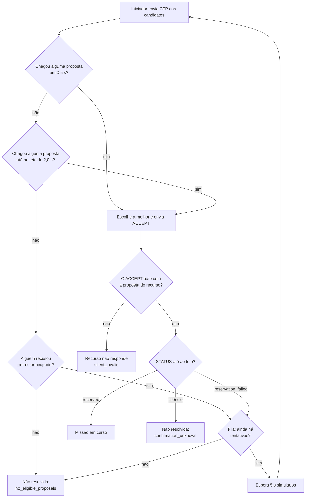

# Escalabilidade — Etapa 9A (P3)

[Plano](development-plan.md#etapa-9a--escalabilidade-computacional-e-situacional) · [Experiências](experiments.md) · [Arquitetura](architecture.md) · [Pendentes](delivery-todo.md#bloco-c--p3-escalabilidade)

Resposta a P3: que limites de escala tem o sistema, quais foram medidos e o que se propõe para cada um. Os números vêm de [`results/scalability/`](../results/scalability/), gerados a 16-11-2026 com o código `src/` da `main` em `89c08a7`.

## Como reproduzir

A partir da raiz do repositório (não precisa de servidor XMPP nem da pasta `.git`):

```bash
PYTHONPATH=src python scripts/dist.py    # ~2 min, grava results/scalability/dist.csv
PYTHONPATH=src python scripts/scale.py   # ~20 s, grava results/scalability/scale.csv
```

- **Cenário:** A (fontes fiáveis), variante `full`, sementes 1000–1009 (10 repetições); os casos com perdas usam 1000–1019 (20).
- **Transporte:** local. As perdas são injetadas no transporte local e não validam a rede XMPP.
- **Tempo real** (`tempo_real_s`): depende da máquina. Comparar casos da mesma execução, nunca valores entre máquinas.
- **«Atendidos»** (`atendidos/ameacas`): ameaças reais em cuja posição uma patrulha confirmou a ameaça. É a métrica por caçador, calculada pela função `attended()` de [`scripts/dist.py`](../scripts/dist.py). Não conta intervenções concluídas pelo guarda.

## Montagem

```
   y
   7 . . . . . . . .
   6 . . . . . . P .     P = caçador fora de alcance (6,6)
   5 . p . . . R . .     p = caçador testado (2,5);  R = guarda (5,5)
   4 . . . . . . . .
   3 . . . . . . . .
   2 D . S X S . . .     S = sensor-1 (2,2), único iniciador; sensor-2 (4,2)
   1 . . . . . . . .     X = caçador base (3,2);  D = drone (0,2)
   0 V . . . . . . Q     V = veículo (0,0);  Q = ponto cego do iniciador (7,0)
     0 1 2 3 4 5 6 7  x
```

Os dois sensores têm alcance de 5 células. Em (7,0), o sensor-2 está a 3,6 células e vê o caçador; o sensor-1 está a 5,4 e não vê.

## Custo computacional (`scale.csv`)

Mensagens por missão com N candidatos: N CFP + N respostas + 1 `ACCEPT` + até N−1 rejeições + 1 `STATUS` + 1 resultado, ou seja, **no máximo 3N + 2**. Uma ocorrência completa = 2 (verificação) + 8 (patrulha, N = 2) + 5 (guarda, N = 1) = **15 mensagens**.

| Caso | Confirmadas | Não resolvidas | Mensagens por execução | Tempo real (10 execuções) |
|---|---|---|---|---|
| Base: 2 patrulhas, 1 guarda, 1 caçador | 8/10 | 0 | 15 (×8), 2 (×2) | 1,5 s |
| Drone silencioso | 8/10 | 0 | 13 (×8), 2 (×2) | 5,5 s |
| 0 patrulhas | 0/10 | 8 | 4 (×8), 2 (×2) | 4,1 s |
| 0 guardas | 8/10 | 8 | 11 (×8), 2 (×2) | 4,6 s |
| 3 caçadores | 8/10 | 0 | 15 (×8), 2 (×2) | 1,5 s |

- As execuções com 2 mensagens pararam na corroboração (`insufficient_corroboration`); por isso a média da base é 12,4 e não 15.
- **C2 medido:** um candidato calado faz cada ronda esperar o prazo inteiro. Nesta máquina, dez execuções passaram de 1,5 s para 5,5 s reais, sem qualquer ganho de resultado. O fator depende da máquina; reportam-se os dois tempos.
- Com 3 caçadores, as mensagens não mudam: só existe uma ocorrência (C7).

## Escalabilidade situacional (`dist.csv`)

**A) Onde estão os caçadores (recursos fixos)**

| Caso | Alertas | Atendidos | t verif. (s sim.) | O que mostra |
|---|---|---|---|---|
| 1 caçador em (3,2) | 10/10 | 8/10 | 4 | Referência; as 2 falhas vêm da corroboração |
| 1 caçador em (2,5) | 10/10 | 8/10 | 6 | Mais longe dos recursos, verificação mais lenta |
| 1 caçador em (7,0) | **0/10** | 0/10 | — | O sensor-2 vê, mas só o sensor-1 inicia |
| 1 caçador em (6,6) | 0/10 | 0/10 | — | Fora do alcance dos dois sensores |
| 2 caçadores | 10/10 | **8/20** | 4 | Uma ocorrência por janela (C7) |
| 3 caçadores | 10/10 | **8/30** | 4 | A métrica por execução (8 TP) esconde as ameaças sem resposta |

**B) Quantidade e posição dos recursos (1 caçador em (3,2), drone com carga 0,5)**

| Caso | Confirmadas | Não resolvidas | t verif. | t guarda | Energia (p.p.) |
|---|---|---|---|---|---|
| Recursos na base | 8 | 0 | 6 | 12 | 16,0 |
| Recursos no canto (7,7) | 8 | 0 | 9 | 19 | 27,2 |
| Só o guarda em (0,7) | 8 | 0 | 6 | 15 | 20,8 |
| Drone com 15 % (1 patrulha elegível) | 8 | 0 | 6 | 12 | 16,0 |
| Drone e veículo com 15 % (0 elegíveis) | 0 | 8 | — | — | 0 |

**C) Recursos com 10 % de perda (20 repetições)**

| Caso | Alertas | Atendidos | Não resolvidas | t guarda |
|---|---|---|---|---|
| 2 patrulhas elegíveis | 19/20 | 13/20 | 8 | 15,9 |
| 1 patrulha elegível | 19/20 | 9/20 | 10 | 17,0 |

**Leitura, com o alcance que a amostra permite:**

1. **A cobertura do iniciador limita mais do que os recursos.** Um caçador fora do alcance do sensor-1 nunca gera alerta, mesmo que o sensor-2 o veja.
2. **Recursos mais longe aumentam tempo e energia, não mudaram decisões** nestes casos.
3. **Menos recursos:** sem perdas, uma patrulha elegível obteve as mesmas confirmações que duas; sem nenhuma, 0 confirmações e 8 não resolvidas. Com 10 % de perda, duas patrulhas atenderam 13/20 e uma atendeu 9/20. Com 20 repetições e sem intervalos de confiança, isto sugere que a redundância ajuda sob perdas; não prova que menos recursos só prejudicam quando há perdas.
4. **Mais caçadores do que ocorrências:** com 2 ou 3 caçadores só um é atendido.

## Estado de C1–C8

| Ref. | Limite | Onde | Estado | Justificação |
|---|---|---|---|---|
| C1 | CFP enviado a todos os candidatos: O(N) por missão | [incident.py:156](../src/isia/agents/incident.py#L156) | **Implementado e medido (Bloco F)** | `cfp_limit=K` envia o CFP só às K patrulhas com base mais próxima do alvo. Com 16 patrulhas: 57 → 15 mensagens por ocorrência, mesma decisão. Opcional: sem `cfp_limit`, o comportamento é o anterior. Usa a posição base, não a atual |
| C2 | Candidato calado obriga a esperar o prazo inteiro | [incident.py:159](../src/isia/agents/incident.py#L159) | **Medido** | 1,5 s → 5,5 s reais nesta máquina. Proposta: não voltar a chamar quem ficou calado na ronda seguinte |
| C3 | Prazos reais com tempo simulado | [runner.py:224](../src/isia/simulation/runner.py#L224), [incident.py:159](../src/isia/agents/incident.py#L159) | Adiado | Obriga a avançar o relógio simulado durante a negociação; trabalho futuro |
| C4 | Recursos e sensores fixos no runner | [runner.py:66](../src/isia/simulation/runner.py#L66), [:82](../src/isia/simulation/runner.py#L82), [:181](../src/isia/simulation/runner.py#L181) | **Mínimo implementado (Bloco F)** | `run_mvp(extra_patrols=..., extra_initiators=...)` acrescenta drones e sensores iniciadores sem mudar o código. Os ficheiros de cenário continuam com os três recursos fixos |
| C5 | `ObservationFeed.recent()` percorre todo o histórico, O(H) | [scenario.py:98](../src/isia/simulation/scenario.py#L98) | Proposto | O feed é lido uma vez por execução; o ganho não é mensurável neste sistema. Proposta: `bisect` ou `deque` da janela |
| C6 | Corroboração com um único par fixo | [runner.py:158](../src/isia/simulation/runner.py#L158) | Proposto | Perguntar aos k vizinhos com alcance e decidir com as respostas até ao prazo |
| C7 | Uma ocorrência por janela, ancorada na primeira observação | [incident.py:300](../src/isia/agents/incident.py#L300), [allocation.py:804](../src/isia/reasoning/allocation.py#L804) | **Medido** | 8/10, 8/20, 8/30 atendidos. Proposta: agrupar observações por proximidade e criar uma ocorrência por grupo |
| C8 (reputação) | Histórico da reputação cresce em memória | [reputation.py:128](../src/isia/reasoning/reputation.py#L128) | **Medido (Bloco F)** | 1000 execuções: 1824 registos, 1,3 MB serializados, crescimento linear (~1,3 kB por execução). Irrelevante à escala do projeto; a proposta de truncar ou gravar em JSONL mantém-se para execuções muito longas |
| C8 (processos) | Todos os agentes num processo | [runner.py](../src/isia/simulation/runner.py) | Adiado | Um processo por agente ligado ao XMPP; mudança grande, trabalho futuro |

**Situacionais, também propostos:** qualquer sensor poder iniciar (elimina o ponto cego de (7,0), mas exige evitar ocorrências duplicadas); fila de ocorrências por gravidade, só depois de C7. A métrica por caçador está feita em `attended()`.

## Correções a afirmações anteriores

- **C1 — o iniciador não conhece a posição base dos recursos.** `candidates` só tem `{jid: resource_id}` ([runner.py:201](../src/isia/simulation/runner.py#L201)). Filtrar pelos K mais próximos obriga o runner a passar as posições ou os recursos a anunciá-las; a posição só chega ao iniciador na `PROPOSAL`, depois do CFP. **Resolvido no Bloco F** pela primeira via: o runner passa as posições base em `configure_mvp(base_positions=...)`.
- **C2 — o fator de lentidão não é constante.** A análise de 13-11 indicava «3,4×» (1,6 s → 5,5 s); a medição de 16-11 deu 1,5 s → 5,5 s. Reportam-se os tempos e a máquina, não um fator.
- **Recursos — «menos recursos só prejudica com falhas» é forte demais.** Sem perdas, retirar todas as patrulhas elegíveis já impede qualquer confirmação; e a diferença 13/20 contra 9/20 vem de 20 repetições sem intervalo de confiança.

## Limites da evidência

- 10–20 repetições, sem intervalos de confiança; um cenário (A) e uma variante (`full`).
- O drone com 15 % de autonomia continua a receber CFP; simula um recurso inelegível, não um recurso ausente.
- O aumento do número de drones (C4) só foi medido em mensagens, com uma ocorrência e drones adicionais com 100 % de autonomia (Bloco F).
- Os resultados não demonstram escalabilidade geral.

## Testes de stress (Bloco F)

Onde o sistema deixa de atender, em várias dimensões. Os números vêm de [`results/stress/`](../results/stress/), gerados a 16-11-2026 na branch `feature/bloco-f-stress`, com o transporte local.

```bash
PYTHONPATH=src python scripts/stress_f1.py     # ~8 min: perda, latencia, cascata, autonomia, combinadas
PYTHONPATH=src python scripts/stress_f2.py     # ~14 min: paralelo, invalidas, escala, prazo (~8,5 min), teto (~2,5 min), fila, silencio
PYTHONPATH=src python scripts/stress_long.py   # ~3 min: longa
```

- **F1** usa o cenário A (1 caçador em (3,2), fontes com ruído) e a variante `full`, com reputação nova em cada execução. Em 10 execuções, 2 param na corroboração; por isso o máximo é 8/10 (17/20 com 20 execuções).
- **F2** usa fontes sem ruído (alcance 1) e política sem corroboração, com um caçador na célula de cada sensor iniciador. Assim, a única variável é a disputa pelos recursos.
- **«Fechadas»** = ocorrências em que a patrulha confirmou e o guarda interveio (`closed`). **«Confirmadas»** = só a verificação pela patrulha.

### Para que serviu este bloco

Antes dizíamos «o sistema foi desenhado para aguentar falhas». Agora dizemos «aguenta até aqui e deixa de funcionar aqui», com números.

**1. Deu respostas medidas às perguntas da defesa.**

| Pergunta | Resposta medida |
|---|---|
| E se a rede perder mensagens? | Fecha 17 de 20 ocorrências sem perda, 7 com 10 % de perda e nenhuma a partir de 30 % |
| E se a rede for lenta? | Funciona até 0,4 s de atraso; a partir de 0,5 s deixa de negociar |
| E se faltarem recursos? | Sem o drone, o resultado é igual, só mais lento. Sem patrulhas, nada é confirmado. Sem o guarda, nada é fechado |
| E se houver várias ocorrências ao mesmo tempo? | Em cada janela confirma 2 e fecha 1, porque só há um guarda |
| E se alguém enviar mensagens falsas? | Milhares de mensagens inválidas não mudam nenhuma decisão nem fazem parar nenhum agente |

**2. Mostrou três fraquezas que não se viam.**

- O prazo de espera fixo (0,5 s) é frágil: não há degradação gradual, o sistema passa de «funciona sempre» para «nunca funciona». Foi isto que motivou o [prazo dinâmico](#prazo-dinâmico-antes-e-depois).
- O único guarda é o gargalo: com 2, 4 ou 8 ocorrências, só uma fecha por janela. Foi isto que motivou a [fila](#fila-para-recursos-ocupados-antes-e-depois).
- Os agentes respondem a parte das mensagens inválidas. As respostas estão corretas, mas dão tráfego de volta a quem ataca. Foi isto que motivou o [silêncio perante `ACCEPT` incoerente](#silêncio-perante-accept-incoerente-antes-e-depois).

**3. Provou duas garantias que eram só alegações.**

- **Nenhuma reserva dupla.** O risco: duas ocorrências pedem o mesmo drone e o drone aceita as duas. O sistema evita-o com o `STATUS`: depois de escolher o drone, o iniciador espera que ele confirme a reserva; se o drone já foi reservado por outra ocorrência, responde que não e o iniciador procura outro recurso. Provocámos esta situação de propósito e contámos zero reservas duplas.
- **Nenhuma exceção.** Enviámos milhares de mensagens com defeito e nenhum agente parou.

**4. Fechou duas pontas soltas da escalabilidade.** O C1 passou a ter «antes e depois» (57 mensagens contra 15, com 16 patrulhas) e o C8 deixou de estar «não medido» (1,3 kB por execução).

**5. Repete-se.** Com as mesmas sementes e num clone limpo, os resultados saem iguais. A única exceção depende da velocidade do computador e está explicada [abaixo](#limites-destes-testes).

### Mapa de limites

| Teste | CSV | Onde deixa de atender |
|---|---|---|
| Perda de mensagens | [perda.csv](../results/stress/perda.csv) | Com 10 % de perda fecha 7/20 (17/20 sem perda); com 20 %, 1/20; a partir de 30 %, nenhuma |
| Latência de `PROPOSAL` e `STATUS` | [latencia.csv](../results/stress/latencia.csv) | Até 0,4 s de atraso, 8/8; a partir de 0,5 s (o `receive_timeout`), 0/8. Não há degradação gradual |
| Recursos a cair | [cascata.csv](../results/stress/cascata.csv) | Sem o drone, igual (8/8); sem as duas patrulhas, 0 confirmadas; sem o guarda, 8 confirmadas e 0 fechadas |
| Escassez de autonomia | [autonomia.csv](../results/stress/autonomia.csv) | Até 20 %, ganha o veículo; de 19 % a 16 %, o veículo recusa e ganha o drone; a partir de 15 %, os dois recusam e nada é atendido |
| Falhas combinadas | [combinadas.csv](../results/stress/combinadas.csv) | 0 duplas reservas e 0 fechos duplicados em 20 execuções; 6 confirmadas, 0 fechadas |
| Ocorrências em paralelo e rajada | [paralelo.csv](../results/stress/paralelo.csv) | Por janela, o sistema fecha 1 ocorrência (1 guarda) e confirma 2 (2 patrulhas), sejam 2, 4 ou 8 as ocorrências. 0 duplas reservas |
| Mensagens inválidas | [invalidas.csv](../results/stress/invalidas.csv) | Até 300 mensagens inválidas de cada tipo por mensagem real (12 600 por execução), resultado igual em 10/10. Com 1000, depende da carga da máquina: 0/10 na primeira execução e 10/10 no clone limpo. Nenhuma exceção |
| Execução longa | [longa.csv](../results/stress/longa.csv) | Não deixa de atender em 1000 execuções; o histórico da reputação cresce 1,3 kB por execução |
| Prazo fixo contra prazo dinâmico | [prazo.csv](../results/stress/prazo.csv) | Atraso: o limite passa de 0,5 s para 2,0 s. Mensagens inválidas: passa de 1000 para 5000 por mensagem real. Ver [antes e depois](#prazo-dinâmico-antes-e-depois) |
| Tetos do prazo dinâmico | [teto.csv](../results/stress/teto.csv) | O teto é o maior atraso tolerado e também o tempo perdido quando ninguém responde. Ver [que teto escolher](#que-teto-escolher) |
| Fila para recursos ocupados | [fila.csv](../results/stress/fila.csv) | Sem fila fecha 1 ocorrência por janela; com fila fecha todas (8 de 8), com o triplo das mensagens. Ver [antes e depois](#fila-para-recursos-ocupados-antes-e-depois) |
| Silêncio perante `ACCEPT` incoerente | [silencio.csv](../results/stress/silencio.csv) | As respostas a lixo descem 80 % (de 5 para 1 por unidade de `flood`). Ver [antes e depois](#silêncio-perante-accept-incoerente-antes-e-depois) |
| Mensagens em função de N (C4 + C1) | [escala.csv](../results/stress/escala.csv) | Sem limite: 15, 21, 33 e 57 mensagens com 2, 4, 8 e 16 patrulhas. Com K = 2: 15 em todos os casos |

### F1 — só parâmetros

**Perda (20 execuções por ponto)**

| Perda | Mobilizou | Confirmadas | Fechadas | Não resolvidas | Mensagens (média) |
|---|---|---|---|---|---|
| 0 % | 17 | 17 | 17 | 0 | 13,0 |
| 10 % | 15 | 13 | 7 | 8 | 9,6 |
| 20 % | 12 | 8 | 1 | 11 | 6,8 |
| 30 % | 10 | 4 | 0 | 10 | 5,0 |
| 50 % | 4 | 0 | 0 | 4 | 2,0 |

- Os agentes não retransmitem. Uma ocorrência completa precisa de 15 mensagens seguidas, por isso a perda de uma só já a deixa por fechar.
- A perda atinge primeiro a corroboração: com 50 %, 15 das 20 execuções param em `insufficient_corroboration` e nem chegam a negociar.

**Latência (10 execuções por ponto).** O limite é o prazo fixo de 0,5 s reais. Atraso na `PROPOSAL` ≥ 0,5 s dá `no_eligible_proposals`; atraso no `STATUS` ≥ 0,5 s dá `confirmation_unknown`, com o recurso já reservado. O prazo fixo é frágil: 0,4 s funciona sempre e 0,5 s nunca.

**Cascata (10 execuções por caso).** Retirar o drone não muda o resultado, mas o tempo real passa de 1,5 s para 5,5 s (o candidato calado esgota o prazo, C2). O guarda é ponto único de falha da intervenção: sem ele, as 8 ameaças confirmadas ficam `unresolved`.

**Autonomia (drone e veículo com o mesmo valor).** A recusa é local e segue a conta de cada recurso: autonomia mínima de 10 % mais a ida e volta (veículo a 5 células, 10 p.p.; drone a 3 células, 6 p.p.).

| Autonomia | `REJECT` dos recursos | Quem verifica | Fechadas |
|---|---|---|---|
| 100 % a 20 % | 0 | veículo | 8 |
| 19 % a 16 % | 8 (veículo) | drone | 8 |
| 15 % e 10 % | 16 (os dois) | ninguém | 0 |

**Falhas combinadas.** Perda de 20 %, `MISSION_RESULT` duplicado e drone ocupado depois da proposta, na mesma execução. As garantias mantêm-se (nenhum recurso com duas missões, nenhum incidente fechado duas vezes), mas nenhuma ocorrência chega ao fim: 12 de 20 ficam `unresolved`.

### F2 — com código novo no runner

`run_mvp` ganhou três parâmetros opcionais, só no transporte local: `extra_initiators`, `extra_patrols` e `cfp_limit`, e a chave `flood` em [`faults`](faults.md). Sem eles, o comportamento é o anterior.

**Ocorrências em paralelo e rajada (10 execuções por caso).** Cada iniciador trata só o que o seu sensor deteta; o runner não escolhe quem trata cada ameaça.

| Ocorrências | Confirmadas | Fechadas | Não resolvidas | `STATUS` `reservation_failed` | CFP de 2.ª ronda | Duplas reservas | Mensagens (média) |
|---|---|---|---|---|---|---|---|
| 1 | 10/10 | 10/10 | 0 | 0 | 0 | 0 | 15 |
| 2 | 20/20 | 10/20 | 10 | 10 | 20 | 0 | 33 |
| 4 | 20/40 | 10/40 | 30 | 50 | 60 | 0 | 63 |
| 8 | 20/80 | 10/80 | 70 | 130 | 140 | 0 | 123 |

- **O `STATUS` resolve a corrida.** Com 2 ocorrências, os dois iniciadores aceitam a mesma patrulha; um recebe `reservation_failed`, renegocia e fica com a outra. Nunca houve dupla reserva.
- **Saturação: 2 verificações e 1 intervenção por janela.** Não há fila: quem perde a corrida fica `unresolved` (`reservation_rejected` ou `no_eligible_proposals`) e não volta a tentar quando o recurso regressa.
- O tempo simulado das ocorrências fechadas não muda (12 s com 1 ou com 8).

**Mensagens inválidas (10 execuções por ponto)**

| Inválidas por mensagem real (de cada tipo) | Inválidas por execução | Resultado igual ao de referência | Exceções | Tempo real |
|---|---|---|---|---|
| 0 | 0 | 10/10 | 0 | 2,0 s |
| 10 | 420 | 10/10 | 0 | 2,2 s |
| 100 | 4 200 | 10/10 | 0 | 4,9 s |
| 300 | 12 600 | 10/10 | 0 | 11,2 s |
| 1000 | 17 200 | 0/10 | 0 | 13,8 s |

- A validação aguenta a carga: nenhum agente termina com exceção e nenhuma mensagem inválida muda uma decisão.
- Com 1000, a negociação legítima falhou por tempo, não por erro: processar o lixo demorou mais do que o prazo de 0,5 s. No clone limpo, com a máquina menos carregada, o mesmo ponto deu 10/10 (42 000 inválidas por execução, 17,8 s). O limite depende do CPU, não do código: na medição do [prazo dinâmico](#prazo-dinâmico-antes-e-depois), com a máquina sem carga, o prazo fixo aguentou 1000 e falhou com 2000.
- **Achado:** os agentes respondem a parte do lixo (5 respostas por unidade de `flood`). O `InformantAgent` responde a um `VERIFY_REQUEST` com IDs trocados (é um pedido bem formado), e os recursos respondem `reservation_failed` a um `ACCEPT` incoerente. São respostas corretas, mas dão tráfego de volta a quem ataca. Ver [silêncio perante `ACCEPT` incoerente](#silêncio-perante-accept-incoerente-antes-e-depois).

**Execução longa.** 1000 execuções com o mesmo `ReputationBook` em 176 s: 1824 registos em `book.history`, 1,3 MB serializados. O pico de memória do processo passou de 85 MB para 104 MB, dos quais 12 MB nas primeiras 100 execuções. A reputação do sensor-1 estabiliza em 0,998.

**Mensagens em função do número de patrulhas (C4 mínimo + C1, 10 execuções por caso)**

| Patrulhas | Sem limite | Com `cfp_limit=2` |
|---|---|---|
| 2 | 15 | 15 |
| 4 | 21 | 15 |
| 8 | 33 | 15 |
| 16 | 57 | 15 |

Cada patrulha a mais custa 3 mensagens (CFP, `PROPOSAL`, `REJECT`). Com K = 2, o custo é constante e as 10 ocorrências fecham no mesmo tempo simulado (12 s).

### Prazo dinâmico (antes e depois)

**O problema.** O iniciador esperava sempre 0,5 s pelas propostas e 0,5 s pelo `STATUS`. Uma resposta que chegasse aos 0,6 s era tratada como se nunca tivesse chegado.

**A ideia.** Esperar pouco quando há alternativa e esperar mais quando desistir significa falhar.

- **Propostas:** ao fim de 0,5 s, se já chegou pelo menos uma proposta, o iniciador avança com ela, como antes. Se não chegou nenhuma, continua à espera até um teto de 2,0 s.
- **`STATUS`:** o iniciador espera até ao teto. Depois do `ACCEPT` não há alternativa: desistir dá `confirmation_unknown`, que não permite escolher outro recurso.

**Como ligar.** `run_mvp(max_receive_timeout=2.0)` ([incident.py:160](../src/isia/agents/incident.py#L160) e [:207](../src/isia/agents/incident.py#L207)). Está desligado por omissão, porque os resultados da Etapa 9 e do F1 foram recolhidos com o prazo fixo; ligá-lo por omissão obrigaria a repeti-los. A decisão fica no item 5.1 da [ata](approvals.md).

**Resultados** ([prazo.csv](../results/stress/prazo.csv), 17-11-2026, montagem do F2, 10 execuções por célula; ocorrências fechadas e tempo real por execução):

| Caso | Prazo fixo (0,5 s) | Prazo dinâmico (0,5 a 2,0 s) |
|---|---|---|
| Sem falhas | 10/10 · 0,20 s | 10/10 · 0,20 s |
| `PROPOSAL` com 0,4 s de atraso | 10/10 · 0,99 s | 10/10 · 0,99 s |
| `PROPOSAL` com 0,6 s | 0/10 · 0,51 s | **10/10** · 1,37 s |
| `PROPOSAL` com 1,5 s | 0/10 · 0,51 s | **10/10** · 3,17 s |
| `PROPOSAL` com 2,5 s | 0/10 · 0,51 s | 0/10 · 2,01 s |
| `STATUS` com 0,6 s | 0/10 · 0,51 s | **10/10** · 1,21 s |
| `STATUS` com 1,5 s | 0/10 · 0,51 s | **10/10** · 3,01 s |
| `STATUS` com 2,5 s | 0/10 · 0,51 s | 0/10 · 2,01 s |
| Sem o drone | 10/10 · 0,70 s | 10/10 · 0,69 s |
| Sem as duas patrulhas | 0/10 · 0,51 s | 0/10 · 2,01 s |
| Sem o guarda | 0/10 · 0,56 s | 0/10 · 2,06 s |
| 1000 inválidas por mensagem | 10/10 · 1,68 s | 10/10 · 1,68 s |
| 2000 inválidas | 0/10 · 1,78 s | **10/10** · 3,17 s |
| 5000 inválidas | 0/10 · 2,10 s | **10/10** · 7,68 s |
| 8000 inválidas | 0/10 · 3,48 s | 0/10 · 6,70 s |

**Vantagens**

- O sistema aguenta atrasos quatro vezes maiores: o limite passou de 0,5 s para 2,0 s.
- Aguenta cinco vezes mais mensagens inválidas nesta máquina: de 1000 para 5000 por mensagem real.
- Não custa nada quando tudo corre bem: sem falhas e sem o drone, o tempo é igual.
- É pequeno: cerca de dez linhas no iniciador, sem mensagens novas e sem mudar o protocolo.

**Desvantagens**

- Falhar demora quatro vezes mais. Quando ninguém responde (sem patrulhas ou sem guarda), a ocorrência só é dada como não resolvida ao fim de 2,0 s, em vez de 0,5 s.
- Há mais um valor para escolher e justificar (o teto).

**Limitações**

- O limite não desapareceu, mudou de sítio: com 2,5 s de atraso falha nos dois casos. O teto continua a ser um número fixo; o iniciador não aprende com os tempos que observa. Um prazo que se ajusta sozinho, como o do TCP, fica como trabalho futuro.
- Uma proposta lenta continua a perder: se uma proposta chega dentro de 0,5 s, o iniciador não espera pelas outras, mesmo que fossem melhores. Já era assim.
- O prazo continua a ser em tempo real. Por isso, o limite das mensagens inválidas depende do computador: os valores 5000 e 8000 são desta máquina, sem carga.
- Só muda a espera por propostas e pelo `STATUS`. A espera pelo `VERIFY_RESPONSE` (10 s) e pelo `MISSION_RESULT` (dez prazos) fica igual.
- Medido só no transporte local, com a política sem corroboração e 10 execuções por célula. Na rede XMPP (servidor local, 17-11-2026) só se confirmou que o MVP fecha a ocorrência com as três opções ligadas; não há injeção de atrasos nesse transporte.

#### Que teto escolher

Medimos quatro tetos ([teto.csv](../results/stress/teto.csv), 5 execuções por célula; sem perdas aleatórias, as execuções de cada célula são iguais). Ocorrências fechadas e tempo real por execução:

| Caso | Teto 0,5 s (prazo fixo) | Teto 1,0 s | Teto 2,0 s | Teto 4,0 s |
|---|---|---|---|---|
| `PROPOSAL` com 0,6 s de atraso | 0/5 · 0,51 s | **5/5** · 1,37 s | **5/5** · 1,38 s | **5/5** · 1,37 s |
| `PROPOSAL` com 1,5 s | 0/5 · 0,51 s | 0/5 · 1,01 s | **5/5** · 3,17 s | **5/5** · 3,18 s |
| `PROPOSAL` com 3,0 s | 0/5 · 0,51 s | 0/5 · 1,01 s | 0/5 · 2,01 s | **5/5** · 6,18 s |
| Ninguém responde (sem patrulhas) | 0/5 · 0,51 s | 0/5 · 1,01 s | 0/5 · 2,01 s | 0/5 · 4,01 s |

- **A regra é simples:** o teto é, ao mesmo tempo, o maior atraso que o sistema tolera e o tempo que se perde quando ninguém responde. Não há um valor ótimo; há uma troca.
- **Quando há resposta, o teto não custa nada:** com 0,6 s de atraso, o tempo é o mesmo (1,37 s) com teto de 1, 2 ou 4 s.
- **O custo é pequeno face a uma missão.** Uma verificação seguida de intervenção demora pelo menos 12 s simulados; num caso real, deslocar um veículo demora minutos. Perder 2 s a mais quando ninguém responde não muda o resultado.
- **Proposta para a ata (item 5.1):** teto de 2,0 s, que é o prazo que o projeto já usa na rede XMPP.

### Fila para recursos ocupados (antes e depois)

**O problema.** Com várias ocorrências ao mesmo tempo, quem encontrava o guarda ocupado terminava logo como `unresolved`. O guarda ficava livre segundos depois, mas já ninguém o voltava a chamar.

**A ideia.** Um recurso ocupado não é uma falha. O iniciador espera 5 s simulados e volta a enviar o `CFP`, até um número máximo de vezes. Vale para o guarda e para as patrulhas.

**Como ligar.** `run_mvp(queue_rounds=60)` ([incident.py:259](../src/isia/agents/incident.py#L259)). Está desligada por omissão, pela mesma razão do prazo dinâmico. A decisão é de cada iniciador; o runner continua sem despachante.

**Resultados** ([fila.csv](../results/stress/fila.csv), 10 execuções por linha):

| Ocorrências | Fechadas sem fila | Fechadas com fila | Último fecho (simulado) | Mensagens sem fila | Mensagens com fila | Duplas reservas |
|---|---|---|---|---|---|---|
| 2 | 10 de 20 | **20 de 20** | 12 s → 23 s | 33 | 40 | 0 |
| 4 | 10 de 40 | **40 de 40** | 12 s → 45 s | 63 | 120 | 0 |
| 8 | 10 de 80 | **80 de 80** | 12 s → 80 s | 123 | 352 | 0 |

**Vantagens**

- Todas as ocorrências acabam por ser atendidas, em vez de uma por janela.
- Continua sem duplas reservas: a disputa pelo recurso libertado é resolvida pelo `STATUS`, como antes.
- Não há agente novo nem mensagens novas: é o mesmo `CFP`, numa ronda seguinte.

**Desvantagens**

- Mais mensagens: com 8 ocorrências, quase o triplo (352 contra 123). Cada tentativa é um `CFP` e uma recusa por candidato.
- A última ocorrência espera: cerca de 10 s simulados a mais por cada ocorrência à frente.

**Limitações**

- Não há ordem de chegada nem prioridade. Ganha quem perguntar primeiro depois de o recurso ficar livre; uma ocorrência grave pode ficar atrás de uma ligeira.
- O gargalo continua a ser o guarda único. A fila troca «não atendida» por «atendida mais tarde»; só um segundo guarda reduziria a espera.
- O iniciador desiste ao fim de `queue_rounds` tentativas, e não verifica se a ameaça ainda lá está quando chega a sua vez.
- O número de mensagens e o instante do último fecho variam até 2 % entre execuções iguais, porque a espera depende do relógio real; o número de ocorrências fechadas não varia.
- Medido só no transporte local, com a política sem corroboração.

### Silêncio perante `ACCEPT` incoerente (antes e depois)

**O problema.** Os recursos respondiam `reservation_failed` a qualquer `ACCEPT` que não batesse com a proposta feita. Quem enviasse lixo recebia uma resposta por cada mensagem.

**A ideia.** Um `ACCEPT` com IDs trocados ou com data no futuro nunca é enviado por um iniciador legítimo. Por isso, o recurso regista um aviso e não responde.

**Como ligar.** `run_mvp(silent_invalid=True)` ([mobile.py:351](../src/isia/agents/mobile.py#L351)). Está desligado por omissão, porque muda o contrato de mensagens aprovado e os testes que o verificam.

**Resultados** ([silencio.csv](../results/stress/silencio.csv), 10 execuções por linha; a ocorrência fecha em 10/10 nos dois casos):

| Inválidas por mensagem real | Inválidas por execução | Respostas a lixo, antes | Respostas a lixo, depois |
|---|---|---|---|
| 10 | 420 | 50 | 10 |
| 100 | 4 200 | 500 | 100 |
| 300 | 12 600 | 1 500 | 300 |

**Vantagens:** menos 80 % de respostas a lixo e menos tráfego total (1515 mensagens passam a 315), sem mudar o resultado.

**Desvantagens:** um iniciador com um erro deixa de receber «reserva falhada» e passa a ver silêncio, que só se nota no fim do prazo (`confirmation_unknown`). Fica mais difícil de diagnosticar.

**Limitações**

- Sobra uma resposta em cada cinco: o `InformantAgent` responde ao `VERIFY_REQUEST` com IDs trocados, porque é um pedido bem formado. Só autenticar o remetente ou limitar pedidos por remetente o impediria.
- Um `ACCEPT` de uma proposta desconhecida ou expirada continua a ter resposta (`proposal_not_correlated`), de propósito: um iniciador legítimo pode aceitar uma proposta que entretanto expirou.
- Não é um amplificador no sentido estrito: cada mensagem inválida gera, no máximo, uma resposta.

### Como funcionam as três opções juntas

O que o iniciador faz em cada missão, com `max_receive_timeout`, `queue_rounds` e `silent_invalid` ligados:



- **Prazo dinâmico** são os dois losangos de cima e o do `STATUS`: prazo curto com uma proposta na mão, teto sem nenhuma.
- **Fila** é o caminho que volta ao início: recurso ocupado ou reserva falhada dão nova tentativa, em vez de fim.
- **Silêncio** é o ramo do recurso: um `ACCEPT` que não bate com a proposta não tem resposta. Um iniciador legítimo nunca chega a esse ramo.

### O que fica por investigar

1. **Prazo que se ajusta sozinho:** estimar o teto a partir dos tempos de resposta observados, em vez de o fixar.
2. **Segundo guarda:** quantos guardas são precisos para N ocorrências simultâneas (pede o C4 completo).
3. **Prioridade na fila:** atender primeiro a ocorrência mais grave.
4. **Atrasos reais na rede XMPP:** os atrasos só foram injetados no transporte local.
5. **Mais cenários e intervalos de confiança:** os testes de stress usam um cenário e 5 a 20 execuções por ponto.

### Limites destes testes

- 10 a 20 execuções por ponto, sem intervalos de confiança; um cenário.
- Tudo no transporte local; nada disto valida a rede XMPP.
- Os iniciadores adicionais não corroboram nem atualizam a reputação.
- `cfp_limit` usa a posição base dos recursos, não a atual.
- Os valores de tempo real e o limite das mensagens inválidas dependem da máquina e da carga: com o prazo fixo, entre 300 e 2000; com o prazo dinâmico, entre 5000 e 8000.
- Repetição (17-11-2026, mesma máquina): o F1 foi corrido duas vezes com as mesmas sementes e depois os três scripts num clone limpo do commit. Os nove CSV de então saíram iguais em todas as colunas, exceto `tempo_real_s` e `rss_pico_kb`, com uma exceção: o ponto de 1000 inválidas, que falhou na primeira execução e passou no clone (ver acima). Os grupos novos do F2 (`prazo`, `teto`, `fila`, `silencio`) foram repetidos num segundo clone limpo: `teto` e `silencio` saíram iguais; no `prazo`, as ocorrências fechadas são as mesmas e só muda o motivo de uma falha em 300 execuções; na `fila`, as ocorrências fechadas são as mesmas (40 de 40 e 80 de 80), mas as mensagens e o instante do último fecho variam até 2 %, porque a espera da fila depende do relógio real.
